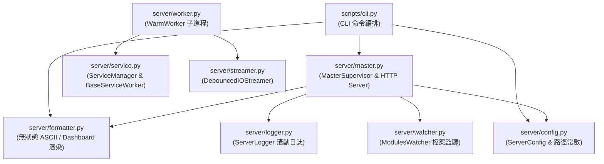

# 技術調研報告：Server 模組業務代碼五維度靜態診斷與重構處方箋 (R02_code_optimization_audit.md)

> 調研主題：Server 模組業務代碼五維度靜態診斷與外科手術重構規劃  
> 建立日期：2026-10-31  
> 所屬主計畫：2026_10_30_1641_code_optimize  
> 調研狀態：Concluded  
> 模型：Gemini 4 Argon (Low)  
> 模板版本：v1.1  

---

## 1. 背景與調研目標 (Background & Objectives)

### 1.1 定錨基準與範圍摘要
- **檢視範圍**：`Module Scope`（`ys_codebase/source/server/`，排除 `tests/`）。涵蓋以下 8 個生產程式碼檔案（總計 1,929 行）：
  - [cli.py](file:///D:/repos/ys_codebase/ys_codebase/source/server/scripts/cli.py)（255 行）：CLI 命令入口（`start`, `stop`, `status`, `reload`）與終端渲染。
  - [master.py](file:///D:/repos/ys_codebase/ys_codebase/source/server/server/master.py)（781 行）：`MasterSupervisor` 守護進程生命週期、Worker IPC 管道、Localhost HTTP 伺服器與 ASCII 橫幅格式化。
  - [logger.py](file:///D:/repos/ys_codebase/ys_codebase/source/server/server/logger.py)（310 行）：`ServerLogger` 即時刷盤日誌、崩潰恢復與 5 代歷史滾動歸檔。
  - [worker.py](file:///D:/repos/ys_codebase/ys_codebase/source/server/server/worker.py)（258 行）：`WarmWorker` 預熱子進程、環境變數保護、本地 CLI 攔截派發與 NDJSON IPC 迴圈。
  - [service.py](file:///D:/repos/ys_codebase/ys_codebase/source/server/server/service.py)（218 行）：`BaseServiceWorker` 抽象契約與 `ServiceManager` 動態服務探索與託管。
  - [streamer.py](file:///D:/repos/ys_codebase/ys_codebase/source/server/server/streamer.py)（159 行）：`DebouncedIOStreamer` 執行緒安全 500ms 防抖串流攔截器。
  - [watcher.py](file:///D:/repos/ys_codebase/ys_codebase/source/server/server/watcher.py)（148 行）：`ModulesWatcher` `.modules/` 目錄輪詢與雙通道熱重載觸發器。
  - [config.py](file:///D:/repos/ys_codebase/ys_codebase/source/server/server/config.py)（79 行）與 [`__init__.py`](file:///D:/repos/ys_codebase/ys_codebase/source/server/server/__init__.py)（3 行）：模組組態載入器與套件標頭。
- **生命週期模式**：`Mode A：收斂期 / 允許破壞性清理 (Convergence Mode)`——強制收斂為單一正統入口（Single Canonical Entry），零容忍物理刪除相容別名、薄轉發層、孤兒死代碼與冗餘狀態，並同步更新內部與跨模組調用點。

### 1.2 核心問題與痛點
- **核心問題與痛點**：
  1. **巨型破窗檔案與正交職責混雜（`D1` / `P0`）**：[master.py](file:///D:/repos/ys_codebase/ys_codebase/source/server/server/master.py) 高達 781 行，單一檔案同時塞入資料結構定義（`ServerDaemonState`）、CLI 終端 ASCII 格式化器（`format_startup_banner` 等 4 個純字串函式）、守護進程監督器（`MasterSupervisor`）、Worker 管道通訊與 `DispatcherHTTPHandler` 路由處理器，嚴重違反單一職責原則（SRP）。
  2. **子進程非同步啟動競爭與無保護讀取（`D4` / `P0`）**：[`MasterSupervisor._spawn_worker_locked`](file:///D:/repos/ys_codebase/ys_codebase/source/server/server/master.py#L603-L625) 啟動 `_read_ready` 背景執行緒讀取 `proc.stdout` 並以 `t.join(timeout=3.0)` 等待；若 Worker 預熱超過 3 秒，`_read_ready` 執行緒仍存活並持續阻塞於 `proc.stdout.readline()`，此時若進入 [`_stream_task_over_worker_pipe`](file:///D:/repos/ys_codebase/ys_codebase/source/server/server/master.py#L489)，將發生兩個執行緒同時爭搶同一個 `proc.stdout` 管道的嚴重 Race Condition（Packet 被隨機吞噬導致 IPC 死鎖）。
  3. **繞過核心基礎設施抽象與重複造輪子（`D5` / `P1`）**：多處散落硬編碼 `.cache/server/daemon.json`、`.cache/server/log`、`.cache/.yscb.lock`，且 [`_spawn_worker_locked`](file:///D:/repos/ys_codebase/ys_codebase/source/server/server/master.py#L550-L567) 重複實作 `core.platform.venv.ensure_private_venv` 已封裝的 `.venv` 跨平台路徑拼接邏輯；`read_daemon_state` 未使用 `core.vfs.read_json`。
  4. **死代碼、薄轉發層與冗餘狀態殘留（`D2` / `P1`）**：存在 0 調用的孤兒方法（如 `ServerLogger.extract_start_time_from_header`、`ServerLogger.log_file_path`、`ServerLogger.is_opened`）、無意義單行轉發包裝（`MasterSupervisor.read_state`、`ModulesWatcher._notify_change` / `_take_snapshot` / `_has_changed`）與只寫不讀的死欄位（`WarmWorker._module_cache`）。
- **調研目標**：
  - 全面盤點 `server` 模組對外契約與內部符號邊界，制定 `Mode A` 破壞性清理清冊。
  - 完成 `D1~D5` 五維度靜態診斷與 `P0/P1/P2` 病灶座標定位。
  - 設計 `S1~S6` 外科手術無損重構處方箋，確保 100% 行為等價並消除架構債。

---

## 2. 候選方案分析與對比 (Candidate Evaluation)

### 2.1 契約邊界與內部工具函式查驗表 (`Mode A` 收斂基準)

| 符號 / 介面分類 | 具體符號與位置 | 跨模組 / 外部調用查驗結果 | `Mode A` 處置策略 |
| :--- | :--- | :--- | :--- |
| **CLI 註冊入口 (`contributes/core.json`)** | [`start`](file:///D:/repos/ys_codebase/ys_codebase/source/server/scripts/cli.py#L83), [`stop`](file:///D:/repos/ys_codebase/ys_codebase/source/server/scripts/cli.py#L137), [`status`](file:///D:/repos/ys_codebase/ys_codebase/source/server/scripts/cli.py#L218), [`reload`](file:///D:/repos/ys_codebase/ys_codebase/source/server/scripts/cli.py#L240) | 由 `core` CLI Dispatcher 反射調用 | **維持單一正統入口**，內部簡化控制流 |
| **跨模組公開類別契約** | [`BaseServiceWorker`](file:///D:/repos/ys_codebase/ys_codebase/source/server/server/service.py#L57) | `knowledge_db/service.py:L19` 跨模組匯入繼承 | **維持 `server.service.BaseServiceWorker` 正統路徑** |
| **IPC & 狀態檔協議** | `.cache/server/daemon.json`, `.cache/server/daemon.lock`, HTTP `/api/{status,dispatch,reload,shutdown}` | `core/commands/dispatcher.py:L117, L189, L205` 直接讀取與呼叫 | **維持 JSON Schema 與 HTTP 端點語意 100% 相容** |
| **孤兒死代碼 (0 生產調用)** | • [`ServerLogger.extract_start_time_from_header`](file:///D:/repos/ys_codebase/ys_codebase/source/server/server/logger.py#L107-L127) • [`ServerLogger.log_file_path`](file:///D:/repos/ys_codebase/ys_codebase/source/server/server/logger.py#L97-L99) • [`ServerLogger.is_opened`](file:///D:/repos/ys_codebase/ys_codebase/source/server/server/logger.py#L102-L105) • [`WarmWorker._module_cache`](file:///D:/repos/ys_codebase/ys_codebase/source/server/server/worker.py#L33) | `knowledge-db callers` 查驗為 **0 調用**（或僅寫入從未讀取） | **物理刪除**（若測試有直接呼叫則於實作階段同步更新測試） |
| **薄轉發層 / 冗餘別名** | • [`MasterSupervisor.read_state`](file:///D:/repos/ys_codebase/ys_codebase/source/server/server/master.py#L641-L642) • [`ModulesWatcher._notify_change`](file:///D:/repos/ys_codebase/ys_codebase/source/server/server/watcher.py#L140-L142) • [`ModulesWatcher._take_snapshot`](file:///D:/repos/ys_codebase/ys_codebase/source/server/server/watcher.py#L144-L145) • [`ModulesWatcher._has_changed`](file:///D:/repos/ys_codebase/ys_codebase/source/server/server/watcher.py#L147-L148) | 僅模組內單點調用（`master.py:L310`、`watcher.py:L67, L106-L119`） | **物理刪除薄包裝**，直接內聯調用底層正統函式 `read_daemon_state`、`_scan_modules_dir`、`self.on_change_callback` 與 `!=` 運算子 |
| **跨檔職責錯置之純展示函式** | • [`format_uptime`](file:///D:/repos/ys_codebase/ys_codebase/source/server/server/master.py#L49) • [`format_watcher_status`](file:///D:/repos/ys_codebase/ys_codebase/source/server/server/master.py#L59) • [`format_startup_banner`](file:///D:/repos/ys_codebase/ys_codebase/source/server/server/master.py#L119) • [`format_shutdown_summary`](file:///D:/repos/ys_codebase/ys_codebase/source/server/server/master.py#L161) • [`_render_status_dashboard`](file:///D:/repos/ys_codebase/ys_codebase/source/server/scripts/cli.py#L184) | 僅 `master.py` 與 `scripts/cli.py` 內部調用 | **依 `S6` 物理拆分並收斂至獨立純函式模組 `server/formatter.py`**，更新 `master.py` 與 `scripts/cli.py` 匯入路徑 |

### 2.2 重構策略候選方案對比

| 方案 | 運作原理 | 優點 (Pros) | 缺點 / 成本 (Cons) | 適用度評級 |
| :--- | :--- | :--- | :--- | :---: |
| **方案 A：局部微調（僅清理死代碼與註解，不拆檔）** | 僅在既有檔案內刪除孤兒方法與薄轉發層，保留 781 行 `master.py` 結構。 | 改動行數少，無須調整模組內匯入路徑。 | 無法解決 `master.py` 巨型破窗（781 行混雜 4 種正交職責）與 HTTP/IPC 耦合問題。 | ⭐⭐ |
| **方案 B：五維度全面收斂 + `S1~S6` 正交模組物理拆分（推薦）** | 結合 `Mode A` 破壞性清理死代碼，將 `master.py` 的終端格式化與 HTTP Handler 正交職責拆出，並以 `S1~S5` 收斂 IPC 同步、雙重日誌與路徑常數。 | 徹底消除 `P0` 破窗與執行緒競爭隱患，`master.py` 降至 ~420 行，職責單一且 100% 行為無損。 | 涉及模組內跨檔匯入更新（`Full Track` 規模）。 | ⭐⭐⭐⭐⭐ |
| **方案 C：重寫為 Asyncio 事件迴圈架構** | 將 `ThreadingHTTPServer`、`ModulesWatcher` 與 `DebouncedIOStreamer` 全面改寫為 `asyncio` 協程。 | 減少背景 Daemon 執行緒數量。 | 違反「禁止過度設計」紅線，改變底層並發模型且與既有同步測試套件不相容，風險極高。 | ⭐ |

---

## 3. 架構設計與驗證 (Architecture & PoC)

### 3.1 `D1 ~ D5` 五維度分級診斷矩陣

| 座標 (`檔案:行號`) | 維度 | 嚴重度 | 具體結構病徵 (Structural Symptoms) | 建議策略 |
| :--- | :---: | :---: | :--- | :---: |
| [master.py:L1-L781](file:///D:/repos/ys_codebase/ys_codebase/source/server/server/master.py#L1-L781) | `D1` | **`P0`** | **巨型破窗檔案 (God File)**：單一檔案長達 781 行，混雜 ① 狀態序列化契約 (`ServerDaemonState`)、② 終端 ASCII 報表渲染 (`format_*`)、③ 進程樹與 Worker 監督 (`MasterSupervisor`)、④ HTTP 路由與 Chunked 串流編碼 (`_create_http_server`) 四大正交職責。 | `S2`, `S6` |
| [master.py:L603-L625](file:///D:/repos/ys_codebase/ys_codebase/source/server/server/master.py#L603-L625) | `D4` | **`P0`** | **非同步管道讀取競爭與無界資源洩漏風險**：`_spawn_worker_locked` 啟動 `_read_ready` 執行緒讀取 `proc.stdout`，僅以 `t.join(timeout=3.0)` 等待卻無超時取消或握手失敗處置。一旦 Worker 預熱超過 3 秒，`_read_ready` 將在背景與後續 `dispatch_task` 的 `_stream_task_over_worker_pipe` 同時讀取 `proc.stdout`，引發封包截斷或死鎖；且預熱失敗時未將 `_worker_proc` 標記異常或清理。 | `S1`, `S3` |
| [master.py:L543-L627](file:///D:/repos/ys_codebase/ys_codebase/source/server/server/master.py#L543-L627) | `D1` / `D3` | **`P1`** | **長程序混雜多層抽象 (85 行)**：`_spawn_worker_locked` 同時塞入 `.venv` 平台路徑計算、`PYTHONPATH` 拼接、`Popen` 跨平台旗標、內嵌 `_drain_stderr` 閉包執行緒與內嵌 `_read_ready` 握手執行緒，違反 SLAP。 | `S1`, `S2` |
| [master.py:L667-L781](file:///D:/repos/ys_codebase/ys_codebase/source/server/server/master.py#L667-L781) | `D1` / `D3` | **`P1`** | **巨型內嵌類別閉包 (115 行)**：`_create_http_server` 在函式內部動態定義 `DispatcherHTTPHandler` 並透過閉包捕獲 `supervisor`，且 `do_POST`（L747-L780）以 `if-elif-else` 混雜路由分派與業務統計組裝（如 `/api/shutdown` 手動存取 `supervisor._worker_proc`、`_start_time`、`_tasks_executed` 等私有欄位）。 | `S1`, `S4`, `S6` |
| [logger.py:L21-L43](file:///D:/repos/ys_codebase/ys_codebase/source/server/server/logger.py#L21-L43) [logger.py:L97-L127](file:///D:/repos/ys_codebase/ys_codebase/source/server/server/logger.py#L97-L127) | `D2` / `D3` | **`P1`** | **重複實作與孤兒死代碼**：`ServerLogger.extract_start_time_from_header`（L107-L127）與模組頂層純函式 `_extract_log_file_timestamp`（L28-L37）邏輯 100% 重複，且 `extract_start_time_from_header`、`log_file_path`（L97）、`is_opened`（L102）在全專案生產代碼中為 **0 調用**。 | `S2`, `S3` |
| [master.py:L641-L642](file:///D:/repos/ys_codebase/ys_codebase/source/server/server/master.py#L641-L642) [watcher.py:L140-L148](file:///D:/repos/ys_codebase/ys_codebase/source/server/server/watcher.py#L140-L148) | `D2` | **`P1`** | **無意義薄轉發方法与奈米函式 (Nano-Functions)**：`MasterSupervisor.read_state` 僅單行轉發 `read_daemon_state(self.yscb_root)`；`ModulesWatcher._notify_change`、`_take_snapshot`、`_has_changed` 皆為僅 1 行的奈米包裝方法，違反防過度設計紅線 ③。 | `S2` |
| [worker.py:L33, L130-L131](file:///D:/repos/ys_codebase/ys_codebase/source/server/server/worker.py#L33) | `D2` | **`P1`** | **只寫不讀之冗餘狀態欄位**：`WarmWorker._module_cache` 於 `__init__` 初始化並在 `_dispatch_command_with_captured_streams`（L131）寫入，但全模組從未讀取使用（實際快取已由 `core.commands.dispatcher._MODULE_CACHE` 維護）。 | `S2` |
| [service.py:L19-L54](file:///D:/repos/ys_codebase/ys_codebase/source/server/server/service.py#L19-L54) | `D3` | **`P1`** | **URI 解析與動態匯入認知複雜度偏高**：`_load_service_class_from_uri` 在單一函式內混雜字串前綴剝離、`:` / `.` 切割、連字號轉底線正規化與雙階段 `importlib.import_module` 退避重試，巢狀達 4 層。 | `S1`, `S4` |
| [service.py:L122-L155](file:///D:/repos/ys_codebase/ys_codebase/source/server/server/service.py#L122-L155) | `D3` | **`P1`** | **深層巢狀掃描 (5 層縮排)**：`ServiceManager.load_from_contributes` 在 fallback 掃描 `.modules/*/contributes/server.json` 時連續 5 層 `if -> for -> if -> try -> with -> for` 縮排，違反 $\le 3$ 層縮排上限。 | `S1`, `S4` |
| [cli.py:L157-L180](file:///D:/repos/ys_codebase/ys_codebase/source/server/scripts/cli.py#L157-L180) [master.py:L761-L772](file:///D:/repos/ys_codebase/ys_codebase/source/server/server/master.py#L761-L772) | `D4` / `D3` | **`P1`** | **跨模組鬆散裸字典契約與重複組裝**：停機摘要 `summary` 與狀態資訊 `status_info` 皆以無型別裸 `dict` 在 `master.py` 與 `scripts/cli.py` 間傳遞，且 `cli.py:stop`（L171-L179）與 `master.py:do_POST`（L763-L771）重複手寫相同的 7 欄位字典結構。 | `S3`, `S5` |
| [master.py:L550-L567](file:///D:/repos/ys_codebase/ys_codebase/source/server/server/master.py#L550-L567) [master.py:L71-L80](file:///D:/repos/ys_codebase/ys_codebase/source/server/server/master.py#L71-L80) [cli.py:L146, L178, L201](file:///D:/repos/ys_codebase/ys_codebase/source/server/scripts/cli.py#L146) | `D5` | **`P1`** | **繞過基礎設施抽象與重複路徑拼接**：① `_spawn_worker_locked` 手動判斷 Windows/POSIX 拼接 `.venv/pyXX/Lib/site-packages`，與 `core.platform.venv` 邏輯重複；② `read_daemon_state` 手動 `open + json.load` 而未統一使用 `vfs.read_json`（對比 `_write_state` 已使用 `vfs.write_json`）；③ `.cache/server/daemon.json`、`.cache/server/daemon.lock`、`.cache/server/log` 字面量散落於 `master.py`、`cli.py`、`logger.py` 達 9 處。 | `S5` |
| [master.py:L34, L417-L420, L445, L454, L637](file:///D:/repos/ys_codebase/ys_codebase/source/server/server/master.py#L34) | `D5` | **`P2`** | **雙重日誌體系混用**：`MasterSupervisor` 既持有專屬 `self.logger`（`ServerLogger`），又在模組頂層定義標準庫 `logger = logging.getLogger(__name__)`，並在 `on_modules_changed`、`restart_server`、`_idle_ttl_loop` 中同時或交替呼叫 `self.logger.info` 與 `logging.info` / `logger.info`。 | `S3`, `S5` |
| [cli.py:L125-L132, L159-L166](file:///D:/repos/ys_codebase/ys_codebase/source/server/scripts/cli.py#L125-L132) | `D3` / `D5` | **`P2`** | **輪詢等待樣板與魔術常數散落**：`start`（30 次 × 0.1s 輪詢）與 `stop`（20 次 × 0.1s 輪詢）重複編寫條件輪詢迴圈，且超時常數、預設 debounce 毫秒數（`500`）等魔術數字散落於行內。 | `S3`, `S5` |

---

### 3.2 `S1 ~ S6` 外科手術重構處方箋 (Refactoring Blueprint)

#### 處方 1 (`S6` 正交職責之物理模組拆分)：拆解 `master.py` 巨型破窗檔案
將 781 行的 [master.py](file:///D:/repos/ys_codebase/ys_codebase/source/server/server/master.py) 按共同封閉原則（CCP）與單向無環依賴（DAG）拆分為正交結構：
1. **新增 `server/formatter.py`（純無狀態終端渲染層）**：
   - 遷入原 `master.py` 之 `format_uptime`、`format_watcher_status`、`format_startup_banner`、`format_shutdown_summary` 以及原 `scripts/cli.py` 之 `_render_status_dashboard`（正名為 `format_status_dashboard` 純字串函式）。
   - **依賴方向**：僅依賴 Python 標準庫，0 內部模組耦合。
2. **集中狀態與路徑契約於 `server/config.py`（或獨立契約區塊）**：
   - 定義統一快取路徑解析輔助函式：`get_server_cache_dir(yscb_root)`、`get_daemon_state_path(yscb_root)`、`get_daemon_lock_path(yscb_root)`、`get_server_log_path(yscb_root)`，消除全模組 9 處 `.cache/server/...` 硬編碼。
   - 封裝 `build_shutdown_summary(...)` 工廠函式，統一 `master.py`（優雅停機）與 `scripts/cli.py`（強制停機兜底）的停機摘要結構。
3. **重構 `server/master.py`（純控制平面與 HTTP 路由層）**：
   - 將內嵌於 `_create_http_server` 的 115 行 `DispatcherHTTPHandler` 提昇為模組頂層類別 `_DispatcherHTTPHandler`，透過 `HTTPServer` 實例屬性（`self.server.supervisor`）存取監督器，消除巨型函式閉包。
   - 在 `MasterSupervisor` 新增公開協調方法 `build_shutdown_summary(reason: str) -> Dict[str, Any]`，解除 HTTP Handler 對 `supervisor._worker_proc`、`_start_time`、`_tasks_executed` 等私有欄位的直接跨界存取。

#### 處方 2 (`S1` 業務階段拆解 + `S2` 無狀態邏輯剝離)
1. **拆解 [`MasterSupervisor._spawn_worker_locked`](file:///D:/repos/ys_codebase/ys_codebase/source/server/server/master.py#L543-L627)**：
   - **階段 1（環境準備 — `S2` 無狀態純函式）**：提取 `_build_worker_env(yscb_root: str) -> Dict[str, str]`，構築子進程 `PYTHONPATH` 與 `PYTHONUNBUFFERED`。
   - **階段 2（行程啟動與 stderr 排空）**：提取 `_start_stderr_drain_thread(proc: subprocess.Popen, logger: ServerLogger) -> None`。
   - **階段 3（確定性就緒握手 — 修復 `P0` 管道競爭）**：提取 `_wait_for_worker_ready(proc: subprocess.Popen, timeout_sec: float = 3.0) -> List[Dict[str, Any]]`，確保握手期間獨占讀取，若超時則安全終止或防止背景殘留執行緒與後續 `dispatch_task` 爭搶 `proc.stdout`。
2. **拆解 [`ServiceManager.load_from_contributes`](file:///D:/repos/ys_codebase/ys_codebase/source/server/server/service.py#L122-L155)**：
   - 提取無狀態輔助函式 `_discover_fallback_service_items(yscb_root: str) -> List[Tuple[str, Dict[str, Any]]]`，將 `.modules/*/contributes/server.json` 的檔案走訪與 JSON 解析從 5 層縮排拉平為 $\le 2$ 層衛語句。
   - 提取 `_normalize_service_module_path(uri_str: str) -> Optional[Tuple[str, str]]` 純函式，將 `_load_service_class_from_uri` 的 URI 字串解析與 `importlib` 雙軌載入分離。
3. **拆解 [`worker_main`](file:///D:/repos/ys_codebase/ys_codebase/source/server/server/worker.py#L179-L250)**：
   - 提取 `_run_worker_ipc_loop(worker: WarmWorker, in_io: Any, emit_fn: Callable, yscb_root: str) -> None`，使 `worker_main` 專注於串流重導向、預熱啟動與 `finally` 資源清理。

#### 處方 3 (`S3` 同構模式聚合 + `S4` 控制流扁平化 + `S5` 結構化契約)
1. **消除 `logger.py` 重複解析與孤兒方法 (`Mode A`)**：
   - 物理刪除 0 調用的 `ServerLogger.extract_start_time_from_header`、`log_file_path`、`is_opened`。
   - 統一由 `_extract_log_file_timestamp` 處理標頭正則匹配與 `mtime` 退避。
2. **清理 `watcher.py` 與 `master.py` 薄轉發層 (`Mode A`)**：
   - 物理刪除 `MasterSupervisor.read_state`，於 `MasterSupervisor.start` 直接呼叫 `read_daemon_state(self.yscb_root)`。
   - 物理刪除 `ModulesWatcher._notify_change`、`_take_snapshot`、`_has_changed` 三個單行奈米方法，直接呼叫 `self.on_change_callback`、`_scan_modules_dir` 與 `!=`。
   - 物理刪除 `WarmWorker._module_cache` 死欄位。
3. **聚合 `cli.py` 狀態輪詢與 HTTP 路由分派 (`S3` / `S4`)**：
   - 在 `cli.py` 提取通用輪詢輔助函式 `_poll_until(predicate: Callable[[], bool], timeout_sec: float, interval_sec: float = 0.1) -> bool`，消除 `start` 與 `stop` 中的重複迴圈。
   - 在 `_DispatcherHTTPHandler.do_POST` 採用路由分派表或具名階段處理器（`_handle_post_dispatch`、`_handle_post_reload`、`_handle_post_shutdown`），拉平控制流。
4. **統一 VFS 與日誌慣例 (`D5` 收斂)**：
   - `read_daemon_state` 改用 `vfs.read_json(state_file)` 搭配例外防禦，與 `_write_state` 的 `vfs.write_json` 對稱。
   - 移除 `master.py` 中冗餘的 `logging.getLogger(__name__)` 雙重日誌呼叫，統一收斂至 `self.logger`（`ServerLogger`）。

---

## 4. 調研結論與落地建議 (Conclusion & Recommendation)

- **診斷總結**：
  - **`P0`（高危破窗 / 資源競爭）**：共 **2** 項（`master.py` 781 行多重正交職責破窗、`_spawn_worker_locked` 非同步 `_read_ready` 執行緒超時後與 `dispatch_task` 爭搶 `proc.stdout` 管道之競爭風險）。
  - **`P1`（結構耦合 / 可維護性阻礙 / 死代碼）**：共 **9** 項（涵蓋 `_spawn_worker_locked` 與 `_create_http_server` 超長函式、`service.py` 5 層深層巢狀、`logger.py` / `watcher.py` / `worker.py` / `master.py` 之孤兒死代碼與薄轉發層、裸字典重複組裝、以及繞過 VFS 與路徑常數硬編碼）。
  - **`P2`（局部異味 / 可讀性打磨）**：共 **2** 項（`master.py` 雙重日誌混用、`cli.py` 輪詢迴圈與魔術常數散落）。
- **推薦落地策略**：
  - 採納 **方案 B（五維度全面收斂 + `S1~S6` 正交模組物理拆分）**，在 `Mode A（收斂期）` 授權下徹底清除死代碼與薄轉發層，抽離 `server/formatter.py`，將 `master.py` 瘦身至 ~420 行並修復 Worker 握手管道競爭。
- **後續行動與流轉出口建議**：
  - 因本模組重構涉及物理拆檔（`S6` 新增 `server/formatter.py`）且預估重構變更行數 $> 100$ 行，若選擇 **「出口 ① 立即原地升級實作」**，建議轉入 **Full Track（`P01`~`P07`）** 或由主計畫 Umbrella 子計畫軌道直接執行無損重構與沙盒回歸測試驗證（`python yscb.py dev check server` 與 `python yscb.py dev test server`）。
