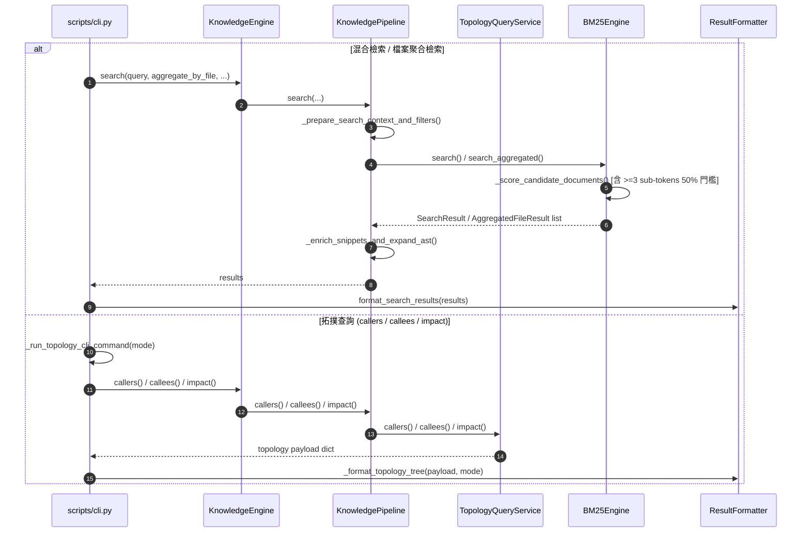

# 架構設計說明書 (Architecture Design)

> 功能名稱：sub_04_knowledge_db_code_optimization  
> 建立日期：2026-10-31  
> 所屬主計畫：2026_10_30_1641_code_optimize  
> 狀態：Confirmed  
> 模型：Gemini 4 Argon (Low)  

> 模板版本：v1.2  

---

## 1. 模組架構分層與職責邊界 (Layered Architecture)

```text
+-----------------------------------------------------------------------+
| CLI & Server Entry Layer (scripts/cli.py, scripts/hook.server.py)     |
|  - 參數解析與統一拓撲命令分派 (_run_topology_cli_command)             |
|  - ResultFormatter (通用樹狀拓撲渲染 _format_topology_tree)           |
+-----------------------------------+-----------------------------------+
                                    |
                                    v
+-----------------------------------------------------------------------+
| Facade & Orchestration Layer (engine.py, pipeline.py, topology_query) |
|  - KnowledgeEngine: 純淨高階門面 (移除 16 個內部代理與 act_* 重複方法) |
|  - KnowledgePipeline: 索引建置、4 階段熱修補、3 階段混合檢索           |
|  - TopologyQueryService (topology_query.py): Callers/Callees/Impact   |
+-----------------+-----------------+-----------------+-----------------+
                  |                 |                 |
                  v                 v                 v
+-----------------+---+   +---------+---------+   +---+-----------------+
| Retrieval & Ranking |   | Call Graph Engine |   | Parsing & Scanning  |
| - InvertedIndex     |   | - TopologyLinker  |   | - ParserRegistry    |
| - BM25Engine (單一  |   | - CallGraphIndex  |   | - TreeSitterDriver  |
|   _score_candidate) |   |   (純 nx.DiGraph) |   | - FingerprintScanner|
| - VectorIndex       |   +---------+---------+   +---+-----------------+
+-----------------+---+             |                 |
                  |                 v                 |
                  +-------> +---------------+ <-------+
                            |  io_utils.py  |
                            |  schema.py    |
                            |  config.py    |
                            +---------------+
```

---

## 2. 核心資料流與循序圖 (Data Flow & Sequence Diagram)



---

## 3. 受影響檔案與新建檔案清單 (Impacted & New Files Inventory)

| 檔案路徑 | 類型 | 職責與變更說明 |
| :--- | :---: | :--- |
| `ys_codebase/source/knowledge-db/knowledge_db/io_utils.py` | New | 提供 `atomic_save_gzip_pickle` 與 `load_gzip_pickle` 共用原子二進制 I/O 原語 (`FR-06`)。 |
| `ys_codebase/source/knowledge-db/knowledge_db/topology_query.py` | New | 承載自 `pipeline.py` 剝離之 `TopologyQueryService`，負責符號消歧、`callers`、`callees` 與 `impact` 圖譜分析 (`FR-03`)。 |
| `ys_codebase/source/knowledge-db/knowledge_db/pipeline.py` | Modify | 委託 `TopologyQueryService` 執行拓撲查詢；拆解 `_hot_patch_unified_index_locked` 與 `search`；純化 `HotPatchResult` 為標準 `@dataclass` 並移除舊版遷移分支 (`FR-02`, `FR-03`)。 |
| `ys_codebase/source/knowledge-db/knowledge_db/retrieval.py` | Modify | 抽取 `BM25Engine._score_candidate_documents` 合併雙軌打分並修復聚合搜尋複合字門檻；移除 `symbols_map`、`build_unified` 與 `Posting` 舊分支；改用 `io_utils` (`FR-02`, `FR-04`, `FR-06`)。 |
| `ys_codebase/source/knowledge-db/knowledge_db/formatter.py` | Modify | 抽取 `_format_topology_tree` 收斂 `format_callers`、`format_callees`、`format_impact`；移除對 `AggregatedFileResult` 舊相容 property 之依賴 (`FR-02`, `FR-05`)。 |
| `ys_codebase/source/knowledge-db/scripts/cli.py` | Modify | 抽取 `_run_topology_cli_command` 收斂三套拓撲 CLI 命令；移除 `status(space_name=...)` 與 `bundle(pretty=...)` 廢棄參數傳遞 (`FR-02`, `FR-05`)。 |
| `ys_codebase/source/knowledge-db/knowledge_db/embedding.py` | Modify | 改用 `io_utils` 實作 `VectorIndex.save_binary/load_binary` 原子讀寫；`download_model` 補齊 `.tmp + os.replace`；移除 0 調用方法與重複設定 (`FR-02`, `FR-06`)。 |
| `ys_codebase/source/knowledge-db/knowledge_db/graph.py` | Modify | `CallGraphIndex` 移除純 Python `_out_edges`/`_in_edges` 與 `_HAS_NX` 分支，統一使用 `nx.DiGraph` 與 `io_utils`；拆解 `TopologyLinker.resolve_call_site`；移除 `patch_incremental` 廢棄參數 (`FR-02`, `FR-06`, `FR-07`)。 |
| `ys_codebase/source/knowledge-db/knowledge_db/schema.py` | Modify | `UnifiedSymbol` 僅保留 `"children"` 與 `"spaces"` 序列化欄位；刪除 `AggregatedFileResult` 6 個相容 property 與 `WeightedToken` (`FR-02`)。 |
| `ys_codebase/source/knowledge-db/knowledge_db/engine.py` | Modify | 刪除 16 個內部組件代理、`act_*` 重複方法、重複回傳鍵與未使用參數 (`FR-02`)。 |
| `ys_codebase/source/knowledge-db/knowledge_db/bundler.py` | Modify | 改用 `io_utils`、`list_spaces()`，移除 `clear_symbols_cache` 與 `import_bundle` 重複包裝 (`FR-01`, `FR-02`, `FR-06`)。 |
| `ys_codebase/source/knowledge-db/knowledge_db/scanner.py` | Modify | 抽取 `_iter_eligible_files` 生成器收斂三處 `os.walk`；刪除 `save_fingerprints` 與 `load_fingerprints` (`FR-01`, `FR-07`)。 |
| `ys_codebase/source/knowledge-db/knowledge_db/space.py` | Modify | 刪除 `get_union_spaces` 薄轉發方法 (`FR-01`)。 |
| `ys_codebase/source/knowledge-db/knowledge_db/tokenizer.py` | Modify | 刪除 `CodeTokenizer` 別名與 `is_cjk`、`split_identifier` 實例包裝方法 (`FR-01`)。 |
| `ys_codebase/source/knowledge-db/knowledge_db/config.py` | Modify | 刪除 `workspace_root`、`root_path`、`_find_workspace_root`、`resolve_jit_vector_timeout`；改用 `ConfigManager` 並集中管理模型預設常數 (`FR-01`, `FR-06`)。 |
| `ys_codebase/source/knowledge-db/knowledge_db/parsers/registry.py` | Modify | 刪除 `LanguageRegistry`、5 個空白 Parser 子類別與 2 個 0 調用方法 (`FR-01`)。 |
| `ys_codebase/source/knowledge-db/knowledge_db/parsers/__init__.py` | Modify | 移除已刪除之 `LanguageRegistry` 與 5 個空白 Parser 子類別匯出 (`FR-01`)。 |
| `ys_codebase/source/knowledge-db/knowledge_db/parsers/treesitter.py` | Modify | 拆解 `extract_symbols` 為三階段輔助方法，並移除 `_extract_preceding_comment` 未使用參數 (`FR-02`, `FR-07`)。 |
| `ys_codebase/source/knowledge-db/knowledge_db/parsers/spice.py` | Modify | 拆解 `extract_symbols` 之行續接預處理與子電路/元件解析輔助方法 (`FR-07`)。 |
| `ys_codebase/source/knowledge-db/scripts/hook.server.py` | Modify | 刪除舊版 `on_worker_warming` 包裝函式 (`FR-02`)。 |
| `ys_codebase/source/knowledge-db/tests/*.py` | Modify | 同步更新測試套件對齊 `Mode A` 正統 API 契約 (`FR-01~FR-07`)。 |

---

## 4. 架構決策記錄 (Architecture Decision Records)

- **[P02:DR-01] 拓撲查詢服務 (`TopologyQueryService`) 與管線解耦**：將 `callers`/`callees`/`impact` 及符號消歧邏輯從 `KnowledgePipeline` 剝離為無狀態/輕量查詢服務 `TopologyQueryService`，由 `KnowledgePipeline` 將 `inverted_index`、`call_graph` 與 `space_manager` 傳入委派執行，既維持 `pipeline.callers(...)` 公開呼叫界面不變，又將 `pipeline.py` 單檔規模大幅瘦身。
- **[P02:DR-02] 共用打分核心消除雙軌分叉**：`BM25Engine._score_candidate_documents` 統一產出符合過濾條件與複合字覆蓋率門檻之 `(doc_scores, doc_matched_tokens, query_token_texts)`，`search` 與 `search_aggregated` 僅負責後段排序與結構組裝，根除演算法分叉風險。
- **[P02:DR-03] 共用原子二進制 I/O 原語 (`io_utils.py`)**：將 `gzip + pickle + .tmp + os.replace` 統一收斂至 `io_utils.py`，確保倒排索引、呼叫圖、向量索引與知識包具備一致的崩潰安全保證。
