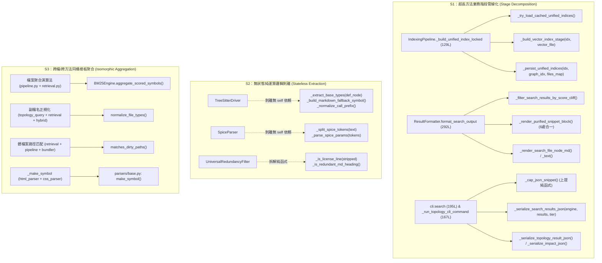

# 技術調研報告：knowledge-db 模組五維度靜態診斷與無損重構審計 (R03_code_optimization_audit.md)

> 調研主題：knowledge-db 業務代碼五維度靜態診斷與結構收斂處方 (D1~D5 & S1~S6)  
> 建立日期：2026-10-31  
> 所屬主計畫：2026_10_30_1641_code_optimize / sub_04_knowledge_db_code_optimization  
> 狀態：Concluded  
> 調研狀態：Concluded  
> 模型：Gemini 4 Argon (Low)  
> 模板版本：v1.1  

---

## 1. 背景與調研目標 (Background & Objectives)

### 1.1 定錨基準與範圍摘要 (Scope & Lifecycle Triage Baseline)

- **檢視範圍 (`Inclusive Scope`)**：**單一模組 (`Module Scope`)** —— `ys_codebase/source/knowledge-db/` 下所有非測試 Python 業務原始碼（共 27 個 `.py` 檔案，總計 `8,452` 行；排除 `ys_codebase/source/knowledge-db/tests/`）。完整涵蓋單檔/類別微觀層級分析（`S1~S6`）與模組內跨檔耦合拓撲、共用樣板收斂及公開入口契約查驗。
- **生命週期模式 (`Lifecycle Mode`)**：兼容 **`Mode A（收斂期 / 允許破壞性清理）`** 與 **`Mode B（維護期 / 嚴守向下相容，純內部工具函式嚴格查證收斂）`** 雙模式落地規範。
- **核心問題與痛點**：
  1. **巨型與長檔案職責過載 (`D1` / `D3`)**：[`pipeline.py`](file:///d:/repos/ys_codebase/ys_codebase/source/knowledge-db/knowledge_db/pipeline.py)（1,100 行）、[`formatter.py`](file:///d:/repos/ys_codebase/ys_codebase/source/knowledge-db/knowledge_db/formatter.py)（930 行）、[`retrieval.py`](file:///d:/repos/ys_codebase/ys_codebase/source/knowledge-db/knowledge_db/retrieval.py)（759 行）、[`cli.py`](file:///d:/repos/ys_codebase/ys_codebase/source/knowledge-db/scripts/cli.py)（717 行）及 [`treesitter.py`](file:///d:/repos/ys_codebase/ys_codebase/source/knowledge-db/knowledge_db/parsers/treesitter.py)（690 行）存在超過 100~280 行的超長程序與多維分支笛卡兒積（如 `Markdown/Text × simple/detail/auto × snippet` 渲染矩陣），違反單一抽象層級原則（SLAP）。
  2. **有狀態實體與無狀態純運算混雜 (`D1`)**：[`TreeSitterDriver`](file:///d:/repos/ys_codebase/ys_codebase/source/knowledge-db/knowledge_db/parsers/treesitter.py#L62-L690)、[`SpiceParser`](file:///d:/repos/ys_codebase/ys_codebase/source/knowledge-db/knowledge_db/parsers/spice_parser.py#L41-L524)、[`BM25Engine`](file:///d:/repos/ys_codebase/ys_codebase/source/knowledge-db/knowledge_db/retrieval.py#L518-L759)、[`SemanticBundler`](file:///d:/repos/ys_codebase/ys_codebase/source/knowledge-db/knowledge_db/bundler.py#L106-L450) 與 [`UniversalRedundancyFilter`](file:///d:/repos/ys_codebase/ys_codebase/source/knowledge-db/knowledge_db/formatter.py#L54-L177) 內含多個完全不讀寫 `self` 實例狀態的假性實例方法。
  3. **跨檔/跨方法結構性重複 (`D3`)**：檔案聚合計分公式（$\text{Score} = \max(S_i) + 0.2 \sum S_j$）、`project://` 路徑解算、副檔名正規化、髒檔案路徑後綴比對、JSON/Gzip 原子寫入與 CLI 例外守門在多處重複實作。
- **調研目標**：
  完成 `D1~D5` 全維度分級病灶定位（`P0/P1/P2`），盤點契約邊界與 0 外部跨模組調用之純內部工具函式，並制定遵守四大防過度設計紅線的 `S1~S6` 外科手術無損重構處方箋。

### 1.2 模組源碼規模與現有測試對應表

| 源碼檔案路徑 (`ys_codebase/source/knowledge-db/`) | 行數 (LOC) | 核心職責 | 對應既有測試套件 (`tests/`) |
| :--- | :---: | :--- | :--- |
| [`knowledge_db/pipeline.py`](file:///d:/repos/ys_codebase/ys_codebase/source/knowledge-db/knowledge_db/pipeline.py) | 1,100 | 全域聯集索引建置、4 階段 JIT 熱修補、混合檢索編排 | `test_engine.py`, `test_hot_reload.py` |
| [`knowledge_db/formatter.py`](file:///d:/repos/ys_codebase/ys_codebase/source/knowledge-db/knowledge_db/formatter.py) | 930 | 切片去重純化、8,000 字元預算控制、4 大查詢渲染 | `test_engine.py`, `test_cli.py` |
| [`knowledge_db/retrieval.py`](file:///d:/repos/ys_codebase/ys_codebase/source/knowledge-db/knowledge_db/retrieval.py) | 759 | `Posting`、`InvertedIndex`、`BM25Engine`、`SnippetExtractor` | `test_retrieval.py` |
| [`scripts/cli.py`](file:///d:/repos/ys_codebase/ys_codebase/source/knowledge-db/scripts/cli.py) | 717 | CLI 命令入口與 JSON / Text / Markdown 分發 | `test_cli.py` |
| [`knowledge_db/parsers/treesitter.py`](file:///d:/repos/ys_codebase/ys_codebase/source/knowledge-db/knowledge_db/parsers/treesitter.py) | 690 | Tree-sitter S-Expression AST 解析、調用點與 Import 提取 | `test_parsers.py`, `test_graph.py` |
| [`knowledge_db/parsers/spice_parser.py`](file:///d:/repos/ys_codebase/ys_codebase/source/knowledge-db/knowledge_db/parsers/spice_parser.py) | 524 | SPICE 雙階段網表語意解析器 | `test_parsers.py` |
| [`knowledge_db/embedding.py`](file:///d:/repos/ys_codebase/ys_codebase/source/knowledge-db/knowledge_db/embedding.py) | 519 | FastEmbed ONNX 推論服務與 `VectorIndex` | `test_retrieval.py`, `test_hot_reload.py` |
| [`knowledge_db/linker.py`](file:///d:/repos/ys_codebase/ys_codebase/source/knowledge-db/knowledge_db/linker.py) | 453 | 跨檔案 4 階消歧調用鏈接器 (`TopologyLinker`) | `test_graph.py` |
| [`knowledge_db/bundler.py`](file:///d:/repos/ys_codebase/ys_codebase/source/knowledge-db/knowledge_db/bundler.py) | 450 | 多進程 AST 語意打包與髒檔案差量提取 (`SemanticBundler`) | `test_bundler.py` |
| [`knowledge_db/schema.py`](file:///d:/repos/ys_codebase/ys_codebase/source/knowledge-db/knowledge_db/schema.py) | 432 | `UnifiedSymbol`、`SpaceConfig`、`SymbolCallSite` 資料契約 | `test_schema.py` |
| [`knowledge_db/scanner.py`](file:///d:/repos/ys_codebase/ys_codebase/source/knowledge-db/knowledge_db/scanner.py) | 430 | `BinarySnapshotManager` (`YFP1`) 與 `FingerprintScanner` | `test_scanner.py` |
| [`knowledge_db/engine.py`](file:///d:/repos/ys_codebase/ys_codebase/source/knowledge-db/knowledge_db/engine.py) | 380 | `KnowledgeEngine` 頂層門面 SDK 與 `get_engine()` 單例 | `test_engine.py` |
| [`knowledge_db/topology_query.py`](file:///d:/repos/ys_codebase/ys_codebase/source/knowledge-db/knowledge_db/topology_query.py) | 371 | `TopologyQueryService` (`callers`/`callees`/`impact`/契約展開) | `test_graph.py`, `test_engine.py` |
| [`knowledge_db/service.py`](file:///d:/repos/ys_codebase/ys_codebase/source/knowledge-db/knowledge_db/service.py) | 328 | `KnowledgeDBServiceWorker` 背景監聽與防抖熱修補 | `test_service_worker.py` |
| [`knowledge_db/graph.py`](file:///d:/repos/ys_codebase/ys_codebase/source/knowledge-db/knowledge_db/graph.py) | 243 | `CallGraphIndex` (`networkx.DiGraph` 雙向圖與影響面 BFS) | `test_graph.py` |
| [`knowledge_db/selector.py`](file:///d:/repos/ys_codebase/ys_codebase/source/knowledge-db/knowledge_db/selector.py) | 237 | `SymbolSelector` 與 `ParsedSelector` 結構化選擇器 | `test_selector.py` |
| [`knowledge_db/hybrid.py`](file:///d:/repos/ys_codebase/ys_codebase/source/knowledge-db/knowledge_db/hybrid.py) | 222 | `HybridSearchEngine` (BM25 + Vector RRF 融合) | `test_retrieval.py` |
| [`knowledge_db/parsers/css_parser.py`](file:///d:/repos/ys_codebase/ys_codebase/source/knowledge-db/knowledge_db/parsers/css_parser.py) | 218 | `CssParser` (CSS/SCSS/LESS 規則與變數解析) | `test_parsers.py` |
| [`knowledge_db/parsers/html_parser.py`](file:///d:/repos/ys_codebase/ys_codebase/source/knowledge-db/knowledge_db/parsers/html_parser.py) | 205 | `HtmlParser` (HTML 標題、ID 與語意標籤解析) | `test_parsers.py` |
| [`knowledge_db/space.py`](file:///d:/repos/ys_codebase/ys_codebase/source/knowledge-db/knowledge_db/space.py) | 208 | `SpaceManager` 多空間聚合與語意 URI 解算 | `test_space.py` |
| [`knowledge_db/parsers/registry.py`](file:///d:/repos/ys_codebase/ys_codebase/source/knowledge-db/knowledge_db/parsers/registry.py) | 190 | `ParserRegistry` 語言插件動態註冊中心 | `test_parsers.py` |
| [`knowledge_db/config.py`](file:///d:/repos/ys_codebase/ys_codebase/source/knowledge-db/knowledge_db/config.py) | 181 | `KnowledgeDBConfig` 多層設定載入與執行緒預算解算 | `test_engine.py` |
| [`knowledge_db/tokenizer.py`](file:///d:/repos/ys_codebase/ys_codebase/source/knowledge-db/knowledge_db/tokenizer.py) | 114 | `MultilingualTokenizer` 識別符拆解與 CJK N-gram 分詞 | `test_retrieval.py` |
| 其餘 8 檔 (`__init__.py`, `base.py`, `providers.py`, `io_utils.py`, `exceptions.py`, `hook.*.py`) | 370 | 匯出門面、抽象基類、Token Provider、I/O 原語、例外與生命週期 Hook | 全套沙盒回歸測試 (`python yscb.py dev test knowledge-db`) |

---

## 2. 候選方案分析與對比 (Candidate Evaluation)

### 2.1 契約邊界與內部工具函式查驗表 (Contract Surface & Internal Helpers Verification)

經全空間調用檢索（掃描 `ys_codebase/source/{core,dev,server,agents-workflow,knowledge-db}/` 及 `contributes/*.json`），其他業務模組對 `knowledge_db` Python 套件為 **0 直接 `import` 耦合**，所有跨模組互動均透過宣告式擴充點（Contributes）與公開門面完成：

| 契約層級分類 | 符號 / 入口座標 | 外部與跨模組引用查驗結果 | `Mode A` (收斂期) 處置策略 | `Mode B` (維護期) 處置策略 |
| :--- | :--- | :--- | :--- | :--- |
| **第一層：插件與 CLI 宣告式剛性入口**<br>*(Contributes Entrypoints)* | • [`scripts/cli.py`](file:///d:/repos/ys_codebase/ys_codebase/source/knowledge-db/scripts/cli.py)：`status`, `index`, `search`, `callers`, `callees`, `impact`, `clean`, `model` (`model_status`, `model_download`)<br>• [`knowledge_db/providers.py`](file:///d:/repos/ys_codebase/ys_codebase/source/knowledge-db/knowledge_db/providers.py#L14)：`get_knowledge_db_spaces`<br>• [`knowledge_db/service.py`](file:///d:/repos/ys_codebase/ys_codebase/source/knowledge-db/knowledge_db/service.py#L79)：`KnowledgeDBServiceWorker`<br>• [`scripts/hook.dev.py`](file:///d:/repos/ys_codebase/ys_codebase/source/knowledge-db/scripts/hook.dev.py) & [`scripts/hook.server.py`](file:///d:/repos/ys_codebase/ys_codebase/source/knowledge-db/scripts/hook.server.py)<br>• [`contributes/knowledge-db.json`](file:///d:/repos/ys_codebase/ys_codebase/source/knowledge-db/contributes/knowledge-db.json)：`SpiceParser`, `HtmlParser`, `CssParser` | 由 `core` CLI 路由器、`agents-workflow` 編譯器、`server` 守護進程與 `dev` 沙盒透過 JSON 宣告動態反射調用。 | **強制維持簽名與入口路徑不變**（屬系統插件協議契約）。 | **強制維持簽名與入口路徑不變**。 |
| **第一層：模組公開匯出契約**<br>*(Public Facade Surface)* | • [`knowledge_db/__init__.py`](file:///d:/repos/ys_codebase/ys_codebase/source/knowledge-db/knowledge_db/__init__.py#L57-L103) 之 `__all__`（共 39 個公開類別/常數）<br>• [`knowledge_db/engine.py`](file:///d:/repos/ys_codebase/ys_codebase/source/knowledge-db/knowledge_db/engine.py#L28-L380)：`KnowledgeEngine` 公開方法與 `get_engine()` | 模組頂層公開 SDK 與單元測試套件主要存取面。 | 允許清理冗餘內部委派，但保留核心公開類別定義。 | **100% 凍結門面簽名**，內部重構透過原路徑重匯出（Facade Re-export）保持相容。 |
| **第二層：經嚴格查驗 0 外部跨模組調用之純內部工具函式与私有方法**<br>*(Strictly Verified Internal Helpers)* | • [`pipeline.py`](file:///d:/repos/ys_codebase/ys_codebase/source/knowledge-db/knowledge_db/pipeline.py)：`_ensure_indices_loaded`, `_build_unified_index_locked`, `_collect_all_dirty_files`, `_evict_dirty_file_artifacts`, `_reparse_and_relink_dirty_files`, `_patch_vector_index_with_probe`, `_persist_patched_indices`, `_ensure_jit_index_ready_locked`, `_execute_lexical_and_vector_retrieval`<br>• [`formatter.py`](file:///d:/repos/ys_codebase/ys_codebase/source/knowledge-db/knowledge_db/formatter.py)：`UniversalRedundancyFilter.purify_lines` 內部解析分支、`ResultFormatter._format_topology_tree` 及 `format_search_output` 內部渲染分支<br>• [`treesitter.py`](file:///d:/repos/ys_codebase/ys_codebase/source/knowledge-db/knowledge_db/parsers/treesitter.py)：`_init_driver`, `_extract_preceding_comment`, `_extract_base_types`, `_extract_raw_definition_items`, `_build_symbol_hierarchy`, `_materialize_unified_symbols`, `_fallback_markdown`<br>• [`linker.py`](file:///d:/repos/ys_codebase/ys_codebase/source/knowledge-db/knowledge_db/linker.py)：`_reindex`, `_get_caller_class_name`, `_get_ancestor_classes`, `_resolve_in_class_or_bases`, `_resolve_self_or_cls_call`, `_resolve_imported_module_call`, `_resolve_same_file_or_global_call`, `_pick_best_by_import_path`, `_score_candidates`<br>• [`spice_parser.py`](file:///d:/repos/ys_codebase/ys_codebase/source/knowledge-db/knowledge_db/parsers/spice_parser.py)：`_aggregate_logical_lines`, `_split_tokens`, `_parse_params_from_line`, `_handle_dot_directive`, `_handle_element_instance`, `_parse_state_machine`<br>• [`html_parser.py`](file:///d:/repos/ys_codebase/ys_codebase/source/knowledge-db/knowledge_db/parsers/html_parser.py#L41) & [`css_parser.py`](file:///d:/repos/ys_codebase/ys_codebase/source/knowledge-db/knowledge_db/parsers/css_parser.py#L23)：重複定義之 `_make_symbol`<br>• [`cli.py`](file:///d:/repos/ys_codebase/ys_codebase/source/knowledge-db/scripts/cli.py)：`_normalize_bags`, `_parse_common_display_options`, `_serialize_target_symbol`, `_run_topology_cli_command`, `_cap_json_snippet` | **全專案跨模組調用數 = 0**，且未列於 `__all__` 或 `contributes/*.json`。 | **直接執行破壞性收斂**（階段拆解 `S1`、無狀態剝離 `S2`、同構合併 `S3`、扁平化 `S4`），零相容轉發垃圾。 | **直接比照 `Mode A` 執行破壞性收斂**（依 `EC-02` 鐵律：0 外部調用之純內部工具函式直接收斂並同步更新模組內調用點，嚴禁保留多餘相容別名）。 |

---

### 2.2 重構策略候選方案對比

| 方案 | 運作原理 | 優點 (Pros) | 缺點 / 成本 (Cons) | 適用度評級 |
| :--- | :--- | :--- | :--- | :---: |
| **方案 A：模組內外科手術式階段拆解與同構收斂 (`S1~S5` 為核心，維持現有模組檔案拓撲)** | 不新增零碎物理子檔案；針對 `pipeline.py`、`formatter.py`、`treesitter.py`、`cli.py`、`retrieval.py`、`linker.py` 執行長方法階段拆解 (`S1`)、無狀態純函式剝離 (`S2`)、重複演算法與例外守門聚合 (`S3`)、控制流衛語句與表驅動分派 (`S4`) 及配置/常數結構化 (`S5`)。 | • 100% 保持既有 `import` 路徑與公開 API 契約穩定<br>• 消除 5 大超過 100 行的巨型方法與多處重複邏輯<br>• 零「碎紙機式拆檔」帶來的跨檔跳轉負擔 | `pipeline.py` 與 `formatter.py` 雖邏輯高度清晰化，單檔行數仍維持在約 700~850 行區間。 | ⭐⭐⭐⭐⭐<br>**(推薦首選)** |
| **方案 B：激進物理拆檔 (`S6` 將 `pipeline`、`formatter`、`treesitter` 拆分為 10+ 個細粒度子檔案)** | 將 `pipeline.py` 拆為 `builder.py` / `patcher.py` / `searcher.py`，將 `formatter.py` 拆為 `styler.py` / `purifier.py` / `search_fmt.py` / `topology_fmt.py`，將 `treesitter.py` 拆為 `ts_symbols.py` / `ts_calls.py` / `ts_imports.py`。 | 單一檔案行數可全面壓低至 450 行以內。 | • 模組檔案數暴增，破壞既有單一領域內聚性<br>• 測試中針對內部屬性或方法的 Mock 路徑需大規模改寫或建立轉發層 | ⭐⭐⭐☆☆ |
| **方案 C：僅做局部 P2 表層打磨** | 僅替換魔術常數與清理局部註解，不動碰 `D1~D3` 長方法與重複骨架。 | 修改行數最少、風險趨近於零。 | 無法解決 `formatter.py` 三重分支重複、`pipeline.py` 檢索聚合重複及 `treesitter.py` 超長解析函式等核心結構痛點。 | ⭐⭐☆☆☆ |

---

## 3. 架構設計與驗證 (Architecture & PoC)

### 3.1 `D1 ~ D5` 五維度靜態診斷矩陣与分級病灶座標表

經對 `ys_codebase/source/knowledge-db/` 全數 27 個非測試 `.py` 檔案逐行靜態審查，共識別出 **`P0` 級病灶 2 項**、**`P1` 級病灶 14 項**、**`P2` 級病灶 5 項**：

| 病灶代號 | 維度 | 嚴重度 | 檔案路徑與行號區間 | 具體結構病徵描述 (Structural Symptoms) | 對應處方 |
| :---: | :---: | :---: | :--- | :--- | :---: |
| **`F-01`** | `D1` / `D3` | **`P0`** | [`knowledge_db/pipeline.py:L1-L1100`](file:///d:/repos/ys_codebase/ys_codebase/source/knowledge-db/knowledge_db/pipeline.py#L1-L1100)<br>（特見 [`L220-L348`](file:///d:/repos/ys_codebase/ys_codebase/source/knowledge-db/knowledge_db/pipeline.py#L220-L348)、[`L844-L942`](file:///d:/repos/ys_codebase/ys_codebase/source/knowledge-db/knowledge_db/pipeline.py#L844-L942)） | **破千行巨型管線類別 (`IndexingPipeline`, 1,100 LOC) 與重複聚合演算法**：<br>1. [`_build_unified_index_locked`](file:///d:/repos/ys_codebase/ys_codebase/source/knowledge-db/knowledge_db/pipeline.py#L220-L348)（129 行）在單一函式內混雜快取命中檢查、5 階段計時回報、AST 打包、倒排建置、調用圖鏈接、ONNX 向量推論、二進位儲存與全域快取更新，違反 SLAP。<br>2. [`_execute_lexical_and_vector_retrieval`](file:///d:/repos/ys_codebase/ys_codebase/source/knowledge-db/knowledge_db/pipeline.py#L844-L942)（99 行）在 `can_use_vector=True` 分支手寫了一套完整的檔案聚合與 $\max(S_i) + 0.2 \sum S_j$ 計分邏輯（L900-L940），與 [`BM25Engine.search_aggregated`](file:///d:/repos/ys_codebase/ys_codebase/source/knowledge-db/knowledge_db/retrieval.py#L706-L759) 演算法高度重複，且未對每檔內部的 `items` 依分數降序排序（潛在排序不一致隱患）。 | `S1`, `S3` |
| **`F-02`** | `D1` / `D3` | **`P0`** | [`knowledge_db/formatter.py:L316-L607`](file:///d:/repos/ys_codebase/ys_codebase/source/knowledge-db/knowledge_db/formatter.py#L316-L607)<br>及 [`L609-L776`](file:///d:/repos/ys_codebase/ys_codebase/source/knowledge-db/knowledge_db/formatter.py#L609-L776) | **930 行呈現層巨型方法與三維分支笛卡兒積複製貼上**：<br>1. [`format_search_output`](file:///d:/repos/ys_codebase/ys_codebase/source/knowledge-db/knowledge_db/formatter.py#L316-L607) 單一方法高達 **292 行**，縮排達 6 層；內部按 `is_md (2) × mode (simple/detail/auto, 3)` 展開為 6 個龐大分支，其中呼叫 `self.redundancy_filter.purify_lines(...)` 並格式化行號與 `>` 游標標記的 20 行切片渲染邏輯**一字不差地重複了 6 次**。<br>2. [`_format_topology_tree`](file:///d:/repos/ys_codebase/ys_codebase/source/knowledge-db/knowledge_db/formatter.py#L609-L776)（168 行）與 [`format_impact_output`](file:///d:/repos/ys_codebase/ys_codebase/source/knowledge-db/knowledge_db/formatter.py#L814-L930)（117 行）同樣將预算檢查、標題生成與節點渲染全部塞入單一長程序。 | `S1`, `S3`, `S4` |
| **`F-03`** | `D1` / `D3` | **`P1`** | [`knowledge_db/parsers/treesitter.py:L461-L589`](file:///d:/repos/ys_codebase/ys_codebase/source/knowledge-db/knowledge_db/parsers/treesitter.py#L461-L589)<br>及 [`L591-L690`](file:///d:/repos/ys_codebase/ys_codebase/source/knowledge-db/knowledge_db/parsers/treesitter.py#L591-L690) | **多語言解析器長程序與硬編碼分支鏈**：<br>1. [`extract_call_sites`](file:///d:/repos/ys_codebase/ys_codebase/source/knowledge-db/knowledge_db/parsers/treesitter.py#L461-L589)（129 行）同時塞入 Markdown 正則連結提取、AST 查詢游標匹配、複雜調用前綴字串剝離（`?.`、`->`、`::`、泛型 `<T>()` 正規化）與最小包圍符號範圍定位。<br>2. [`extract_imports`](file:///d:/repos/ys_codebase/ys_codebase/source/knowledge-db/knowledge_db/parsers/treesitter.py#L591-L690)（100 行）以連續 5 個 `if self.config.id == ...` 分支處理 Markdown / Python / JS&TS / C&C++ / C# 的正規表達式提取，且每次呼叫皆在函式內重新 `re.compile` 12 個正規表達式。<br>3. [`_extract_base_types`](file:///d:/repos/ys_codebase/ys_codebase/source/knowledge-db/knowledge_db/parsers/treesitter.py#L161-L181) 與 [`_fallback_markdown`](file:///d:/repos/ys_codebase/ys_codebase/source/knowledge-db/knowledge_db/parsers/treesitter.py#L431-L459) 完全不讀寫 `self`，屬假性實例方法。 | `S1`, `S2`, `S4`, `S5` |
| **`F-04`** | `D1` / `D3` | **`P1`** | [`scripts/cli.py:L234-L428`](file:///d:/repos/ys_codebase/ys_codebase/source/knowledge-db/scripts/cli.py#L234-L428)<br>及 [`L498-L664`](file:///d:/repos/ys_codebase/ys_codebase/source/knowledge-db/scripts/cli.py#L498-L664) | **CLI 控制器巨型方法與重複樣板**：<br>1. [`search`](file:///d:/repos/ys_codebase/ys_codebase/source/knowledge-db/scripts/cli.py#L234-L428) 單一函式長達 **195 行**，內嵌 35 行閉包 `_cap_json_snippet`，並以長串字典推導式分別組裝 `detail` / `snippet` / `simple` 三種 JSON 結構（高度同構）。<br>2. [`_run_topology_cli_command`](file:///d:/repos/ys_codebase/ys_codebase/source/knowledge-db/scripts/cli.py#L498-L664) 高達 **167 行**，將 `impact` 與 `callers`/`callees` 的參數解析及 5 種 JSON 序列化分支全部塞在同一個函式。<br>3. 全檔 7 個命令函式重複編寫完全相同的 `guard_dispatch` + `_setup_stream_encodings` 前置樣板與 `except (SpaceNotFoundError, KnowledgeDBError, Exception)` 10 行結尾捕捉塊。 | `S1`, `S3` |
| **`F-05`** | `D3` | **`P1`** | [`knowledge_db/linker.py:L242-L330`](file:///d:/repos/ys_codebase/ys_codebase/source/knowledge-db/knowledge_db/linker.py#L242-L330) | **Tier 3（同空間）與 Tier 4（全庫）消歧邏輯鏡像重複**：<br>[`_resolve_same_file_or_global_call`](file:///d:/repos/ys_codebase/ys_codebase/source/knowledge-db/knowledge_db/linker.py#L242-L330)（89 行，縮排達 6 層）中，Tier 3 針對 `self._by_space_name[space_name]` 的「`prefix.callee` 匹配 $\to$ `prefix_tail.callee` 回退 $\to$ `imports` 類別過濾 $\to$ `_score_candidates` 打分」邏輯（L255-L295），與 Tier 4 針對 `self._by_name` 的處理邏輯（L299-L329）結構 90% 同構重複。 | `S3`, `S4` |
| **`F-06`** | `D3` | **`P1`** | [`knowledge_db/embedding.py:L137-L270`](file:///d:/repos/ys_codebase/ys_codebase/source/knowledge-db/knowledge_db/embedding.py#L137-L270) | **模型實例化與維度探測邏輯重複**：<br>[`download_model`](file:///d:/repos/ys_codebase/ys_codebase/source/knowledge-db/knowledge_db/embedding.py#L137-L185) 與 [`_init_model`](file:///d:/repos/ys_codebase/ys_codebase/source/knowledge-db/knowledge_db/embedding.py#L187-L270) 重複實作了「解析執行緒數並設定 `OMP_NUM_THREADS` / `ONNXRUNTIME_INTRA_OP_NUM_THREADS` $\to$ `TextEmbedding(..., threads=...)` 與 `TypeError` 降級 $\to$ `embedding_size` 屬性讀取與 `embed(['probe'])` 探針回退」共約 35 行完全相同的初始化骨架。此外 [`_init_model`](file:///d:/repos/ys_codebase/ys_codebase/source/knowledge-db/knowledge_db/embedding.py#L200-L270) 內重複兩次寫入 `[GUARD]` stderr 提示。 | `S3` |
| **`F-07`** | `D3` | **`P1`** | [`knowledge_db/retrieval.py:L439-L506`](file:///d:/repos/ys_codebase/ys_codebase/source/knowledge-db/knowledge_db/retrieval.py#L439-L506)、<br>[`knowledge_db/pipeline.py:L385-L404`](file:///d:/repos/ys_codebase/ys_codebase/source/knowledge-db/knowledge_db/pipeline.py#L385-L404)、<br>[`knowledge_db/bundler.py:L414-L431`](file:///d:/repos/ys_codebase/ys_codebase/source/knowledge-db/knowledge_db/bundler.py#L414-L431) | **髒檔案路徑匹配規則（Dirty Path Matching）三處散落重複**：<br>在增量熱修補流程中，「將路徑轉為小寫正斜線並比對完全相等、`endswith('/' + p)` 或純檔名相等」的匹配邏輯，分別在 `InvertedIndex.patch_incremental`、`IndexingPipeline._evict_dirty_file_artifacts` 與 `SemanticBundler.extract_dirty_call_sites_and_imports` 中重複手寫了 3 次；且 `InvertedIndex` 在 `add_symbol`、`build` 與 `patch_incremental` 中重複編寫了 `members_text` 拼接與 `field_avgdl` 重算迴圈。 | `S2`, `S3` |
| **`F-08`** | `D1` / `D3` | **`P1`** | [`knowledge_db/parsers/html_parser.py:L41-L205`](file:///d:/repos/ys_codebase/ys_codebase/source/knowledge-db/knowledge_db/parsers/html_parser.py#L41-L205)<br>及 [`knowledge_db/parsers/css_parser.py:L23-L218`](file:///d:/repos/ys_codebase/ys_codebase/source/knowledge-db/knowledge_db/parsers/css_parser.py#L23-L218) | **自訂解析器跨檔樣板重複與表驅動缺失**：<br>1. `html_parser.py` 與 `css_parser.py` 各自重複定義了完全一模一樣的 32 行 `_make_symbol(...)` 輔助函式（應上提至 `parsers/base.py`）。<br>2. 兩檔的 `parse()` 均以 120+ 行的 `for i, line in enumerate(lines)` 迴圈搭配多段結構雷同的「正規表達式匹配 $\to$ `_make_symbol` $\to$ 清空 `comments = []` $\to$ `continue`」瀑布分支。 | `S3`, `S4` |
| **`F-09`** | `D1` / `D3` | **`P1`** | [`knowledge_db/parsers/spice_parser.py:L175-L479`](file:///d:/repos/ys_codebase/ys_codebase/source/knowledge-db/knowledge_db/parsers/spice_parser.py#L175-L479) | **SPICE 解析器無狀態方法未剝離與符號建構重複**：<br>1. [`_split_tokens`](file:///d:/repos/ys_codebase/ys_codebase/source/knowledge-db/knowledge_db/parsers/spice_parser.py#L175-L214) 與 [`_parse_params_from_line`](file:///d:/repos/ys_codebase/ys_codebase/source/knowledge-db/knowledge_db/parsers/spice_parser.py#L216-L232) 完全不讀寫 `self`，卻綁定為實例方法。<br>2. [`_handle_dot_directive`](file:///d:/repos/ys_codebase/ys_codebase/source/knowledge-db/knowledge_db/parsers/spice_parser.py#L259-L404)（146 行）與 [`_handle_element_instance`](file:///d:/repos/ys_codebase/ys_codebase/source/knowledge-db/knowledge_db/parsers/spice_parser.py#L406-L479)（74 行）中，判斷 `if current_subckt is not None: current_subckt.members.append(MemberInfo(...)) else: symbols.append(UnifiedSymbol(...))` 的雙軌建構樣板重複出現 4 次。 | `S2`, `S3` |
| **`F-10`** | `D3` / `D5` | **`P1`** | [`knowledge_db/bundler.py:L228-L262`](file:///d:/repos/ys_codebase/ys_codebase/source/knowledge-db/knowledge_db/bundler.py#L228-L262)<br>及 [`L375-L450`](file:///d:/repos/ys_codebase/ys_codebase/source/knowledge-db/knowledge_db/bundler.py#L375-L450) | **`SemanticBundler` 並行/串行結果消費重複與調用點提取重複**：<br>1. [`bundle_union`](file:///d:/repos/ys_codebase/ys_codebase/source/knowledge-db/knowledge_db/bundler.py#L228-L262) 中處理 `(c_key, sym_dicts, err)`（進度回呼、錯誤日誌、`UnifiedSymbol.from_dict` 轉換與寫入 `_file_symbols_cache`）的迴圈體在並行與串行回退分支中重複了兩次。<br>2. [`extract_all_call_sites_and_imports`](file:///d:/repos/ys_codebase/ys_codebase/source/knowledge-db/knowledge_db/bundler.py#L375-L404) 與 [`extract_dirty_call_sites_and_imports`](file:///d:/repos/ys_codebase/ys_codebase/source/knowledge-db/knowledge_db/bundler.py#L406-L450) 除過濾條件外，檔案讀取與解析器調用迴圈完全重複。<br>3. [`export_bundle`](file:///d:/repos/ys_codebase/ys_codebase/source/knowledge-db/knowledge_db/bundler.py#L344-L360) 手寫 `tempfile.mkstemp` + `os.replace`，未優先透過 `core.vfs` 或統一原子寫入原語處理。 | `S2`, `S3`, `D5` |
| **`F-11`** | `D1` | **`P1`** | [`knowledge_db/formatter.py:L68-L176`](file:///d:/repos/ys_codebase/ys_codebase/source/knowledge-db/knowledge_db/formatter.py#L68-L176) | **`UniversalRedundancyFilter.purify_lines` 超長狀態機程序**：<br>單一方法長達 **109 行**，縮排達 6 層，將版權匹配、Markdown 標題比對、多行 `"""`/`'''`/`/*` Docstring 狀態機追蹤、單行 `#`/`//` 摘要去重與連續空行壓縮全部交織在單一迴圈內，且類別本身無任何可變實例狀態。 | `S1`, `S2`, `S4` |
| **`F-12`** | `D3` | **`P1`** | [`knowledge_db/schema.py:L209-L290`](file:///d:/repos/ys_codebase/ys_codebase/source/knowledge-db/knowledge_db/schema.py#L209-L290) | **`UnifiedSymbol.from_dict` 成員轉換重複與 metadata 正規化重複**：<br>在 [`from_dict`](file:///d:/repos/ys_codebase/ys_codebase/source/knowledge-db/knowledge_db/schema.py#L220-L260) 中，將 `MemberInfo` 轉為子 `UnifiedSymbol` 的 15 行建構式在 `isinstance(m, dict)` 與 `isinstance(m, MemberInfo)` 兩個分支中完全重複；且 `if "space" in meta: ...` 的舊格式正規化在 `to_dict`（L183-L186）與 `from_dict`（L264-L267）重複編寫。 | `S3` |
| **`F-13`** | `D3` | **`P1`** | [`knowledge_db/topology_query.py:L32-L44`](file:///d:/repos/ys_codebase/ys_codebase/source/knowledge-db/knowledge_db/topology_query.py#L32-L44)、<br>[`knowledge_db/retrieval.py:L546-L558`](file:///d:/repos/ys_codebase/ys_codebase/source/knowledge-db/knowledge_db/retrieval.py#L546-L558)、<br>[`knowledge_db/hybrid.py:L99-L109`](file:///d:/repos/ys_codebase/ys_codebase/source/knowledge-db/knowledge_db/hybrid.py#L99-L109) | **副檔名篩選正規化 (`normalize_ftypes`) 跨三檔各自實作**：<br>`TopologyQueryService.normalize_ftypes`、`BM25Engine._normalize_ftypes` 與 `HybridSearchEngine.search` 內部各自實作了將逗號/管線分隔或串列轉為去點小寫副檔名集合的邏輯，且分隔符支援度不一致（`retrieval.py` 支援 `[|,]`，其餘僅支援 `,`）。 | `S2`, `S3` |
| **`F-14`** | `D3` / `D5` | **`P1`** | [`knowledge_db/space.py:L16-L27`](file:///d:/repos/ys_codebase/ys_codebase/source/knowledge-db/knowledge_db/space.py#L16-L27)、<br>[`knowledge_db/config.py:L173-L181`](file:///d:/repos/ys_codebase/ys_codebase/source/knowledge-db/knowledge_db/config.py#L173-L181)、<br>[`knowledge_db/bundler.py:L120-L141`](file:///d:/repos/ys_codebase/ys_codebase/source/knowledge-db/knowledge_db/bundler.py#L120-L141)、<br>[`knowledge_db/formatter.py:L238-L255`](file:///d:/repos/ys_codebase/ys_codebase/source/knowledge-db/knowledge_db/formatter.py#L238-L255)、<br>[`knowledge_db/retrieval.py:L173-L181`](file:///d:/repos/ys_codebase/ys_codebase/source/knowledge-db/knowledge_db/retrieval.py#L173-L181) | **語意 URI 與 `project://` 根目錄解算跨 5 檔重複封裝**：<br>5 個檔案各自以 `try: from core import uri; uri.resolve(...) except Exception: ...` 撰寫語意路徑解算與 fallback，缺乏模組級單一內部解算輔助原語。同時 `SpaceManager._load_contributes`（[`space.py:L90-L120`](file:///d:/repos/ys_codebase/ys_codebase/source/knowledge-db/knowledge_db/space.py#L90-L120)）與 `ParserRegistry._load_from_contributes`（[`registry.py:L36-L68`](file:///d:/repos/ys_codebase/ys_codebase/source/knowledge-db/knowledge_db/parsers/registry.py#L36-L68)）重複實作了「自訂字典 $\to$ `core.contributes.get('knowledge-db')` $\to$ 本地 `contributes/knowledge-db.json` 降級讀取」的三階載入邏輯。 | `S3`, `D5` |
| **`F-15`** | `D3` | **`P1`** | [`knowledge_db/scanner.py:L190-L224`](file:///d:/repos/ys_codebase/ys_codebase/source/knowledge-db/knowledge_db/scanner.py#L190-L224) | **`FingerprintScanner` 空間路徑歸屬判斷重複**：<br>[`_file_belongs_to_space`](file:///d:/repos/ys_codebase/ys_codebase/source/knowledge-db/knowledge_db/scanner.py#L190-L207) 與 [`_relpath_for_space`](file:///d:/repos/ys_codebase/ys_codebase/source/knowledge-db/knowledge_db/scanner.py#L209-L223) 走訪 `resolve_space_include(sp.name)` 並比對單檔或目錄前綴的邏輯完全重複，導致 [`scan_space`](file:///d:/repos/ys_codebase/ys_codebase/source/knowledge-db/knowledge_db/scanner.py#L334-L345) 在處理刪除檔案時對同一路徑重複執行兩次空間根目錄解析與字串前綴切割。 | `S3` |
| **`F-16`** | `D4` | **`P1`** | [`knowledge_db/embedding.py:L364-L389`](file:///d:/repos/ys_codebase/ys_codebase/source/knowledge-db/knowledge_db/embedding.py#L364-L389) | **回傳型別契約隨參數長度變異 (Polymorphic Return Tuple Anti-pattern)**：<br>[`EmbeddingService.embed_texts_probe`](file:///d:/repos/ys_codebase/ys_codebase/source/knowledge-db/knowledge_db/embedding.py#L364-L389) 當傳入 `total_count` 時回傳 2-tuple `(probe_vectors, est_total)`，未傳入時卻回傳 3-tuple `(probe_vectors, elapsed, unit_sec)`，迫使回傳型別標註退化為 `Any`，違反 `D4` 靜態型別簽名明確性。 | `S5` |
| **`F-17`** | `D5` | **`P2`** | [`knowledge_db/parsers/css_parser.py:L59`](file:///d:/repos/ys_codebase/ys_codebase/source/knowledge-db/knowledge_db/parsers/css_parser.py#L59) vs. [`contributes/knowledge-db.json:L76`](file:///d:/repos/ys_codebase/ys_codebase/source/knowledge-db/contributes/knowledge-db.json#L76)<br>及 [`spice_parser.py:L46`](file:///d:/repos/ys_codebase/ys_codebase/source/knowledge-db/knowledge_db/parsers/spice_parser.py#L46) vs. [`contributes/knowledge-db.json:L61`](file:///d:/repos/ys_codebase/ys_codebase/source/knowledge-db/contributes/knowledge-db.json#L61) | **自訂解析器 `SUPPORTED_EXTENSIONS` 與 `contributes/knowledge-db.json` 宣告不一致**：<br>1. `contributes/knowledge-db.json` 為 CSS 宣告了 `[".css", ".scss", ".sass", ".less"]`，但 `CssParser.SUPPORTED_EXTENSIONS` 僅有 `{".css", ".scss", ".less"}`（遺漏 `.sass`，導致 `.sass` 檔案被掃描卻在 `can_parse` 被拒絕）。<br>2. `SpiceParser.SUPPORTED_EXTENSIONS` 為 `{".cir", ".sp", ".spice", ".net", ".cdl"}`，而 `knowledge-db.json` 為 `[".sp", ".cir", ".cdl", ".netlist"]`（兩邊各自缺漏 `.netlist` 與 `.spice`/`.net`）。 | `S5` |
| **`F-18`** | `D4` / `D5` | **`P2`** | [`knowledge_db/config.py:L125-L170`](file:///d:/repos/ys_codebase/ys_codebase/source/knowledge-db/knowledge_db/config.py#L125-L170)<br>及 [`knowledge_db/engine.py:L38-L39`](file:///d:/repos/ys_codebase/ys_codebase/source/knowledge-db/knowledge_db/engine.py#L38-L39) | **`KnowledgeDBConfig.load` 參數型別契約與文檔標註不一致**：<br>`KnowledgeEngine.__init__` 將 `local_config` 與 `project_config` 標註為 `Optional[Union[str, Path, Dict[str, Any]]]` 並原樣傳入 `KnowledgeDBConfig.load()`，但 `KnowledgeDBConfig.load()` 簽名僅接受 `Optional[Dict[str, Any]]` 且內部以 `if isinstance(project_config, dict):` 檢查——若呼叫方依 `KnowledgeEngine` 型別提示傳入 `Path` 或 `str` 將被靜默忽略。 | `S5` |
| **`F-19`** | `D5` | **`P2`** | [`knowledge_db/pipeline.py:L517`](file:///d:/repos/ys_codebase/ys_codebase/source/knowledge-db/knowledge_db/pipeline.py#L517), [`L881`](file:///d:/repos/ys_codebase/ys_codebase/source/knowledge-db/knowledge_db/pipeline.py#L881), [`L910`](file:///d:/repos/ys_codebase/ys_codebase/source/knowledge-db/knowledge_db/pipeline.py#L910), [`L926`](file:///d:/repos/ys_codebase/ys_codebase/source/knowledge-db/knowledge_db/pipeline.py#L926)<br>及 [`knowledge_db/formatter.py:L338-L348`](file:///d:/repos/ys_codebase/ys_codebase/source/knowledge-db/knowledge_db/formatter.py#L338-L348) | **業務控制流中散落魔術常數 (Magic Literals)**：<br>`pipeline.py` 中硬編碼探針閾值 `10`（L517, L529, L538）、每檔項目上限 `3`（L910）、聚合衰減係數 `alpha = 0.2`（L926）；`formatter.py` 中硬編碼自適應分數斷層比例 `0.20`、`0.40`、`0.15` 與節點上限 `15`（L338-L348）。 | `S5` |
| **`F-20`** | `D2` | **`P2`** | [`knowledge_db/pipeline.py`](file:///d:/repos/ys_codebase/ys_codebase/source/knowledge-db/knowledge_db/pipeline.py)、[`knowledge_db/engine.py`](file:///d:/repos/ys_codebase/ys_codebase/source/knowledge-db/knowledge_db/engine.py)、[`knowledge_db/graph.py`](file:///d:/repos/ys_codebase/ys_codebase/source/knowledge-db/knowledge_db/graph.py)、[`knowledge_db/retrieval.py`](file:///d:/repos/ys_codebase/ys_codebase/source/knowledge-db/knowledge_db/retrieval.py)、[`knowledge_db/parsers/treesitter.py`](file:///d:/repos/ys_codebase/ys_codebase/source/knowledge-db/knowledge_db/parsers/treesitter.py) | **殘留過時歷史任務代號廢話註解 (Noise Comments)**：<br>多處 Docstring 與行內註解殘留歷史工單編號與已刪除功能說明（如 `(移除重複鍵 M-08)`、`(移除舊版 field_lengths 分支 M-06)`、`(移除 tuple/int 繼承與 .patched 別名 M-09)`、`(移除未使用參數 content_lines M-10)`、`(F-01 S1 拆解)` 等），違反核心紅線 ④「自我解釋優先於廢話註解」。 | `D2` 清理 |
| **`F-21`** | `D4` | **`P2`** | [`knowledge_db/service.py:L251-L268`](file:///d:/repos/ys_codebase/ys_codebase/source/knowledge-db/knowledge_db/service.py#L251-L268)<br>及 [`L190-L217`](file:///d:/repos/ys_codebase/ys_codebase/source/knowledge-db/knowledge_db/service.py#L190-L217) | **`KnowledgeDBServiceWorker` 內嵌事件類別與雙層巢狀 `try...except`**：<br>`start()` 內部動態定義 `class Handler(FileSystemEventHandler)` 並捕獲局部變數 `service_ref = self`；`_execute_debounced_patch` 內部存在 3 層巢狀 `try...except`，可提取為具名單次修補輔助方法以扁平化鎖內迴圈。 | `S1`, `S4` |

*(註：[`exceptions.py`](file:///d:/repos/ys_codebase/ys_codebase/source/knowledge-db/knowledge_db/exceptions.py)、[`tokenizer.py`](file:///d:/repos/ys_codebase/ys_codebase/source/knowledge-db/knowledge_db/tokenizer.py)、[`graph.py`](file:///d:/repos/ys_codebase/ys_codebase/source/knowledge-db/knowledge_db/graph.py)、[`selector.py`](file:///d:/repos/ys_codebase/ys_codebase/source/knowledge-db/knowledge_db/selector.py)、[`providers.py`](file:///d:/repos/ys_codebase/ys_codebase/source/knowledge-db/knowledge_db/providers.py) 與 `hook.*.py` 結構內聚、職責單一，於 `D1~D5` 審查中評定為 **`Pass`**。)*

---

### 3.2 類別業務階段與無狀態邏輯剝離分析圖 (`S1` & `S2` Blueprint)



---

## 4. 調研結論與落地建議 (Conclusion & Recommendation)

### 4.1 `S1 ~ S6` 外科手術無損重構處方箋 (Refactoring Blueprint)

#### 處方 1：[`knowledge_db/pipeline.py`](file:///d:/repos/ys_codebase/ys_codebase/source/knowledge-db/knowledge_db/pipeline.py) & [`knowledge_db/retrieval.py`](file:///d:/repos/ys_codebase/ys_codebase/source/knowledge-db/knowledge_db/retrieval.py) — 索引建置階段拆解與聚合演算法單一化 (`F-01`, `F-07`, `F-13`, `F-19`)
1. **`S3` 消除檔案聚合演算法重複**：
   - 於 [`BM25Engine`](file:///d:/repos/ys_codebase/ys_codebase/source/knowledge-db/knowledge_db/retrieval.py#L689-L759) 提煉靜態/純方法 `aggregate_scored_items(scored_items, limit, alpha=0.2, top_k_per_file=3) -> List[AggregatedFileResult]`（統一處理 Top-N 檔案收集、檔內項目按分數降序排序、$\max(S_i) + \alpha \sum S_j$ 計算與結果排序）。
   - [`BM25Engine.search_aggregated`](file:///d:/repos/ys_codebase/ys_codebase/source/knowledge-db/knowledge_db/retrieval.py#L689) 與 [`IndexingPipeline._execute_lexical_and_vector_retrieval`](file:///d:/repos/ys_codebase/ys_codebase/source/knowledge-db/knowledge_db/pipeline.py#L900-L940) 共用此單一聚合核心，消除 `pipeline.py` 中 42 行重複聚合代碼並修復混合檢索模式下檔內項目未顯式排序的細節差異。
2. **`S1` 拆解 `_build_unified_index_locked`（129 行 $\to$ 主幹 ~45 行）**：
   - 將「非強制模式快取載入檢核」提取為 `_try_load_existing_unified_index(bin_file, graph_file, meta_file, vector_file) -> Optional[InvertedIndex]`。
   - 將「Stage 4 向量特徵建置與保存」提取為 `_build_and_save_vector_index(idx, vector_file) -> Tuple[int, str]`。
   - 將「更新 `_GLOBAL_INDEX_CACHE` 時間戳與引用」與 `_persist_patched_indices` 的重複同步區塊合併為 `_sync_global_index_cache(bin_file, graph_file, vector_file)`。
3. **`S2` / `S3` 統一髒檔案路徑匹配與倒排欄位計算**：
   - 提取無狀態純函式 `is_symbol_in_dirty_paths(file_path: str, dirty_paths_norm: Set[str]) -> bool`，供 `InvertedIndex.patch_incremental`、`IndexingPipeline._evict_dirty_file_artifacts` 與 `SemanticBundler.extract_dirty_call_sites_and_imports` 共用。
   - 於 `InvertedIndex` 提取 `_extract_symbol_field_texts(symbol)` 與 `_recompute_avgdl()`，消除 `add_symbol`、`build` 與 `patch_incremental` 間的重複計算。

#### 處方 2：[`knowledge_db/formatter.py`](file:///d:/repos/ys_codebase/ys_codebase/source/knowledge-db/knowledge_db/formatter.py) — 消除 6 重切片渲染重複與拆解 292 行巨型方法 (`F-02`, `F-11`, `F-19`)
1. **`S3` 收斂 6 次重複的切片純化與行號格式化**：
   - 於 `ResultFormatter` 提取 `_render_purified_code_block(code_snippet, sym, language, max_snip_lines, is_md, indent_prefix, show_header_line_range=None) -> List[str]`，集中呼叫 `self.redundancy_filter.purify_lines(...)`、行數截斷與 Markdown ```` ```lang ```` 或 Text `> ln | code` 渲染。
2. **`S1` 拆解 `format_search_output`（292 行 $\to$ 主幹 ~55 行）**：
   - 提取 `_filter_results_by_score_cliff(results, limit_mode) -> List[AggregatedFileResult]`（將 `0.20`、`0.40`、`0.15`、`15` 提為頂層具名常數）。
   - 提取 `_render_search_node_md(rank, res, file_link, mode, snippet, max_snip_lines) -> List[str]` 與 `_render_search_node_text(...) -> List[str]`，徹底拉平 6 層巢狀縮排。
3. **`S1` / `S2` 拆解 `UniversalRedundancyFilter.purify_lines`（109 行 $\to$ ~45 行）**：
   - 提取無狀態輔助函式 `_is_license_or_boilerplate(stripped: str) -> bool` 與 `_is_redundant_heading(stripped: str, norm_name: str, signature: str) -> bool`，使主迴圈專注於多行 Docstring 區間狀態轉換。

#### 處方 3：[`knowledge_db/parsers/`](file:///d:/repos/ys_codebase/ys_codebase/source/knowledge-db/knowledge_db/parsers/) — 語法解析器階段拆解、常數預編譯與基底共用 (`F-03`, `F-08`, `F-09`, `F-17`)
1. **[`treesitter.py`](file:///d:/repos/ys_codebase/ys_codebase/source/knowledge-db/knowledge_db/parsers/treesitter.py) (`F-03`)**：
   - **`S1`**：將 `extract_call_sites`（129 行）中的 Markdown 連結調用提取拆為 `_extract_markdown_call_sites(normalized_path, content, space)`；將 C++/C#/TS 複雜調用前綴清理邏輯拆為純函式 `_clean_call_context_prefix(raw_prefix: str) -> str`；將最小包圍符號查找拆為 `_find_enclosing_caller(line_no, target_symbols) -> Tuple[str, str]`。
   - **`S4` / `S5`**：將 `extract_imports`（100 行）內每次呼叫重新編譯的 12 個正規表達式提至模組頂層預編譯常數，並按語言拆分為無狀態提取函式透過 `_IMPORT_EXTRACTORS: Dict[str, Callable]` 表驅動分派。
   - **`S2`**：將不讀寫 `self` 的 `_extract_base_types` 與 `_fallback_markdown` 轉為 `@staticmethod` 或模組級純函式。
2. **[`base.py`](file:///d:/repos/ys_codebase/ys_codebase/source/knowledge-db/knowledge_db/parsers/base.py)、[`html_parser.py`](file:///d:/repos/ys_codebase/ys_codebase/source/knowledge-db/knowledge_db/parsers/html_parser.py)、[`css_parser.py`](file:///d:/repos/ys_codebase/ys_codebase/source/knowledge-db/knowledge_db/parsers/css_parser.py)、[`spice_parser.py`](file:///d:/repos/ys_codebase/ys_codebase/source/knowledge-db/knowledge_db/parsers/spice_parser.py) (`F-08`, `F-09`, `F-17`)**：
   - 將 `html_parser.py` 與 `css_parser.py` 重複的 `_make_symbol` 上提至 [`parsers/base.py`](file:///d:/repos/ys_codebase/ys_codebase/source/knowledge-db/knowledge_db/parsers/base.py)（`make_symbol`）。
   - 於 `SpiceParser` 將 `_split_tokens` 與 `_parse_params_from_line` 標註為 `@staticmethod`，並提取 `_append_scoped_or_root_symbol(...)` 消除 4 處 `if current_subckt is not None: ... else: ...` 重複建構塊。
   - 對齊 `CssParser.SUPPORTED_EXTENSIONS`（補齊 `.sass`）與 `SpiceParser.SUPPORTED_EXTENSIONS`（補齊 `.netlist`）及 `contributes/knowledge-db.json` 宣告。

#### 處方 4：[`scripts/cli.py`](file:///d:/repos/ys_codebase/ys_codebase/source/knowledge-db/scripts/cli.py) — CLI 控制器職責拆解與守門樣板收斂 (`F-04`)
1. **`S1` / `S2` 剝離 JSON 序列化組裝邏輯**：
   - 將 `search()` 內部閉包 `_cap_json_snippet` 上提為模組級純函式，並提取 `_serialize_search_json(engine, query_str, results, tier, max_snippet_lines) -> str`，使 `search()` 主幹縮減至 ~50 行。
   - 將 `_run_topology_cli_command`（167 行）拆分為 `_run_impact_cli(engine, bags, query_str, space_target, ftype_filter, opts)` 與 `_run_callers_callees_cli(...)` 兩個專職輔助函式。
2. **`S3` 統一 CLI 前置初始化與例外守門**：
   - 提取 `_execute_cli_action(default_cmd: str, cmd_bags: Any, handler: Callable[[CmdBags, KnowledgeEngine], int]) -> int`，集中執行 `guard_dispatch("knowledge-db")`、`_setup_stream_encodings()`、`_normalize_bags()` 與 `SpaceNotFoundError` / `KnowledgeDBError` / `Exception` 標準錯誤輸出，消除 7 個命令入口重複的 70+ 行樣板。

#### 處方 5：[`knowledge_db/linker.py`](file:///d:/repos/ys_codebase/ys_codebase/source/knowledge-db/knowledge_db/linker.py) & [`knowledge_db/embedding.py`](file:///d:/repos/ys_codebase/ys_codebase/source/knowledge-db/knowledge_db/embedding.py) & 基礎設施收斂 (`F-05`, `F-06`, `F-10`, `F-12`, `F-14`, `F-15`, `F-16`, `F-18`)
1. **[`linker.py`](file:///d:/repos/ys_codebase/ys_codebase/source/knowledge-db/knowledge_db/linker.py) (`F-05`)**：提取 `_resolve_from_symbol_pool(pool_by_name, prefix, prefix_tail, callee, imports, caller_class="", norm_path="") -> Optional[str]`，讓 Tier 3（空間池 `self._by_space_name[space_name]`）與 Tier 4（全域池 `self._by_name`）共用單一消歧與打分流程，將 `_resolve_same_file_or_global_call` 從 89 行（6 層縮排）收斂至 ~30 行（3 層縮排）。
2. **[`embedding.py`](file:///d:/repos/ys_codebase/ys_codebase/source/knowledge-db/knowledge_db/embedding.py) (`F-06`, `F-16`)**：提取 `_instantiate_fastembed_model() -> None` 共用 ONNX 執行緒環境設定、模型實例化與維度探測邏輯；提取 `_emit_agent_vector_guard()` 消除重複 stderr 輸出；固定 `embed_texts_probe` 簽名與回傳結構。
3. **共用基礎原語收斂 (`F-10`, `F-12`, `F-14`, `F-15`, `F-18`)**：
   - 於 [`io_utils.py`](file:///d:/repos/ys_codebase/ys_codebase/source/knowledge-db/knowledge_db/io_utils.py) 增補 `atomic_save_json(target_path, payload)` 與統一的 `resolve_yscb_uri(uri_str)` / `load_module_contributes()` 輔助函式，供 `bundler.py`、`space.py`、`config.py`、`formatter.py`、`registry.py` 共用。
   - 於 [`config.py`](file:///d:/repos/ys_codebase/ys_codebase/source/knowledge-db/knowledge_db/config.py#L125) 支援 `project_config` / `local_config` 傳入 `str | Path` 時自動讀取 JSON 字典，對齊 `KnowledgeEngine.__init__` 型別簽名。
   - 於 [`schema.py`](file:///d:/repos/ys_codebase/ys_codebase/source/knowledge-db/knowledge_db/schema.py) 提取 `_member_to_child_symbol(parent_data, mem)` 與 `_normalize_space_metadata(meta)`。
   - 於 [`scanner.py`](file:///d:/repos/ys_codebase/ys_codebase/source/knowledge-db/knowledge_db/scanner.py) 讓 `_file_belongs_to_space` 委派基於 `_match_space_relpath(canonical_path, sp) -> Optional[str]`，消除雙重空間路徑解算。

---

### 4.2 預估重構前後結構量化對照表 (Projected Before / After Metrics)

| 量化指標 (Metric) | 重構前基線 (Before) | 預估重構後 (After) | 預估變化幅度 (Delta) | 結構改善說明 |
| :--- | :---: | :---: | :---: | :--- |
| **目標模組業務代碼總行數 (Total LOC)** | `8,452 行` (27 檔) | `~7,650 行` (27 檔) | **`-9.5%` (~-800 行)** | 消除 6 重切片渲染、雙重檔案聚合、Tier 3/4 鏡像消歧、CLI 守門與跨檔樣板重複 |
| **最大單一函式行數 (Max Function LOC)** | `292 行`<br>(`format_search_output`) | `≤ 65 行` | **`-77.7%`** | 全面消除所有 $> 100$ 行的巨型程序（原共 6 個方法 $> 100$ 行） |
| **最大控制流縮排深度 (Max Nesting Depth)** | `6 層`<br>(`formatter.py` / `linker.py`) | `≤ 3 層` | **`-3 層`** | 透過 `S1` 階段輔助函式提取與 `S4` 衛語句 / 表驅動分派徹底扁平化 |
| **剝離之無狀態純函式 / 聚合之共用原語數** | `0` | **`18+ 個`** | **`+18`** | 剝離 `treesitter`/`spice_parser`/`formatter`/`cli` 無狀態邏輯並收斂跨檔重複工具 |
| **自動化回歸測試通過率 (Regression Suite)** | `100% Passed` | `100% Passed` | **`100% 行為無損`** | 嚴守公开 API、CLI 輸出格式、錯誤語意與二進位快取協議 100% 等價 |

### 4.3 風險評估與推薦流轉出口 (Risk Assessment & Export Outlet Recommendation)

- **風險評估**：
  - **二進位快取相容性（低風險）**：本次處方完全不變動 `Posting`、`InvertedIndex`、`CallGraphIndex`、`VectorIndex` 與 `BinarySnapshotManager (YFP1)` 的序列化欄位結構，既有磁碟快取 100% 相容。
  - **測試耦合保護（可控風險）**：部分單元測試可能直接呼叫 `IndexingPipeline` 或 `TreeSitterDriver` 的半私有方法（如 `_ensure_indices_loaded`、`_extract_raw_definition_items`）；重構時應保留這些已被測試直接點名的階段方法簽名，僅對其內部實作進行委派與純化。
- **推薦流轉出口**：
  - 建議選擇 **「出口 ① 立即原地升級實作」**：由於涉及 `knowledge-db` 模組內多個核心檔案之 `S1~S5` 結構重塑且總修改量預計 $> 300$ 行，建議於主計畫 `sub_04_knowledge_db_code_optimization` 下走 **Full Track（`P01`~`P07`）** 分階段推進並以 `python yscb.py dev check knowledge-db` 與 `python yscb.py dev test knowledge-db` 守門驗收。
