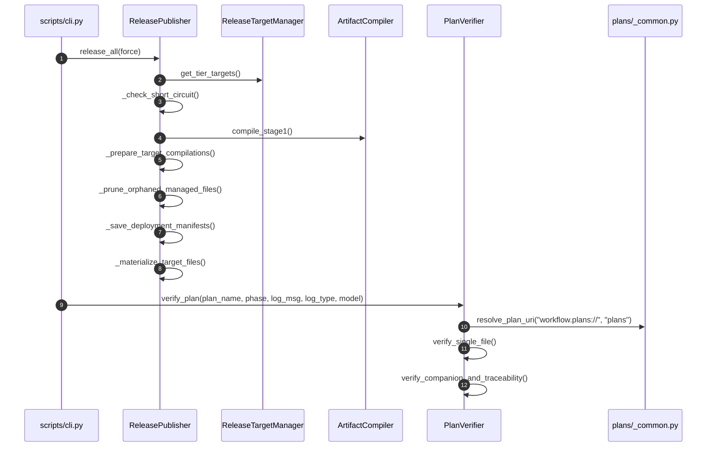

# 架構設計說明書 (Architecture Design)

> 功能名稱：sub_05_agents_workflow_code_optimization  
> 建立日期：2026-10-31  
> 所屬主計畫：2026_10_30_1641_code_optimize  
> 狀態：Confirmed  
> 模型：Gemini 4 Argon (Low)  

> 模板版本：v1.2  

---

## 1. 模組架構分層與職責邊界 (Layered Architecture)

```text
ys_codebase/source/agents-workflow/
├── contributes/
│   └── core.json                      # CLI 命令註冊表（移除重複之 plan check）
├── scripts/
│   └── cli.py                         # CLI 薄路由層（PEP 562/按需匯入，移除 plan_check 與 11 個 cmd_*）
└── agents_workflow/
    ├── compiler.py                    # ArtifactCompiler：Stage 1 錨點展開 + Stage 2 語意 URI 編譯（純函式化與去重）
    ├── targets.py                     # ReleaseTargetManager：多目標雙層配置讀寫（斷開與 publisher 之頂層循環匯入）
    ├── publisher.py                   # ReleasePublisher：二層物化發布編排器（5 階段拆解，遷移至 vfs.<io>）
    ├── initializer.py                 # WorkflowInitializer：工作流初始化引導（清除死屬性）
    ├── roadmap.py                     # RoadmapManager & TodoManager：路線圖與待辦盤點及統一晉升管線
    └── plans/
        ├── __init__.py                # PEP 562 __getattr__ 延遲載入門面
        ├── _common.py                 # 共用基底：resolve_plan_uri 與 parse_markdown_blockquote_headers
        ├── scanner.py                 # PlanScanner：計畫目錄走訪與 7 大模式拓撲快照生成
        ├── status.py                  # PlanStatusResolver：7 大計畫軌道下一步行動分派器與標頭解析
        ├── archiver.py                # PlanArchiver：結案計畫合規守門與歸檔搬移
        ├── searcher.py                # PlanSearcher：決策紀錄 (DR) 與全文檢索
        ├── _verifier_specs.py         # TEMPLATE_HEADER_SPECS、狀態機合法值與預編譯正則常數
        ├── _verifier_healer.py        # 確定性標頭正規化自癒與伴隨檔 / changelog.md 盲寫追加
        ├── verifier.py                # PlanVerifier 驗證器與 PlanReport
        ├── _trace_parser.py           # 多宿主 .jsonl 異質轉錄解析器與工具調用配對（單函式 <= 70 LOC）
        ├── _trace_renderer.py         # FrictionSignal、SessionTraceReport 與對齊審計報告渲染
        └── session_trace.py           # SessionTraceEngine 門面與跨平台轉錄目錄探索
```

---

## 2. 核心資料流與循序圖 (Data Flow & Sequence Diagram)



---

## 3. 受影響檔案與新建檔案清單 (Impacted & New Files Inventory)

| 檔案路徑 | 類型 | 職責與變更說明 |
| :--- | :---: | :--- |
| `ys_codebase/source/agents-workflow/agents_workflow/plans/_common.py` | New | 集中定義 `resolve_plan_uri` 與 `parse_markdown_blockquote_headers`，消除 4 處 URI 解析與 3 處標頭解析重複 |
| `ys_codebase/source/agents-workflow/agents_workflow/plans/_verifier_specs.py` | New | 自 `verifier.py` 剝離 `TEMPLATE_HEADER_SPECS`、合法狀態表與正則常數 |
| `ys_codebase/source/agents-workflow/agents_workflow/plans/_verifier_healer.py` | New | 自 `verifier.py` 剝離確定性標頭自癒、伴隨檔生成與 `changelog.md` 免讀盲寫追加邏輯 |
| `ys_codebase/source/agents-workflow/agents_workflow/plans/_trace_parser.py` | New | 自 `session_trace.py` 剝離轉錄載入、多宿主事件解析器與工具配對邏輯 |
| `ys_codebase/source/agents-workflow/agents_workflow/plans/_trace_renderer.py` | New | 自 `session_trace.py` 剝離 `FrictionSignal`、`SessionTraceReport` 與 ASCII 報告渲染 |
| `ys_codebase/source/agents-workflow/agents_workflow/plans/__init__.py` | Modify | 改為 PEP 562 `__getattr__` 延遲匯入，消除頂層飢渴載入 |
| `ys_codebase/source/agents-workflow/agents_workflow/plans/session_trace.py` | Modify | 精簡為 `SessionTraceEngine` 門面與轉錄探索，委派解析與渲染予 `_trace_parser` / `_trace_renderer` |
| `ys_codebase/source/agents-workflow/agents_workflow/plans/verifier.py` | Modify | 移除 `PlanReport` 魔術方法、`get_resolved_template_headers`、`verify()`、舊檔名分支與未使用參數 |
| `ys_codebase/source/agents-workflow/agents_workflow/plans/scanner.py` | Modify | 移除舊檔名分支（`FT_plan.md`/`P00_semantic_requirements.md`/`master_plan*.md`），改用 `_common.resolve_plan_uri` |
| `ys_codebase/source/agents-workflow/agents_workflow/plans/status.py` | Modify | 移除舊檔名分支，改用 `_common` 共用函式，並將 `resolve_next_action` 拆分為軌道專屬處理函式 |
| `ys_codebase/source/agents-workflow/agents_workflow/plans/archiver.py` | Modify | 移除舊檔名分支，改用 `_common.resolve_plan_uri`（修正 `archive_plans` 拼字錯誤） |
| `ys_codebase/source/agents-workflow/agents_workflow/plans/searcher.py` | Modify | 移除未使用 `import os` 並改用 `_common.resolve_plan_uri` |
| `ys_codebase/source/agents-workflow/agents_workflow/roadmap.py` | Modify | 抽取 `_resolve_or_create_promoted_plan_dir` 與 `_append_promoted_changelog` 統一 `promote_roadmap` 與 `promote_todos`，並改用 `_common.parse_markdown_blockquote_headers` |
| `ys_codebase/source/agents-workflow/agents_workflow/compiler.py` | Modify | 移除死正則、未使用 `mod_order`、舊包裝與 `workflow`/`workflows` 分支；提升 `resolve_stage2_uri` 閉包並抽取 `_lookup_deployed_abs_path`；遷移至 `vfs.<io>` |
| `ys_codebase/source/agents-workflow/agents_workflow/publisher.py` | Modify | 移除舊路徑遷移、`get_registered_targets`、`_soft_merge_agents_md`、未使用 `interactive` 與舊目錄清理；將 `release_all` 拆為 5 階段；遷移至 `vfs.<io>` |
| `ys_codebase/source/agents-workflow/agents_workflow/targets.py` | Modify | 移除頂層 `ReleasePublisher` 循環匯入與未使用匯入，移除靜默 `except Exception: pass` |
| `ys_codebase/source/agents-workflow/agents_workflow/initializer.py` | Modify | 移除 `host_dir`/`module_root` 死屬性與未使用 `import json` |
| `ys_codebase/source/agents-workflow/scripts/cli.py` | Modify | 移除 `plan_check` 與底部 11 個 `cmd_*` 舊轉發函式及未使用匯入 |
| `ys_codebase/source/agents-workflow/contributes/core.json` | Modify | 移除 `plan check` 重複命令宣告 |
| `ys_codebase/source/agents-workflow/tests/test_compiler.py` | Modify | 更新 `_soft_merge_agents_md` 測試為 `_soft_merge_agents_text` |
| `ys_codebase/source/agents-workflow/tests/test_publisher.py` | Modify | 更新 `cmd_release`、移除舊版 `LEGACY_PROJECT_MANIFEST_STORAGE_URI` 測試並遷移至 `vfs.<io>` |
| `ys_codebase/source/agents-workflow/tests/test_roadmap.py` | Modify | 更新 `cmd_roadmap` 為 `cli.roadmap` |
| `ys_codebase/source/agents-workflow/tests/test_plans_toolchain.py` | Modify | 更新測試夾具中之 `P00_semantic_requirements.md` 為 `P00_discuss.md` |

---

## 4. 架構決策記錄 (Architecture Decision Records)

- **[P02:DR-01] 採納私有子模組（`_common.py`, `_verifier_specs.py`, `_verifier_healer.py`, `_trace_parser.py`, `_trace_renderer.py`）解耦巨型檔案**：
  - 維持 `agents_workflow.plans` 對外公開類別路徑不變，內部以 `_` 前綴模組隔離規格常數、無狀態解析器與渲染器，兼顧單一職責與模組封裝性。
- **[P02:DR-02] 斬斷 `publisher <-> targets` 雙向循環並於 `plans/__init__.py` 啟用 PEP 562 延遲載入**：
  - `targets.py` 僅依賴 `compiler.WorkflowCompiler.get_donor_contributions` 讀取註冊目標，`publisher.py` 單向依賴 `targets.py`；`plans/__init__.py` 透過 `__getattr__` 按需匯入子模組，達成 100% 單向無環依賴拓撲。
