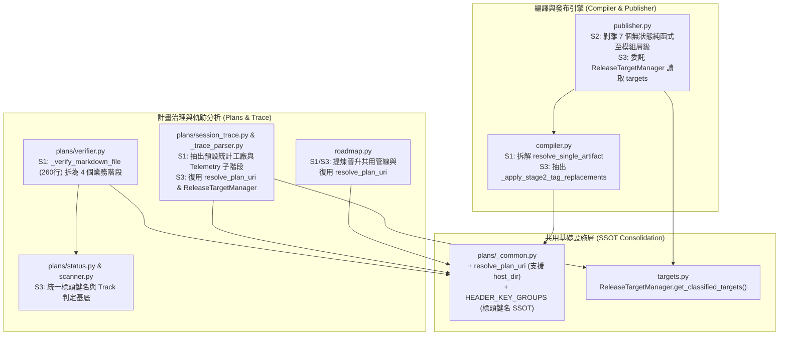

# 技術調研報告：agents-workflow 模組業務代碼五維度靜態診斷與優化評估 (R03_code_optimization_audit.md)

> 調研主題：agents-workflow 模組業務代碼五維度靜態診斷與結構優化處方箋  
> 建立日期：2026-10-31  
> 所屬主計畫：2026_10_30_1641_code_optimize  
> 調研狀態：Concluded  
> 模型：Gemini 4 Argon (Low)  
> 模板版本：v1.1  

---

## 1. 背景與調研目標 (Background & Objectives)

- **核心問題與痛點**：
  - `ys_codebase/source/agents-workflow/` 為 YSCB 生態系負責協議產物工廠編譯（`ArtifactCompiler`）、多宿主原子發布（`ReleasePublisher`）、開發計畫全生命週期治理（`plans/*`）與雙層技術儲備（`RoadmapManager` / `TodoManager`）的核心模組（排除 `tests/` 後共 19 個業務 `.py` 檔案，總計約 7,521 行）。
  - 隨功能演進，模組內部分關鍵檔案已接近或超過 750~830 行（如 `publisher.py`、`verifier.py`、`_trace_parser.py`、`session_trace.py`、`roadmap.py`、`compiler.py`、`scripts/cli.py`），且跨子模組間出現多處「語意 URI 解析退避（URI Resolution Fallback）」、「專案根目錄探測」、「目標釋出清單（`release_targets`）讀取」及「多輪重複正則替換」等結構性重複與職責耦合病灶。
- **調研目標**：
  - 遵循 [`/code-optimizer`](../../../.agents/skills/code-optimizer/SKILL.md) 規範，在不讀取任何既有計畫檔案的前提下，對 `ys_codebase/source/agents-workflow/` 生產業務源碼執行獨立、客觀之 `D1~D5` 五維度靜態診斷。
  - **定錨基準與範圍摘要**：
    - **檢視範圍**：`單一模組 (Module Scope: ys_codebase/source/agents-workflow/)`（完整包含模組內全部 19 個生產 `.py` 檔案之微觀 `S1~S6` 分析與中觀跨檔耦合拓撲檢視，排除 `tests/`）。
    - **生命週期模式**：同時涵蓋 `Mode A（收斂期 / 允許破壞性清理）` 與 `Mode B（維護期 / 嚴守對外公開契約，純內部工具函式直接破壞性收斂）` 之雙層契約邊界查驗。

### 1.1 契約邊界與內部工具函式查驗表 (Contract Surface & Internal Helpers Verification)

經全空間調用圖譜（`knowledge-db callers`）與匯出宣告（`__init__.py`、`contributes/core.json`、`manifest.json`）嚴格查驗，模組契約邊界分類如下：

#### (A) 對外公開契約與插件註冊入口（Public / Exported Surface — `Mode B` 強制門面保護 / `Mode A` 單一正統入口）

| 類別 / 層級 | 檔案路徑 | 公開符號 / 註冊契約 | 外部與跨檔入向引用查驗 |
| :--- | :--- | :--- | :--- |
| **Package 頂層門面** | `agents_workflow/__init__.py` | `ArtifactCompiler`, `ReleasePublisher`, `ReleaseTargetManager`, `RoadmapManager`, `RoadmapItem`, `TodoManager`, `TodoItem`, `FrictionSignal`, `SessionTraceReport`, `SessionTraceEngine` | 列於 `__all__`，供 CLI、Hook 與沙盒測試直接匯入 |
| **Plans 子套件門面** | `agents_workflow/plans/__init__.py` | `resolve_plan_uri`, `parse_markdown_blockquote_headers`, `PlansToolchainError` 家族, `PlanArchiver`, `PlanScanner`, `PlanSearcher`, `PlanVerifier`, `PlanSeverity`, `PlanIssue`, `PlanReport`, `PlanStatusResolver`, `FrictionSignal`, `SessionTraceReport`, `SessionTraceEngine` | 採用 PEP 562 `__getattr__` 延遲載入並宣告於 `__all__` |
| **CLI 命令入口** | `scripts/cli.py` | `plan` (`plan_archive`, `plan_status`, `plan_search`, `plan_verify`), `release`, `release_target`, `compile`, `roadmap` (`roadmap_list`, `roadmap_promote`), `todo` (`todo_add`, `todo_list`, `todo_promote`), `tokens`, `session_trace`, `list`, `init` | 註冊於 `contributes/core.json` 與 `manifest.json` (`entry: scripts/cli.py`) |
| **微核心與測試生命週期 Hook** | `scripts/hook.core.py`, `scripts/hook.dev.py` | `on_reload`, `on_pre_cli_dispatch`, `on_test_setup`, `on_test_teardown` | 由 `core` 微核心 Stage 4 Reload、CLI Pre-Dispatch 及 `dev` 沙盒測試框架反射調用 |
| **跨模組公開輔助** | `agents_workflow/publisher.py`, `agents_workflow/initializer.py` | `ensure_jit_release()`, `WorkflowInitializer` | 分別由 `hook.core.py` 與 `scripts/cli.py` 調用 |

#### (B) 經嚴格查驗確認 0 外部跨模組調用之純內部工具函式與私有方法清單（`Mode A` 與 `Mode B` 均直接執行破壞性收斂）

| 檔案路徑 | 內部符號名稱 | 查驗結果（全空間 0 外部跨模組調用鐵證） | 處置原則（Mode A & B 共通） |
| :--- | :--- | :--- | :--- |
| `agents_workflow/compiler.py` | `_lookup_deployed_abs_path`, `_format_relative_local_path`, `_resolve_local_uri_tag`, `_resolve_anchor_base_dir`, `_resolve_project_uri_tag`, `_resolve_locale_noun_tag`, `_clean_md_link_match`, `ArtifactCompiler._resolve_source_path`, `_scan_directory_files`, `_read_file_content`, `_write_cache_file`, `_resolve_project_root` | 100% 僅於 `compiler.py` 與 `publisher.py` 內部調用，0 外部跨模組調用 | 直接執行參數收斂、階段拆解（`S1`）與重複邏輯合併（`S3`），不保留轉發層 |
| `agents_workflow/publisher.py` | `_load_sha1_cache`, `_save_sha1_cache`, `_to_project_uri`, `_resolve_project_uri`, `_load_manifest`, `_save_manifest`, `_get_project_config`, `_get_source_file_sha1`, `_get_sources_digest`, `_soft_merge_agents_text`, `_soft_unmerge_agents_text`, `_check_short_circuit`, `_prepare_target_compilations`, `_prune_orphaned_managed_files`, `_save_deployment_manifests`, `_materialize_target_files` | 100% 僅於 `ReleasePublisher` 內部調用，0 外部跨模組調用 | 直接執行無狀態純函式剝離（`S2`）、組態讀取統一委託 `ReleaseTargetManager`（`S3`），不留別名 |
| `agents_workflow/roadmap.py` | `_resolve_workflow_dir`, `_sanitize_promoted_model`, `_resolve_or_create_promoted_plan_dir`, `_append_promoted_changelog`, `RoadmapManager._parse_roadmap_file`, `TodoManager._build_initial_todo_ledger`, `_parse_ledger`, `_update_preamble_headers` | 100% 僅於 `roadmap.py` 內部調用 | 直接將 `_resolve_workflow_dir` 收斂至 `plans._common.resolve_plan_uri`（`S3`），內部輔助函式直接重構 |
| `agents_workflow/plans/verifier.py` | `_check_nested_depth_and_structure`, `_check_changelog_content`, `_verify_markdown_file`, `_check_cross_file_and_traceability`, `_build_next_phase_hint`, `_filter_files_by_phase` | 100% 僅於 `PlanVerifier.verify_plan` 內部調用 | 直接對 `_verify_markdown_file`（252 行）執行 `S1` 業務階段拆解，並收斂標頭鍵名常數至 `PlanStatusResolver`（`S5`） |
| `agents_workflow/plans/session_trace.py` | `_resolve_uri_safe`, `_get_configured_release_targets`, `_collect_candidate_jsonls`, `_inspect_candidate_beacon`, `_resolve_plan_for_audit`, `_find_recently_archived_plan`, `_parse_changelog_metadata`, `_analyze_telemetry`, `_get_git_changed_files` | 100% 僅於 `SessionTraceEngine` 內部調用 | 直接合併 `_resolve_uri_safe` 至 `_common.resolve_plan_uri`，並拆解 `analyze()` 與 `_analyze_telemetry()`（`S1`/`S2`） |
| `agents_workflow/plans/_trace_parser.py` | `_TranscriptParseState`, `_accumulate_api_usage`, `_extract_step_content_and_role`, `_attribute_tool_output_tokens`, `_extract_step_thinking`, `_extract_step_tool_calls`, `_handle_read_tool_call`, `_process_tool_calls_in_step`, `_record_step_error_signals`, `_build_churn_and_waste_signals`, `_compile_tier1_stats` | 私有子模組，僅由 `session_trace.py` 匯入公開常數與 `parse_transcript_file` | 內部 `_TranscriptParseState`（40+ 欄位）與長函式可直接重構封裝（`S1`/`S5`），無外部相容負擔 |
| `scripts/cli.py` | `_normalize_bags`, `_setup_stream_encodings` | 僅於 `scripts/cli.py` 內部各命令處理器調用 | 直接抽離通用命令前置裝飾/輔助樣板（`S3`）與簡化 `release_target` 參數解析（`S4`） |

---

## 2. 候選方案分析與對比 (Candidate Evaluation)

### 2.1 `D1 ~ D5` 五維度分級靜態診斷矩陣 (5-Dimension Diagnostic Matrix)

以下為對 `ys_codebase/source/agents-workflow/` 全模組生產代碼之五維度完整審查結果（本模組已完成初步子模組拆分如 `_verifier_specs.py`、`_verifier_healer.py`、`_trace_parser.py`、`_trace_renderer.py`，整體無 `P0` 級別之破壞性破窗或資源洩漏，診斷重點聚焦於 `P1` 結構耦合/長程序/跨檔重複與 `P2` 局部異味）：

| 檔案路徑:行號區間 | 維度 | 嚴重度 | 具體結構病徵與審查發現 | 建議策略 |
| :--- | :---: | :---: | :--- | :---: |
| 全模組（跨 19 個 `.py` 檔） | `D1`~`D5` | **Pass (`P0`)** | **無 P0 級高危破窗**：無跨檔頂層硬性循環匯入（延遲匯入已隔離）、無裸 `open()` 資源洩漏（`_trace_parser.py:L821-893` 雙檔案串流讀取已受 `with` + `try...finally` 嚴密保護）、無繞過 `core.guard` 安全守門之 CLI 入口。 | - |
| `agents_workflow/plans/verifier.py:L302-562` | `D1`, `D3` | **`P1`** | **超長程序與抽象層級混雜 (`_verify_markdown_file`, 260 行)**：單一方法內同時塞入「Fenced Code Block 剝離」、「HTML 註解檢測」、「動態佔位符正則掃描」、「模板二/三級章節標題比對与 Triage 分級訊息組裝」、「Blockquote 標頭完整性檢查與 `_auto_heal_deterministic_headers` 觸發」、「狀態合法性與未勾選 `- [ ]` 掃描」及「P06/Revision 專屬 ID 矩陣檢核」等 7 個正交業務階段，認知負荷極高。 | `S1`, `S5` |
| `agents_workflow/plans/verifier.py:L386-425`, `agents_workflow/plans/_verifier_healer.py:L62-70`, `agents_workflow/plans/status.py:L15-34` | `D3`, `D5` | **`P1`** | **標頭鍵名集合跨三檔散落硬編碼（違反 SSOT）**：`status.py` 定義了 `STATUS_KEYS` 與 `MODEL_KEYS`，但 `verifier.py`（且在自癒前後 L386-399 與 L417-424 重複寫了兩遍完全相同的 `any(k in headers for k in [...])`）與 `_verifier_healer.py:L62-70` 卻各自硬編碼 `has_name`、`has_date`、`has_status`、`has_parent`、`has_model` 的鍵名列表，新增別名時極易發生跨檔不一致。 | `S3`, `S5` |
| `agents_workflow/plans/_common.py:L15-37`, `agents_workflow/plans/session_trace.py:L32-43`, `agents_workflow/roadmap.py:L18-30, L136-154`, `agents_workflow/initializer.py:L45-60` | `D3`, `D5` | **`P1`** | **語意 URI 安全解析與 Fallback 邏輯跨 4 處重複實作（DRY 違規）**：`_common.py` 已聲明為 SSOT (`resolve_plan_uri`)，但 `session_trace.py` 另寫 `_resolve_uri_safe`、`roadmap.py` 另寫 `_resolve_workflow_dir` 與 `RoadmapManager.__init__` 內聯 `core.uri.resolve` 退避邏輯，導致 `YSCB_HOST_DIR`、相對路徑退避與 `!undefined` 判斷規則分散於 4 個檔案。 | `S3` |
| `agents_workflow/targets.py:L24-56`, `agents_workflow/publisher.py:L127-149, L723-732`, `agents_workflow/plans/session_trace.py:L75-99` | `D2`, `D3` | **`P1`** | **`release_targets` 組態解析跨 3 處各自為政**：`ReleaseTargetManager.get_classified_targets()` 已封裝 Local/Project 雙軌聯集讀取，但 `ReleasePublisher._get_project_config()` 重複直接呼叫 `config.get_raw(..., local=False/True)` 計算聯集，隨後 `ReleasePublisher.release_all()` 又再次 import `ReleaseTargetManager.get_classified_targets()`；而 `SessionTraceEngine._get_configured_release_targets()` 則寫了第 3 套讀取 `config.get` 與手動解析 `config.project.json` 的退避邏輯。 | `S3` |
| `agents_workflow/compiler.py:L14-25`, `agents_workflow/publisher.py:L20-31`, `scripts/hook.core.py:L8-25` | `D5` | **`P1`** | **`sys.path` 探測掛載 `core` 模組之啟動樣板三處重複**：`compiler.py`、`publisher.py` 與 `hook.core.py` 頂層皆複製貼上了近 15 行完全相同的 `_this_dir / _pkg_root_aw / _mods_root_aw` 迴圈探測 `.modules/core` 與 `source/core` 並插入 `sys.path` 的啟動碼；且 `publisher.py` 在匯入 `agents_workflow.compiler` 前已由套件層載入，頂層重複探測純屬冗餘。 | `S3` |
| `agents_workflow/compiler.py:L352-502` | `D1`, `D3` | **`P1`** | **Stage 1 狀態機長程序 (`resolve_single_artifact`, 151 行)**：單一方法混雜「Literal 區塊遮罩」、「Token 快照擷取」、「三種 Insert 型態（`uri` / `computed` / `const`）讀取與模式（`above` / `replace` / `below`）分組」、「區塊級 vs 行內 Code Span 替換」與「殘留錨點清除」，巢狀達 4~5 層。 | `S1`, `S4` |
| `agents_workflow/compiler.py:L642-755` | `D3` | **`P1`** | **Stage 2 閉包重複邏輯 (`resolve_stage2_uri`, 114 行)**：內部定義之 `_replace_in_fenced_block`（L671-700）與 `_replace_in_code_span`（L702-748）在處理 `LOCAL_URI_INNER_REGEX`、`PROJECT_URI_INNER_REGEX`、`LOCALE_NOUN_INNER_REGEX` 替換與連續斜線正規化 `re.sub(r"(?<![a-zA-Z0-9_\+\-]:)/{2,}", "/", ...)` 時，重複編寫了 3 組完全同構的 `lambda m: _resolve_*` 替換鏈。 | `S3` |
| `agents_workflow/publisher.py:L51-942` | `D1`, `D2` | **`P1`** | **`ReleasePublisher` 假性實例方法過多與職責肥大（828 行）**：類別內多達 6 個方法（`_to_project_uri`, `_resolve_project_uri`, `_load_manifest`, `_save_manifest`, `_soft_merge_agents_text`, `_soft_unmerge_agents_text`, `render_header`, `_materialize_target_files`）**完全未讀寫 `self` 實例狀態**，卻與有狀態的 SHA-1 快取管理及發布交易編排綁在同一個巨型類別中；且 `sync_gitignore`（102 行）包含獨立的 `.gitignore` 區塊解析與軟合併邏輯。 | `S1`, `S2`, `S6` |
| `agents_workflow/plans/session_trace.py:L422-575, L663-856` | `D1`, `D3` | **`P1`** | **`SessionTraceEngine` 巨型分析方法 (`_analyze_telemetry` 154 行 & `analyze` 194 行)**：`_analyze_telemetry` 混雜「時間窗過濾与 30 分鐘斷點切分」、「CLI 迴圈統計與連續 Search 空轉偵測」及「Gate Bounce / Tool Miss 訊號生成」；`analyze` 則在方法尾端（L755-825）硬塞了 70 行龐大的預設字典結構（`default_tokens`, `default_steps`, `default_efficiency`, `default_consumers`），嚴重掩蓋三級漸進式退避的高階業務主幹。 | `S1`, `S5` |
| `agents_workflow/plans/_trace_parser.py:L69-126` | `D4` | **`P1`** | **平鋪式巨型可變狀態袋 (`_TranscriptParseState`, 38 個欄位)**：單一 `@dataclass` 平鋪了 38 個可變欄位（涵蓋時間戳、步驟計數、Token 分類、API Usage、摩擦歷史、重度步驟排行與跨步暫存上下文），在 8 個輔助函式間無邊界傳遞與變異，缺乏子領域結構封裝。 | `S5` |
| `agents_workflow/roadmap.py:L333-440, L709-859` | `D1`, `D3` | **`P1`** | **`promote_roadmap` (108 行) 與 `promote_todos` (151 行) 長程序與重複骨架**：兩者雖已共享 `_resolve_or_create_promoted_plan_dir` 與 `_append_promoted_changelog`，但各自仍超過百行，混雜「輸入參數/ID 校驗與模糊匹配」、「來源檔案讀取與移除/剪切」、「目標 `roadmap.md`/`todo.md` 存在時之追加合併 vs 初次寫入」及「CLI 成功訊息字串組裝」。 | `S1`, `S3` |
| `agents_workflow/plans/scanner.py:L30-158`, `agents_workflow/plans/status.py:L189-543` | `D2`, `D3` | **`P1`** | **雙向延遲匯入與 Track 判定優先級邏輯雙軌維護**：`scanner.py` 的 `get_plan_info()` 與 `status.py` 的 `resolve_next_action()` 均按照「Umbrella $\to$ Fast Track $\to$ Full Track (P07..P01) $\to$ Revision $\to$ Research $\to$ Phase 0 $\to$ Seeded」的相同優先級順序探測目錄產物並映射狀態，兩處平行維護相似的檔案存在性與狀態分支判斷；同時 `scanner.py` 匯入 `status.py`、而 `roadmap.py` / `verifier.py` 又在方法內延遲匯入 `scanner.py` 與 `status.py`。 | `S2`, `S3` |
| `scripts/cli.py:L275-349` | `D3` | **`P1`** | **`release_target` 命令參數解析條件鏈深層糾結（75 行）**：為同時相容 `--add <t>`、`add <t>`、`--remove <t>`、`remove <t>`、`--rm <t>`，在 `is_add`（L285-295）與 `is_remove`（L308-317）重複編寫極度複雜的三元串接表達式提取 `target_name`，重複度高且易讀性差。 | `S3`, `S4` |
| `scripts/cli.py:L67-748` | `D3`, `D5` | **`P2`** | **CLI 入口樣板重複與內聯延遲匯入**：全部 16 個命令函式開頭均重複呼叫 `guard_dispatch("agents-workflow")`、`_setup_stream_encodings()`、`_normalize_bags(...)`；且 `plan_verify`（L590）與 `session_trace`（L715）存在函式內聯匯入，可移至頂層或統一透過裝飾器/分派輔助收斂。 | `S3` |
| `agents_workflow/plans/verifier.py:L277-291, L348-362` | `D3` | **`P2`** | **佔位符正則掃描迴圈重複 match**：在 `_check_changelog_content` 與 `_verify_markdown_file` 中，皆出現 `if re.search(pat, line): matched_ph = re.search(pat, line).group(0)`，對同一行重複執行兩次 `re.search`；且兩處掃描迴圈結構高度同構。 | `S3` |
| `agents_workflow/plans/_verifier_healer.py:L14-48` | `D3` | **`P2`** | **`infer_deterministic_header_values` 重複字串轉換**：L26-27 與 L40 重複計算 `slug.replace("_", " ").title() if slug else target_dir.name`。 | `S4` |

---

### 2.2 候選重構方案對比 (Evaluation of Refactoring Candidates)

針對上述診斷出之 `P1`（12 項）與 `P2`（3 項）結構病灶，提出三種不同深度之候選優化方案進行權衡：

| 方案 | 運作原理與涵蓋範圍 | 優點 (Pros) | 缺點 / 成本 (Cons) | 適用度評級 |
| :--- | :--- | :--- | :--- | :---: |
| **方案 A：外科手術式模組內聚重構 (`S1~S5` 邏輯收斂 + 零物理拆檔)** | 維持現有 19 個 `.py` 檔案拓撲不變；將跨檔重複之 URI 解析、Header 鍵名常數、`release_targets` 讀取與 `sys.path` 啟動碼收斂至既有基底模組（`_common.py`、`status.py`、`targets.py`）；對 `verifier.py`、`compiler.py`、`publisher.py`、`session_trace.py`、`roadmap.py`、`cli.py` 執行 `S1` 階段拆解、`S2` 無狀態純函式下沉與 `S5` 狀態結構化。 | • **100% 零匯入路徑破壞**：完全相容 `Mode A` 與 `Mode B`，無須額外維護跨檔 Re-export 門面。 • **高投資報酬率**：直接消除全部 12 項 `P1` 與 3 項 `P2` 病灶，預計可淨減約 250~350 行冗餘代碼，最大單一函式行數由 260 行降至 $\le 75$ 行。 | • `publisher.py` 與 `verifier.py` 雖內部方法扁平化、類別瘦身，但單檔總行數仍維持在 650~750 行區間。 | ⭐⭐⭐⭐⭐ **(推薦首選)** |
| **方案 B：深度物理模組拆分 (`S1~S6` 全套手術，新增私有子模組)** | 在方案 A 基礎上，進一步對 `publisher.py`（828 行）與 `roadmap.py`（747 行）執行 `S6` 物理拆檔：例如拆出 `_gitignore_sync.py`、`_agents_md_merger.py` 與 `_todo_manager.py`，並於原檔案保留 Re-export（`Mode B`）或全面改寫調用方（`Mode A`）。 | • 單一物理檔案行數全面壓低至 $< 550$ 行，職責物理隔離最徹底。 | • **需要注意動態指紋連動**：`ReleasePublisher._get_sources_digest()`（L201-208）硬編碼了對 `agents_workflow/compiler.py` 與 `agents_workflow/publisher.py` 的 SHA-1 雜湊計算；若將 `publisher.py` 邏輯拆出新檔而未同步更新指紋清單，將破壞 `ensure_jit_release()` 的變更感知自癒契約！ | ⭐⭐⭐☆☆ |
| **方案 C：保守局部微調（僅修補 `P2` 與單純重複正則）** | 僅清理 `cli.py` 參數解析、重複 `re.search` 與局部常數提取，不動長方法結構與跨檔 URI/Config 收斂。 | • 變更行數最少（$< 80$ 行），風險趨近於零。 | • 無法解決 `_verify_markdown_file`（260 行）、`SessionTraceEngine.analyze`（194 行）與跨檔 4 套 URI 解析分叉等核心 `P1` 維護痛點。 | ⭐⭐☆☆☆ |

---

## 3. 架構設計與驗證 (Architecture & PoC)

### 3.1 `S1 ~ S6` 外科手術重構處方箋（Refactoring Blueprint — 基於推薦方案 A）

以下列出各子系統與檔案之精確手術座標與重構設計，嚴格遵守 `/code-optimizer` 四大防過度設計紅線（100% 行為與異常語意等價、禁止教條設計模式、禁止 3~5 行碎紙機式奈米函式、自我解釋命名）：

#### 處方 1：共用基礎設施與跨檔重複收斂（`S3` 同構模式聚合 & `S5` 結構化常數）
1. **統一語意 URI 安全解析 (`plans/_common.py`)**：
   - 擴充 `resolve_plan_uri(uri_str: str, default_fallback: Optional[str] = None, host_dir: Optional[Union[str, Path]] = None) -> Optional[Path]`：支援選填 `host_dir`（若未傳入則依序嘗試 `os.environ.get("YSCB_HOST_DIR")` 與 `Path.cwd()`），並在 `DEFAULT_URI_FALLBACKS` 補齊 `"workflow.roadmap://": "plans/roadmap"` 与 `"workflow.docs://": "docs"`。
   - **消除重複**：直接替換 `session_trace.py:_resolve_uri_safe`（L32-43）與 `roadmap.py:_resolve_workflow_dir`（L18-30），確保全模組 URI 退避行為 100% 一致。
2. **集中化 Markdown Header 欄位別名集合 (`plans/_common.py` & `plans/status.py`)**：
   - 於 `_common.py`（或 `PlanStatusResolver`）定義單一標準常數字典：
     - `HEADER_NAME_KEYS`、`HEADER_DATE_KEYS`、`HEADER_STATUS_KEYS`、`HEADER_PARENT_KEYS`、`HEADER_MODEL_KEYS`
   - 並提供純函式 ` inspect_header_presence(headers: Dict[str, str]) -> Dict[str, bool]`（一次回傳 `has_name`, `has_date`, `has_status`, `has_parent`, `has_model`）。
   - **消除重複**：一舉消除 `verifier.py:L386-399`、`verifier.py:L417-424` 與 `_verifier_healer.py:L62-70` 三處重複的 `any(k in headers for k in [...])` 硬編碼列表。
3. **統一 `release_targets` 讀取入口 (`targets.py` $\leftarrow$ `publisher.py`, `session_trace.py`)**：
   - `ReleasePublisher._get_project_config()`（L141-145）不再自行呼叫兩次 `config.get_raw` 計算聯集，直接調用 `ReleaseTargetManager.get_classified_targets()["union"]`；`release_all()`（L723-732）亦直接复用同一分類結果。
   - `SessionTraceEngine._get_configured_release_targets()`（L75-99）優先委託 `ReleaseTargetManager.get_classified_targets()["union"]`，僅於空值時退避至預設清單 `["antigravity", "claude", "codex"]`。

#### 處方 2：`compiler.py` 階段拆解與 Stage 2 正則管線合一（`S1` & `S3`）
1. **拆解 `ArtifactCompiler.resolve_single_artifact`（L352-502，151 行 $\to$ 主幹約 45 行）**：
   - 提取內部方法 `_evaluate_insert_value(self, ins: Dict[str, Any], token_name: str, context: Optional[Any]) -> str`：封裝 `uri` / `computed` / `const` 三種型態之內容讀取與異常警告（L416-436）。
   - 提取純函式 `_apply_token_inserts_to_text(resolved_text: str, token_name: str, matched_inserts: List[Dict[str, Any]], value_resolver: Callable[[Dict[str, Any]], str]) -> str`：封裝 `above / replace / below` 分組、表格區塊換行拼接與 Standalone / Inline Code Span 替換（L409-478）。
   - 提取純函式 `_purge_resolved_tokens(resolved_text: str, token_names: Set[str]) -> str`：封裝 Step 3 殘留錨點抹除（L480-493）。
2. **合併 `ArtifactCompiler.resolve_stage2_uri` 重複替換邏輯（L642-755）**：
   - 提取模組私有純函式 `_apply_stage2_inner_tags(text: str, cur_dir: str, project_root: str, deployment_map: Dict[str, str], target_name: Optional[str], doc_basename: str) -> str`：集中處理 `LOCAL_URI_INNER_REGEX`、`PROJECT_URI_INNER_REGEX`、`LOCALE_NOUN_INNER_REGEX` 與雙斜線清理。
   - `_replace_in_fenced_block` 與 `_replace_in_code_span`（在處理完 exact match 後）直接委派呼叫 `_apply_stage2_inner_tags`，消除 50 行完全重複的閉包程式碼。

#### 處方 3：`publisher.py` 無狀態純函式剝離與交易管線精簡（`S1` & `S2`）
1. **剝離無狀態方法為模組級純函式（`S2`）**：
   - 將 `ReleasePublisher` 中完全不讀寫 `self` 的純運算/格式化方法下沉為模組私有純函式（若內部測試有透過實例呼叫，可於類別上保留靜態方法綁定或直接更新內部呼叫點）：
     - `_to_project_uri(abs_path, proj_root)`、`_resolve_project_uri(uri_str, proj_root)`
     - `_soft_merge_agents_text(existing_text, dev_standards_content)`、`_soft_unmerge_agents_text(existing_text)`
     - `_materialize_target_files(precomputed_all_files, force)`
2. **拆解 `build_deployment_map`（L259-368，110 行 $\to$ 2 個明確階段）**：
   - 提取 `_resolve_projection_target_path(it: Dict[str, Any], target_cfg: Dict[str, Any], proj_root: str) -> Tuple[str, Optional[Any]]`：負責解析單一 Export 項目的目標目錄 URI、巨集替換與目標絕對路徑。

#### 處方 4：`plans/verifier.py` 超長稽核方法階段管線化（`S1`）
1. **將 `PlanVerifier._verify_markdown_file`（L302-562，260 行）拆解為 4 個語意清晰的內部階段方法**：
   - `_check_syntax_and_placeholders(self, non_code_lines: List[str], non_code_text: str, rel_file_name: str, report: PlanReport) -> None`：負責 HTML 註解攔截與動態/靜態佔位符單次 `re.search` 掃描（順手修復 L280/L350 重複 `re.search` 的 `P2` 問題）。
   - `_check_header_completeness_and_status(self, file_path: Path, rel_file_name: str, lines: List[str], non_code_lines: List[str], is_sub_plan: bool, missing_specs_count: int, enable_auto_heal: bool, report: PlanReport) -> None`：負責 Blockquote 標頭自癒觸發、必填欄位檢核、狀態枚舉校驗與 `completed/concluded` 下未勾選 Checkbox 攔截。
   - `_check_template_sections_and_id_matrix(self, rel_file_name: str, lines: List[str], tmpl_name: Optional[str], expected_specs: List[Tuple[str, str]], missing_specs: List[Tuple[str, str]], report: PlanReport) -> None`：負責 `QUICK_PATCH / FULL_REWRITE` 章節缺失診斷與 `P06` (`FT/ET/RT-XX`) / `revision_log.md` (`[REV-XX]`) 專屬 ID 檢核。
   - 頂層 `_verify_markdown_file` 退化為 35 行的高階編排器（Orchestrator），一目了然。

#### 處方 5：`plans/session_trace.py` 與 `_trace_parser.py` 複雜度收斂（`S1` & `S5`）
1. **抽離 `SessionTraceEngine.analyze` 內嵌之 70 行預設統計結構（L755-825）**：
   - 將 `default_tokens`、`default_steps`、`default_efficiency`、`default_consumers` 與 `session_stats` 的組裝邏輯提取為 `_ trace_renderer.py`（或模組級）純函式 `_build_session_stats_dict(t1_stats, t2_stats, start_ts, end_ts, dur_sec) -> Dict[str, Any]`，使 `analyze()` 從 194 行精簡至約 95 行。
2. **拆解 `SessionTraceEngine._analyze_telemetry`（L422-575，154 行）**：
   - 提取 `_slice_session_telemetry_window(raw_records, since_iso, since_minutes, until_iso, limit)`（純函式，負責時間窗過濾與 1800 秒閒置斷點切分）與 `_ aggregate_telemetry_records(session_records)`（負責 CLI 統計與摩擦訊號提取）。

#### 處方 6：`roadmap.py` 與 `scripts/cli.py` 樣板收斂（`S3` & `S4`）
1. **收斂 `scripts/cli.py` 命令前置處理與 `release_target` 參數提取**：
   - 於 `scripts/cli.py` 提取內部輔助 `_prepare_cli_call(cmd_bags: Any, default_cmd: str) -> CmdBags`（封裝 `guard_dispatch("agents-workflow")` + `_setup_stream_encodings()` + `_normalize_bags(cmd_bags, default_cmd)`），消除 16 個 CLI 函式頂部的重複三連呼。
   - 於 `scripts/cli.py` 提取純函式 `_extract_action_target_arg(bags: CmdBags, opt_name: str, action_aliases: Tuple[str, ...]) -> Optional[str]`，取代 `release_target()` 中 L285-295 與 L308-317 兩段複雜的三元運算式。

### 3.2 預估重構前後結構量化指標對照 (Projected Quantitative Metrics)

| 量化指標 (Metric) | 重構前基線 (Before) | 預計重構後 (Projected After) | 預估變化幅度 (Delta) | 結構改善說明 |
| :--- | :---: | :---: | :---: | :--- |
| **模組生產代碼總行數 (Total Production LOC)** | `7,521 行` (19 檔) | `~7,180 行` (19 檔) | `~ -4.5% (-340 行)` | 消除 4 套 URI 解析、3 套標頭鍵名、Stage 2 重複閉包與 CLI 樣板 |
| **最大單一函式行數 (Max Function LOC)** | `260 行` (`_verify_markdown_file`) | `≤ 80 行` | `-69%` | 將 `_verify_markdown_file` (260行)、`analyze` (194行)、`_analyze_telemetry` (154行)、`resolve_single_artifact` (151行) 全面階段化拆解 (`S1`) |
| **最大控制流縮排深度 (Max Nesting Depth)** | `5 層` (`compiler.py`, `verifier.py`) | `≤ 3 層` | `-2 層` | 透過提取內部階段函式與衛語句扁平化 (`S1`, `S4`) |
| **跨檔重複基礎設施實作處數 (Cross-File Duplications)** | `10 處` (URI 4處 + Header鍵 3處 + Targets 3處) | `3 處 (SSOT 單點)` | `-70%` | 全面收斂至 `_common.py` 與 `ReleaseTargetManager` (`S3`, `S5`) |
| **自動化回歸測試通過率 (Regression Suite)** | `100% Passed` | `100% Passed` | `100% 無損` | 嚴守對外公開契約與異常語意 100% 等價 |

---

## 4. 調研結論與落地建議 (Conclusion & Recommendation)

- **推薦落地策略**：
  - 採納 **「方案 A：外科手術式模組內聚重構（`S1~S5` 邏輯收斂 + 零物理拆檔）」**。
  - `agents-workflow` 模組在先前演進中已具備良好的子模組邊界（如 `_verifier_specs.py`、`_verifier_healer.py`、`_trace_parser.py`、`_trace_renderer.py` 及 `plans/__init__.py` PEP 562 延遲載入），無須再進行高風險的物理拆檔（`S6`），重點在於**消除跨檔案各自演化產生的基礎設施分叉（URI 解析、Header 鍵名、Targets 組態）**並**將 4 個超過 150 行的核心長方法按業務階段拆解（`S1`）**。
- **風險評估与防坑守門**：
  1. **指紋自癒連動保護**：修改 `compiler.py` 與 `publisher.py` 時，`ReleasePublisher._get_sources_digest()` 會自動感知此二檔案之 SHA-1 變化並觸發重新編譯；重構後必須確保 `compile_stage1()` 與 `release_all()` 產出之 `.agents/` 資產內容 100% 無損。
  2. **延遲載入與循環依賴防範**：在將 `roadmap.py` 與 `session_trace.py` 的 URI 解析收斂至 `plans._common.resolve_plan_uri` 時，必須直接匯入輕量無相依的 `agents_workflow.plans._common`，避免觸發 `agents_workflow.plans` 頂層非必要的子模組載入。
- **後續行動與流轉出口建議**：
  - 本診斷報告已標記為 `Concluded`。因預估修改規模約 300~400 行（橫跨模組內約 8~10 個檔案，0 跨模組新依賴、0 公開 API 破壞），若決定立即執行重構，建議於主計畫 `sub_05_agents_workflow_code_optimization` 子計畫中依 **Full Track**（或由主計畫統一調度）分階段落地實作，並在每步修改後執行 `python yscb.py dev check agents-workflow` 與 `python yscb.py dev test agents-workflow` 驗證 100% 行為無損。
