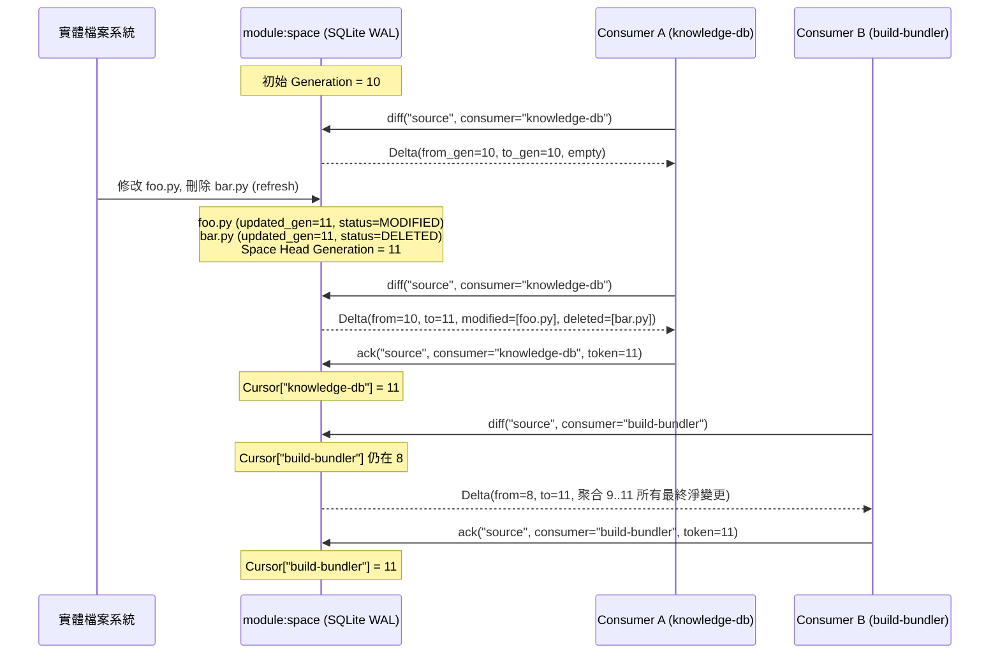

# 專題調研與分析報告：通用檔案空間定義、增量指紋快取與背景監視套件設計 (R02_space_api_and_architecture_design.md)

> 調研主題：通用檔案空間定義、增量指紋快取與背景檔案監視套件（`module:space`）之第一原理架構與 API 契約設計  
> 建立日期：2026-11-02  
> 所屬主計畫：2026_11_02_0339_module_space_feasibility_research  
> 調研狀態：Concluded  
> 模型：Gemini 4 Argon (Low)  
> 模板版本：v1.2  

---

## 1. 背景與調研目標 (Background & Objectives)

- **背景脈絡與核心問題**：
  在 `ys-codebase` 微內核生態系中，不同領域模組（如語意索引引擎、模組建置打包器、增量測試執行器、配置聚合器與未知的下游專案工具）皆高度依賴「目錄樹走訪過濾」、「檔案變更偵測（Fingerprinting & Diffing）」與「常駐背景檔案監視（Background File Watching）」。若各模組各自實作掃描與快取邏輯，不僅造成大量重複的 `os.scandir` I/O 走訪與雜湊計算開銷，更會面臨多消費者狀態互相覆寫（如 Consumer A 消費變更後清除 dirty 標記，導致 Consumer B 漏接變更）、大型二進位資產全檔雜湊阻塞、以及跨程序併發讀寫競爭等系統性架構風險。
- **調研目標與範疇**：
  本報告完全從第一原理（First Principles）與微內核既有基礎契約（[`core.uri`](../../ys_codebase/source/core/core/uri.py)、[`core.vfs`](../../ys_codebase/source/core/core/vfs/__init__.py)、[`core.contributes`](../../ys_codebase/source/core/core/contributes.py)、[`core.events`](../../ys_codebase/source/core/core/events.py)、[`core.platform`](../../ys_codebase/source/core/core/platform/__init__.py) 與 [`server.service`](../../ys_codebase/source/server/server/service.py)）出發，在 **100% Python 標準庫（零強制第三方 `pip` 依賴）** 與 **100% 領域無關（Domain-Blind）** 的約束下，獨立推演並設計 `module:space` 的：
  1. 宣告式空間定義契約（Contributes Schema）與多根重疊裁剪規則。
  2. 核心資料模型（Data Classes）與二階段/三級惰性指紋策略（Tiered Hashing Strategy）。
  3. 基於單調遞增世代流水號（Monotonic Generation Sequence / Watermark）的多消費者游標隔離機制。
  4. Python SDK 核心公開 API 簽名契約。
  5. 有/無 `server` 雙模自適應背景監視與雙通道事件分發協議。
  6. 標準 CLI 介面與安全等級契約。

---

## 2. 核心分析與評估 (Core Analysis & Evaluation)

### 2.1 第一原理設計公理與架構邊界 (First-Principles Axioms)

為確保 `module:space` 能夠同時服務小型純文字源碼樹（數百個 `< 100 KB` 檔案）、大型二進位資產目錄（數 GB 模型權重、音訊或打包產物）以及龐大的外部依賴目錄，套件設計必須恪守以下五條正交公理：

1. **絕對領域無關公理（Strict Domain-Blindness）**：
   `module:space` 僅認知「語意路徑（URI）、位元組流（Bytes）、作業系統元數據（Stat Metadata）、內容指紋（Digest）與變更事件（Delta）」。嚴禁內建任何領域概念（如 AST 語法樹、Markdown 標題、符號表或特定編譯器規則）。
2. **評估與消費解耦公理（Separation of Observation and Consumption）**：
   「偵測物理磁碟現況並更新空間快照（`scan` / `refresh`）」與「特定下游模組讀取自上次處理以來的差異集（`diff(consumer_id)`）」必須徹底分離。全球唯一真相為當前磁碟狀態，而每個消費者持有獨立的進度水位（Watermark Cursor）。
3. **O(Directory) 剪枝與惰性雜湊公理（Prune-Early & Hash-Late）**：
   目錄排除規則必須在 `os.scandir` 展開子樹前執行（In-place directory pruning），杜絕踏入 `.git`、`node_modules` 或 `.venv` 等黑洞；檔案雜湊計算僅在 `(mtime_ns, size)` 發生變動且消費者要求內容級比對時才惰性觸發。
4. **跨程序無鎖讀取與原子提交公理（MVCC & Atomic Persistence）**：
   底層持久化採用 Python 標準庫內建之 `sqlite3`（啟用 `WAL` 模式，`cache://space/state.db`），搭配 [`core.platform.InterProcessLock`](../../ys_codebase/source/core/core/platform/lock.py#L19-L131) 協調寫入，支援多個 CLI 程序與背景 `server` Worker 同時無阻塞讀取快照。
5. **零常駐強制依賴公理（Server-Optional Dual-Mode）**：
   當 [`server`](../../ys_codebase/source/server/server/worker.py#L24-L98) 常駐時，由背景 Worker 持續將磁碟變更預熱寫入 SQLite WAL 快取並廣播事件；當無 `server`（如 CI/CD 或單次 CLI 執行）時，SDK 呼叫自動退化為按需同步增量掃描（JIT Incremental Scan），對呼叫端保持 100% 相同的 API 語意。

---

### 2.2 宣告式空間定義契約 (`contributes/space.json`)

各模組可透過 `module://<donor>/contributes/space.json` 或專案級 `config://space/contribute.json` 宣告邏輯空間。`module:space` 透過 [`core.contributes.get("space", "spaces")`](../../ys_codebase/source/core/core/contributes.py#L183-L204) 動態聚合。

#### 2.2.1 空間宣告 JSON Schema 規格

```json
{
  "spaces": [
    {
      "name": "source",
      "description": "核心模組源碼空間",
      "roots": ["module.source://"],
      "include_globs": ["**/*.py", "**/*.json", "**/*.md"],
      "exclude_globs": ["**/__pycache__/**", "**/.pytest_cache/**", "**/*.pyc"],
      "ignore_files": [".gitignore", ".yscbignore"],
      "follow_symlinks": false,
      "hash_policy": "adaptive",
      "large_file_threshold_bytes": 10485760,
      "watch": {
        "enabled": true,
        "debounce_ms": 300,
        "polling_interval_sec": 2.0
      }
    }
  ]
}
```

#### 2.2.2 路徑正規化、多根重疊與循環防禦規則

1. **URI 錨定與相對路徑正規化**：
   所有 `roots` 支援語意 URI（由 [`core.uri.resolve()`](../../ys_codebase/source/core/core/uri.py#L524-L606) 解算為實體路徑）。空間內的每個檔案皆以相對於所屬 Root 的 POSIX 斜線路徑（`rel_path`）及完整語意 URI（如 `module.source://core/core/uri.py`）雙重標識，確保跨平台（Windows / POSIX）快取鍵值一致。
2. **多根重疊去重（Multi-Root Overlap Deduplication）**：
   若單一空間宣告多個 `roots` 且發生父子目錄包含關係（如同時包含 `project://` 與 `project://sub`），掃描器在初始化時自動按實體規範路徑前綴進行**最長前綴歸併**或**實體 `(dev, ino)` 集合去重**，保證同一實體檔案在單一空間內僅出現一次。
3. **符號連結循環防禦（Symlink Loop Protection）**：
   預設 `follow_symlinks: false`。當顯式開啟 `follow_symlinks: true` 時，走訪器維護已造訪目錄之 `(st_dev, st_ino)` 祖先集合（Ancestor Set），一旦偵測到指向祖先目錄的循環連結，立即截斷該分支並記錄結構化警告。

---

### 2.3 分級雜湊與二階段指紋快取協議 (Tiered Hashing & Two-Stage Fingerprinting)

針對小型源碼到數 GB 大型二進位資產的極端跨度，單一的全檔 SHA-256 會在大型檔案上造成災難性的 I/O 停頓，而僅靠 `mtime` 又會在 `git checkout` / `touch` 時產生假陽性（False Positives）。因此設計 **二階段短路過濾 + 三級內容雜湊（2-Stage Gate + 3-Tier Content Digest）**：

#### 階段一：O(1) 元數據快速閘門 (Stage-1 Stat Gate)
透過 `os.scandir()` 在一次系統呼叫中直接取得 `DirEntry.stat()`（在 Windows 與現代 Linux ファイル系統上幾乎免除額外 `stat` 系統呼叫成本）：
- 提取 `(mtime_ns, size)`。
- 若快取中已存在該檔案紀錄，且 `(cached.mtime_ns == cur.mtime_ns and cached.size == cur.size)`：
  $\rightarrow$ **直接判定 `UNCHANGED`（100% 零檔案開啟、零位元組讀取）**，直接沿用快取中的 `content_hash`。

#### 階段二：分級內容雜湊計算 (Stage-2 Content Digest)
當且僅當檔案為新增，或 `(mtime_ns, size)` 與快取不符時，依空間之 `hash_policy` 計算內容指紋：

| 雜湊等級 (`HashPolicy`) | 觸發條件與適用場景 | 演算法與標準庫實作（100% Stdlib） | 效能與碰撞特性 |
| :--- | :--- | :--- | :--- |
| **`STAT_ONLY`** | 超大型唯讀外部依賴庫、純時間戳驅動之快速預檢 | 不開啟檔案；指紋直接編碼為 `"stat:{size}:{mtime_ns}"` | 零 I/O 讀取；無法過濾 `touch` 假陽性 |
| **`FULL_HASH`** | 小型源碼樹、組態檔、嚴格校驗場景（或 `adaptive` 下 `< threshold`，預設 `10 MB`） | `hashlib.blake2b(digest_size=20)`，以 `memoryview` + `64 KB` 緩衝區串流讀取 | Python 標準庫 C 實作之 `blake2b` 比 `sha256` 快約 30%~50%，160-bit 碰撞機率 $< 10^{-48}$ |
| **`SAMPLED_HASH`** | 大型二進位資產（或 `adaptive` 下 $\ge threshold`，如 `> 10 MB` 的模型檔、壓縮包、媒體檔） | **頭尾中稀疏取樣雜湊**：讀取檔案前 `64 KB` + 正中央 `64 KB` + 末尾 `64 KB`，連同檔案 `size` 注入 `hashlib.blake2b(digest_size=20)`，前綴標記 `"sample2b:"` | 無論檔案是 `50 MB` 或 `50 GB`，單檔最多僅讀取 `192 KB`（$< 1\text{ ms}$），徹底杜絕大檔卡死 |

> [!TIP]
> **Racy-Clean（同時間戳極速修改）防禦**：
> 借鑑 Git Index 的 Racy-Git 防護機制：若檔案的 `mtime_ns` 與當前掃描開始時間（`scan_start_ns`）差距小於作業系統檔案系統時間精度視窗（例如 `< 10 ms`），即使下次掃描看到相同的 `(mtime_ns, size)`，仍會強制觸發一次 Stage-2 內容雜湊重算，徹底杜絕同一毫秒內「寫入 $\to$ 掃描 $\to$ 再寫入等長內容」被漏判的邊界漏洞。

---

### 2.4 多消費者狀態游標隔離機制 (Multi-Consumer Watermark Isolation)

#### 2.4.1 傳統 Dirty-Flag 模式的致命缺陷
若快取僅儲存「檔案上次掃描是否變更（boolean dirty flag）」，當 `knowledge-db` 呼叫 `scan()` 取得變更並更新索引後，若將狀態清為 clean，隨後執行的 `dev test --incremental` 或資產打包器就會看到「零變更」，引發嚴重的跨模組狀態干擾。

#### 2.4.2 單調世代流水號與讀取游標模型 (Monotonic Generation & Consumer Cursors)
`module:space` 將「空間物理狀態演進」建模為一條**單調遞增的世代日誌（Generation Log / Revision Watermark）**：



1. **空間世代號（`space_generation: int`）**：
   每次 `refresh(space_name)` 若偵測到任何實質變更（新增、內容雜湊改變、刪除），該空間的 `head_generation` 原子加 1（例如從 `Gen 10` $\to$ `Gen 11`）。
2. **檔案狀態表（`space_files`）**：
   每個檔案紀錄保存：
   - `space_name`, `rel_path`, `uri`
   - `size`, `mtime_ns`, `content_hash`, `hash_tier`
   - `created_gen`: 首次出現或重建時的世代號
   - `updated_gen`: 內容最後一次實質變更（或被標記刪除）的世代號
   - `is_deleted`: 墓碑標記（Tombstone，`0` 或 `1`）
3. **消費者游標表（`space_cursors`）**：
   每個消費者以 `(space_name, consumer_id)` 註冊其已確認處理完畢的世代號 `acked_gen` 與空間組態指紋 `config_hash`。
4. **O(Changed) 增量差異查詢（Zero-Write Read）**：
   當消費者呼叫 `diff(space_name, consumer_id)` 時：
   - 先確保空間已刷新至最新物理狀態（或容許指定 `max_staleness_ms` 直接讀快取）。
   - 查詢 `SELECT * FROM space_files WHERE space_name = ? AND updated_gen > ?`（索引直查，時間複雜度僅與變更檔案數成正比，與總檔案數無關）：
     - `is_deleted == 1` 且 `created_gen <= acked_gen` $\rightarrow$ 歸入 `deleted`（若 `created_gen > acked_gen` 代表在兩次消費間新增又刪除，直接淨抵銷忽略）。
     - `is_deleted == 0` 且 `created_gen > acked_gen` $\rightarrow$ 歸入 `added`。
     - `is_deleted == 0` 且 `created_gen <= acked_gen` $\rightarrow$ 歸入 `modified`。
5. **Tombstone 垃圾回收（Garbage Collection）**：
   當某筆 `is_deleted == 1` 的墓碑紀錄，其 `updated_gen <= MIN(all_active_consumers.acked_gen)`（且超過保留期 TTL，預設 7 天）時，背景或隨附 GC 自動物理清除該墓碑列，防止資料庫無限膨脹。
6. **組態變更自動重設（Config Fingerprint Invalidation）**：
   若空間的 `roots`、`include_globs` 或 `exclude_globs` 發生改變，`space` 計算之 `config_hash` 將變動，自動觸發全量重掃並將不匹配的舊游標標記為 `requires_full_resync=True`。

---

### 2.5 核心資料結構與 Python SDK API 契約

#### 2.5.1 核心資料模型 (`space.models`)

所有公開資料結構均採用 `@dataclass(frozen=True)`，具備不可變性、型別安全與直接序列化為 JSON 的能力：

```python
from dataclasses import dataclass, field
from enum import Enum
from typing import Dict, List, Optional, Tuple, Iterator, Callable


class HashPolicy(str, Enum):
    STAT_ONLY = "stat_only"      # 僅比對 (size, mtime_ns)
    ADAPTIVE = "adaptive"        # 小檔全量 blake2b，大檔頭尾中取樣 blake2b (預設)
    FULL_HASH = "full_hash"      # 強制全檔 blake2b


class ChangeKind(str, Enum):
    ADDED = "added"
    MODIFIED = "modified"
    DELETED = "deleted"


@dataclass(frozen=True)
class SpaceSpec:
    """空間定義規格模型（對應 contributes/space.json 單項）。"""
    name: str
    roots: Tuple[str, ...]
    description: str = ""
    include_globs: Tuple[str, ...] = ("**/*",)
    exclude_globs: Tuple[str, ...] = ()
    ignore_files: Tuple[str, ...] = (".gitignore", ".yscbignore")
    follow_symlinks: bool = False
    hash_policy: HashPolicy = HashPolicy.ADAPTIVE
    large_file_threshold_bytes: int = 10 * 1024 * 1024  # 10 MB
    provider: str = "core"
    config_hash: str = ""


@dataclass(frozen=True)
class FileEntry:
    """空間內單一檔案之快照元數據與內容指紋。"""
    space_name: str
    rel_path: str          # 標準化 POSIX 相對路徑 (e.g. "core/core/uri.py")
    uri: str               # 語意 URI (e.g. "module.source://core/core/uri.py")
    abs_path: str          # 實體作業系統絕對路徑
    size: int              # 檔案位元組大小
    mtime_ns: int          # 奈秒級修改時間戳 (st_mtime_ns)
    content_hash: str      # 內容指紋 (e.g. "b2:8f9a..." 或 "sample2b:...")
    created_gen: int       # 首次納入空間之世代號
    updated_gen: int       # 最後實質內容變更之世代號


@dataclass(frozen=True)
class FileChange:
    """單一檔案變更事件項目。"""
    kind: ChangeKind
    rel_path: str
    uri: str
    abs_path: str
    current: Optional[FileEntry] = None   # ADDED / MODIFIED 時提供最新快照
    previous_hash: Optional[str] = None   # MODIFIED / DELETED 時提供舊內容指紋


@dataclass(frozen=True)
class SpaceDiff:
    """針對特定消費者游標計算出之空間增量差異集。"""
    space_name: str
    consumer_id: str
    from_generation: int
    to_generation: int
    is_initial_sync: bool                 # 若游標首次建立或因組態變更重置則為 True
    added: Tuple[FileChange, ...] = ()
    modified: Tuple[FileChange, ...] = ()
    deleted: Tuple[FileChange, ...] = ()
    scan_duration_ms: float = 0.0
    stats: Dict[str, int] = field(default_factory=dict)  # e.g. {"walked": 500, "stat_hits": 495, "hashed": 5}

    @property
    def has_changes(self) -> bool:
        return bool(self.added or self.modified or self.deleted)

    def iter_all(self) -> Iterator[FileChange]:
        yield from self.added
        yield from self.modified
        yield from self.deleted
```

#### 2.5.2 核心 Python SDK 簽名契約 (`from space import ...`)

```python
from contextlib import contextmanager
from typing import Optional, List, Sequence, Iterator, Generator

# 1. 空間註冊表與臨時空間建構
def list_spaces() -> List[SpaceSpec]:
    """列出全系統已透過 Contributes 註冊之所有空間規格。"""

def get_space(name: str) -> SpaceSpec:
    """取得指定名稱之空間規格；若未註冊則拋出 SpaceNotFoundError。"""

def define_ephemeral_space(
    name: str,
    roots: Sequence[str],
    include_globs: Sequence[str] = ("**/*",),
    exclude_globs: Sequence[str] = (),
    hash_policy: HashPolicy = HashPolicy.ADAPTIVE,
) -> SpaceSpec:
    """動態建立或覆蓋不依賴 contributes 檔案之程式碼級空間定義（供模組內部臨時快取使用）。"""

# 2. 狀態刷新與快照讀取
def refresh(
    space_name: str,
    subpath_prefix: Optional[str] = None,
    force_rehash: bool = False,
    max_staleness_ms: int = 0,
) -> int:
    """
    掃描實體磁碟並將最新指紋同步至 SQLite 快取，返回最新 head_generation。
    - 若背景 Watcher 正在運行且距離上次心跳 < max_staleness_ms，可直接 O(1) 返回當前世代號。
    - 支援 subpath_prefix 局部子樹刷新。
    """

def snapshot(
    space_name: str,
    glob_filter: Optional[str] = None,
    auto_refresh: bool = True,
) -> List[FileEntry]:
    """返回指定空間當前所有有效（非刪除）檔案之 FileEntry 清單。"""

def merkle_root(
    space_name: str,
    auto_refresh: bool = True,
    max_staleness_ms: int = 0,
) -> str:
    """
    計算並返回指定空間當前所有有效檔案之確定性總指紋（Merkle Root, blake2b hex）。
    按檔案標準化 rel_path 字典序聚合各檔案之 (rel_path, size, content_hash)，
    供下游建置快取、測試驗收印章或發布器 O(1) 比對空間整體是否發生實質變更。
    """

# 3. 多消費者增量游標 API (核心推薦介面)
def diff(
    space_name: str,
    consumer_id: str,
    auto_refresh: bool = True,
    max_staleness_ms: int = 0,
) -> SpaceDiff:
    """
    計算指定 consumer_id 自上次 ack 以來的淨變更集（ADDED / MODIFIED / DELETED）。
    注意：呼叫 diff() 不會推進游標，必須在消費者成功完成自身業務（如寫入索引）後顯式呼叫 ack()，
    或使用 consume_diff() 上下文管理器，確保 At-Least-Once 交易一致性。
    """

def ack(space_name: str, consumer_id: str, generation: int) -> None:
    """原子推進 consumer_id 在指定空間之已處理水位游標至 generation。"""

def reset_cursor(space_name: str, consumer_id: Optional[str] = None) -> None:
    """重置指定消費者（或該空間全部消費者）之游標，使下次 diff() 觸發全量初始同步。"""

@contextmanager
def consume_diff(
    space_name: str,
    consumer_id: str,
    auto_refresh: bool = True,
) -> Generator[SpaceDiff, None, None]:
    """
    交易式差異消費上下文管理器：
    進入 with 區塊時取得 SpaceDiff；若區塊無異常退出且 diff.has_changes 為真，
    自動呼叫 ack(space_name, consumer_id, diff.to_generation)；若拋出異常則保留原游標不推進。
    """
```

**典型下游呼叫範例（以增量建置或語意索引為例）**：
```python
import space

with space.consume_diff("source", consumer_id="knowledge-db:indexer") as delta:
    if delta.is_initial_sync:
        rebuild_all(delta.added)
    elif delta.has_changes:
        remove_records([c.uri for c in delta.deleted])
        upsert_records([c.current for c in (*delta.added, *delta.modified)])
# 退出 with 區塊無異常時，游標自動推進至 delta.to_generation
```

---

### 2.6 背景監視架構與雙通道事件分發協議 (`watchdog` 原生事件驅動 + 雙通道通知)

#### 2.6.1 基於 `watchdog` 之跨平台原生事件監視引擎 (`SpaceWatcherService`)

經開發者架構裁決，`module:space` 直接於 `manifest.json` 宣告 `"pip_dependencies": {"watchdog": ">=4.0.0"}`（承接原 `knowledge-db` 之監聽套件依賴），直接採用經過跨平台生產驗證的 `watchdog.observers.Observer`（Linux `inotify`、macOS `FSEvents`、Windows `ReadDirectoryChangesW`，並支援環境變數 `SPACE_FORCE_POLLING=1` 切換至 `PollingObserver`），免除自造目錄輪詢樹之維護負擔：

1. **空間根目錄聯集監聽与前置快篩**：
   - 啟動時透過 `SpaceManager` 解算所有啟用監聽（`watch.enabled = true`）空間之實體根目錄聯集，並自動剔除已被父目錄涵蓋之子目錄，以最小數量的 `observer.schedule(handler, root_dir, recursive=True)` 掛載監聽。
   - 事件回呼第一時間在記憶體中過濾 `.git`、`.venv`、`__pycache__`、`.cache`、`.modules` 等黑盒目錄，並比對目標空間之 `exclude` 與 `file_patterns`（或 `include_globs`），無關檔案事件直接 $O(1)$ 丟棄。
2. **交易鎖感知（Transaction Lock Guard）**：
   - 當偵測到 `core` 正在執行安裝或熱重載事務（`<yscb_root>/.cache/.yscb.lock` 被鎖定）時，自動延後防抖結算，避免在模組替換中途掃描半成品檔案。
3. **無 `watchdog` / 無 `server` 環境之優雅降級（Graceful Fallback）**：
   - 當處於未啟動常駐 `server` 的單次 CLI 執行，或極端尚未安裝 `watchdog` 的環境時，SDK 的 `refresh()`、`diff()`、`merkle_root()` 自動透過 `os.scandir` 執行極速 Stage-1 `(mtime_ns, size)` JIT 增量比對，確保對上層呼叫端 100% 語意透明。

#### 2.6.2 與 `server` 模組之生命週期整合 (`SpaceWatcherService`)

`module:space` 透過 `contributes/server.json` 註冊常駐服務，實作 [`server.service.BaseServiceWorker`](../../ys_codebase/source/server/server/service.py#L57-L94)：

```json
{
  "services": [
    {
      "name": "space-watcher",
      "worker_class": "code.class://space.watcher:SpaceWatcherService",
      "description": "Background file system fingerprint refresher and debounced change broadcaster",
      "auto_start": true
    }
  ]
}
```

- **遵循 Server 生命週期鐵律**：`SpaceWatcherService` 在 [`WarmWorker.pre_warm()`](../../ys_codebase/source/server/server/worker.py#L35-L98) 時透過 `start(context)` 啟動單一 Daemon 執行緒，並在 Server 閒置逾時或關閉時透過 `stop()` 優雅釋放 SQLite 連線與執行緒鎖，絕不產生孤兒程序。
- **防抖批次化（Debounced Coalescing Window）**：
  當偵測到磁碟變動（如 `git checkout` 或 IDE 批次存檔瞬間觸發數百個檔案變更）時，Watcher 啟動預設 `300 ms` 的滑動防抖視窗（Sliding Debounce Window），待變更平息後一次性提交單一 SQLite Transaction（產生單一新 `generation`），避免事件風暴。

#### 2.6.3 雙通道事件分發協議 (Dual-Channel Event Notification)

當背景 Watcher 完成一次批次刷新並推進 `head_generation` 時，透過兩個互補通道通知下游：

1. **通道 A：跨模組生命週期事件匯流排（[`core.events.broadcast`](../../ys_codebase/source/core/core/events.py#L15-L107)）**：
   - 發送者：`emit_module="space"`，事件名稱：`on_space_changed`。
   - 下游模組只需提供 `module://<mod>/scripts/hook.space.py` 並定義 `def on_space_changed(ctx: ExecutionContext)` 即可被動接收通知。
   - `ctx.payload` 結構（輕量指標，不塞入龐大檔案清單以免阻塞 IPC）：
     ```json
     {
       "space_name": "source",
       "from_generation": 10,
       "to_generation": 11,
       "summary": {"added": 1, "modified": 3, "deleted": 0},
       "timestamp": 1762055321.45
     }
     ```
   - 接收端 Hook 內部再呼叫 `space.consume_diff("source", consumer_id="<mod>")` 精確拉取並確認自身游標，即使某次 Hook 執行失敗，下次仍可由游標無損重試。
2. **通道 B：進程內低延遲記憶體訂閱（In-Process Callback Pub/Sub）**：
   - 在 `server` WarmWorker 同一進程內的常駐服務，可透過 `space.subscribe(space_name, callback)` 直接註冊記憶體回呼，達成 `< 5 ms` 的零序列化通知。

---

### 2.7 CLI 介面契約與安全等級設計

`module:space` 透過 `contributes/core.json` 註冊頂層子命令 `python yscb.py space <subcmd>`，所有唯讀與幂等快取刷新指令均標記為 `[SAFE]`，並原生支援 `--json` 結構化輸出：

| 子命令簽名 | 安全等級 | 核心職責與輸出契約 |
| :--- | :--- | :--- |
| `yscb.py space list [--json]` | `[SAFE]` | 列出所有已註冊之空間名稱、來源模組（`__provider__`）、解算後之實體 `roots`、當前 `head_generation`、有效檔案總數與背景 Watcher 狀態。 |
| `yscb.py space status [<space>] [--json]` | `[SAFE]` | 檢視指定（或全部）空間之快取健康度、快取命中率、各已註冊消費者（`consumer_id`）之 `acked_gen` 游標水位與落後世代數（Lag）。 |
| `yscb.py space scan [<space>] [--force] [--json]` | `[SAFE]` | 立即對目標空間執行增量（或 `--force` 全量重算雜湊）掃描並更新快取，回傳掃描耗時、Stat 命中數、重算雜湊數與最新 `generation`。 |
| `yscb.py space files <space> [--glob=<pat>] [--json]` | `[SAFE]` | 列印空間內符合條件之檔案清單及其 `(rel_path, uri, size, content_hash, updated_gen)`。 |
| `yscb.py space diff <space> --consumer=<id> [--ack] [--json]` | `[SAFE]` | 以指定消費者身分查詢自上次游標以來的 `added / modified / deleted` 清單；若附帶 `--ack` 則於輸出後同步推進該消費者游標。 |
| `yscb.py space clean [<space>] [--reset-cursors] [--json]` | `[CONDITIONAL]` | 清理指定空間之過期刪除墓碑（Tombstones）或重建快取；若帶 `--reset-cursors` 則重置所有消費者游標。 |

---

### 2.8 架構設計權衡與替代方案對比矩陣 (Architecture Trade-offs Matrix)

| 設計維度 | 方案 A：各模組私有 JSON 快取 + Boolean Dirty 標記 | 方案 B：全域單一 SHA-256 + 無世代游標隔離 | 方案 C（推薦）：`module:space`（SQLite WAL + 世代游標 + 三級自適應指紋 + `watchdog` 原生監聽） |
| :--- | :--- | :--- | :--- |
| **依賴與監聽效率** | 無監聽或各自重複啟動 Watcher | 單一監聽但缺乏離線游標 | **極佳**（核心掃描與快取 100% 標準庫 `sqlite3`/`blake2b`，背景服務統一由 `space` 宣告 `watchdog>=4.0.0` 實現零輪詢 OS 原生事件監聽） |
| **多消費者狀態隔離** | **極差**（多模組共用會互相洗掉 dirty 狀態；各自存 JSON 則重複掃描 N 次） | 中（僅能發送即時暫態事件，離線消費者會漏接變更） | **極佳**（單次掃描更新世代號，任意數量消費者各自維護 `acked_gen` 游標，互不干擾且支援離線追趕） |
| **大型二進位資產效能** | 差（大檔雜湊卡頓，JSON 全量反序列化隨檔案數線性退化） | 差（全量 SHA-256 在 GB 級資產上阻塞數秒至數十秒） | **極佳**（Stage-1 Stat Gate 零讀取短路 + `>10MB` 自動切換 `192KB` 頭尾中取樣 `blake2b`，耗時 `< 1ms`） |
| **跨程序併發安全性** | 差（JSON 全檔覆寫易在 CLI 與 Server 併發時損毀或競爭） | 中 | **極佳**（SQLite WAL 支援多讀單寫 + `InterProcessLock` 保護寫入交易） |

---

## 3. 結論 (Conclusion)

- **核心結論**：
  在 `ys-codebase` 微內核生態系中，建立專注於空間管理、分級指紋與背景監視的 `module:space` 基礎設施模組，其核心設計支柱確立為：
  1. **宣告式空間聚合（`contributes/space.json`）**：結合 `core.uri` 將多根目錄與過濾規則標準化。
  2. **二階段短路 + 三級自適應雜湊（`STAT_ONLY` / `ADAPTIVE` / `FULL_HASH`）+ 空間總指紋（`merkle_root`）**：以 `(mtime_ns, size)` 攔截 99% 未變更檔案，並以 `blake2b` 全量與頭尾中稀疏取樣兼顧源碼精確度與 GB 級二進位資產的極速體驗。
  3. **單調世代水位與多消費者游標隔離（Monotonic Generation & Consumer Cursors）**：以 SQLite WAL 持久化 `(created_gen, updated_gen, is_deleted)` 與各別 `consumer_id` 的 `acked_gen`，搭配 `with space.consume_diff(...)` 交易式上下文管理器，徹底解決多模組共用快取的狀態污染與漏接問題。
  4. **基於 `watchdog` 的 `SpaceWatcherService` 與 Server-Optional 降級**：直接依賴 `watchdog>=4.0.0` 並透過 `BaseServiceWorker` 掛載常駐 OS 原生事件監聽，結合 `core.events.broadcast("on_space_changed")` 實現常駐預熱與無 Server JIT 掃描的無縫降級。
- **後續建議**：
  1. 建議將 `module:space` 定位為僅依賴 `core`（並透過軟性 `contributes/server.json` 擴充 `server`）的基礎層模組。
  2. 既有與未來的下游消費者（如 `knowledge-db` 語意索引、`dev` 增量測試/建置快取、`core.contributes` 變更嗅探）均可透過獨立的 `consumer_id`（例如 `"knowledge-db:ast"`, `"dev:test-cache"`）接入同一套空間快取，消除全系統重複的磁碟走訪開銷。

