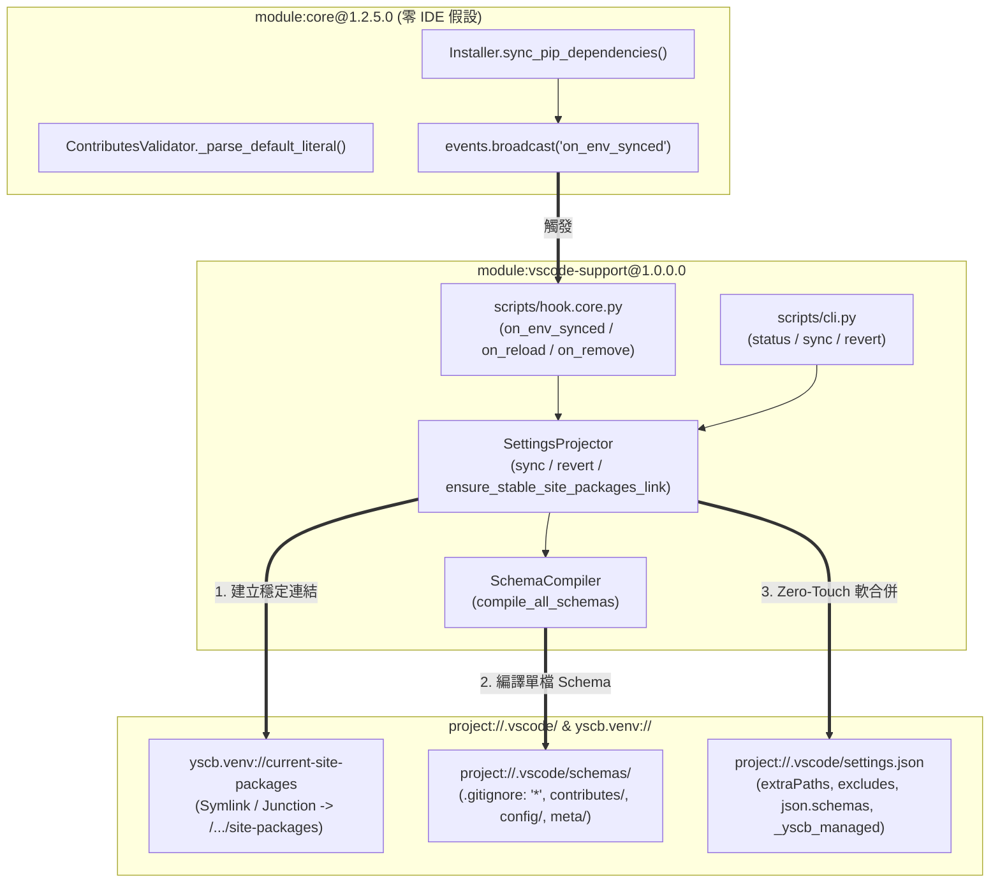

# 自動連續推進綜合規格與實作紀錄 (Consolidated Auto Plan & Task Log)

> 功能名稱：2026_11_03_1701_vscode_support_module_and_core_ide_decoupling  
> 建立日期：2026-11-03  
> 所屬主計畫：N/A (Root Plan)  
> 狀態：Completed  
> 模型：Gemini 4 Argon (Low)  

> 依據 P00：[P00_discuss.md](./P00_discuss.md)  
> 模板版本：v1.0  

---

## 1. 需求規格與邊界契約 (P01)

*(已人工定案並經兩輪盲審通過於 [`P01_requirements_spec.md`](./P01_requirements_spec.md)，涵蓋 `FR-01` ~ `FR-06`、`EC-01` ~ `EC-06`、`NFR-01` ~ `NFR-02` 與 `[P01:DR-01]` ~ `[P01:DR-05]`。)*

---

## 2. 架構設計與異動檔案清單 (P02)

### 2.1 模組架構與核心資料流 (Architecture & Data Flow)



### 2.2 受影響與新建檔案清單 (Impacted & New Files Inventory)

| 檔案路徑 | 類型 | 職責與變更說明 |
| :--- | :---: | :--- |
| `ys_codebase/source/core/core/ide_projector.py` | Delete | 物理移除 `core` 內之 VS Code 投影器，遷移至 `module:vscode-support` (`FR-01`) |
| `ys_codebase/source/core/tests/test_ide_projector_cross_platform.py` | Delete | 物理移除 `core` 內之 VS Code 投影器測試，遷移並擴充至 `vscode-support/tests/test_vscode_support.py` (`FR-01`) |
| `ys_codebase/source/core/core/__init__.py` | Modify | 移除 `ide_projector` 之匯入、`_LAZY_ATTRS` 與 `__all__` 項目 (`FR-01`) |
| `ys_codebase/source/core/core/installer.py` | Modify | `sync_pip_dependencies()` 移除 `IdeProjector` 呼叫，改為廣播 `on_env_synced` 事件 (`FR-01`) |
| `ys_codebase/source/core/core/validator.py` | Modify | `_parse_default_literal()` 支援帶正負號整數與浮點數解析 (`FR-02`, `[TODO-18]`)；`parse_type_signature()` 支援 `uri`/`path` 一等公民型別與 `@desc(...)` / `@<attr>(...)` 平衡括號正交屬性解析 (`FR-05`) |
| `ys_codebase/source/core/core/engine.py` | Modify | `_deploy_and_strip_single_module_config()` 略過 `_*.json` 模板部署，並保留 `module://<mod>/configurable/_format.json` 供組態 Schema 編譯 (`FR-05`) |
| `ys_codebase/source/dev/dev/checker.py` | Modify | 允許 `configurable/` 目錄下放置同構組態契約 `_format.json` (`FR-05`) |
| `ys_codebase/source/*/contributes/_format.json` | Modify | 全倉 8 模組擴充點契約升級 `uri`/`path` 型別並補齊 `@desc(...)` 欄位說明 (`FR-05`) |
| `ys_codebase/source/{core,agents-workflow,knowledge-db,server}/configurable/_format.json` | New | 建立 4 個可組態模組之同構組態 Schema 定義檔（含 `uri`/`path`、`enum` 與 `@desc(...)`） (`FR-05`) |
| `ys_codebase/source/core/contributes/core.json` | Modify | `events` 清冊新增 `on_env_synced` 事件說明 (`FR-01`) |
| `ys_codebase/source/core/manifest.json` | Modify | 版號遞增至 `1.2.5.0` (`[P01:DR-01]`) |
| `ys_codebase/source/core/tests/test_venv_core.py` | Modify | 移除 `IdeProjector` 匯入，`test_ft_08` 改為驗證 `on_env_synced` 事件廣播 (`FR-01`) |
| `ys_codebase/source/core/tests/test_validator.py` | Modify | 新增 `_parse_default_literal` 負整數、浮點數與多點字串邊界測試 (`FR-02`) |
| `ys_codebase/source/vscode-support/manifest.json` | New | 宣告 `vscode-support@1.0.0.0`，依賴 `core >= 1.2.5`，`pip_dependencies: {}` (`FR-03`) |
| `ys_codebase/source/vscode-support/README.md` | New | 模組隨包說明文件 (`FR-03`) |
| `ys_codebase/source/vscode-support/contributes/_format.json` | New | 定義 `json_schemas` 擴充點 Schema (`FR-05`) |
| `ys_codebase/source/vscode-support/contributes/_manifest.md` | New | 擴充點規格文檔 (`FR-05`) |
| `ys_codebase/source/vscode-support/contributes/core.json` | New | 註冊 `vscode-support <status\|sync\|revert>` CLI 指令 (`FR-06`) |
| `ys_codebase/source/vscode-support/contributes/vscode-support.json` | New | 自注入 `format-meta` 與 `manifest` 兩個元 Schema 規則 (`FR-05`) |
| `ys_codebase/source/vscode-support/contributes/agents-workflow.json` | New | 注入 `/how-to-yscb` 與 `/how-to-config-yscb` 模組說明卡資產 (`FR-06`) |
| `ys_codebase/source/vscode-support/assets/usage_guide.md` | New | 提供 `/how-to-yscb` 速查指南 (`FR-06`) |
| `ys_codebase/source/vscode-support/assets/config_guide.md` | New | 提供 `/how-to-config-yscb` 組態診斷指南 (`FR-06`) |
| `ys_codebase/source/vscode-support/vscode_support/__init__.py` | New | 套件入口，宣告 `__version__ = "1.0.0.0"` 與 PEP 562 延遲載入 (`FR-03`) |
| `ys_codebase/source/vscode-support/vscode_support/schema_compiler.py` | New | `SchemaCompiler`：編譯擴充點 Schema、組態 Schema 與元 Schema 至 `.vscode/schemas/` (`FR-05`) |
| `ys_codebase/source/vscode-support/vscode_support/projector.py` | New | `SettingsProjector`：管理 `current-site-packages` 穩定連結、自動建立 `.vscode/`、軟合併 `settings.json` 與完整 `revert` (`FR-03`, `FR-04`, `FR-06`) |
| `ys_codebase/source/vscode-support/scripts/cli.py` | New | 實作 `status`、`sync`、`revert` CLI 命令處理器 (`FR-06`) |
| `ys_codebase/source/vscode-support/scripts/hook.core.py` | New | 實作 `on_env_synced`、`on_reload` 與 `on_remove` 生命週期鉤子 (`FR-06`) |
| `ys_codebase/source/vscode-support/scripts/hook.dev.py` | New | 沙盒測試生命週期鉤子 (`FR-03`) |
| `ys_codebase/source/vscode-support/tests/test_vscode_support.py` | New | 完整覆蓋 `FT-01`~`FT-06`、`ET-01`~`ET-06` 之單元與邊界測試 (`FR-03`~`FR-06`) |
| `docs/core/README.md` | Modify | 移除 `IdeProjector` 說明並補充 `on_env_synced` 事件契約 |
| `docs/vscode-support/README.md` | New | `module:vscode-support` 模組總覽與 CLI 快速上手手冊 |
| `docs/vscode-support/DESIGN_NOTES.md` | New | 記錄 `DN-01`~`DN-03` 設計決策與邊界防呆 |

### 2.3 架構決策記錄 (Architecture Decision Records)

- **[P02:DR-01] 單一 `.vscode/schemas/` 自我忽略目錄與 `_yscb_managed["jsonSchemas"]` 差集追蹤**：
  - `SchemaCompiler` 將生成的 Schema 寫入 `project://.vscode/schemas/{contributes,config,meta}/`，並於 `project://.vscode/schemas/.gitignore` 寫入 `*\n`。
  - `SettingsProjector` 將生成的 `[{"fileMatch": [...], "url": "./.vscode/schemas/..."}]` 合併入 `.vscode/settings.json` 的 `"json.schemas"`，同時於 `_yscb_managed["jsonSchemas"]` 記錄受託管的 `url` 列表；下次同步或還原時，僅替換/移除 `url` 位於舊 `_yscb_managed["jsonSchemas"]` 內的條目，100% 保留使用者自訂之 `json.schemas`。
- **[P02:DR-02] 跨平台 `current-site-packages` 安全連結與移除**：
  - 建立連結前先確保目標 `site-packages` 實體目錄存在（`os.makedirs(target_dir, exist_ok=True)`）；若 `current-site-packages` 已存在，使用 `_safe_remove_link(link_path)`（對 symlink/junction 使用 `os.unlink` 或 `os.rmdir`，絕不使用 `shutil.rmtree` 誤刪實體套件）後重建；POSIX 使用 `os.symlink(target_dir, link_path)`，Windows 先嘗試 `os.symlink(target_dir, link_path, target_is_directory=True)`，失敗則執行 `subprocess.run(["cmd", "/c", "mklink", "/J", link_path, target_dir])`；若仍失敗則自動退回注入跨平台雙路徑列表。

---

## 3. 介面契約與 API 簽名 (P03)

### 3.1 介面契約與核心簽名 (Interface Inventory & Method Signatures)

```python
# ys_codebase/source/core/core/validator.py
class ContributesValidator:
    @staticmethod
    def _parse_default_literal(def_str: str) -> Any: ...

# ys_codebase/source/vscode-support/vscode_support/schema_compiler.py
class SchemaCompiler:
    def __init__(self, yscb_dir: Optional[str] = None) -> None: ...
    def compile_contributes_schema(self, mod_name: str, fmt_data: Dict[str, Any]) -> Dict[str, Any]: ...
    def compile_config_schema(self, mod_name: str, template_data: Dict[str, Any]) -> Dict[str, Any]: ...
    def build_format_meta_schema(self) -> Dict[str, Any]: ...
    def build_manifest_meta_schema(self) -> Dict[str, Any]: ...
    def sync_all_schemas(self, proj_root: str) -> List[Dict[str, Any]]: ...

# ys_codebase/source/vscode-support/vscode_support/projector.py
class SettingsProjector:
    YSCB_MANAGED_KEY: str = "_yscb_managed"
    ANALYSIS_EXCLUDE_PATTERNS: List[str]
    EXCLUDE_KEYS: Dict[str, str]

    def __init__(self, yscb_dir: Optional[str] = None) -> None: ...
    def ensure_stable_site_packages_link(self, py_tag: Optional[str] = None) -> Optional[str]: ...
    def remove_stable_site_packages_link(self) -> bool: ...
    def sync_vscode_settings(
        self,
        proj_root: str,
        extra_paths: Optional[List[str]] = None,
        py_tag: Optional[str] = None,
        compile_schemas: bool = True,
    ) -> bool: ...
    def revert_vscode_settings(self, proj_root: str) -> bool: ...
    def get_status(self, proj_root: str) -> Dict[str, Any]: ...

# ys_codebase/source/vscode-support/scripts/cli.py
def status(bags: CmdBags) -> int: ...
def sync(bags: CmdBags) -> int: ...
def revert(bags: CmdBags) -> int: ...

# ys_codebase/source/vscode-support/scripts/hook.core.py
def on_env_synced(ctx: Any = None) -> bool: ...
def on_reload(ctx: Any = None) -> bool: ...
def on_remove(ctx: Any = None) -> bool: ...
```

- **錯誤與例外契約 (Error & Exception Contracts)**：
  - `SettingsProjector.sync_vscode_settings`：遇非標準 JSON（JSONC 註解或語法錯誤）時向 `stderr` 輸出 `[vscode-support] Warning` 並回傳 `False`，不拋出未捕獲例外阻斷安裝流程 (`EC-01`)。
  - `SettingsProjector.ensure_stable_site_packages_link`：遇檔案系統不支援 Symlink/Junction 時捕獲 `OSError` / `SubprocessError` 並回傳 `None`，由呼叫端自動 Fallback 為實際跨平台路徑 (`EC-02`)。
- **階段決策紀錄**：`[P03:DR-01]` 為保持對既有測試案例與邊界參數之完整相容性，`SettingsProjector` 保留 `extra_paths` 與 `py_tag` 選填參數，並新增 `compile_schemas: bool = True` 參數。

---

## 4. 定稿審查與文檔衝擊規劃 (P04)

### 4.1 交叉驗證與靈魂拷問 (Cross-Validation & Resilience Review)

- [x] **需求對齊**：`FR-01` ~ `FR-06` 皆已於介面簽名與實作清單中完整對齊
- [x] **邊界防護**：`EC-01` ~ `EC-06` 皆有具體錯誤攔截與降級策略
- [x] **依賴純淨**：100% 符合 `NFR-01` ~ `NFR-02` 指標約束（0 第三方依賴、0 `module.source://` 探測）
- **靈魂拷問與防護解法**：
  1. *問：當某個已安裝模組被 `yscb remove <mod>` 移除時，`.vscode/schemas/` 下該模組的舊 `.schema.json` 是否會殘留？*
     *答*：`SchemaCompiler.sync_all_schemas()` 每次執行時會記錄本次有效生成的 `.schema.json` 集合，並巡檢 `.vscode/schemas/{contributes,config,meta}/` 自動刪除不在集合內的孤兒 `.schema.json` (`EC-05`)。
  2. *問：在 Windows 或 Linux 容器中，若移除 `current-site-packages` 時誤用 `shutil.rmtree` 會發生什麼事？*
     *答*：針對 Directory Junction 或 Symlink 若使用不當刪除可能波及目標目錄；因此實作專用 `_safe_remove_link(path)` 僅呼叫 `os.unlink(path)` / `os.rmdir(path)`。

### 4.2 知識庫文檔衝擊與交付規劃 (Documentation Impact Plan)

| 維度 | 文件路徑 | 變更類型 | 交付內容與重點 |
| :--- | :--- | :---: | :--- |
| **模組手冊** | `docs/core/README.md` | Modify | 移除 `IdeProjector` 耦合描述，更新 `on_env_synced` 事件說明 |
| **模組手冊** | `docs/vscode-support/README.md` | New | `module:vscode-support` 架構、CLI 指令與自動 Schema 綁定說明 |
| **設計決策** | `docs/vscode-support/DESIGN_NOTES.md` | New | 登記 `DN-01`（零 IDE 假設與 `on_env_synced`）、`DN-02`（`current-site-packages` 穩定連結）、`DN-03`（Zero-Probing 運行態 Schema 編譯） |
| **微觀註解** | 源碼檔案 Docstrings | Modify | 同步更新關鍵介面契約與模組 Docstring |
| **發布日誌** | `CHANGELOG.md` | Modify | 於 Phase 7 結案時記錄本計畫變更摘要 |

- **決策定稿**：**[P04:DR-01]** 確認通過動刀前規格定稿審查，準備執行 `Pre-Code Analyze Gate` 與實作。

---

## 5. 實作任務清單與偏差紀錄 (P05)

### 5.1 實作任務清單 (Task Breakdown)

- [x] **TASK-01**：實作 `core` 解耦與 `[TODO-18]` 修復（刪除 `ide_projector.py` 與對應舊測試、更新 `core/__init__.py`、`core/installer.py` 廣播 `on_env_synced`、`core/contributes/core.json` 登錄事件、`core/validator.py` 支援負數與浮點數預設值、`core/manifest.json` 升至 `1.2.5.0`，並更新 `test_venv_core.py` 與 `test_validator.py`）
- [x] **TASK-02**：建立 `ys_codebase/source/vscode-support/` 模組骨架與擴充點資產（`manifest.json`、`README.md`、`contributes/{_format,_manifest,core,vscode-support,agents-workflow}.json`、`assets/{usage_guide,config_guide}.md`、`vscode_support/__init__.py`）
- [x] **TASK-03**：實作 `SchemaCompiler` (`vscode_support/schema_compiler.py`) 與 `SettingsProjector` (`vscode_support/projector.py`)，以及 `scripts/{cli,hook.core,hook.dev}.py`
- [x] **TASK-04**：撰寫 `ys_codebase/source/vscode-support/tests/test_vscode_support.py`，執行 `dev check`、`dev test` 驗證並安裝 `core@build` 與 `vscode-support@build` 熱部署
- [x] **TASK-DOC**：同步更新 `docs/core/README.md` 與新建 `docs/vscode-support/{README,DESIGN_NOTES}.md`

### 5.2 實作偏差紀錄表 (Implementation Deviations)

| 任務編號 | 偏差等級 | 偏離描述與決策理由 | 處置方式 / 記錄 |
| :--- | :---: | :--- | :--- |
| **TASK-03** | Minor | 於 `P06` UX 實機驗收期間，依開發者指示強化三項正交能力：(1) `SettingsProjector` 恆定寫入 `./ys_codebase/.venv/current-site-packages` 並保留宿主机已建之有效連結；(2) `ContributesValidator` 支援 `uri`/`path` 型別與 `@desc(...)` / `@<attr>(...)` 平衡括號正交屬性，並由 `SchemaCompiler` 注入全系統語意 URI `defaultSnippets`；(3) 將可組態模組之 `configurable/` 納入同構 `_format.json` 正規化（更新 `core/engine.py` 與 `dev/checker.py` 保留 `module://<mod>/configurable/_format.json`）。 | 已更新 `P01`/`P02-05`/`P06` 與三層文檔，並全量通過測試 |

