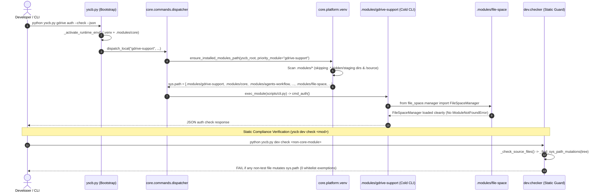

# 架構設計說明書 (Architecture Design)

> 功能名稱：sub_01_core_all_modules_sys_path  
> 建立日期：2026-11-04  
> 所屬主計畫：2026_11_04_1739_sys_path_and_five_semantic_spaces  
> 狀態：Completed  
> 模型：Unknown  

> 模板版本：v1.2  

---

## 1. 模組架構分層與職責邊界 (Layered Architecture)

```text
+-----------------------------------------------------------------------------------+
| Layer 0: Host Bootstrap (yscb.py)                                                 |
|   - Pre-import bootstrap only: mounts .venv site-packages + .modules/core         |
+-----------------------------------------+-----------------------------------------+
                                          |
                                          v
+-----------------------------------------------------------------------------------+
| Layer 1: Core Runtime Path Authority (core.platform.venv / core.platform)         |
|   - list_installed_module_roots(yscb_root, priority_module)                       |
|   - ensure_installed_modules_path(yscb_root, priority_module,                     |
|                                   include_host_roots, extra_paths)                |
|   - build_runtime_pythonpath(yscb_root, priority_module,                          |
|                              include_host_roots, existing_pythonpath)             |
|   - init_subprocess_sys_path(parent_sys_path)                                     |
|   - activate_test_module_source_path(src_real, src_root, yscb_root)               |
|   - restore_sys_path(snapshot)                                                    |
+-------------------+---------------------+---------------------+-------------------+
                    |                     |                     |
      +-------------+       +-------------+       +-------------+-------------+
      v                     v                     v                           v
+---------------+   +---------------+   +-------------------+   +---------------------------+
| Core Gateways |   | Server Engine |   | AST / Custom Load |   | Dev Checker & Test Runner |
| - dispatcher  |   | - master.py   |   | - bundler.py      |   | - runner.py & case.py     |
| - events.py   |   | - worker.py   |   | - registry.py     |   |   (delegates to core)     |
| - symbols.py  |   | - service.py  |   |   (delegates to   |   | - checker.py              |
|               |   |   (delegates) |   |    core.platform) |   |   (AST rule: 0 non-core   |
|               |   |               |   |                   |   |    sys.path mutations!)   |
+-------+-------+   +-------+-------+   +---------+---------+   +-------------+-------------+
        |                   |                     |                           |
        +-------------------+---------------------+---------------------------+
                                          |
                                          v
+-----------------------------------------------------------------------------------+
| Layer 2: Ecosystem Business Modules (file-space, ast, knowledge-db,               |
|          agents-workflow, vscode-support, gdrive-support, dev, server)            |
|   - ZERO direct sys.path mutations in production code                             |
|   - Directly `from <cross_module> import ...` underboth Cold & Warm dispatch      |
+-----------------------------------------------------------------------------------+
```

---

## 2. 核心資料流與循序圖 (Data Flow & Sequence Diagram)



---

## 3. 受影響檔案與新建檔案清單 (Impacted & New Files Inventory)

| 檔案路徑 | 類型 | 職責與變更說明 |
| :--- | :---: | :--- |
| [`ys_codebase/source/core/core/platform/venv.py`](../../../../ys_codebase/source/core/core/platform/venv.py) | Modify | 新增 `list_installed_module_roots`、`ensure_installed_modules_path`、`build_runtime_pythonpath`、`init_subprocess_sys_path`、`activate_test_module_source_path`、`restore_sys_path` 六大運行時路徑管理原語 |
| [`ys_codebase/source/core/core/platform/__init__.py`](../../../../ys_codebase/source/core/core/platform/__init__.py) | Modify | 公開導出上述 6 個 `core.platform` 路徑管理函式並列入 `__all__` |
| [`ys_codebase/source/core/core/commands/dispatcher.py`](../../../../ys_codebase/source/core/core/commands/dispatcher.py) | Modify | `dispatch_local` 改為調用 `ensure_installed_modules_path(yscb_abs, priority_module=module_name)` |
| [`ys_codebase/source/core/core/events.py`](../../../../ys_codebase/source/core/core/events.py) | Modify | `broadcast` 改為調用 `ensure_installed_modules_path(priority_module=mod_name, extra_paths=[hook_root])`，且當 `search_roots is not None` 時於 `finally` 調用 `restore_sys_path` 防止沙盒路徑殘留 |
| [`ys_codebase/source/core/core/symbols.py`](../../../../ys_codebase/source/core/core/symbols.py) | Modify | `resolve_callable` 軌道 1 前調用 `ensure_installed_modules_path(priority_module=module_name)`；軌道 2 僅在 `YSCB_TEST_SANDBOX=="1"` 時才允許回退 `module.source://`，並透過 `ensure_installed_modules_path(extra_paths=[target_dir])` 掛載 |
| [`ys_codebase/source/core/tests/test_config.py`](../../../../ys_codebase/source/core/tests/test_config.py) | Modify | 移除 L8 冗餘之 `sys.path.insert(0, "..")` |
| [`ys_codebase/source/core/tests/test_platform.py`](../../../../ys_codebase/source/core/tests/test_platform.py) | Modify | 新增針對 `list_installed_module_roots`、`ensure_installed_modules_path`、`build_runtime_pythonpath`、`init_subprocess_sys_path`、`activate_test_module_source_path`、`restore_sys_path` 之完整單元與邊界測試 |
| [`ys_codebase/source/server/server/master.py`](../../../../ys_codebase/source/server/server/master.py) | Modify | `MasterSupervisor._spawn_worker_locked` 統一調用 `build_runtime_pythonpath(self.yscb_root, include_host_roots=True)`（保留 `spawn_detached_master` 既有 8 參數 `cmd` 前置引導契約） |
| [`ys_codebase/source/server/server/worker.py`](../../../../ys_codebase/source/server/server/worker.py) | Modify | `WarmWorker.pre_warm` 改為調用 `ensure_installed_modules_path(self.yscb_root, include_host_roots=True)` |
| [`ys_codebase/source/server/server/service.py`](../../../../ys_codebase/source/server/server/service.py) | Modify | `ServiceManager._load_service_item` 改為調用 `ensure_installed_modules_path(yscb_root=yscb_root, priority_module=provider)` |
| [`ys_codebase/source/agents-workflow/agents_workflow/compiler.py`](../../../../ys_codebase/source/agents-workflow/agents_workflow/compiler.py) | Modify | 移除 L15-L34 手動 `sys.path` 補丁與 `source/core` 越界探測 |
| [`ys_codebase/source/agents-workflow/agents_workflow/publisher.py`](../../../../ys_codebase/source/agents-workflow/agents_workflow/publisher.py) | Modify | 移除 L20-L37 手動 `sys.path` 補丁與 `source/core` 越界探測 |
| [`ys_codebase/source/agents-workflow/scripts/hook.core.py`](../../../../ys_codebase/source/agents-workflow/scripts/hook.core.py) | Modify | 移除 L8-L25 手動 `sys.path` 補丁與 `source/core` 越界探測 |
| [`ys_codebase/source/vscode-support/scripts/cli.py`](../../../../ys_codebase/source/vscode-support/scripts/cli.py) | Modify | 移除 `_ensure_module_path()` 定義與 3 處呼叫 |
| [`ys_codebase/source/vscode-support/scripts/hook.core.py`](../../../../ys_codebase/source/vscode-support/scripts/hook.core.py) | Modify | 移除 `_ensure_module_path()` 定義與 2 處呼叫 |
| [`ys_codebase/source/vscode-support/vscode_support/projector.py`](../../../../ys_codebase/source/vscode-support/vscode_support/projector.py) | Modify | `_compute_managed_extra_paths` 串接 `core.platform.list_module_search_roots(self.yscb_dir, prefer_source=True)` 自動投影模組與源碼搜尋路徑至 `python.analysis.extraPaths`；`_apply_vscode_settings_merge` 於 `extraPaths` 含 `/.modules/` 時動態省略 `**/.modules/**` 排除規則（`TODO-22`） |
| [`ys_codebase/source/vscode-support/tests/test_vscode_support.py`](../../../../ys_codebase/source/vscode-support/tests/test_vscode_support.py) | Modify | 新增 `test_ft_07_module_and_source_extra_paths_projection_and_revert` 驗證模組/源碼路徑投影優先序、`analysisExclude` 動態調整與 100% 乾淨還原 |
| [`ys_codebase/source/file-space/scripts/cli.py`](../../../../ys_codebase/source/file-space/scripts/cli.py) | Modify | 移除 `_ensure_module_path()` 定義與 6 處呼叫 |
| [`ys_codebase/source/ast/ast_engine/__init__.py`](../../../../ys_codebase/source/ast/ast_engine/__init__.py) | Modify | 移除 `_ensure_dependency_module_paths()` 定義與呼叫 |
| [`ys_codebase/source/ast/ast_engine/bundler.py`](../../../../ys_codebase/source/ast/ast_engine/bundler.py) | Modify | `_init_bundle_worker` 改為委派呼叫 `core.platform.init_subprocess_sys_path(parent_sys_path)` |
| [`ys_codebase/source/ast/ast_engine/parsers/registry.py`](../../../../ys_codebase/source/ast/ast_engine/parsers/registry.py) | Modify | `_ensure_search_paths` 與 `_instantiate_custom_parser` 改為委派呼叫 `core.platform.ensure_installed_modules_path` |
| [`ys_codebase/source/ast/scripts/cli.py`](../../../../ys_codebase/source/ast/scripts/cli.py) | Modify | 移除 `_ensure_module_path()` 定義與 2 處呼叫 |
| [`ys_codebase/source/ast/scripts/hook.file-space.py`](../../../../ys_codebase/source/ast/scripts/hook.file-space.py) | Modify | 移除 `_ensure_module_path()` 定義與 2 處呼叫 |
| [`ys_codebase/source/knowledge-db/knowledge_db/__init__.py`](../../../../ys_codebase/source/knowledge-db/knowledge_db/__init__.py) | Modify | 移除 `_ensure_dependency_module_paths()` 定義與呼叫 |
| [`ys_codebase/source/knowledge-db/knowledge_db/io_utils.py`](../../../../ys_codebase/source/knowledge-db/knowledge_db/io_utils.py) | Modify | 移除 `_ensure_ast_path()` 定義與呼叫 |
| [`ys_codebase/source/knowledge-db/knowledge_db/providers.py`](../../../../ys_codebase/source/knowledge-db/knowledge_db/providers.py) | Modify | 移除 `_ensure_file_space_path()` 定義與呼叫 |
| [`ys_codebase/source/dev/dev/checker.py`](../../../../ys_codebase/source/dev/dev/checker.py) | Modify | 1. `_check_custom_rules` 改為委派 `ensure_installed_modules_path` 與 `finally: restore_sys_path(orig_sys_path)`；<br/>2. 於 `_check_source_files` 新增 `_find_sys_path_mutations` 靜態 AST 檢查（`name != "core" and not is_test_file` 修改 `sys.path` 即 `FAIL`） |
| [`ys_codebase/source/dev/dev/testing/runner.py`](../../../../ys_codebase/source/dev/dev/testing/runner.py) | Modify | `TestDiscovery.build_suite_for_module` 改為委派呼叫 `core.platform.activate_test_module_source_path`，並修正 `sys.modules` 預載套件快取清除映射（避免誤刪標準庫 `ast`） |
| [`ys_codebase/source/dev/dev/testing/case.py`](../../../../ys_codebase/source/dev/dev/testing/case.py) | Modify | `YSCBTestCase.tearDown` 改為委派呼叫 `core.platform.restore_sys_path(self._orig_sys_path)` |
| [`ys_codebase/source/dev/tests/test_checker.py`](../../../../ys_codebase/source/dev/tests/test_checker.py) | Modify | 新增針對非 `core` 模組 `sys.path` 變動攔截（含 `insert`/`append`、別名、切片賦值、`del`、唯讀放行、`core` 放行、測試檔放行）之單元測試 |

---

## 4. 架構決策記錄 (Architecture Decision Records)

- **[P02:DR-01] 將路徑管理原語定錨於 `core.platform.venv` 並由 `core.platform` 頂層匯出**：
  - `core/platform/venv.py` 原先已負責管理運行時 `.venv` 路徑探索與 `activate_venv()`（這也是少數合法操作 `sys.path` 的核心基礎設施檔案），且僅依賴 Python 標準庫 (`os`, `sys`) 與按需延遲載入 `core.uri`，不會在 `core` 內部引發任何循環匯入。
- **[P02:DR-02] 零白名單豁免的 `dev check` 靜態 AST 守門**：
  - 若在 `dev/checker.py` 為 `server`、`ast`、`dev` 開設模組白名單，未來這些模組內部仍可能被塞入臨時 `sys.path.insert` 補丁。透過將子進程快照 (`init_subprocess_sys_path`)、額外搜尋路徑掛載 (`ensure_installed_modules_path(..., extra_paths=...)`) 與測試沙盒源碼切換 (`activate_test_module_source_path` / `restore_sys_path`) 收斂為 `core.platform` 標準函式，`dev/checker.py` 即可實施 `name != "core" and not is_test_file` 的零豁免剛性規則。

