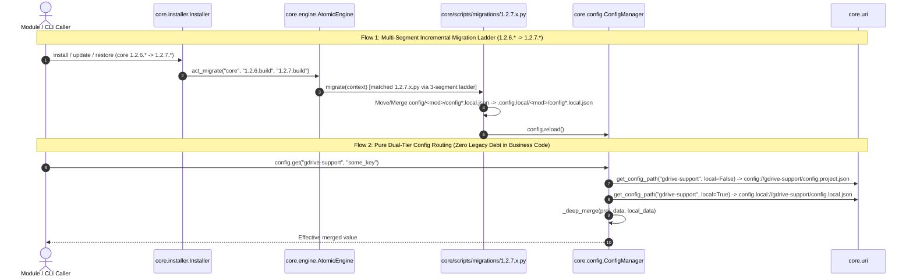

# 架構設計說明書 (Architecture Design)

> 功能名稱：sub_02_five_semantic_spaces_architecture  
> 建立日期：2026-11-04  
> 所屬主計畫：2026_11_04_1739_sys_path_and_five_semantic_spaces  
> 狀態：Confirmed  
> 模型：Unknown  

> 模板版本：v1.2  

---

## 1. 模組架構分層與職責邊界 (Layered Architecture)

| 語意 URI 協議 | 物理映射路徑 (`yscb://` 基準) | 語意職責 | Git 政策 | 磁碟持久性 (`tmpfs` 策略) | 納入 `snapshot://` | `remove --purge` 清理 |
| :--- | :--- | :--- | :---: | :---: | :---: | :---: |
| **`config://`** | `yscb://config/<mod>/` | 團隊共享模組組態 (`config.project.json`, `contribute.json`) | **Git Tracked** | 實體磁碟持久 | **是** | **是** |
| **`config.local://`** | `yscb://.config.local/<mod>/` | 本機私有覆寫組態 (`config.local.json`) 與機密憑證 (`credentials.json`, `token.json`) | **Git Ignored** | 實體磁碟持久（嚴禁 `tmpfs`） | **是** | **是** |
| **`storage://`** | `yscb://storage/<mod>/` | 團隊共享跨模組持久化資料資產 | **Git Tracked** | 實體磁碟持久 | **是** | **是** |
| **`storage.local://`** | `yscb://.storage.local/<mod>/` | 本機持久化狀態帳本 (`sync_state.json`, `release_manifest.json`)、本地模型權重 (`models/`) 與索引庫 | **Git Ignored** | 實體磁碟持久（嚴禁 `tmpfs`） | **否**（防百 MB 膨脹） | **是** |
| **`cache://`** | `yscb://.cache/<mod>/` | 純揮發性運行時快取 (`contributes.merged.json`)、跨進程鎖檔、日誌與測試沙盒 | **Git Ignored** | 揮發性（可安全掛載 `tmpfs`） | **否** | **總是清理** |

---

## 2. 核心資料流與循序圖 (Data Flow & Sequence Diagram)

---

## 3. 受影響檔案與新建檔案清單 (Impacted & New Files Inventory)

| 檔案路徑 | 類型 | 職責與變更說明 |
| :--- | :---: | :--- |
| [`ys_codebase/source/core/core/uri.py`](../../../../ys_codebase/source/core/core/uri.py) | Modify | 於 `_BOOTSTRAP_FALLBACK_SCHEMES` 新增 `config.local` (`yscb://.config.local/`) 與 `storage.local` (`yscb://.storage.local/`) |
| [`ys_codebase/source/core/contributes/core.json`](../../../../ys_codebase/source/core/contributes/core.json) | Modify | 於 `uri_schemes` 註冊 `config.local` 與 `storage.local`；於 `gitignore` 預設清單新增 `yscb://.config.local/` 與 `yscb://.storage.local/` |
| [`ys_codebase/source/core/core/gitignore.py`](../../../../ys_codebase/source/core/core/gitignore.py) | Modify | `LEGACY_UNANCHORED_LINES` 新增 `/.config.local/` 與 `/.storage.local/`；`normalize_pattern` 支援 `config.local://`、`storage.local://`、`config://`、`storage://`、`cache://` 直接映射至 `eff_yscb` |
| [`ys_codebase/source/core/core/installer.py`](../../../../ys_codebase/source/core/core/installer.py) | Modify | `INTERNAL_IGNORE_PATTERNS` 新增 `/.config.local/` 與 `/.storage.local/`；`cmd_restore` 升級既有模組時同步觸發 `act_migrate` |
| [`ys_codebase/source/core/core/config.py`](../../../../ys_codebase/source/core/core/config.py) | Modify | `get_config_path(..., local=True)` 純淨指向 `config.local://{module}/config.local.json`；`list_modules` 聯集掃描 `config://` 與 `config.local://` |
| `ys_codebase/source/core/scripts/migrations/1.2.7.x.py` | New | 註冊 `core` `1.2.7.x` 遷移腳本：掃描全模組 `config://<mod>/config*.local.json` 並無損遷入 `config.local://<mod>/config*.local.json` |
| [`ys_codebase/source/core/core/engine.py`](../../../../ys_codebase/source/core/core/engine.py) | Modify | `_resolve_target_cfg_uris`、`_infill_single_template`、`_deploy_and_strip_single_module_config` 將 `*.local.json` 部署至 `config.local://<mod>/`；`act_snapshot` / `act_restore_snapshot` 納入 `config.local://` 並排除 `storage.local://`；`act_delete(purge=True)` 清理四大持久空間；升級 `act_migrate` 支援 2/3/4 段版號遷移腳本並擴充 `context` |
| [`ys_codebase/source/core/core/commands/dispatcher.py`](../../../../ys_codebase/source/core/core/commands/dispatcher.py) | Modify | `_read_server_spawn_config` 純淨讀取 `config/server/config.project.json` 與 `.config.local/server/config.local.json` |
| [`ys_codebase/source/vscode-support/vscode_support/schema_compiler.py`](../../../../ys_codebase/source/vscode-support/vscode_support/schema_compiler.py) | Modify | `_collect_uri_scheme_snippets` 新增 `config.local` 與 `storage.local`；`sync_all_schemas` 之 `fileMatch` 新增 `**/.config.local/{mod}/config.*.json` |
| [`ys_codebase/source/vscode-support/vscode_support/projector.py`](../../../../ys_codebase/source/vscode-support/vscode_support/projector.py) | Modify | `ANALYSIS_EXCLUDE_PATTERNS` 新增 `**/.config.local/**` 與 `**/.storage.local/**` |
| [`ys_codebase/source/dev/dev/testing/sandbox.py`](../../../../ys_codebase/source/dev/dev/testing/sandbox.py) | Modify | `SandboxContext.set_module_config` 對 `*.local.json` 自動寫入 `.config.local/<mod>/` |
| [`ys_codebase/source/core/tests/test_uri.py`](../../../../ys_codebase/source/core/tests/test_uri.py) | Modify | 新增 `config.local://` 與 `storage.local://` 解析、`@/` 自省、`to_uri` 反向轉換與路徑穿越防禦測試 |
| [`ys_codebase/source/core/tests/test_config.py`](../../../../ys_codebase/source/core/tests/test_config.py) | Modify | 更新 `tearDown` 清理 `config.local://`，並驗證雙軌純淨讀寫與 `list_modules` |
| [`ys_codebase/source/core/tests/test_engine.py`](../../../../ys_codebase/source/core/tests/test_engine.py) | Modify | 對齊 `config.local://` 模板部署斷言，新增 `act_snapshot`（含 `config.local://`、排除 `storage.local://`）、`act_delete(purge=True)` 四空間清除與 `act_migrate` 多段式 `1.2.7.x.py` 遷移測試 |
| [`ys_codebase/source/core/tests/test_locale.py`](../../../../ys_codebase/source/core/tests/test_locale.py) | Modify | 對齊 `config.local://core/config.local.json` 初始語系種子路徑斷言 |
| [`ys_codebase/source/core/tests/test_core_commands.py`](../../../../ys_codebase/source/core/tests/test_core_commands.py) | Modify | 對齊 `_read_server_spawn_config` 測試中之 `.config.local/server/config.local.json` 路徑 |
| [`ys_codebase/source/vscode-support/tests/test_vscode_support.py`](../../../../ys_codebase/source/vscode-support/tests/test_vscode_support.py) | Modify | 驗證 `config.local://` / `storage.local://` snippets 與 `**/.config.local/<mod>/config.*.json` `fileMatch` 綁定 |

---

## 4. 架構決策記錄 (Architecture Decision Records)

| 決策編號 | 決策內容摘要 | 採納理由 |
| :--- | :--- | :--- |
| **DR-01** | 零執行期歷史版本遷移債（升級 `AtomicEngine.act_migrate` 支援 2/3/4 段版號遷移腳本，將 `config.local.json` 搬移收斂於 `core/scripts/migrations/1.2.7.x.py`） | 保持 `core.config`、`core.engine` 與 `dispatcher` 100% 純淨新路徑解算，杜絕為一次性格式演進在微內核熱路徑殘留永久相容債 |
| **DR-02** | `act_snapshot` 納入 `config.local://` 但明確排除 `storage.local://` 與 `cache://` | 保護使用者本機覆寫設定與憑證，同時避免數十至數百 MB 的本地模型與語意索引拖慢每次模組安裝/升級之原子快照與回滾 |

