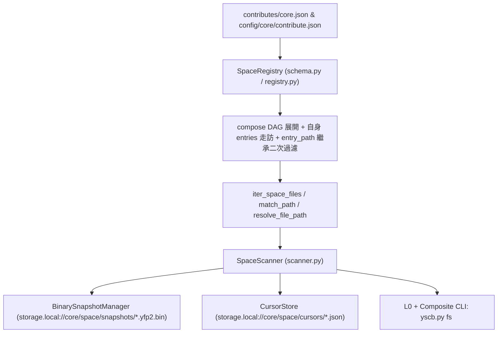

# 自動連續推進綜合規格與實作紀錄 (Consolidated Auto Plan & Task Log)

> 功能名稱：sub_02_composite_capabilities  
> 建立日期：2026-11-07  
> 所屬主計畫：2026_11_06_1020_core_file_space_architecture  
> 狀態：Completed  
> 模型：Gemini 4 Argon (Low)  

> 依據 P00：[P00_discuss.md](./P00_discuss.md)  
> 模板版本：v1.0  

---

## 1. 需求規格與邊界契約 (P01)

### 1.1 功能需求清單 (Functional Requirements)

| 需求編號 | 需求名稱 | 詳細規格與驗收條件 (Acceptance Criteria) | 優先級 | 對應 P00 語意 |
| :--- | :--- | :--- | :---: | :--- |
| **FR-01** | `SpaceDef` 選填 `entries` 與 `compose` Schema 擴充及聯合校驗 | 於 `ys_codebase/source/core/contributes/_format.json` 將 `SpaceDef.entries` 改為選填 `"list[uri]? \| extend"`（預設 `[]`），並新增 `"compose": "list[str]? \| extend"`；於 `SpaceConfig` 支援 `compose: Tuple[str, ...]` 與 `unresolved_compose: Tuple[str, ...]`，並強制校驗 `bool(entries) or bool(compose)` 至少一者非空（否則拋出 `SpaceError`）。 | P0 | [P00:DR-02] |
| **FR-02** | `compose` 空間組合代數、DAG 循環檢測與 `entry_path` 繼承之二次過濾 | `SpaceRegistry` 解析空間時支援 `compose` 引用 `<owner>/<space>` 或短名聯集 `<space>`；偵測到引用環路立即拋出 `SpaceCycleError`（繼承自 `SpaceError`）；列舉與匹配時先取子空間篩選後之結果集聯集 $U_{\text{compose}}$ 與自身 `entries` 候選集 $U_{\text{own}}$（同 `rel_path` 衝突時 `U_own` 優先並合併 `matched_spaces`），保留各候選之 `candidate.entry_path` 傳入父空間 `CompiledRuleSet` 執行二次過濾（`exclude` 全體剔除；顯式非 `["*"]` 之 `include` 全體白名單交集），且 `match_path` 支援 `compose` 溯源。 | P0 | [P00:DR-02] |
| **FR-03** | 導航與執行期動態空間 API (`resolve_file_path` & `define_ephemeral_space`) | 於 `SpaceRegistry` 及 `core.space` 門面提供：① `resolve_file_path(rel_path, space_query=None)` 將空間內標準相對路徑反解為磁碟 `Path`（驗證檔案存在、符號連結邊界且通過空間規則匹配，否則回傳 `None`）；② `define_ephemeral_space(name, config)` 於記憶體動態掛載臨時空間（預設歸屬 `ephemeral/<name>`，若傳入 `<owner>/<name>` 則按指定 owner 掛載），並標記 `is_ephemeral=True`。 | P0 | [P00:DR-01] |
| **FR-04** | `YFP2` 單調世代二進位快照與雙階段增量掃描 (`BinarySnapshotManager` & `SpaceScanner`) | 於 `core.space.scanner` 實作 `BinarySnapshotManager`（Magic `b"YFP2"` 二進位格式，透過 `core.vfs` 原子寫入至 `storage.local://core/space/snapshots/<target_key>.yfp2.bin`）與 `SpaceScanner`：支援 Stage 1 `(mtime_ns, size)` + `10ms` Racy-Clean 防護與 Stage 2 委派 `core.space.hasher`（統一 `BLAKE2B_DIGEST_SIZE = 16` / 32-char hex）計算單檔 `content_hash` 與空間 `merkle_root`；提供 `scan`/`refresh`、`patch_files`、`snapshot`、`merkle_root` 與 `status`；`config_hash` 自動遞迴納入參與聯集、`compose` 展開子空間與 `presets` 指紋，變更時自動觸發全量重算並推進 `head_generation`。 | P0 | [P00:DR-01], [P00:DR-03] |
| **FR-05** | 多消費者獨立水位游標與 At-Least-Once 交易消費 (`CursorStore` & `consume_diff`) | 於 `storage.local://core/space/cursors/<consumer_id>.json`（搭配 `RLock` 與 `cache://core/space/` 下之 `InterProcessLock`）維護消費者游標，提供 `diff`、`ack`、`reset_cursor`、`clean` 與 `consume_diff` 交易式 Context Manager（`with` 區塊正常結束自動 `ack` 推進世代，拋出例外則保留原游標）。 | P0 | [P00:DR-01], [P00:DR-03] |
| **FR-06** | 複合 CLI 子命令擴充 (`status`, `scan`, `diff`, `clean` 與 `ls --pattern`) | 於 `contributes/core.json` 與 `core/scripts/cli.py` 為 `core file-space` 與別名 `fs` 擴充 `status`、`scan`、`diff [--consumer] [--ack]`、`clean [--consumer]` 四個子命令（支援 `--space`/`-s` 與 `--json`），並確認 `ls --pattern` 對複合空間與聯集空間完整生效。 | P0 | [P00:DR-01] |

### 1.2 邊界與異常情況 (Edge Cases & Failure Modes)

| 邊界編號 | 情境說明 | 預期防禦與處理行為 |
| :--- | :--- | :--- |
| **EC-01** | `compose` 存在直接或間接循環引用（如 `A -> B -> A` 或透過短名聯集形成環路） | 拓撲展開時透過呼叫堆疊偵測環路，立即拋出 `SpaceCycleError` 並附帶完整循環鏈路徑訊息（如 `a -> b -> a`）。 |
| **EC-02** | 純 `compose` 空間省略 `entries` vs 既無 `entries` 亦無 `compose` | 僅有 `compose` 而無 `entries` 時合法通過；若 `entries` 與 `compose` 同時為空，於 `SpaceConfig` 建立時拋出 `SpaceError`。 |
| **EC-03** | `compose` 引用了未註冊之空間名稱 | 非嚴格載入期記錄於 `SpaceConfig.unresolved_compose` 供 `spaces` / `status` 診斷呈現；若直接對不存在之目標空間呼叫 `resolve_spaces(query)` 則拋出 `SpaceNotFoundError`。 |
| **EC-04** | 臨時空間 (`define_ephemeral_space`) 執行 `scan` / `snapshot` / `consume_diff` | 凡目標空間涉及 `is_ephemeral=True`，其 `SnapshotState` 與消費者游標強制僅駐留於 `SpaceScanner` 記憶體字典中，絕不寫入 `storage.local://core/space/` 磁碟。 |
| **EC-05** | 多空間聯集／組合空間下 `patch_files` 處理已從磁碟刪除之外部 `entry` 檔案 | 當髒路徑已不存在於磁碟或不再匹配空間規則時，結合 `project_root` 與所有參與空間（含 `compose` 展開子空間）之 `entry_path` 推算候選 `rel_path`（並比對既有 `prev_state.entries` 之 `rel_path` 與 `entry_path`），精準標記 `is_deleted = True` 與 `updated_gen = next_gen`。 |
| **EC-06** | `YFP2` 二進位快照檔損毀、Magic 不符或 Checksum 校驗失敗 | `BinarySnapshotManager.load_state` 捕獲格式或 Checksum 異常時自動安全回退為空 `SnapshotState(head_generation=0)`，觸發全量重掃自癒而不崩潰。 |

### 1.3 非功能需求 (Non-Functional Requirements)

| 需求編號 | 類別 | 指標與量化約束 |
| :--- | :--- | :--- |
| **NFR-01** | 依賴純淨度 | 100% Python 標準庫實作，零第三方套件依賴，零 `module:server` / `watchdog` 耦合。 |
| **NFR-02** | 雜湊與跨平台一致性 | 單檔與空間 `merkle_root` 100% 採用 16-byte (`32-hex`) Blake2b 與 POSIX `/` 正規化相對路徑；Windows 與 Linux 產出 100% 一致。 |
| **NFR-03** | 併發與原子安全性 | 快照與游標持久化 100% 經由 `core.vfs` 原子寫入，並以 `threading.RLock` + `InterProcessLock` (`cache://core/space/`) 保護跨執行緒與跨進程安全。 |

### 1.4 知識庫與踩坑紀錄查閱 (Known Gotchas & CAUTIONs)

- **`[!NOTE]` 雜湊長度對齊**：`sub_01` 之 `core.space.hasher` 已確立 `BLAKE2B_DIGEST_SIZE = 16` (32-char hex)，`YFP2` 快照與 `SpaceScanner` 必須直接呼叫 `core.space.hasher.compute_file_hash` 與 `compute_space_merkle_root`，嚴禁自行硬編碼 20-byte digest。
- **`[!NOTE]` `compose` 二次過濾之 `entry_path` 繼承**：子空間檔案匯入父組合空間時，必須攜帶其原始匹配的 `entry_path` 參與父空間三座標匹配，否則不在父空間 `entries` 下的檔案會喪失 `entry_rel` 座標。

---

## 2. 架構設計與異動檔案清單 (P02)

### 2.1 模組架構與核心資料流 (Architecture & Data Flow)



### 2.2 受影響與新建檔案清單 (Impacted & New Files Inventory)

| 檔案路徑 | 類型 | 職責與變更說明 |
| :--- | :---: | :--- |
| `ys_codebase/source/core/contributes/_format.json` | Modify | 將 `SpaceDef.entries` 改為選填 `"list[uri]? \| extend"`，新增 `"compose": "list[str]? \| extend"` |
| `ys_codebase/source/core/contributes/core.json` | Modify | 於 `commands.cmd.file-space.cmd` 與 `commands.cmd.fs.cmd` 新增 `status`, `scan`, `diff`, `clean` 子命令定義 |
| `ys_codebase/source/core/core/space/exceptions.py` | Modify | 新增 `SpaceCycleError(SpaceError)` 例外類別 |
| `ys_codebase/source/core/core/space/schema.py` | Modify | `SpaceConfig` 新增 `compose`、`unresolved_compose`、`is_ephemeral` 與 `has_explicit_include` 判斷，實作 `bool(entries) or bool(compose)` 聯合校驗 |
| `ys_codebase/source/core/core/space/registry.py` | Modify | 實作 `compose` DAG 拓撲解析與循環檢測、結果集聯集 + `entry_path` 繼承二次過濾、`match_path` 組合空間溯源、`resolve_file_path`、`define_ephemeral_space` 與 `compute_config_hash` |
| `ys_codebase/source/core/core/space/scanner.py` | New | 實作 `FileFingerprint`、`ScanDiffDetail`、`ScanDiffResult`、`SnapshotState`、`BinarySnapshotManager` (`YFP2`)、`CursorStore`、`SpaceScanner` 與模組級門面函式 |
| `ys_codebase/source/core/core/space/__init__.py` | Modify | 匯出 `SpaceCycleError`、`SpaceScanner`、`FileFingerprint`、`ScanDiffDetail`、`ScanDiffResult`、`SnapshotState`、`resolve_file_path`、`define_ephemeral_space`、`scan`、`refresh`、`patch_files`、`snapshot`、`merkle_root`、`diff`、`ack`、`reset_cursor`、`consume_diff`、`status`、`clean` |
| `ys_codebase/source/core/scripts/cli.py` | Modify | 實作 `file_space_status`/`fs_status`、`file_space_scan`/`fs_scan`、`file_space_diff`/`fs_diff`、`file_space_clean`/`fs_clean` CLI 入口 |
| `ys_codebase/source/core/tests/test_space.py` | Modify | 新增 `compose` 組合與二次過濾、DAG 環路攔截、`resolve_file_path`、`define_ephemeral_space` 記憶體隔離、`YFP2` 增量快照、`patch_files` 多空間刪除定址、`consume_diff` 交易游標與複合 CLI 測試 |
| `docs/core/README.md` | Modify | 同步更新 `core.space` 複合能力與 CLI 子命令說明 |

### 2.3 架構決策記錄 (Architecture Decision Records)

- **[P02:DR-01] `SpaceScanner` 與 `SpaceRegistry` 職責正交分離**：`SpaceRegistry` 專注於空間/預設集/組合拓撲解析、三座標匹配、零冗餘目錄走訪、`resolve_file_path` 與遞迴 `compute_config_hash`；`SpaceScanner` 聚合 `SpaceRegistry`、`BinarySnapshotManager` 與 `CursorStore`，專責 `YFP2` 快照、雙階段指紋掃描、局部修補與多消費者游標交易。
- **[P02:DR-02] `YFP2` 快照內嵌 `entry_path` 支援外部 URI 入口刪除反查**：於 `FileFingerprint` 與 `YFP2` 二進位序列化格式中保存檔案之正規化 `rel_path` 與 `entry_path`（或透過 `SpaceRegistry` 所有參與空間之 `entry_path` 集合推算候選 `rel_path`），使 `patch_files` 面對已刪除之外部入口檔案時能 O(1) 命中既有快照條目。

---

## 3. 介面契約與 API 簽名 (P03)

### 3.1 介面契約與核心簽名 (Interface Inventory & Method Signatures)

```python
# ys_codebase/source/core/core/space/exceptions.py
class SpaceCycleError(SpaceError):
    """Raised when a circular reference is detected in space `compose` definitions."""

# ys_codebase/source/core/core/space/schema.py
@dataclass
class SpaceConfig:
    qualified_name: str
    owner: str
    short_name: str
    description: str = ""
    entries: Tuple[str, ...] = ()
    compose: Tuple[str, ...] = ()
    presets: Tuple[str, ...] = ()
    include: Tuple[str, ...] = ("*",)
    exclude: Tuple[str, ...] = ()
    hash_policy: HashPolicy = HashPolicy.ADAPTIVE
    large_file_threshold_mb: int = 10
    follow_symlinks: bool = False
    is_ephemeral: bool = False
    has_explicit_include: bool = False
    effective_include: Tuple[RuleItem, ...] = ()
    effective_exclude: Tuple[RuleItem, ...] = ()
    unresolved_presets: Tuple[str, ...] = ()
    unresolved_compose: Tuple[str, ...] = ()
    uri_warnings: Tuple[str, ...] = ()

# ys_codebase/source/core/core/space/registry.py
class SpaceRegistry:
    def define_ephemeral_space(
        self, name: str, config: Union[SpaceConfig, Mapping[str, Any]]
    ) -> SpaceConfig: ...
    def resolve_file_path(
        self, rel_path: str, space_query: Optional[str] = None
    ) -> Optional[Path]: ...
    def compute_config_hash(self, space_query: Optional[str] = None) -> str: ...
    def is_ephemeral_query(self, space_query: Optional[str] = None) -> bool: ...

# ys_codebase/source/core/core/space/scanner.py
@dataclass
class FileFingerprint:
    rel_path: str
    mtime_ns: int
    ctime_ns: int
    size: int
    content_hash: str
    created_gen: int = 1
    updated_gen: int = 1
    is_deleted: bool = False
    entry_path: str = ""
    def to_dict(self) -> Dict[str, Any]: ...

@dataclass
class ScanDiffDetail:
    added: Set[str] = field(default_factory=set)
    modified: Set[str] = field(default_factory=set)
    deleted: Set[str] = field(default_factory=set)
    unchanged: Set[str] = field(default_factory=set)
    @property
    def dirty_files(self) -> Set[str]: ...
    @property
    def has_changes(self) -> bool: ...
    def to_dict(self) -> Dict[str, Any]: ...

@dataclass
class ScanDiffResult:
    added_count: int = 0
    modified_count: int = 0
    deleted_count: int = 0
    unchanged_count: int = 0
    detail: ScanDiffDetail = field(default_factory=ScanDiffDetail)
    from_generation: int = 0
    to_generation: int = 0
    merkle_root: str = ""
    space_name: Optional[str] = None
    space_generations: Dict[str, int] = field(default_factory=dict)
    def to_dict(self) -> Dict[str, Any]: ...

@dataclass
class SnapshotState:
    head_generation: int = 0
    merkle_root: str = ""
    config_hash: str = ""
    entries: Dict[str, FileFingerprint] = field(default_factory=dict)
    def active_entries(self) -> Dict[str, FileFingerprint]: ...

class BinarySnapshotManager:
    MAGIC: bytes = b"YFP2"
    VERSION: int = 2
    def save_state(self, state: SnapshotState, path: Union[str, Path]) -> Path: ...
    def load_state(self, path: Union[str, Path]) -> SnapshotState: ...

class CursorStore:
    def __init__(self, storage_root: Path, lock_dir: Optional[Path] = None) -> None: ...
    def load_consumer(self, consumer_id: str = "default") -> Dict[str, Dict[str, Any]]: ...
    def get_cursor(self, space_key: str, consumer_id: str = "default") -> Dict[str, Any]: ...
    def set_cursor(
        self, space_key: str, consumer_id: str, acked_gen: int, merkle_root: str = "", config_hash: str = ""
    ) -> None: ...
    def reset_cursor(self, space_key: Optional[str] = None, consumer_id: str = "default") -> None: ...
    def list_consumers(self) -> List[str]: ...

class SpaceScanner:
    UNIFIED_KEY: str = "__all__"
    def __init__(
        self,
        registry: Optional[SpaceRegistry] = None,
        storage_root: Optional[Union[str, Path]] = None,
        lock_dir: Optional[Union[str, Path]] = None,
    ) -> None: ...
    def scan(
        self, space_query: Optional[str] = None, *, force: bool = False
    ) -> ScanDiffResult: ...
    def refresh(
        self, space_query: Optional[str] = None, *, background: bool = False, force: bool = False
    ) -> ScanDiffResult: ...
    def patch_files(
        self, space_query: str, dirty_paths: Iterable[Union[str, Path]]
    ) -> SnapshotState: ...
    def snapshot(
        self, space_query: Optional[str] = None, *, refresh_first: bool = False
    ) -> Dict[str, FileFingerprint]: ...
    def merkle_root(
        self, space_query: Optional[str] = None, *, refresh_first: bool = False
    ) -> str: ...
    def diff(
        self, space_query: Optional[str] = None, consumer_id: str = "default", *, auto_refresh: bool = True
    ) -> ScanDiffResult: ...
    def ack(
        self,
        space_query: Optional[str] = None,
        consumer_id: str = "default",
        generation: Optional[int] = None,
        space_generations: Optional[Dict[str, int]] = None,
    ) -> int: ...
    def reset_cursor(
        self, space_query: Optional[str] = None, consumer_id: str = "default"
    ) -> None: ...
    @contextmanager
    def consume_diff(
        self, space_query: Optional[str] = None, consumer_id: str = "default", *, auto_refresh: bool = True
    ) -> Iterator[ScanDiffResult]: ...
    def status(self, space_query: Optional[str] = None) -> Dict[str, Any]: ...
    def clean(
        self, space_query: Optional[str] = None, *, consumer_id: Optional[str] = None
    ) -> Dict[str, Any]: ...
```

- **錯誤與例外契約 (Error & Exception Contracts)**：
  - `SpaceNotFoundError`：查詢未知之 `<owner>/<space>` 或 `<space>` 時拋出。
  - `SpaceCycleError`：`compose` 拓撲存在自我引用或間接循環時拋出。
  - `SpaceError`：空間定義同時缺少 `entries` 與 `compose`、或雜湊策略無效時拋出。
- **階段決策紀錄**：`[P03:DR-01]` `SpaceScanner.refresh` 與 `scan` 為同義別名（保留 `background` 關鍵字參數向後相容下游呼叫端），且門面函式同時提供 `scan`/`refresh`、`patch_files`、`snapshot`、`merkle_root`、`diff`、`ack`、`reset_cursor`、`consume_diff`、`status`、`clean`、`resolve_file_path`、`define_ephemeral_space`。

---

## 4. 定稿審查與文檔衝擊規劃 (P04)

### 4.1 交叉驗證與靈魂拷問 (Cross-Validation & Resilience Review)

- [x] **需求對齊**：FR-01 ~ FR-06 皆已於介面簽名與實作中完整對齊
- [x] **邊界防護**：EC-01 ~ EC-06 皆有具體錯誤攔截與降級策略
- [x] **依賴純淨**：100% 符合 NFR-01 ~ NFR-03 指標約束
- **靈魂拷問與防護解法**：
  - *問：當複合空間 `C` 宣告 `compose: ["A", "B"]` 且未顯式宣告 `include` 時，如何區分「使用者未宣告 `include`（預設 `["*"]`）」與「使用者顯式宣告 `include: ["*.py"]`」？*
  - *答*：於 `SpaceConfig` 紀錄 `has_explicit_include: bool`（當空間自身 `include` 含有非 `("*", "**", "**/*")` 樣式，或其引用之 `presets` 含有 `include` 樣式時為 `True`）。對 `compose` 子空間結果集執行二次過濾時，永遠執行父空間 `exclude` 檢查；若 `has_explicit_include` 為 `True`，則額外執行父空間 `include` 檢查。

### 4.2 知識庫文檔衝擊與交付規劃 (Documentation Impact Plan)

| 維度 | 文件路徑 | 變更類型 | 交付內容與重點 |
| :--- | :--- | :---: | :--- |
| **模組手冊** | `docs/core/README.md` | Modify | 增補 `core.space` 複合能力（`compose`、`YFP2` 快照、消費者游標与 `status`/`scan`/`diff`/`clean` CLI）說明 |
| **專題手冊** | `docs/core/uri_protocols.md` | N/A | 本次未新增頂層 URI Scheme |
| **設計決策** | `docs/core/DESIGN_NOTES.md` | N/A | 將於主計畫收尾或按需記錄 |
| **微觀註解** | 源碼檔案 Docstrings | Modify | 同步更新 `core/space/*.py` 與 `core/scripts/cli.py` Docstring |
| **發布日誌** | `CHANGELOG.md` | Modify | 於 Phase 7 結案時記錄 `sub_02_composite_capabilities` 變更摘要 |

- **決策定稿**：**[P04:DR-01]** 確認通過交叉驗證，鎖定規格進入實作。

---

## 5. 實作任務清單與偏差紀錄 (P05)

### 5.1 實作任務清單 (Task Breakdown)

- [x] **TASK-01**：擴充 `contributes/_format.json`、`core/space/exceptions.py`、`core/space/schema.py` 與 `core/space/registry.py`（實作 `compose` DAG 解析與循環檢測、二次過濾 `entry_path` 繼承、`resolve_file_path`、`define_ephemeral_space` 與 `compute_config_hash`）
- [x] **TASK-02**：新建 `core/space/scanner.py` 並更新 `core/space/__init__.py`、`contributes/core.json` 與 `core/scripts/cli.py`（實作 `YFP2` 二進位快照、雙階段增量掃描、`patch_files` 多空間刪除定址、`CursorStore` 交易游標與 `status`/`scan`/`diff`/`clean` CLI）
- [x] **TASK-03**：於 `ys_codebase/source/core/tests/test_space.py` 編寫完整單元測試與邊界測試（涵蓋 `FR-01`~`FR-06` 與 `EC-01`~`EC-06`），執行 `dev check core`、`dev test core` 與 `@build` 熱部署驗證
- [x] **TASK-DOC**：同步更新 `docs/core/README.md` 與微觀代碼 Docstrings

### 5.2 實作偏差紀錄表 (Implementation Deviations)

| 任務編號 | 偏差等級 | 偏離描述與決策理由 | 處置方式 / 記錄 |
| :--- | :---: | :--- | :--- |
| - | - | 無偏差 | - |
