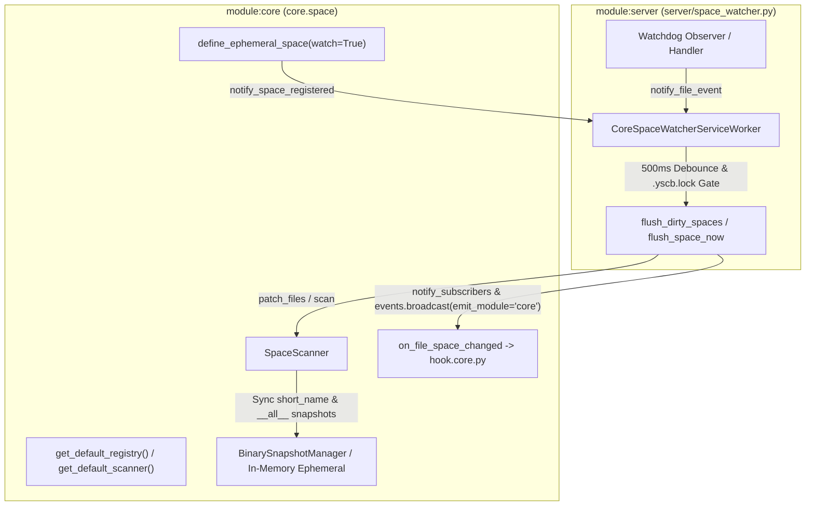

# 自動連續推進綜合規格與實作紀錄 (Consolidated Auto Plan & Task Log)

> 功能名稱：sub_03_server_hook_integration  
> 建立日期：2026-11-07  
> 所屬主計畫：2026_11_06_1020_core_file_space_architecture  
> 狀態：Completed  
> 模型：Gemini 4 Argon (Low)  

> 依據 P00：[P00_discuss.md](./P00_discuss.md)  
> 模板版本：v1.0  

---

## 1. 需求規格與邊界契約 (P01)

### 1.1 功能需求清單 (Functional Requirements)

| 需求編號 | 需求名稱 | 詳細規格與驗收條件 (Acceptance Criteria) | 優先級 | 對應 P00 語意 |
| :--- | :--- | :--- | :---: | :--- |
| **FR-01** | `SpaceDef.watch` 擴充與 `define_ephemeral_space` 預設 `watch=True` 及程序內共享實例 | 於 `ys_codebase/source/core/contributes/_format.json` 之 `SpaceDef` 新增 `"watch": "bool? = true"`；於 `SpaceConfig` 與 `define_ephemeral_space(name, config, *, watch=True)` 支援 `watch: bool = True`；於 `core.space` 實作依 `(project_root, yscb_root)` 上下文索引之程序內共享實例 `get_default_registry()` 與 `get_default_scanner()`（及 `reset_default_instances()`），確保同一進程內頂層呼叫 `define_ephemeral_space`、`scan`、`diff`、`consume_diff` 與常駐監聽器共享同一份動態空間定義、`_ephemeral_snapshots` 與 `_ephemeral_cursors`。 | P0 | [P00:DR-02] |
| **FR-02** | `ScanDiffResult` 頂層便捷屬性、程序內 `subscribe` 雙軌過濾與 `on_file_space_changed` (`emit_module="core"`) 廣播 | 為 `core.space.ScanDiffResult` 補齊 `.has_changes`、`.added`、`.modified`、`.deleted`、`.unchanged` 頂層唯讀屬性；於 `core.space` 新增 `subscribe(callback, *, spaces=None)`（支援 `<owner>/<space>` 與短名 `<space>` 雙向匹配）與 `clear_subscribers()`；於 `core/contributes/core.json` 登錄 `on_file_space_changed` 事件，並在常駐監聽器更新空間快照世代 (`has_changes=True`) 時呼叫 `core.events.broadcast("on_file_space_changed", payload, emit_module="core")`。 | P0 | [P00:DR-01], [P00:DR-03] |
| **FR-03** | 同進程待防抖事件即時沖刷 (`flush_in_process_watcher`) 與跨進程狀態/髒信標 (`watcher_state.json` & `.watcher_dirty`) | 於 `core.space` 維護活躍監聽器掛鉤 (`register_active_watcher` / `get_active_watcher` / `is_watcher_active`) 與 `cache://core/space/watcher_state.json`、`cache://core/space/.watcher_dirty` 信標；當呼叫 `SpaceScanner.snapshot`、`merkle_root`、`diff`、`consume_diff` 時，若同進程活躍 Watcher 存在待沖刷髒事件，自動先行呼叫 `flush_space_now(space_query)`（支援展開 `<owner>/<space>`、`<space>` 短名聯集、`compose` 子空間與 `None` 全空間）；若跨進程偵測到 `.watcher_dirty` 則自動觸發增量 `scan`。 | P0 | [P00:DR-01], [P00:DR-03] |
| **FR-04** | `module:server` 內建 `CoreSpaceWatcherServiceWorker` 常駐監聽、動態空間熱掛載與關聯聯集快照同步 | 於 `ys_codebase/source/server/manifest.json` 新增 `"pip_dependencies": {"watchdog": ">=4.0.0"}`，於 `ys_codebase/source/server/contributes/server.json` 宣告 `core-space-watcher` (`server.space_watcher:CoreSpaceWatcherServiceWorker`)；實作 0-syscall 黑盒目錄段快篩、500ms 防抖、`.yscb.lock` 交易鎖避讓、目錄新增/搬移/刪除升級全掃、透過 `collect_all_entry_paths` 遞迴展開 `compose` 入口、在 `define_ephemeral_space` 時自動動態掛載新入口 (`sync_watched_directories`)，以及在 `<owner>/<space>` 快照更新後自動同步已存在之短名聯集 (`<short_name>.yfp2.bin`) 與全域聚合 (`__all__.yfp2.bin`) 快照。 | P0 | [P00:DR-01], [P00:DR-02], [P00:DR-03] |

### 1.2 邊界與異常情況 (Edge Cases & Failure Modes)

| 邊界編號 | 情境說明 | 預期防禦與處理行為 |
| :--- | :--- | :--- |
| **EC-01** | 未安裝 `module:server`、未啟動常駐 Daemon 或環境未安裝 `watchdog` | `core.space` 所有功能 100% 純本地拉取運作；若無 `watchdog`，`CoreSpaceWatcherServiceWorker` 安全降級（`watchdog_active=False`）不崩潰。 |
| **EC-02** | 全域 `.yscb.lock` 交易鎖定期間發生檔案變動或呼叫 `flush_space_now` | 自動延後沖刷（遞增 `deferred_by_lock_count` 並保留髒佇列與 `.watcher_dirty`），待鎖釋放後於下一輪輪詢完成更新。 |
| **EC-03** | 目錄級 `created` / `moved` / `deleted` 事件或單批髒路徑超過閾值 (`> 200`) | 自動將命中的空間升級為 `_full_rescan_spaces`，於防抖收斂時執行全量 `scan` 確保子樹墓碑完整更新。 |
| **EC-04** | 常駐運行期間呼叫 `define_ephemeral_space("yscb-skills", ..., watch=True)` | 自動註冊至程序內共享 `SpaceRegistry`，並觸發活躍 Watcher 將新空間入口目錄動態掛載至 `watchdog` Observer（冪等去重），且其快照維持記憶體隔離不寫入 `.yfp2.bin`。 |
| **EC-05** | 背景刷新或局部修補中途發生檔案系統異常 | 透過 `_rollback_space_batch` 完整回滾未完成之髒空間與髒路徑集合並維持 `.watcher_dirty=True`，確保事件不遺失。 |

### 1.3 非功能需求 (Non-Functional Requirements)

- **NFR-01 (Core 零第三方依賴)**：`module:core` 維持 100% Python 標準庫實作，`watchdog` 僅宣告於 `module:server` 之 `pip_dependencies`。
- **NFR-02 (路徑與快取零洩漏)**：`watcher_state.json` 與 `.watcher_dirty` 嚴格存放於 `cache://core/space/`（`yscb://.cache/core/space/`），絕不污染下游 `project://`。
- **NFR-03 (執行緒安全與拆卸冪等性)**：所有訂閱表、預設共享實例與 Watcher 髒佇列皆受 `threading.RLock` / `Lock` 保護，`stop()` 具備完整冪等性並清理狀態檔。

### 1.4 知識庫與踩坑紀錄查閱 (Known Gotchas & CAUTIONs)

- **已查閱文件清單**：
  - `docs/server/hot_reload_and_services.md`
  - `docs/file-space/ARCHITECTURE.md`
  - `ys_codebase/source/file-space/file_space/service.py`
- **關鍵防坑設計對齊**：
  1. **同進程零延遲同步**：當同進程呼叫 `snapshot` / `diff` / `consume_diff` 時，若 Watcher 有未滿 500ms 防抖的髒事件，必須先同步 `flush_space_now`，避免讀到防抖前的舊快照。
  2. **跨切面名稱傳播**：`<owner>/<space>` 更新後，必須同步刷新已存在的短名聯集 `<short_name>` 與 `__all__` 快照，確保以短名查詢的消費者游標能立即感知變更。

---

## 2. 架構設計與異動檔案清單 (P02)

### 2.1 模組架構與核心資料流 (Architecture & Data Flow)



### 2.2 受影響與新建檔案清單 (Impacted & New Files Inventory)

| 檔案路徑 | 類型 | 職責與變更說明 | 對應需求 |
| :--- | :---: | :--- | :---: |
| `ys_codebase/source/core/contributes/_format.json` | Modify | 於 `SpaceDef` 新增 `"watch": "bool? = true"` | FR-01 |
| `ys_codebase/source/core/contributes/core.json` | Modify | 於 `events` 登錄 `on_file_space_changed` 事件說明 | FR-02 |
| `ys_codebase/source/core/core/space/schema.py` | Modify | `SpaceConfig` 新增 `watch: bool = True` 欄位與序列化輸出 | FR-01 |
| `ys_codebase/source/core/core/space/registry.py` | Modify | 新增程序內按 `(project_root, yscb_root)` 快取之 `get_default_registry()` / `reset_default_registry()`、`define_ephemeral_space(..., watch=True)` 與動態空間註冊回呼通知 | FR-01, EC-04 |
| `ys_codebase/source/core/core/space/watcher.py` | New | 純標準庫 Watcher 協同中樞：`subscribe`、`clear_subscribers`、`notify_subscribers`、`broadcast_file_space_changed` (`emit_module="core"`)、活躍 Watcher 註冊表、`is_watcher_active` 與 `watcher_state.json` / `.watcher_dirty` 管理 | FR-02, FR-03, NFR-01, NFR-02 |
| `ys_codebase/source/core/core/space/scanner.py` | Modify | `ScanDiffResult` 補齊頂層 `.has_changes`/`.added`/`.modified`/`.deleted`/`.unchanged` 屬性；新增 `get_default_scanner()`、`mark_watcher_dirty`、`has_watcher_dirty_marker`、`sync_dependent_snapshots`，並於 `snapshot`/`merkle_root`/`diff` 整合 `_flush_in_process_watcher` 與 `.watcher_dirty` 感知 | FR-01, FR-02, FR-03 |
| `ys_codebase/source/core/core/space/__init__.py` | Modify | 匯出 `subscribe`、`clear_subscribers`、`is_watcher_active`、`get_active_watcher`、`get_default_registry`、`get_default_scanner`、`reset_default_instances` | FR-01, FR-02, FR-03 |
| `ys_codebase/source/server/manifest.json` | Modify | 新增 `"pip_dependencies": {"watchdog": ">=4.0.0"}` | FR-04, NFR-01 |
| `ys_codebase/source/server/contributes/server.json` | New | 宣告 `core-space-watcher` (`server.space_watcher:CoreSpaceWatcherServiceWorker`) 自動隨 `WarmWorker` 啟動 | FR-04 |
| `ys_codebase/source/server/server/space_watcher.py` | New | 實作 `CoreSpaceWatcherServiceWorker(BaseServiceWorker)`（0-syscall 快篩、500ms 防抖、`.yscb.lock` 避讓、`compose` 入口展開、動態空間熱掛載、失敗回滾與關聯聯集快照同步） | FR-04, EC-01~EC-05 |
| `ys_codebase/source/core/tests/test_space.py` | Modify | 新增共享實例、動態空間預設 `watch=True`、`ScanDiffResult` 頂層屬性、`subscribe` 雙軌過濾與同進程/跨進程 Watcher 協同單元測試 | FR-01~FR-03, EC-01~EC-05 |
| `ys_codebase/source/server/tests/test_space_watcher.py` | New | 新增 `CoreSpaceWatcherServiceWorker` 防抖修補、目錄事件全掃、`.yscb.lock` 避讓、動態空間熱掛載、短名聯集/`compose` 髒傳播與 `on_file_space_changed` (`emit_module="core"`) 廣播測試 | FR-04, EC-01~EC-05 |
| `docs/core/README.md` & `docs/server/hot_reload_and_services.md` | Modify | 同步更新 `core.space` 監聽協同 API 與 `server` 之 `core-space-watcher` 說明 | FR-01~FR-04 |

### 2.3 架構決策記錄 (Architecture Decision Records)

- **[P02:DR-01]**：於 `core.space.watcher` 放置純標準庫的訂閱表、活躍 Watcher 介面協議與 `watcher_state.json`/`.watcher_dirty` 信標管理，而將依賴 `watchdog` 的 `CoreSpaceWatcherServiceWorker` 實體置於 `server/space_watcher.py` 並透過 `server/contributes/server.json` 自動註冊，達成 `core` 零第三方依賴與 `server` 在線自動接管的完美解耦。

---

## 3. 介面契約與 API 簽名 (P03)

### 3.1 介面契約與核心簽名 (Interface Inventory & Method Signatures)

```python
# ys_codebase/source/core/core/space/schema.py
@dataclass(frozen=True)
class SpaceConfig:
    qualified_name: str
    owner: str
    short_name: str
    entries: Tuple[str, ...]
    compose: Tuple[str, ...] = ()
    description: str = ""
    presets: Tuple[str, ...] = ()
    include: Tuple[str, ...] = ("*",)
    exclude: Tuple[str, ...] = ()
    hash_policy: str = "adaptive"
    large_file_threshold_mb: int = 10
    follow_symlinks: bool = False
    watch: bool = True
    is_ephemeral: bool = False
    has_explicit_include: bool = False

# ys_codebase/source/core/core/space/registry.py
def get_default_registry(
    project_root: Optional[Union[str, Path]] = None,
    yscb_root: Optional[Union[str, Path]] = None,
) -> SpaceRegistry: ...

def reset_default_registry() -> None: ...

def define_ephemeral_space(
    name: str,
    config: Dict[str, Any],
    *,
    watch: Optional[bool] = None,
    registry: Optional[SpaceRegistry] = None,
) -> SpaceConfig: ...

# ys_codebase/source/core/core/space/scanner.py
@dataclass
class ScanDiffResult:
    @property
    def has_changes(self) -> bool: ...
    @property
    def added(self) -> List[str]: ...
    @property
    def modified(self) -> List[str]: ...
    @property
    def deleted(self) -> List[str]: ...
    @property
    def unchanged(self) -> List[str]: ...

def get_default_scanner(
    registry: Optional[SpaceRegistry] = None,
    storage_root: Optional[Union[str, Path]] = None,
) -> SpaceScanner: ...

def reset_default_instances() -> None: ...

# ys_codebase/source/core/core/space/watcher.py
def subscribe(
    callback: Callable[[str, ScanDiffResult], Any],
    *,
    spaces: Optional[Iterable[str]] = None,
) -> Callable[[], None]: ...

def clear_subscribers() -> None: ...
def notify_subscribers(space_name: str, diff_result: ScanDiffResult) -> None: ...
def broadcast_file_space_changed(space_name: str, diff_result: ScanDiffResult) -> Dict[str, Any]: ...
def register_active_watcher(worker: Optional[Any]) -> None: ...
def get_active_watcher() -> Optional[Any]: ...
def is_watcher_active(
    space_query: Optional[str] = None,
    project_root: Optional[Union[str, Path]] = None,
) -> bool: ...

# ys_codebase/source/server/server/space_watcher.py
class CoreSpaceWatcherServiceWorker(BaseServiceWorker):
    DEFAULT_DEBOUNCE_SECONDS: float = 0.5
    MAX_PATCH_PATHS_THRESHOLD: int = 200
    def __init__(
        self,
        name: str = "core-space-watcher",
        context: Optional[Dict[str, Any]] = None,
        *,
        registry: Optional[SpaceRegistry] = None,
        scanner: Optional[SpaceScanner] = None,
        debounce_seconds: float = DEFAULT_DEBOUNCE_SECONDS,
    ) -> None: ...
    def sync_watched_directories(self) -> List[str]: ...
    def notify_file_event(
        self,
        file_path: Union[str, Path],
        is_directory: bool = False,
        event_type: str = "modified",
    ) -> List[str]: ...
    def flush_space_now(self, space_query: Optional[str] = None) -> Optional[Dict[str, Any]]: ...
    def flush_dirty_spaces(self, *, force: bool = False) -> Dict[str, ScanDiffResult]: ...
```

- **錯誤與例外契約 (Error & Exception Contracts)**：
  - 無 `server` 或無 `watchdog` 時絕不拋出 `ImportError`，`is_watcher_active` 安全回傳 `False`。
  - 訂閱者回呼或 `events.broadcast` 發生異常時捕獲記錄日誌，不中斷其他空間之快照刷新。
- **階段決策紀錄**：`[P03:DR-01]` `define_ephemeral_space(name, config, *, watch=None)` 若未傳入 `watch` 關鍵字參數，則讀取 `config.get("watch", True)`，預設恆為 `True`。

---

## 4. 定稿審查與文檔衝擊規劃 (P04)

### 4.1 交叉驗證與靈魂拷問 (Cross-Validation & Resilience Review)

- [x] **需求對齊**：FR-01 ~ FR-04 皆已於介面簽名與架構中完整對齊
- [x] **邊界防護**：EC-01 ~ EC-05 皆有具體錯誤攔截與回滾策略
- [x] **依賴純淨**：100% 符合 NFR-01 ~ NFR-03 指標約束
- **靈魂拷問與防護解法**：
  - *問：當單一檔案 `ys_codebase/source/core/core/uri.py` 被修改時，Watcher 更新了 `core/source` 的快照 (`core__source.yfp2.bin`)，若下游模組是以短名 `consume_diff("source")` 查詢，如何確保 `source.yfp2.bin` 也同步推進世代？*
  - *答*：於 `SpaceScanner.sync_dependent_snapshots(changed_qnames)` 中，每當 `<owner>/<short_name>` 快照發生實質變更 (`diff_res.has_changes`)，自動檢查：
    1. 對應短名聯集 `<short_name>` 的快照檔（或記憶體快照）若已存在，立即對 `<short_name>` 執行 `patch_files`（或 `scan`）同步更新並觸發 `<short_name>` 訂閱通知；
    2. 全域聚合 `__all__` 的快照檔若已存在，同步更新 `__all__` 快照。
    同時，對於任何透過 `compose` 包含該變更空間且 `watch=True` 的複合父空間，`notify_file_event` 會直接透過 `registry.match_path(abs_p, parent_qname)` 將該複合父空間一併加入 `_dirty_spaces` 原生刷新。

### 4.2 知識庫文檔衝擊與交付規劃 (Documentation Impact Plan)

| 維度 | 文件路徑 | 變更類型 | 交付內容與重點 |
| :--- | :--- | :---: | :--- |
| **模組手冊** | `docs/core/README.md` | Modify | 增補 `watch` 屬性、`subscribe`、`is_watcher_active` 與 `on_file_space_changed` 事件說明 |
| **專題手冊** | `docs/server/hot_reload_and_services.md` | Modify | 增補 `core-space-watcher` (`CoreSpaceWatcherServiceWorker`) 內建背景服務說明 |
| **設計決策** | `docs/core/DESIGN_NOTES.md` | N/A | 無反直覺妥協，免更 |
| **微觀註解** | 源碼檔案 Docstrings | Modify | 同步維護 `core/space/*.py` 與 `server/space_watcher.py` Docstring |
| **發布日誌** | `CHANGELOG.md` | Modify | 於 Phase 7 結案時記錄 `sub_03_server_hook_integration` 變更摘要 |

- **決策定稿**：**[P04:DR-01]** 確認通過交叉驗證，鎖定規格進入 Pre-Code Analyze Gate 與實作。

---

## 5. 實作任務清單與偏差紀錄 (P05)

### 5.1 實作任務清單 (Task Breakdown)

- [x] **TASK-01**：擴充 `core/contributes/_format.json`、`core/contributes/core.json`、`core/space/schema.py`、`core/space/registry.py`、`core/space/watcher.py`、`core/space/scanner.py` 與 `core/space/__init__.py`（實作 `watch: bool = True`、程序內預設共享 `SpaceRegistry`/`SpaceScanner`、`ScanDiffResult` 頂層屬性、`subscribe` 雙軌過濾、`on_file_space_changed` 廣播、同進程 `flush_space_now` 協同與關聯聯集快照同步）
- [x] **TASK-02**：更新 `server/manifest.json`、新建 `server/contributes/server.json` 與 `server/server/space_watcher.py`（實作 `CoreSpaceWatcherServiceWorker` 背景監聽、0-syscall 快篩、500ms 防抖、`.yscb.lock` 避讓、`compose` 入口展開与動態空間熱掛載）
- [x] **TASK-03**：於 `core/tests/test_space.py` 與 `server/tests/test_space_watcher.py` 編寫完整單元與整合測試（涵蓋 `FR-01`~`FR-04` 與 `EC-01`~`EC-05`），執行 `dev check`、`dev test` 與 `@build` 熱部署驗證
- [x] **TASK-DOC**：同步更新 `docs/core/README.md`、`docs/server/hot_reload_and_services.md` 與微觀代碼 Docstrings

### 5.2 實作偏差紀錄表 (Implementation Deviations)

| 任務編號 | 偏差等級 | 偏離描述與決策理由 | 處置方式 / 記錄 |
| :--- | :---: | :--- | :--- |
| - | - | 無偏差 | - |
