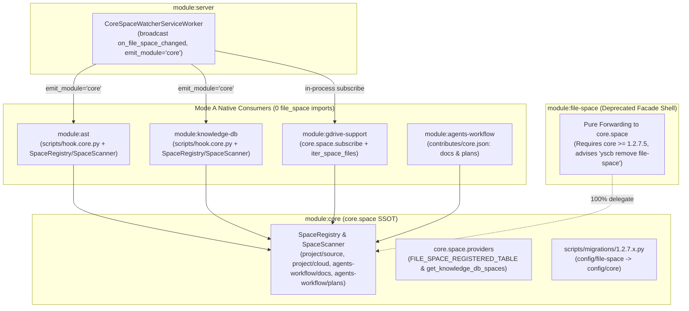

# 自動連續推進綜合規格與實作紀錄 (Consolidated Auto Plan & Task Log)

> 功能名稱：sub_04_ecosystem_migration_and_legacy_removal  
> 建立日期：2026-11-07  
> 所屬主計畫：2026_11_06_1020_core_file_space_architecture  
> 狀態：Completed  
> 模型：Gemini 4 Argon (Low)  

> 依據 P00：[P00_discuss.md](./P00_discuss.md)  
> 模板版本：v1.0  

---

## 1. 需求規格與邊界契約 (P01)

### 1.1 功能需求清單 (Functional Requirements)

| 需求編號 | 需求名稱 | 詳細規格與驗收條件 (Acceptance Criteria) | 優先級 | 對應 P00 語意 |
| :--- | :--- | :--- | :---: | :--- |
| **FR-01** | **`core.space` 微觀對齊、`FILE_SPACE_REGISTERED_TABLE` 移交與 CLI 避讓移除** | 1. 將 `core.space.scanner.ScanDiffDetail.dirty_files` 修正為 `self.added \| self.modified`（與 `deleted` 嚴格正交）。<br>2. 於 `core/space/providers.py` 實作 `get_registered_file_spaces_table` 與 `get_knowledge_db_spaces`，並於 `core/contributes/agents-workflow.json` 宣告 `FILE_SPACE_REGISTERED_TABLE` computed token、更新 `core/assets/{config_guide.md,usage_guide.md}`。<br>3. 移除 `core/commands/dispatcher.py` 中頂層 `file-space` 對外部舊模組之過渡期避讓，並從 `core/installer.py` 的預設 `candidate_mods` 移除 `"file-space"`。 | P0 | [P00:DR-01]<br>[P00:DR-04] |
| **FR-02** | **宿主專案與 `agents-workflow` 空間組態遷移及 `scripts/migrations/` 自動遷移 Hook** | 1. 將 `ys_codebase/config/file-space/contribute.json` 遷移為 `ys_codebase/config/core/contribute.json`（舊 `"include"` 轉 `"entries"`、舊 `"file_patterns"` 轉 `"include"`）並刪除舊 `ys_codebase/config/file-space/`。<br>2. 將 `ys_codebase/source/agents-workflow/contributes/file-space.json` 之 `docs` 與 `plans` 空間併入 `ys_codebase/source/agents-workflow/contributes/core.json` 並刪除 `file-space.json`。<br>3. 於 `core/scripts/migrations/1.2.7.x.py` 新增 `_migrate_legacy_file_space_config(yscb_dir)`，自動將殘留之 `config/file-space/contribute.json` 轉換合併至 `config/core/contribute.json`，並於 `ast` (`scripts/migrations/1.0.1.x.py`) 與 `knowledge-db` (`scripts/migrations/1.2.1.x.py`) 提供游標重置遷移腳本。 | P0 | [P00:DR-01]<br>[P00:DR-02]<br>[P00:DR-04] |
| **FR-03** | **下游業務模組 (`ast`、`knowledge-db`、`gdrive-support`) `Mode A` 純淨遷移至 `core.space`** | 1. 從 `ast`、`knowledge-db`、`gdrive-support` 之 `manifest.json` 移除 `"file-space"` 相依，將 `"core"` 下限對齊至 `>=1.2.7.4`。<br>2. 將 `ast`、`knowledge-db`、`gdrive-support` 內部與測試全面切換至 `core.space`（`SpaceRegistry`、`SpaceScanner`、`SpaceConfig`、`SpaceNotFoundError`、`SpaceError`、`ScanDiffDetail`、`ScanDiffResult`、`consume_diff`、`reset_cursor`、`subscribe`），100% 根除 `from file_space import ...` 與舊式別名。<br>3. 將 `ast/scripts/hook.file-space.py` 與 `knowledge-db/scripts/hook.file-space.py` 更名為 `scripts/hook.core.py`，刪除 `ast/contributes/file-space.json`，並支援 `<owner>/<space>` 與短名 (`short_name`) 雙向匹配。 | P0 | [P00:DR-01]<br>[P00:DR-04] |
| **FR-04** | **`module:file-space` 棄用空殼轉發版 (`Facade Deprecation Shell`) 與本機退役** | 1. 將 `ys_codebase/source/file-space/` 重構為無 `watchdog` 依賴、無 `contributes/{server,agents-workflow}.json` 之極簡 `core.space` 轉發空殼（`file_space/__init__.py`、`manager.py`、`scanner.py`、`service.py`、`providers.py`、`scripts/cli.py` 全數輕量委派 `core.space`）。<br>2. 於 `ys_codebase/source/file-space/manifest.json` 將 `"core"` 相依設為 `">=1.2.7.5"`，並於 `description`、`onboarding`、`release.summary` 明確提示更新 `core >=1.2.7.5` 後執行 `python yscb.py remove file-space` 移除本模組。<br>3. 通過 `file-space` 空殼模組沙盒測試後，於本倉執行 `remove file-space` 卸載舊模組，更新 `ys_codebase/config/agents-workflow/snippets/project_role.md` 並重新編譯發布技能。 | P0 | [P00:DR-03]<br>[P00:DR-04] |

### 1.2 邊界與異常情況 (Edge Cases & Failure Modes)

| 邊界編號 | 情境說明 | 預期防禦與處理行為 |
| :--- | :--- | :--- |
| **EC-01** | **刪除檔案時之 `ScanDiffDetail.dirty_files` 邊界** | `ScanDiffDetail.dirty_files` 僅回傳 `added \| modified`，刪除檔案僅存於 `deleted`，確保 `ast` 與 `knowledge-db` 熱修補時不將已刪除檔案視為存活檔案解析。 |
| **EC-02** | **短名 (`source`/`docs`/`plans`/`cloud`) 與 `<owner>/<space>` 對齊邊界** | `SpaceFileEntry.matched_spaces` 為 `<owner>/<space>`（如 `project/source`、`agents-workflow/docs`），`ast` 符號標記與 `knowledge-db` 權重/過濾器自動同時識別 `<owner>/<space>` 與 `short_name`，確保 `space_weights: {"source": 1.0, "docs": 1.2, "plans": 0.85}` 與 `--space=docs` 100% 命中。 |
| **EC-03** | **舊版 `config/file-space/contribute.json` 欄位語義反轉遷移** | `core/scripts/migrations/1.2.7.x.py` 轉換舊版空間定義時，自動將舊 `"include"` 陣列映射為 `core.space` 之 `"entries"`、將舊 `"file_patterns"` 映射為 `"include"`，且若目標 `config/core/contribute.json` 已存在同名空間則保留目標設定不覆蓋，具備 100% 冪等性。 |
| **EC-04** | **單元測試自訂空間 (`custom_spaces` / `contributes_data`) 隔離邊界** | `ast` 與 `knowledge-db` 在單元測試傳入自訂 `project_root`、`storage_dir` 或 `custom_spaces` 時，透過獨立 `SpaceRegistry` 與 `SpaceScanner(registry, storage_root=...)` 隔離運作，不污染全域單例快取。 |
| **EC-05** | **空殼 `module:file-space` 與 `core-space-watcher` 共存無雙重監聽** | 空殼 `file-space` 移除 `contributes/server.json` 與 `watchdog` 依賴，`file_space.subscribe` 直接轉發 `core.space.subscribe`，即便使用者尚未執行 `remove file-space` 亦絕不啟動第二個背景 Watcher。 |

### 1.3 非功能需求 (Non-Functional Requirements)

| 需求編號 | 類別 | 指標與量化約束 |
| :--- | :--- | :--- |
| **NFR-01** | **零遺留純淨度 (`Mode A`)** | `core`、`agents-workflow`、`ast`、`knowledge-db`、`gdrive-support` 五大模組源碼與測試中對 `file_space` 的 import 數量為 `0`。 |
| **NFR-02** | **依賴精簡** | `ast`、`knowledge-db`、`gdrive-support` 的 `manifest.json` 移除 `file-space` 相依；`file-space` 空殼移除 `watchdog` 第三方套件相依。 |
| **NFR-03** | **全倉合規與測試** | 遷移後 `core`、`server`、`agents-workflow`、`ast`、`knowledge-db`、`gdrive-support`、`file-space` 之 `dev check` 100% `PASSED`，並在 P06 通過全量回歸測試。 |

### 1.4 知識庫與踩坑紀錄查閱 (Known Gotchas & CAUTIONs)

- **`[!CAUTION]` 欄位語義映射 (`include` vs `entries`)**：舊版 `file-space` 中 `"include"` 是目錄 URI 清單、`"file_patterns"` 是檔名萬用字元；`core.space` 中 `"entries"` 是目錄/檔案 URI 清單、`"include"` 是規則萬用字元。遷移 JSON 與測試夾具時務必轉換。
- **`[!NOTE]` Hook 事件發射源 (`emit_module="core"`)**：`core.events.broadcast("on_file_space_changed", ..., emit_module="core")` 會尋找各已安裝模組下的 `scripts/hook.core.py`，因此 `ast` 與 `knowledge-db` 的訂閱腳本必須命名為 `scripts/hook.core.py`。

---

## 2. 架構設計與異動檔案清單 (P02)

### 2.1 模組架構與核心資料流 (Architecture & Data Flow)



### 2.2 受影響與新建檔案清單 (Impacted & New Files Inventory)

| 檔案路徑 | 類型 | 職責與變更說明 |
| :--- | :---: | :--- |
| `ys_codebase/config/core/contribute.json` | New | 由 `config/file-space/contribute.json` 遷移而來之 `source` 與 `cloud` 空間定義（`entries` + `include` 格式） |
| `ys_codebase/config/file-space/contribute.json` | Delete | 舊專案空間設定檔移除 |
| `ys_codebase/config/agents-workflow/snippets/project_role.md` | Modify | 更新母倉核心模組清單（移除已內聚至 `core` 之獨立 `file-space`） |
| `ys_codebase/source/core/core/space/scanner.py` | Modify | `ScanDiffDetail.dirty_files` 修正為 `self.added \| self.modified` |
| `ys_codebase/source/core/core/space/providers.py` | New | 實作 `get_registered_file_spaces_table` 與 `get_knowledge_db_spaces` 動態表格生成 |
| `ys_codebase/source/core/core/space/__init__.py` | Modify | 匯出 `get_registered_file_spaces_table` 與 `get_knowledge_db_spaces` |
| `ys_codebase/source/core/contributes/agents-workflow.json` | Modify | 接管註冊 `FILE_SPACE_REGISTERED_TABLE` token 與 `computed` 注入 |
| `ys_codebase/source/core/assets/config_guide.md` | Modify | 納入 `config/core/contribute.json` 空間設定與 `__@{FILE_SPACE_REGISTERED_TABLE}__` |
| `ys_codebase/source/core/assets/usage_guide.md` | Modify | 納入 `yscb fs` / `yscb file-space` 標準指令速查 |
| `ys_codebase/source/core/core/commands/dispatcher.py` | Modify | 移除過渡期對外部同名模組的避讓邏輯 |
| `ys_codebase/source/core/core/installer.py` | Modify | 從預設 `candidate_mods` 移除 `"file-space"` |
| `ys_codebase/source/core/scripts/migrations/1.2.7.x.py` | Modify | 新增 `_migrate_legacy_file_space_config` 自動轉換合併 `config/file-space/contribute.json` 至 `config/core/contribute.json` |
| `ys_codebase/source/core/tests/test_space.py` | Modify | 更新 CLI 路由測試並新增 `providers` 與 `1.2.7.x.py` 空間組態自動遷移測試 |
| `ys_codebase/source/core/tests/test_platform.py` | Modify | 測試夾具移除舊 `file-space` 耦合 |
| `ys_codebase/source/core/tests/test_validator.py` | Modify | 測試夾具更新為 `$SpaceDef` |
| `ys_codebase/source/agents-workflow/contributes/core.json` | Modify | 新增 `spaces`（`docs` 與 `plans`）定義 |
| `ys_codebase/source/agents-workflow/contributes/file-space.json` | Delete | 舊空間貢獻檔移除 |
| `ys_codebase/source/agents-workflow/contributes/_manifest.md` | Modify | 移除 `file-space.json` 說明 |
| `ys_codebase/source/ast/manifest.json` | Modify | 移除 `"file-space"` 相依，將 `"core"` 設為 `">=1.2.7.4"` |
| `ys_codebase/source/ast/contributes/file-space.json` | Delete | 移除空白舊貢獻檔 |
| `ys_codebase/source/ast/contributes/_manifest.md` | Modify | 移除 `file-space.json` 紀錄 |
| `ys_codebase/source/ast/contributes/core.json` | Modify | 更新描述文字為 `core.space` |
| `ys_codebase/source/ast/ast_engine/engine.py` | Modify | `Mode A` 全面切換至 `core.space` (`SpaceRegistry`, `SpaceScanner`, `SpaceConfig`, `consume_diff`, `reset_cursor`) |
| `ys_codebase/source/ast/ast_engine/bundler.py` | Modify | `Mode A` 全面切換至 `core.space` (`SpaceRegistry`, `SpaceScanner`, `SpaceConfig`, `SpaceFileEntry`) 與短名映射 |
| `ys_codebase/source/ast/ast_engine/resolver.py` | Modify | `SnippetExtractor` 對齊 `SpaceRegistry.resolve_file_path` |
| `ys_codebase/source/ast/scripts/cli.py` | Modify | 切換為 `from core.space import SpaceNotFoundError` |
| `ys_codebase/source/ast/scripts/hook.core.py` | New | 由 `hook.file-space.py` 遷移並切換至 `from core.space import consume_diff` |
| `ys_codebase/source/ast/scripts/hook.file-space.py` | Delete | 移除舊 Hook 檔案 |
| `ys_codebase/source/ast/scripts/migrations/1.0.1.x.py` | New | 升級時清理舊格式 `ast` 消費者游標 |
| `ys_codebase/source/ast/README.md` | Modify | 更新依賴與架構說明為 `core.space` |
| `ys_codebase/source/ast/assets/config_guide.md` | Modify | 更新空間組態說明為 `config/core/contribute.json` |
| `ys_codebase/source/ast/tests/test_ast_engine.py` | Modify | `Mode A` 切換至 `core.space` 與 `hook.core.py` |
| `ys_codebase/source/ast/tests/test_provisioner_and_jit.py` | Modify | `Mode A` 切換至 `core.space` 與 `hook.core.py` |
| `ys_codebase/source/knowledge-db/manifest.json` | Modify | 移除 `"file-space"` 相依，更新 `onboarding` 為 `config/core/contribute.json` |
| `ys_codebase/source/knowledge-db/contributes/_manifest.md` | Modify | 更新說明為 `core.space` |
| `ys_codebase/source/knowledge-db/knowledge_db/providers.py` | Modify | 委派至 `core.space.providers.get_knowledge_db_spaces` |
| `ys_codebase/source/knowledge-db/knowledge_db/engine.py` | Modify | `Mode A` 全面切換至 `core.space` (`SpaceRegistry`, `SpaceScanner`, `SpaceNotFoundError`, `SpaceError`) |
| `ys_codebase/source/knowledge-db/knowledge_db/pipeline.py` | Modify | `Mode A` 全面切換至 `core.space` |
| `ys_codebase/source/knowledge-db/knowledge_db/retrieval.py` | Modify | `SnippetExtractor` 對齊 `SpaceRegistry.resolve_file_path` |
| `ys_codebase/source/knowledge-db/knowledge_db/service.py` | Modify | 更新註解為 `core-space-watcher` |
| `ys_codebase/source/knowledge-db/scripts/cli.py` | Modify | 切換至 `from core.space import SpaceNotFoundError` |
| `ys_codebase/source/knowledge-db/scripts/hook.core.py` | New | 由 `hook.file-space.py` 遷移並切換至 `from core.space import ScanDiffResult, consume_diff` |
| `ys_codebase/source/knowledge-db/scripts/hook.file-space.py` | Delete | 移除舊 Hook 檔案 |
| `ys_codebase/source/knowledge-db/scripts/migrations/1.2.1.x.py` | New | 升級時清理舊格式 `knowledge-db` 消費者游標 |
| `ys_codebase/source/knowledge-db/README.md` | Modify | 更新為 `core.space` 與 `config/core/contribute.json` |
| `ys_codebase/source/knowledge-db/assets/config_guide.md` | Modify | 更新為 `config/core/contribute.json` |
| `ys_codebase/source/knowledge-db/assets/usage_guide.md` | Modify | 更新為 `core.space` |
| `ys_codebase/source/knowledge-db/assets/skills/knowledge-db-search/SKILL.md` | Modify | 更新為 `core.space` |
| `ys_codebase/source/knowledge-db/tests/test_engine.py` | Modify | `Mode A` 切換至 `core.space` |
| `ys_codebase/source/knowledge-db/tests/test_file_space.py` | Modify | `Mode A` 切換至 `core.space` |
| `ys_codebase/source/knowledge-db/tests/test_hot_reload.py` | Modify | `Mode A` 切換至 `core.space` 與 `hook.core.py` |
| `ys_codebase/source/knowledge-db/tests/test_schema.py` | Modify | `Mode A` 切換至 `core.space` |
| `ys_codebase/source/knowledge-db/tests/test_self_healing.py` | Modify | `Mode A` 切換至 `core.space` |
| `ys_codebase/source/knowledge-db/tests/test_service_worker.py` | Modify | `Mode A` 切換至 `core.space` 與 `hook.core.py` |
| `ys_codebase/source/gdrive-support/manifest.json` | Modify | 移除 `"file-space"` 相依 |
| `ys_codebase/source/gdrive-support/contributes/_format.json` | Modify | 更新描述文字為 `core.space` |
| `ys_codebase/source/gdrive-support/contributes/_manifest.md` | Modify | 更新描述文字為 `core.space` |
| `ys_codebase/source/gdrive-support/gdrive_support/config.py` | Modify | `Mode A` 切換至 `core.space.SpaceRegistry` (`entries`, `large_file_threshold_mb`, `iter_space_files`) |
| `ys_codebase/source/gdrive-support/gdrive_support/service.py` | Modify | `Mode A` 切換至 `from core.space import subscribe` |
| `ys_codebase/source/gdrive-support/gdrive_support/coordinator.py` | Modify | 對齊 `space_registry` / `file_space_manager` 介面 |
| `ys_codebase/source/gdrive-support/assets/usage_guide.md` | Modify | 更新為 `core.space` |
| `ys_codebase/source/gdrive-support/assets/skills/gdrive-local-ops/SKILL.md` | Modify | 更新為 `core.space` |
| `ys_codebase/source/gdrive-support/tests/test_atomic_api_and_config.py` | Modify | `Mode A` 切換至 `core.space` |
| `ys_codebase/source/gdrive-support/tests/test_branch_and_sync_engine.py` | Modify | `Mode A` 切換至 `core.space` |
| `ys_codebase/source/file-space/manifest.json` | Modify | 升級為棄用空殼組態（`core >=1.2.7.5`、移除 `watchdog`、標註更新 `core` 後執行 `remove file-space`） |
| `ys_codebase/source/file-space/contributes/server.json` | Delete | 移除舊 `file-space-watcher` 註冊 |
| `ys_codebase/source/file-space/contributes/agents-workflow.json` | Delete | 移除舊 `FILE_SPACE_REGISTERED_TABLE` 註冊（已由 `core` 接管） |
| `ys_codebase/source/file-space/skills/how-to-yscb/file_space_guide.md` | Delete | 移除舊導引片段 |
| `ys_codebase/source/file-space/file_space/__init__.py` | Modify | 轉發至 `core.space` |
| `ys_codebase/source/file-space/file_space/exceptions.py` | Modify | 轉發 `core.space.exceptions` |
| `ys_codebase/source/file-space/file_space/schema.py` | Modify | 轉發 `core.space` 資料結構 |
| `ys_codebase/source/file-space/file_space/manager.py` | Modify | 輕量適配轉發至 `core.space.SpaceRegistry` |
| `ys_codebase/source/file-space/file_space/scanner.py` | Modify | 輕量適配轉發至 `core.space.SpaceScanner` |
| `ys_codebase/source/file-space/file_space/service.py` | Modify | 輕量轉發 `core.space.watcher` |
| `ys_codebase/source/file-space/file_space/providers.py` | Modify | 轉發 `core.space.providers` |
| `ys_codebase/source/file-space/scripts/cli.py` | Modify | 轉發至 `core` 之 `file-space` CLI 處理器並印出棄用提示 |
| `ys_codebase/source/file-space/README.md` | Modify | 標註棄用與 `remove file-space` 升級指引 |
| `ys_codebase/source/file-space/tests/` | Modify | 收斂為驗證空殼轉發契約之精簡測試集 |
| `docs/README.md` | Modify | 更新系統知識庫導航表（`file-space` 併入 `core`） |
| `docs/core/README.md` | Modify | 增補 `config/core/contribute.json` 空間組態與遷移說明 |
| `docs/ast/README.md` | Modify | 更新為 `core.space` 與 `hook.core.py` |
| `docs/knowledge-db/README.md` | Modify | 更新為 `core.space` 與 `hook.core.py` |
| `docs/gdrive-support/README.md` | Modify | 更新為 `core.space` |
| `docs/file-space/README.md` | Modify | 標註已併入 `core.space` 與退役指引 |

### 2.3 架構決策記錄 (Architecture Decision Records)

- **[P02:DR-01] `SpaceRegistry` 支援測試期 `custom_spaces` / `raw_spaces` 標準化注入與短名解析**：
  - 於 `SpaceRegistry` 支援直接傳入 `raw_spaces`（自動將測試夾具之簡寫或 `SpaceConfig` 正規化為 `owner="project"` 或指定 owner），並提供便捷屬性/方法讓 `ast`、`knowledge-db`、`gdrive-support` 以零轉發殼層直接操作 `SpaceRegistry` 與 `SpaceScanner`。
- **[P02:DR-02] 短名 (`short_name`) 作為 `ast` 與 `knowledge-db` 跨空間邏輯標籤**：
  - 當檔案匹配 `project/source` 或 `agents-workflow/docs` 時，`SpaceConfig.short_name` 為 `"source"` / `"docs"`。`ast` 符號之 `spaces` 集合同時支援以短名歸類（當單一短名無歧義或聯集查詢時），確保 `knowledge-db` 的 `space_weights` (`{"source": 1.0, "docs": 1.2, "plans": 0.85}`) 與 `--space=docs` / `--space=project/source` 皆能精準命中。

---

## 3. 介面契約與 API 簽名 (P03)

### 3.1 介面契約與核心簽名 (Interface Inventory & Method Signatures)

```python
# ys_codebase/source/core/core/space/providers.py
from typing import Any, Optional

def get_registered_file_spaces_table(context: Optional[Any] = None) -> str: ...
def get_knowledge_db_spaces(context: Optional[Any] = None, **kwargs: Any) -> str: ...

# ys_codebase/source/core/scripts/migrations/1.2.7.x.py
from typing import Any, Dict

def _migrate_legacy_file_space_config(yscb_dir: str) -> None: ...
def migrate(context: Dict[str, Any]) -> bool: ...

# ys_codebase/source/ast/scripts/hook.core.py
from typing import Any, Dict, List, Optional

def on_file_space_changed(
    context: Any = None,
    spaces: Optional[List[str]] = None,
    diff_summary: Optional[Dict[str, Any]] = None,
    **kwargs: Any,
) -> Dict[str, Any]: ...

# ys_codebase/source/knowledge-db/scripts/hook.core.py
def on_file_space_changed(
    context: Any = None,
    spaces: Optional[List[str]] = None,
    diff_summary: Optional[Dict[str, Any]] = None,
    **kwargs: Any,
) -> Dict[str, Any]: ...
```

- **錯誤與例外契約 (Error & Exception Contracts)**：
  - 查詢未註冊空間時統一拋出 `core.space.SpaceNotFoundError`；空間設定不合法時拋出 `core.space.SpaceError`（或 `SpaceCycleError`）。
  - `_migrate_legacy_file_space_config` 遇損毀 JSON 時靜默跳過不中斷升級，遇正常舊版 JSON 時原子寫入 `config/core/contribute.json` 並刪除舊檔。
- **階段決策紀錄**：`[P03:DR-01]` `ast` 與 `knowledge-db` 之 `scripts/hook.core.py` 直接接收 `core-space-watcher` 廣播之 `payload`（含 `space_name`、`spaces`、`diff_summary`），並以 `auto_refresh=False` 呼叫 `consume_diff` 實現零重掃增量更新。

---

## 4. 定稿審查與文檔衝擊規劃 (P04)

### 4.1 交叉驗證與靈魂拷問 (Cross-Validation & Resilience Review)

- [x] **需求對齊**：FR-01 ~ FR-04 皆已於介面簽名與實作清單中完整對齊
- [x] **邊界防護**：EC-01 ~ EC-05 皆有具體錯誤攔截與降級策略
- [x] **依賴純淨**：100% 符合 NFR-01 ~ NFR-03 指標約束
- **靈魂拷問與防護解法**：
  - *問：當本倉執行 `yscb remove file-space` 後，`agents-workflow compile` 解析 `FILE_SPACE_REGISTERED_TABLE` 與 `KNOWLEDGE_DB_SPACE` 是否會失敗？*
  - *答*：`FILE_SPACE_REGISTERED_TABLE` 已移交至 `core/contributes/agents-workflow.json` (`code.func://core/core/space/providers:get_registered_file_spaces_table`)，`KNOWLEDGE_DB_SPACE` 由 `knowledge-db/knowledge_db/providers.py` 委派至 `core.space.providers:get_knowledge_db_spaces`，兩者皆 100% 獨立於 `module:file-space`。

### 4.2 知識庫文檔衝擊與交付規劃 (Documentation Impact Plan)

| 維度 | 文件路徑 | 變更類型 | 交付內容與重點 |
| :--- | :--- | :---: | :--- |
| **模組手冊** | `docs/core/README.md`, `docs/ast/README.md`, `docs/knowledge-db/README.md`, `docs/gdrive-support/README.md`, `docs/file-space/README.md` | Modify | 對齊 `core.space`、`config/core/contribute.json`、`hook.core.py` 與 `file-space` 棄用指引 |
| **專題手冊** | `docs/README.md` | Modify | 更新全系統知識庫導航表 |
| **設計決策** | `docs/core/DESIGN_NOTES.md` | N/A | 免更（遵守 DN 防膨脹守門） |
| **微觀註解** | 源碼檔案 Docstrings | Modify | 同步更新 `core`、`ast`、`knowledge-db`、`gdrive-support`、`file-space` 模組 Docstring |
| **發布日誌** | `CHANGELOG.md` | Modify | 記錄 `sub_04` 與主計畫結案摘要 |

- **決策定稿**：**[P04:DR-01]** 確認無誤，啟動實作與靶向測試驗證。

---

## 5. 實作任務清單與偏差紀錄 (P05)

### 5.1 實作任務清單 (Task Breakdown)

- [x] **TASK-01**：完成 `core`（`ScanDiffDetail.dirty_files`、`core/space/providers.py`、`contributes/agents-workflow.json`、`dispatcher.py`、`installer.py`、`scripts/migrations/1.2.7.x.py`、assets 與測試）、`ys_codebase/config/core/contribute.json` 與 `agents-workflow/contributes/core.json` 遷移
- [x] **TASK-02**：完成 `ast`、`knowledge-db`、`gdrive-support` 三大下游模組之 `/code-optimizer` `Mode A` 純淨遷移（移除 `file-space` 相依、切換 `core.space`、`hook.core.py`、新增 `scripts/migrations/` 與更新測試集）
- [x] **TASK-03**：完成 `module:file-space` 棄用空殼轉發層重構（移除 `watchdog` 與 `server.json`，委派 `core.space`，更新 `manifest.json` 提示 `core >=1.2.7.5` 後移除），執行各模組靶向測試與本機自部署、卸載 `file-space` 及 `agents-workflow release`
- [x] **TASK-DOC**：同步更新 `docs/` 知識庫文檔與微觀代碼 Docstrings

### 5.2 實作偏差紀錄表 (Implementation Deviations)

| 任務編號 | 偏差等級 | 偏離描述與決策理由 | 處置方式 / 記錄 |
| :--- | :---: | :--- | :--- |
| - | - | 無偏差 | - |
