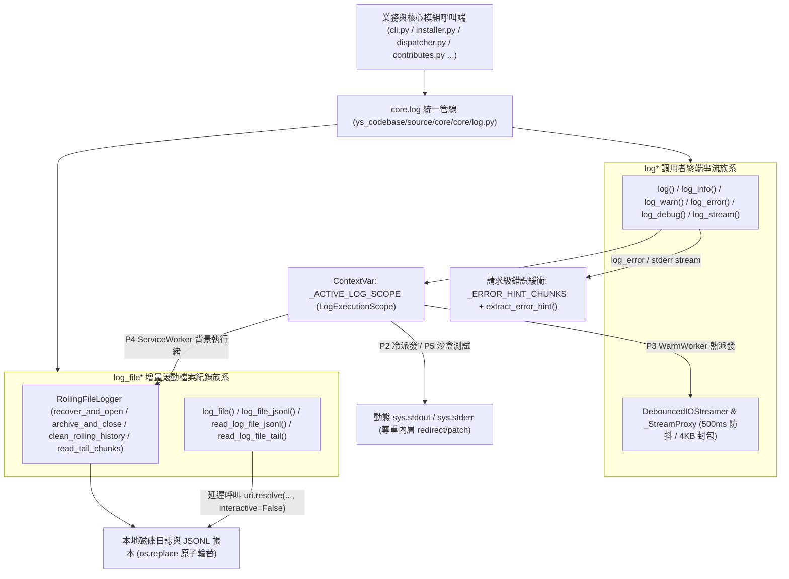

# 自動連續推進綜合規格與實作紀錄 (Consolidated Auto Plan & Task Log)

> 功能名稱：sub_01_core_log_pipeline_and_streamer_unification  
> 建立日期：2026-11-08  
> 所屬主計畫：2026_11_07_2052_jupyter_style_runtime_isolation_and_static_guardrails  
> 狀態：Completed  
> 模型：Gemini 4 Argon (Low)  

> 依據 P00：[P00_discuss.md](./P00_discuss.md)  
> 模板版本：v1.0  

---

## 1. 需求規格與邊界契約 (P01)

> *(P01 已於 [P01_requirements_spec.md](./P01_requirements_spec.md) 獨立定案 (`Confirmed`)，此處保留摘要對齊)*

### 1.1 功能需求清單 (Functional Requirements)

| 需求編號 | 需求名稱 | 詳細規格與驗收條件 (Acceptance Criteria) | 優先級 | 對應 P00 語意 |
| :--- | :--- | :--- | :---: | :--- |
| **FR-01** | `core.log` 調用者終端串流族系 (`log*`) 與 `ContextVar` 執行平面路由 | 於 `core/core/log.py` 實作 `log`、`log_stream`、`log_info`、`log_warn`、`log_error`、`log_debug` 及 `LogExecutionScope` / `bind_log_context`，支援前景原樣輸出與 P4 背景 `ServiceWorker` 自動轉寫結構化日誌檔。 | P0 | [P00:DR-01], [P00:DR-02] |
| **FR-02** | `DebouncedIOStreamer` 下沉收編與 `server/streamer.py` 相容門面 | 將 `DebouncedIOStreamer` 與 `_StreamProxy` 下沉至 `core/core/log.py`（100% 維持 `debounce_ms=500`、`write(stream_name, text)`、`send_task_finish(...)`、`start_capture() -> DebouncedIOStreamer` 既有簽名），`start_capture()` 同步綁定 `ContextVar` 與串流代理，`server/streamer.py` 轉為純匯出門面。 | P0 | [P00:DR-01], [P00:DR-02], [P00:DR-03] |
| **FR-03** | `core.log` 增量滾動檔案紀錄族系 (`log_file*`) 與 `ServerLogger` 收編 | 於 `core/core/log.py` 實作 `RollingFileLogger`（100% 對齊 `ServerLogger` 建構子與公開方法：`recover_and_open() -> str`、`archive_and_close() -> Optional[str]`、`clean_rolling_history() -> List[str]`、`get_expected_archive_path() -> str`、`write_raw(line)`、`log(level, msg, component="master", exc_info=None)`、`info`、`warning`、`error`、`read_tail_chunks`、`log_file_path`、`is_opened`）、`_safe_replace_file`（`os.replace` 升級）、`log_file`、`log_file_jsonl`、`read_log_file_jsonl`、`read_log_file_tail`；`ServerLogger` 直接繼承 `RollingFileLogger`。 | P0 | [P00:DR-01], [P00:DR-03], [P00:DR-04] |
| **FR-04** | `telemetry.py` 滾動截斷收編與派發級 `error_hint` 累積萃取連動 | `telemetry.py` 檔案追加與滾動截斷委派 `core.log`；`core.log` 實作 `record_error_hint`、`get_last_error_hint`、`clear_error_hint` 並消除 `dispatcher.py` 之 `global _LAST_DISPATCH_ERROR_HINT`。 | P0 | [P00:DR-01], [P00:DR-02] |
| **FR-05** | `module:core` 內部生產輸出 (`print`/`stdout`/`stderr`/`logging`) 全量遷移與公開 API 匯出 | 將 `ys_codebase/source/core/` 下所有非測試 `.py` 檔（共 13 個含 A1 原生輸出或 `logging` 的生產檔案，扣除頂層啟動器 `yscb.py` 豁免之 40 處）100% 遷移至 `core.log`，並於 `core/__init__.py` 匯出 `log`。 | P0 | [P00:DR-01], [P00:DR-02] |

### 1.2 邊界與異常情況 (Edge Cases & Failure Modes)

| 邊界編號 | 情境說明 | 預期防禦與處理行為 |
| :--- | :--- | :--- |
| **EC-01** | `core.log` 與 `core.uri` 循環匯入或 `!undefined` URI 互動重入 | `core/log.py` 頂層 0 `core.*` 匯入；解析 URI 時函式內延遲匯入 `core.uri` 並強制呼叫 `uri.resolve(target, interactive=False)`。 |
| **EC-02** | 單元測試使用 `redirect_stdout` / `redirect_stderr` 或 `patch("sys.stdout")` 攔截輸出 | 每次寫入動態讀取當下 `sys.stdout` / `sys.stderr`；若 `DebouncedIOStreamer` 期間內層測試替換 `sys.stdout` 為非 `_stdout_proxy` 物件，優先寫入內層被替換串流。 |
| **EC-03** | `DebouncedIOStreamer` 在 `emit_chunk` 回呼內重入呼叫 `flush()`，或 `stop_capture()` 重複呼叫 | `_flush_locked()` 於 `RLock` 內先清空 `_buffer` 與 `_buffer_bytes = 0` 後再呼叫 `emit_chunk(packet)`；`stop_capture()` 具 `_is_closed` 冪等保護。 |
| **EC-04** | 跨磁碟區或檔案鎖定導致 `os.replace(src, dst)` 拋出 `OSError` | `_safe_replace_file(src, dst)` 先試 `os.replace`，失敗退回 `shutil.copy2` + `os.remove`。 |
| **EC-05** | 單次 CLI 派發期間多次呼叫 `log_error()`，或 `post_cli_dispatch` 輸出次要訊息 | `error_hint` 緩衝保留最多 16 筆錯誤片段並由 `extract_error_hint` 按關鍵字優先序萃取；`dispatcher.py` 於 `post_cli_dispatch` 前鎖定主命令 `error_hint`。 |

### 1.3 非功能需求 (Non-Functional Requirements)

| 需求編號 | 類別 | 指標與量化約束 |
| :--- | :--- | :--- |
| **NFR-01** | 零外部依賴與啟動速度 | `core/core/log.py` 100% 僅使用 Python 標準庫，載入時間 $< 1\text{ms}$。 |
| **NFR-02** | 靜態守門合規性 (`A1` & `E12`) | 除 `core/core/log.py` 底層單點出口與 `dispatcher.py` 啟動串流 `reconfigure` 外，`core` 45 個生產檔與 `server/{logger,streamer}.py` 達成 **0 `print()`、0 `sys.stdout/stderr.write()`、0 `import logging`、0 `os.rename()`**。 |
| **NFR-03** | 執行緒安全與檔案描述符隔離 | 全程 `threading.RLock()` / `ContextVar` 隔離，長持檔案描述符 100% 設定 `os.set_inheritable(fd, False)`。 |

### 1.4 知識庫與踩坑紀錄查閱 (Known Gotchas & CAUTIONs)

- **`[!CAUTION]` 既有測試對 `stdout` vs `stderr` 的剛性斷言依賴**：原無 `file=sys.stderr` 者維持預設 `stream="stdout"`，原有 `file=sys.stderr`（及原 `logging.warning` 於 `config.py`, `contributes.py`, `locale.py`, `space/watcher.py`）顯式傳入 `stream="stderr"`。
- **`[!NOTE]` `test_server_logging.py` 與 `test_server.py` 白箱斷言對齊**：`RollingFileLogger` 100% 維持 `ServerLogger` 既有簽名（含 `yscb_root: str, log_dir: Optional[str] = None, echo_console: bool = False`、`recover_and_open`、`archive_and_close() -> Optional[str]`、`log(level, msg, component="master", exc_info=None)`、`warning` 等），`DebouncedIOStreamer` 100% 維持 `debounce_ms: int = 500`、`write(stream_name, text)`、`send_task_finish(...)` 與 `start_capture() -> DebouncedIOStreamer`，並將 `test_server_logging.py` 之 `os.rename` mock 同步升級為 `os.replace`。

---

## 2. 架構設計與異動檔案清單 (P02)

### 2.1 模組架構與核心資料流 (Architecture & Data Flow)



### 2.2 受影響與新建檔案清單 (Impacted & New Files Inventory)

| 檔案路徑 | 類型 | 職責與變更說明 |
| :--- | :---: | :--- |
| `ys_codebase/source/core/core/log.py` | New | 新建 `core.log` 核心管線：實作 `log*` 族系、`LogExecutionScope`、`bind_log_context`、`DebouncedIOStreamer`、`_StreamProxy`、`RollingFileLogger`、`_extract_log_file_timestamp`、`_safe_replace_file`、`log_file*` 族系與 `error_hint` 緩衝管理。 |
| `ys_codebase/source/core/core/__init__.py` | Modify | 匯出 `log` 子模組與核心日誌 API。 |
| `ys_codebase/source/core/core/telemetry.py` | Modify | 將 JSONL 追加、`_rotate_telemetry_file` 與 `read_telemetry_records` 底層委派至 `core.log` 之 `log_file_jsonl` / `read_log_file_jsonl`，並與 `core.log` 共享 `extract_error_hint`。 |
| `ys_codebase/source/core/scripts/cli.py` | Modify | 遷移 146 處 `print(...)` 至 `core.log`。 |
| `ys_codebase/source/core/core/installer.py` | Modify | 遷移 85 處 `print(...)` 至 `core.log`。 |
| `ys_codebase/source/core/core/commands/dispatcher.py` | Modify | 遷移 49 處 `print` / `sys.stdout.write` / `sys.stderr.write` 至 `core.log`；消除 `global _LAST_DISPATCH_ERROR_HINT`，改由 `core.log` 驅動並在 `post_cli_dispatch` 前鎖定主命令錯誤摘要。 |
| `ys_codebase/source/core/core/commands/contributes_cmd.py` | Modify | 遷移 27 處 `print(...)` 至 `core.log`。 |
| `ys_codebase/source/core/core/uri.py` | Modify | 遷移 21 處 `print(...)` 至 `core.log`。 |
| `ys_codebase/source/core/core/contributes.py` | Modify | 移除 `import logging` 與 `logging.getLogger`，將 8 處 `logger.warning(...)` 遷移至 `core.log.log_warn(..., stream="stderr")`（共消除 10 處 A1 違規）。 |
| `ys_codebase/source/core/core/space/watcher.py` | Modify | 移除 `import logging` 與 `logging.getLogger`，將 `logger.warning(...)` / `logger.debug(...)` 遷移至 `core.log.log_warn(..., stream="stderr")` 與 `core.log.log_debug(...)`（共消除 6 處 A1 違規）。 |
| `ys_codebase/source/core/core/guard.py` | Modify | 遷移 5 處 `print(..., file=sys.stderr)` 至 `core.log.log_error(..., stream="stderr")`。 |
| `ys_codebase/source/core/core/locale.py` | Modify | 移除 `import logging` 與 `logging.getLogger`，將 2 處 `logger.warning(...)` 遷移至 `core.log.log_warn(..., stream="stderr")`（共消除 4 處 A1 違規）。 |
| `ys_codebase/source/core/core/config.py` | Modify | 移除 `import logging` 與 `logging.getLogger`，將 1 處 `logger.warning(...)` 遷移至 `core.log.log_warn(..., stream="stderr")`（共消除 3 處 A1 違規）。 |
| `ys_codebase/source/core/core/engine.py` | Modify | 遷移 2 處 `print(...)` 至 `core.log`。 |
| `ys_codebase/source/core/core/events.py` | Modify | 遷移 2 處 `print(..., file=sys.stderr)` 至 `core.log.log_warn(..., stream="stderr")` / `core.log.log_error(..., stream="stderr")`。 |
| `ys_codebase/source/core/core/update_checker.py` | Modify | 遷移 1 處 `print(...)` 至 `core.log`。 |
| `ys_codebase/source/server/server/logger.py` | Modify | 重構為委派 `core.log`：自 `core.log` 匯入 `_extract_log_file_timestamp`、`_safe_replace_file`、`RollingFileLogger`，定義 `class ServerLogger(RollingFileLogger)`，消除本檔 `os.rename` 與 `sys.stdout`。 |
| `ys_codebase/source/server/server/streamer.py` | Modify | 重構為委派 `core.log`：直接自 `core.log` 匯入並暴露 `DebouncedIOStreamer` 與 `_StreamProxy`，消除本檔原生 `sys.stdout` / `sys.stderr` 操作。 |
| `ys_codebase/source/core/tests/test_log.py` | New | 新建 `core.log` 完整單元與邊界測試套件（覆蓋 `FT-01` ~ `FT-05`, `ET-01` ~ `ET-05`）。 |
| `ys_codebase/source/core/tests/test_core_commands.py` | Modify | 對齊 `dispatcher.py` 移除 `_LAST_DISPATCH_ERROR_HINT` 私有全域變數之變更，改用 `core.log.clear_error_hint()` 與 `core.log.get_last_error_hint()`。 |
| `ys_codebase/source/server/tests/test_server_logging.py` | Modify | 將 `test_archive_collision_handling` (`L211, L225`) 對 `os.rename` 之 mock 標的對齊升級為 `os.replace`。 |
| `docs/core/README.md` | Modify | 補充 `core.log` 雙族系終端串流與增量滾動檔案管線說明。 |

### 2.3 架構決策記錄 (Architecture Decision Records)

- **[P02:DR-01] `core/log.py` 單一標準庫底層與延遲 URI 解析隔離**：`core/core/log.py` 頂層僅依賴 Python 標準庫，任何語意 URI（含 `://`）均於 `_resolve_log_target()` 內部延遲匯入 `core.uri` 並以 `interactive=False` 解析，保證 `uri.py`、`config.py`、`contributes.py`、`locale.py`、`guard.py`、`events.py` 頂層可安全匯入 `core.log` 而無循環依賴。
- **[P02:DR-02] 內外層串流攔截優先序 (`Inner Redirect Precedence`)**：當 `DebouncedIOStreamer` 啟用時會同時設定 `ContextVar` 與替換 `sys.stdout` / `sys.stderr` 為 `_StreamProxy`。若業務方法內部的單元測試又使用 `contextlib.redirect_stdout(buf)` 或 `patch("sys.stderr", buf)` 將 `sys.stdout` / `sys.stderr` 替換為其他物件，`core.log` 寫入時會檢查當前 `sys.stdout` / `sys.stderr` 是否仍為該 `DebouncedIOStreamer` 之 proxy；若已被內層替換，則直接寫入內層 `sys.stdout` / `sys.stderr`，兼顧熱派發攔截與內層測試斷言。
- **[P02:DR-03] `RollingFileLogger` 與 `DebouncedIOStreamer` 100% 簽名向後相容**：`RollingFileLogger` 完整保留 `ServerLogger` 所有類別常數（`TIME_FORMAT`, `HIST_REGEX`, `MAX_HIST_FILES`, `START_BANNER_PREFIX`, `HEADER_TIME_REGEX`）、建構子簽名 `(self, yscb_root: str = "", log_dir: Optional[str] = None, echo_console: bool = False)` 與全部公開方法/屬性（`log_file_path`, `is_opened`, `recover_and_open() -> str`, `archive_and_close() -> Optional[str]`, `clean_rolling_history() -> List[str]`, `get_expected_archive_path() -> str`, `write_raw(line: str)`, `log(level, msg, component="master", exc_info=None)`, `info`, `warning`, `error`, `read_tail_chunks`）；`DebouncedIOStreamer` 完整保留 `(self, emit_chunk, debounce_ms: int = 500, max_buffer_bytes: int = 4096)`、`write(stream_name, text)`、`send_task_finish(exit_code, duration_ms, error=None)` 與 `start_capture() -> DebouncedIOStreamer`。

---

## 3. 介面契約與 API 簽名 (P03)

### 3.1 介面契約與核心簽名 (Interface Inventory & Method Signatures)

```python
# ys_codebase/source/core/core/log.py
from contextlib import contextmanager
from dataclasses import dataclass, field
import io
from pathlib import Path
import re
from typing import Any, Callable, Dict, Iterator, List, Optional, Tuple, Union

PathTarget = Union[str, Path]

@dataclass
class LogExecutionScope:
    streamer: Optional["DebouncedIOStreamer"] = None
    background_sink: Optional["RollingFileLogger"] = None
    component: str = "core"
    debug_enabled: bool = False
    error_chunks: List[str] = field(default_factory=list)

@contextmanager
def bind_log_context(
    *,
    streamer: Optional["DebouncedIOStreamer"] = None,
    background_sink: Optional["RollingFileLogger"] = None,
    component: Optional[str] = None,
    debug_enabled: Optional[bool] = None,
    isolated_error_scope: bool = False,
) -> Iterator[LogExecutionScope]: ...

def get_current_log_scope() -> Optional[LogExecutionScope]: ...

# --- 1. log* 調用者終端串流族系 ---
def log(
    *objects: Any,
    sep: str = " ",
    end: str = "\n",
    flush: bool = False,
    stream: str = "stdout",
) -> None: ...

def log_stream(
    text: str,
    *,
    stream: str = "stdout",
    flush: bool = True,
    record_hint: bool = False,
) -> None: ...

def log_info(
    msg: Any,
    *,
    stream: str = "stdout",
    flush: bool = False,
) -> None: ...

def log_warn(
    msg: Any,
    *,
    stream: str = "stdout",
    flush: bool = False,
) -> None: ...

def log_error(
    msg: Any,
    *,
    stream: str = "stdout",
    flush: bool = False,
    record_hint: bool = True,
) -> None: ...

def log_debug(
    msg: Any,
    *,
    stream: str = "stderr",
    flush: bool = False,
) -> None: ...

# --- 2. 派發級 error_hint 累積與萃取 ---
def extract_error_hint(text: str, max_len: int = 200) -> str: ...
def record_error_hint(text: str) -> None: ...
def get_last_error_hint(max_len: int = 200) -> str: ...
def clear_error_hint() -> None: ...

# --- 3. 熱派發防抖串流攔截器 (100% 相容 server/streamer.py) ---
class _StreamProxy(io.TextIOBase):
    def __init__(self, streamer: "DebouncedIOStreamer", stream_name: str) -> None: ...
    def write(self, s: str) -> int: ...
    def flush(self) -> None: ...

class DebouncedIOStreamer:
    def __init__(
        self,
        emit_chunk: Callable[[Dict[str, Any]], None],
        debounce_ms: int = 500,
        max_buffer_bytes: int = 4096,
    ) -> None: ...
    def write(self, stream_name: str, text: str) -> None: ...
    def flush(self) -> None: ...
    def send_task_finish(
        self,
        exit_code: int,
        duration_ms: float,
        error: Optional[str] = None,
    ) -> None: ...
    def start_capture(self) -> "DebouncedIOStreamer": ...
    def stop_capture(self) -> None: ...
    def __enter__(self) -> "DebouncedIOStreamer": ...
    def __exit__(self, exc_type: Any, exc_val: Any, exc_tb: Any) -> None: ...

# --- 4. log_file* 增量滾動檔案紀錄族系 (100% 相容 server/logger.py) ---
def _extract_log_file_timestamp(file_path: str, time_format: str, header_regex: re.Pattern) -> str: ...
def _safe_replace_file(src: str, dst: str) -> None: ...

class RollingFileLogger:
    TIME_FORMAT: str
    HIST_REGEX: re.Pattern
    MAX_HIST_FILES: int
    START_BANNER_PREFIX: str
    HEADER_TIME_REGEX: re.Pattern

    def __init__(
        self,
        yscb_root: str = "",
        log_dir: Optional[str] = None,
        echo_console: bool = False,
    ) -> None: ...
    @property
    def log_file_path(self) -> str: ...
    @property
    def is_opened(self) -> bool: ...
    def clean_rolling_history(self) -> List[str]: ...
    def recover_and_open(self) -> str: ...
    def archive_and_close(self) -> Optional[str]: ...
    def get_expected_archive_path(self) -> str: ...
    def write_raw(self, line: str) -> None: ...
    def log(
        self,
        level: str,
        msg: str,
        component: str = "master",
        exc_info: Optional[BaseException] = None,
    ) -> None: ...
    def info(self, msg: str, component: str = "master") -> None: ...
    def warning(self, msg: str, component: str = "master") -> None: ...
    def warn(self, msg: str, component: str = "master") -> None: ...
    def error(
        self,
        msg: str,
        component: str = "master",
        exc_info: Optional[BaseException] = None,
    ) -> None: ...
    def close(self) -> None: ...
    def read_tail_chunks(
        self,
        last_offset: int = 0,
        last_inode: Optional[int] = None,
    ) -> Tuple[str, int, Optional[int]]: ...

def log_file(
    target: PathTarget,
    line: str,
    *,
    max_bytes: int = 0,
    keep_lines: int = 0,
) -> bool: ...

def log_file_jsonl(
    target: PathTarget,
    record: Dict[str, Any],
    *,
    max_bytes: int = 0,
    keep_lines: int = 0,
) -> bool: ...

def read_log_file_jsonl(
    target: PathTarget,
    *,
    limit: Optional[int] = None,
) -> List[Dict[str, Any]]: ...

def read_log_file_tail(
    target: PathTarget,
    last_offset: int = 0,
    last_inode: Optional[int] = None,
) -> Tuple[str, int, Optional[int]]: ...
```

- **錯誤與例外契約 (Error & Exception Contracts)**：
  - `log_file` / `log_file_jsonl` 屬於非阻塞診斷與帳本輔助，當目標路徑無法解析（如 `!undefined` URI）或磁碟 I/O 異常時，靜默捕獲 `Exception` 並回傳 `False`，絕不中斷主業務流程。
  - `read_log_file_jsonl` / `read_log_file_tail` 於目標檔案不存在或讀取失敗時，安全回傳空清單 `[]` 或 `("", 0, None)`。
  - `DebouncedIOStreamer.stop_capture()` 與 `RollingFileLogger.archive_and_close()` 保證冪等，重複呼叫不拋出例外。
- **階段決策紀錄**：`[P03:DR-01]` `RollingFileLogger` 完整保留 `ServerLogger` 的建構子 `(self, yscb_root: str = "", log_dir: Optional[str] = None, echo_console: bool = False)` 與方法簽名（同時提供 `warning` 與別名 `warn`），`DebouncedIOStreamer` 完整保留 `debounce_ms`、`write`、`send_task_finish` 與 `start_capture() -> DebouncedIOStreamer`，使 `ServerLogger(RollingFileLogger)` 與 `server/streamer.py` 100% 零轉接損耗相容。

---

## 4. 定稿審查與文檔衝擊規劃 (P04)

### 4.1 交叉驗證與靈魂拷問 (Cross-Validation & Resilience Review)

- [x] **需求對齊**：FR-01 ~ FR-05 皆已於介面簽名與實作中完整對齊
- [x] **邊界防護**：EC-01 ~ EC-05 皆有具體錯誤攔截與降級策略
- [x] **依賴純淨**：100% 符合 NFR-01 ~ NFR-03 指標約束
- **靈魂拷問與防護解法**：
  - *問：當 `uri.py` 的 `reconcile_undefined_uri` 因找不到 URI 而呼叫 `core.log.log()` 提示使用者時，會不會再度觸發 `core.log` 解析 URI 造成無窮遞迴？*
  - *答*：`log*` 調用者終端串流族系完全不涉及 URI 解析；而 `log_file*` 檔案族系在解析含 `://` 的路徑時強制傳入 `uri.resolve(target, interactive=False)`，從根源切斷互動重入迴路（`EC-01`）。

### 4.2 知識庫文檔衝擊與交付規劃 (Documentation Impact Plan)

| 維度 | 文件路徑 | 變更類型 | 交付內容與重點 |
| :--- | :--- | :---: | :--- |
| **模組手冊** | `docs/core/README.md` | Modify | 新增 `core.log` 雙族系終端串流與增量滾動檔案管線章節 |
| **專題手冊** | `docs/core/uri_protocols.md` | N/A | 語意 URI 協議未變更 |
| **設計決策** | `docs/core/DESIGN_NOTES.md` | N/A | 無新增工程妥協 |
| **微觀註解** | `ys_codebase/source/core/core/log.py` 等源碼 Docstrings | Modify | 補齊 `core.log` 公開 API 完整 Google Style Docstrings |
| **發布日誌** | `CHANGELOG.md` | Modify | 於 Phase 7 結案時記錄 `sub_01` 變更摘要 |

- **決策定稿**：**[P04:DR-01]** 經盲眼 `Pre-Code Spec Auditor` 核驗修正，對齊 `core` 13 個含 A1 輸出的生產檔案（含 4 個 `logging` 檔案）與 `RollingFileLogger` / `DebouncedIOStreamer` 100% 既有簽名契約，鎖定進入實作。

---

## 5. 實作任務清單與偏差紀錄 (P05)

### 5.1 實作任務清單 (Task Breakdown)

- [x] **TASK-01**：新建 `ys_codebase/source/core/core/log.py` 與更新 `ys_codebase/source/core/core/__init__.py`，實作 `log*` 終端串流族系、`LogExecutionScope`、`bind_log_context`、`DebouncedIOStreamer`、`RollingFileLogger`、`_safe_replace_file`、`log_file*` 增量滾動檔案族系與派發級 `error_hint` 緩衝。
- [x] **TASK-02**：重構 `ys_codebase/source/server/server/logger.py`、`ys_codebase/source/server/server/streamer.py` 與 `ys_codebase/source/core/core/telemetry.py` 委派至 `core.log`，並同步更新 `ys_codebase/source/server/tests/test_server_logging.py` 之 `os.replace` mock 標的。
- [x] **TASK-03**：完成 `ys_codebase/source/core/` 內部 13 個含 A1 輸出的生產檔案（`scripts/cli.py`, `installer.py`, `commands/dispatcher.py`, `commands/contributes_cmd.py`, `uri.py`, `contributes.py`, `space/watcher.py`, `guard.py`, `locale.py`, `config.py`, `engine.py`, `events.py`, `update_checker.py`）100% 遷移至 `core.log`。
- [x] **TASK-04**：新建 `ys_codebase/source/core/tests/test_log.py` 覆蓋 `FT-01` ~ `FT-05` 與 `ET-01` ~ `ET-05`（並對齊 `test_core_commands.py` 錯誤摘要讀取 API），執行 `dev check` 與 `dev test` 驗證 `core` 與 `server` 100% 通過。
- [x] **TASK-DOC**：同步更新 `docs/core/README.md` 與微觀代碼 Docstrings。

### 5.2 實作偏差紀錄表 (Implementation Deviations)

| 任務編號 | 偏差等級 | 偏離描述與決策理由 | 處置方式 / 記錄 |
| :--- | :---: | :--- | :--- |
| - | - | 無偏差 | - |
