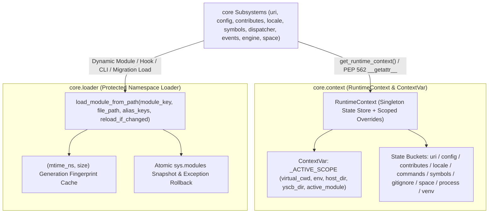

# 自動連續推進綜合規格與實作紀錄 (Consolidated Auto Plan & Task Log)

> 功能名稱：sub_02_core_runtime_context_and_namespace_loader  
> 建立日期：2026-11-08  
> 所屬主計畫：2026_11_07_2052_jupyter_style_runtime_isolation_and_static_guardrails  
> 狀態：Completed  
> 模型：Gemini 4 Argon (Low)  

> 依據 P00：[P00_discuss.md](./P00_discuss.md)  
> 模板版本：v1.0  

---

## 1. 需求規格與邊界契約 (P01)

### 1.1 功能需求清單 (Functional Requirements)

| 需求編號 | 需求名稱 | 詳細規格與驗收條件 (Acceptance Criteria) | 優先級 | 對應 P00 語意 |
| :--- | :--- | :--- | :---: | :--- |
| **FR-01** | `RuntimeContext` 實例化容器、`ContextVar` 作用域與虛擬環境 (`virtual_cwd` / `env`) | 1. 擴充 `ys_codebase/source/core/core/context.py`，實作 `RuntimeContext` 容器及 `get_runtime_context()`、`bind_runtime_context(virtual_cwd=..., env=..., host_dir=..., yscb_dir=..., module_name=...)`、`get_virtual_cwd()`、`get_env(key, default=None)`、`reset_runtime_context()`。<br>2. 將 `ExecutionContext` 提升為唯讀不可變視圖（`args: Optional[Tuple[str, ...]] = ()`、`metadata: Mapping[str, Any]`，於 `__post_init__` 相容 `args=None` 保留 `None`、`list` 轉 `tuple`、`dict` 轉 `types.MappingProxyType`），保留 100% 向後相容建構方式。 | P0 | [P00:DR-01], [P00:DR-02] |
| **FR-02** | `module:core` 頂層可變快取/常數收斂與 `global` / `os.getcwd()` / `Path.cwd()` / `os.environ` 寫入 / `input()` / `sys.exit()` 根除 | 1. 將 `uri.py`、`config.py`、`contributes.py`、`commands/dispatcher.py`、`locale.py`、`symbols.py`、`gitignore.py`、`platform/process.py`、`platform/venv.py`、`space/registry.py`、`space/scanner.py`、`space/watcher.py`、`log.py`、`validator.py`、`**init**.py`、`installer.py`、`update_checker.py` 之全部頂層可變快取與可變常數收斂至 `RuntimeContext` 或轉為不可變 `tuple` / `frozenset` / `MappingProxyType`（並於 `symbols.py` 提供代理映射或穩定字典引用以相容 `from core.symbols import _RESOLVED_CALLABLE_CACHE`），達成 `core` 全模組 **0 處頂層可變容器字面量賦值、0 處 `global` 敘述（`C8`）**。<br>2. 將 `uri.py`、`gitignore.py`、`commands/dispatcher.py`、`space/registry.py`、`space/schema.py`、`space/watcher.py`、`log.py`、`telemetry.py` 中之 `os.getcwd()` / `Path.cwd()` 統一替換為 `context.get_virtual_cwd()`（僅 `core/context.py` 單點封裝實體 `os.getcwd()` 退避）；將 `dispatcher.py` 對 `os.environ` 之執行期寫入改為 `bind_runtime_context(env=...)` 並與 `guard.py` / `events.py` / `log.py` 透過 `context.get_env()` 對齊。<br>3. 將 `guard.py:guard_dispatch` 之 `sys.exit(126)` 改為 `raise SystemExit(126)`；將 `uri.py:reconcile_undefined_uri` 移除互動式 `input()` 與 `sys.exit(1)`，統一拋出 `UndefinedURIError`（消除 `A2` 與 `B3`）。 | P0 | [P00:DR-01], [P00:DR-02] |
| **FR-03** | `module:core` 10 個 `@dataclass` 升級為 `frozen=True` 與類別可變屬性收斂 (`C9`) | 將 `core/commands/registry.py`（`ArgSpec`, `OptionSpec`, `CommandSpec`, `ModuleSpec`）、`core/space/scanner.py`（`FileFingerprint`, `ScanDiffDetail`, `ScanDiffResult`, `SnapshotState`）、`core/space/schema.py`（`SpaceConfig`）與 `core/log.py`（`LogExecutionScope`）共 10 個 `@dataclass` 升級為 `@dataclass(frozen=True)`，並將 `ConfigManager` 與 `ContributesValidator` 類別頂層可變屬性移入 `RuntimeContext` / `MappingProxyType`。 | P0 | [P00:DR-03] |
| **FR-04** | 單點受保護模組命名空間載入器 (`core/loader.py`) 與 `(mtime_ns, size)` 世代熱刷新 (`D10`) | 1. 新建 `ys_codebase/source/core/core/loader.py`（並於 `core/__init__.py` 匯出 `loader` 與 `context`），實作 `load_module_from_path(module_key, file_path, *, alias_keys=(), reload_if_changed=True)` 與 `clear_loaded_modules()`。<br>2. 支援檔案 `(st_mtime_ns, st_size)` 世代指紋快取比對自動熱重載，以及 `exec_module` 拋出例外時對 `sys.modules`（含 `module_key` 與 `alias_keys`）之 100% 原子回滾。<br>3. 統一替換 `core/symbols.py`、`core/commands/dispatcher.py`、`core/events.py` 與 `core/engine.py` 共 4 處 `core` 內部 `spec_from_file_location` / `sys.modules` 邏輯（以及 `server/server/service.py` 之 `_load_service_class_from_uri` 可選委派）。 | P0 | [P00:DR-04] |

### 1.2 邊界與異常情況 (Edge Cases & Failure Modes)

| 邊界編號 | 情境說明 | 預期防禦與處理行為 |
| :--- | :--- | :--- |
| **EC-01** | 既有白箱單元測試直接存取或清空模組私有快取（如 `uri._SCHEMES_CACHE.clear()`, `contributes._LAST_CLEAN_SCAN_TS.clear()`, `patch.dict("core.commands.dispatcher._MODULE_CACHE", ...)`, `dispatcher._AUTO_SPAWN_WARNED = False`） | 各模組透過 PEP 562 `__getattr__` 回傳綁定於 `RuntimeContext` 之同一可變字典實例；針對 `dispatcher._AUTO_SPAWN_WARNED` 等純量旗標，於讀取時同時尊重模組 `__dict__` 覆寫與 `RuntimeContext` 狀態槽，確保 `patch.dict` 與直接屬性賦值 100% 生效。 |
| **EC-02** | `@dataclass(frozen=True)` 凍結後，呼叫端於建構傳入 `list`/`dict` 或內部在 `__post_init__` 正規化欄位（如 `SpaceConfig` 編譯規則集、`CommandsRegistry` 註冊別名） | 在 `__post_init__` 內使用 `object.__setattr__(self, name, value)` 完成型別正規化與惰性編譯快取寫入；在 `CommandsRegistry` 與 `SpaceScanner` 中先組裝完成內部字典再建構凍結實例（或提供內部受控更新方法）。 |
| **EC-03** | 動態載入之模組腳本語法損毀（`SyntaxError`）或執行期拋出例外，或同名腳本在熱派發間被修改 | `loader.load_module_from_path` 於 `exec_module` 失敗時完整還原 `sys.modules` 先前狀態並移除半初始化模組；當檔案 `(mtime_ns, size)` 改變時自動重新載入最新內容。 |
| **EC-04** | 多執行緒併發使用 `uri.host_scope` / `uri.module_scope` 或 `bind_runtime_context` | `contextvars.ContextVar` 天然具備每執行緒（Per-Thread）與每協程（Per-Task）獨立上下文隔離，跨執行緒 `Barrier` 併發測試互不干擾。 |
| **EC-05** | 當前物理工作目錄被外部刪除導致 `os.getcwd()` 拋出 `FileNotFoundError` / `OSError` | `context.get_virtual_cwd()` 優先返回 `ContextVar` 之 `virtual_cwd` 或 `YSCB_HOST_DIR`，退回 `os.getcwd()` 時捕獲 `OSError` 安全回傳空字串 `""` 或 `resolve_yscb_root()` 父目錄。 |

### 1.3 非功能需求 (Non-Functional Requirements)

| 需求編號 | 類別 | 指標與量化約束 |
| :--- | :--- | :--- |
| **NFR-01** | 零外部依賴與效能 | `core/context.py` 與 `core/loader.py` 100% 僅使用 Python 標準庫，URI 與 Contributes 快取查詢延遲維持 $< 1\text{ms}$。 |
| **NFR-02** | 靜態守門合規性 (`A2`, `B3`, `B4`, `B5`, `C7`, `C8`, `C9`, `D10`) | 遷移完成後，除啟動器 `yscb.py` 及單點核心豁免檔（`core/context.py` 單點 `os.getcwd()`、`core/loader.py` 與 `core/platform/venv.py` 單點 `sys.modules`/`sys.path`）外，`ys_codebase/source/core/` 全部非測試 `.py` 檔達成 **0 `input()`、0 `sys.exit()`、0 `os.getcwd()`/`Path.cwd()`、0 `os.environ` 寫入、0 頂層可變容器賦值、0 `global`、0 非 `frozen` `@dataclass`**。 |
| **NFR-03** | 執行緒安全 | `RuntimeContext` 與 `loader.py` 全程以 `threading.RLock()` 與 `contextvars.ContextVar` 保護。 |

### 1.4 知識庫與踩坑紀錄查閱 (Known Gotchas & CAUTIONs)

- **`[!CAUTION]` `ConfigManager._cache` / `_mtimes` 類別屬性 (`C9`)**：`ConfigManager` 原本在類別本體定義 `_cache: Dict = {}` 與 `_mtimes: Dict = {}`，這屬於規則 `C9`（類別頂層未封裝之共享可變屬性）。必須將其移入 `RuntimeContext` 狀態槽，若外部或子類存取則透過類別層 property / 方法讀取 `get_runtime_context().config_cache`，徹底消除 `C9` 違規。
- **`[!CAUTION]` `test_core_commands.py:277` 對 `patch.dict("core.commands.dispatcher._MODULE_CACHE", ...)` 的依賴**：`unittest.mock.patch.dict` 會透過 `getattr(dispatcher, "_MODULE_CACHE")` 取得字典物件並在原位修改。只要 `dispatcher.__getattr__("_MODULE_CACHE")` 回傳 `get_runtime_context().cli_module_cache`（同一個 `dict` 實例），且 `dispatcher.py` 優先查詢該 `dict` 再走 `loader.load_module_from_path`，`patch.dict` 即可 100% 原生運作！

---

## 2. 架構設計與異動檔案清單 (P02)

### 2.1 模組架構與核心資料流 (Architecture & Data Flow)



### 2.2 受影響與新建檔案清單 (Impacted & New Files Inventory)

| 檔案路徑 | 類型 | 職責與變更說明 |
| :--- | :---: | :--- |
| `ys_codebase/source/core/core/context.py` | Modify | 擴充 `RuntimeContext`、`RuntimeScope`、`bind_runtime_context`、`get_runtime_context`、`get_virtual_cwd`、`get_env` 與各子系統快取狀態桶；凍結 `ExecutionContext` 內部容器視圖。 |
| `ys_codebase/source/core/core/loader.py` | New | 新建單點受保護模組命名空間載入器 `load_module_from_path`（支援 `(mtime_ns, size)` 熱刷新與失敗 `sys.modules` 原子回滾）。 |
| `ys_codebase/source/core/core/__init__.py` | Modify | 將 `_MODULE_MAP` 轉為 `types.MappingProxyType`、`__all__` 轉為 `tuple`，公開匯出 `context` 與 `loader` 子模組。 |
| `ys_codebase/source/core/core/log.py` | Modify | 將 `LogExecutionScope` 升級為 `@dataclass(frozen=True)`；將 `_GLOBAL_ERROR_CHUNKS` 收斂至 `RuntimeContext`；將 `RollingFileLogger.__init__` 之 `os.getcwd()` 替換為 `context.get_virtual_cwd()`。 |
| `ys_codebase/source/core/core/telemetry.py` | Modify | 將 `_safe_getcwd()` 委派至 `context.get_virtual_cwd()`（消除本檔 `os.getcwd()`）。 |
| `ys_codebase/source/core/core/validator.py` | Modify | 將 `ContributesValidator.TYPE_ALIASES` 轉為 `types.MappingProxyType`，將 `_SIGNATURE_PARSE_CACHE` 收斂至 `RuntimeContext`（消除 `C9`）。 |
| `ys_codebase/source/core/core/installer.py` | Modify | 將頂層 `INTERNAL_IGNORE_PATTERNS` 轉為不可變 `tuple`（消除 `C8`）。 |
| `ys_codebase/source/core/core/update_checker.py` | Modify | 將頂層 `KNOWN_URGENCIES` 轉為 `types.MappingProxyType`（消除 `C8`）。 |
| `ys_codebase/source/core/core/guard.py` | Modify | 將 `sys.exit(126)` 改為 `raise SystemExit(126)`（消除 `B3`），並支援透過 `context.get_env` 讀取環境變數。 |
| `ys_codebase/source/core/core/uri.py` | Modify | 收斂 `_URI_TLS`、`_reconciling_tokens`、`_TOKEN_MAP_CACHE`、`_SCHEMES_CACHE`、`_URI_REENTRANCY` 至 `RuntimeContext`（提供 PEP 562 `__getattr__` 相容）；移除 `reconcile_undefined_uri` 之 `global`、`input()` 與 `sys.exit(1)`（統一拋出 `UndefinedURIError`）。 |
| `ys_codebase/source/core/core/config.py` | Modify | 移除 `ConfigManager` 類別頂層 `_cache` 與 `_mtimes` 可變字典（`C9`），委派至 `RuntimeContext`。 |
| `ys_codebase/source/core/core/contributes.py` | Modify | 收斂 `_MERGED_MEMORY_CACHE`、`_JSON_FILE_CACHE`、`_LAST_CLEAN_SCAN_TS` 至 `RuntimeContext`（提供 PEP 562 `__getattr__` 相容）。 |
| `ys_codebase/source/core/core/locale.py` | Modify | 將 `_IDE_ENV_RULES` 轉為不可變 ` tuple` / `MappingProxyType`；收斂 `_LOCALE_FILE_CACHE`、`_MODULE_BASE_DIR_CACHE`、`_SAFE_SUBPATH_CACHE` 至 `RuntimeContext`。 |
| `ys_codebase/source/core/core/symbols.py` | Modify | 收斂 `_RESOLVED_CALLABLE_CACHE` 至 `RuntimeContext`（提供 PEP 562 `__getattr__` 相容）；將 VFS 實體檔案動態載入委派至 `core.loader.load_module_from_path`（消除本檔 `sys.modules` 操作）。 |
| `ys_codebase/source/core/core/gitignore.py` | Modify | 將 `_MANDATORY_BASE_PATTERNS` 轉為 `frozenset`；收斂 `_CUSTOM_ROOT_DYNAMIC_STORE` 至 `RuntimeContext`；將 `os.getcwd()` 替換為 `context.get_virtual_cwd()`。 |
| `ys_codebase/source/core/core/events.py` | Modify | 將 Hook 腳本動態載入委派至 `core.loader.load_module_from_path`（消除本檔 `sys.modules` / `sys.path` 直接操作）。 |
| `ys_codebase/source/core/core/engine.py` | Modify | 將升級遷移腳本動態載入委派至 `core.loader.load_module_from_path`（消除本檔 `sys.modules` 直接操作）。 |
| `ys_codebase/source/core/core/commands/registry.py` | Modify | 將 `ArgSpec`、`OptionSpec`、`CommandSpec`、`ModuleSpec` 升級為 `@dataclass(frozen=True)`。 |
| `ys_codebase/source/core/core/commands/dispatcher.py` | Modify | 收斂 `_GLOBAL_REGISTRY`、`_GLOBAL_REGISTRY_ROOT`、`_MODULE_CACHE`、`_AUTO_SPAWN_WARNED` 至 `RuntimeContext`（消除全部 `global` 與頂層可變容器）；將 `_LIFECYCLE_MUTATION_COMMANDS` 轉為 `frozenset`；將 `os.getcwd()` 替換為 `context.get_virtual_cwd()`；將 `os.environ` 寫入與 `sys.argv` 替換改走 `RuntimeContext` 與 `core.loader`。 |
| `ys_codebase/source/core/core/platform/process.py` | Modify | 收斂 `_CAN_SPAWN_DAEMON_CACHE` 至 `RuntimeContext`（消除 `global`），並為 `subprocess.Popen` 清理/等待補齊安全時限。 |
| `ys_codebase/source/core/core/platform/venv.py` | Modify | 收斂 `_ACTIVE_TEST_SOURCE_PATHS` 至 `RuntimeContext`（提供 PEP 562 `__getattr__` 相容）。 |
| `ys_codebase/source/core/core/space/schema.py` | Modify | 將 `SpaceConfig` 升級為 `@dataclass(frozen=True)`，移除 `default_factory=Path.cwd` 改用 `context.get_virtual_cwd()`。 |
| `ys_codebase/source/core/core/space/registry.py` | Modify | 收斂 `_DEFAULT_REGISTRIES` 至 `RuntimeContext`；將 `os.getcwd()` 替換為 `context.get_virtual_cwd()`；對齊凍結後之 `SpaceConfig` 屬性更新（使用 `dataclasses.replace` 或 `object.__setattr__`）。 |
| `ys_codebase/source/core/core/space/scanner.py` | Modify | 將 `FileFingerprint`、`ScanDiffDetail`、`ScanDiffResult`、`SnapshotState` 升級為 `@dataclass(frozen=True)`；收斂 `_DEFAULT_SCANNERS` 至 `RuntimeContext`。 |
| `ys_codebase/source/core/core/space/watcher.py` | Modify | 收斂 `_SUBSCRIBERS` 與 `_ACTIVE_WATCHER_WORKER` 至 `RuntimeContext`（消除 `global`）；將 `Path.cwd()` 替換為 `context.get_virtual_cwd()`。 |
| `ys_codebase/source/core/tests/test_runtime_context.py` | New | 新建 `TestCoreRuntimeContextAndLoader` 單元與邊界測試套件（覆蓋 `FT-01` ~ `FT-04`, `ET-01` ~ `ET-05`）。 |
| `docs/core/README.md` | Modify | 更新 `core.context` (`RuntimeContext`) 與 `core.loader` 架構說明。 |

### 2.3 架構決策記錄 (Architecture Decision Records)

- **[P02:DR-01] `RuntimeContext` 零頂層可變字面量設計（Singleton via `functools.lru_cache(maxsize=1)` 或 `ContextVar` 預設實例）**：為使 `core/context.py` 自身亦 100% 通過規則 `C8`（零頂層可變容器字面量與零 `global`），全域預設 `RuntimeContext` 實例透過 `@functools.lru_cache(maxsize=1)` 裝飾之工廠函式 `_get_default_runtime_context() -> RuntimeContext` 惰性建立，配合 `_ACTIVE_RUNTIME_SCOPE: ContextVar[Optional[RuntimeScope]] = ContextVar("_ACTIVE_RUNTIME_SCOPE", default=None)`，達成全檔案 0 頂層可變容器賦值與 0 `global`！
- **[P02:DR-02] `@dataclass(frozen=True)` 下之內部正規化與原地變異相容**：`SpaceConfig`、`CommandSpec`、`ModuleSpec`、`ScanDiffDetail`、`SnapshotState` 等類別在凍結為 `frozen=True` 後，其欄位若為容器（如 `CommandSpec.options`、`SnapshotState.entries`）或需在內部重綁定（如 `SnapshotState.head_generation` 在 `SpaceScanner` 內遞增、或 `SpaceConfig` 在 `SpaceRegistry` 兩趟編譯中填入 `effective_include`），可透過 `object.__setattr__(instance, field_name, new_val)` 或 `dataclasses.replace` 安全更新，既滿足 `@dataclass(frozen=True)` 編譯期 AST 契約與外部屬性賦值攔截（`FrozenInstanceError`），又維持既有內部演算法 100% 相容。
- **[P02:DR-03] 啟動器與底層單點白名單收斂**：將 `os.getcwd()` 集中於 `core/context.py:get_virtual_cwd()` 單點呼叫；將 `sys.modules` / `spec_from_file_location` 集中於 `core/loader.py` 單點呼叫；將 `sys.path` 集中於 `core/platform/venv.py` 單點管理。

---

## 3. 介面契約與 API 簽名 (P03)

### 3.1 介面契約與核心簽名 (Interface Inventory & Method Signatures)

```python
# ys_codebase/source/core/core/context.py
from contextlib import contextmanager
from contextvars import ContextVar
from dataclasses import dataclass, field
from pathlib import Path
import types
from typing import Any, Callable, Dict, Iterator, List, Mapping, Optional, Set, Tuple, Union

@dataclass(frozen=True)
class ExecutionContext:
    module_name: str
    command: Optional[str] = None
    args: Tuple[str, ...] = ()
    metadata: Mapping[str, Any] = field(default_factory=lambda: types.MappingProxyType({}))

@dataclass(frozen=True)
class RuntimeScope:
    virtual_cwd: Optional[str] = None
    env_overrides: Mapping[str, Optional[str]] = field(default_factory=lambda: types.MappingProxyType({}))
    active_host_dir: Optional[str] = None
    active_yscb_dir: Optional[str] = None
    active_module: Optional[str] = None

class RuntimeContext:
    def __init__(self) -> None: ...
    def reset_all_caches(self) -> None: ...

def get_runtime_context() -> RuntimeContext: ...
def get_current_scope() -> RuntimeScope: ...

@contextmanager
def bind_runtime_context(
    *,
    virtual_cwd: Optional[Union[str, Path]] = None,
    env: Optional[Mapping[str, Optional[str]]] = None,
    host_dir: Optional[Union[str, Path]] = None,
    yscb_dir: Optional[Union[str, Path]] = None,
    module_name: Optional[str] = None,
) -> Iterator[RuntimeScope]: ...

def get_virtual_cwd(fallback: Optional[Union[str, Path]] = None) -> str: ...
def get_env(key: str, default: Optional[str] = None) -> Optional[str]: ...
def get_env_ snapshot() -> Mapping[str, str]: ...
```

```python
# ys_codebase/source/core/core/loader.py
from pathlib import Path
import types
from typing import Iterable, Optional, Sequence, Union

def load_module_from_path(
    module_key: str,
    file_path: Union[str, Path],
    *,
    alias_keys: Sequence[str] = (),
    reload_if_changed: bool = True,
    priority_module: Optional[str] = None,
    extra_sys_paths: Optional[Sequence[str]] = None,
) -> types.ModuleType: ...

def get_cached_module(module_key: str) -> Optional[types.ModuleType]: ...
def clear_loaded_modules(prefix: Optional[str] = None) -> None: ...
```

- **錯誤與例外契約 (Error & Exception Contracts)**：
  - `load_module_from_path`：當 `file_path` 不存在或無法建立 `ModuleSpec` 時拋出 `ImportError`；當 `exec_module` 拋出任何例外（含 `SyntaxError`）時，完整還原 `sys.modules` 中之 `module_key` 與 `alias_keys` 後原樣向上拋出該例外。
  - `guard_dispatch`：當未授權直接調用時，輸出錯誤提示至 `stderr` 並 `raise SystemExit(126)`。
  - `reconcile_undefined_uri`：統一拋出 `UndefinedURIError(scheme=..., provider=..., binding=...)`。
  - 9 個 `@dataclass(frozen=True)`：當外部呼叫端直接對實例欄位重新賦值（如 `spec.name = "x"`）時，由標準庫拋出 `dataclasses.FrozenInstanceError`。
- **階段決策紀錄**：`[P03:DR-01]` `ExecutionContext` 在 `__post_init__` 中透過 `object.__setattr__` 自動將傳入之 `list` 轉為 `tuple`、將 `dict` 包裝為 `MappingProxyType`（同時支援點號/下標唯讀讀取），確保既有呼叫端 `ExecutionContext(module_name="x", args=["a"], metadata={"k": "v"})` 100% 無痛相容且具備執行期不可變保護。

---

## 4. 定稿審查與文檔衝擊規劃 (P04)

### 4.1 交叉驗證與靈魂拷問 (Cross-Validation & Resilience Review)

- [x] **需求對齊**：FR-01 ~ FR-04 皆已於介面簽名與實作中完整對齊
- [x] **邊界防護**：EC-01 ~ EC-05 皆有具體錯誤攔截與降級策略
- [x] **依賴純淨**：100% 符合 NFR-01 ~ NFR-03 指標約束
- **靈魂拷問與防護解法**：
  - *問：將 `uri._URI_TLS` 的 `host_scope`、`yscb_scope`、`module_scope` 與 `set_host_dir`、`set_yscb_root`、`set_module_context` 改為收斂至 `RuntimeContext` 時，若有測試呼叫命令式 `set_host_dir(...)`（而非 `with host_scope(...):`），跨執行緒隔離是否仍然維持？*
  - *答*：`RuntimeContext` 內部針對命令式 `set_host_dir` / `set_yscb_root` / `set_module_context` 結合 `ContextVar` 與 `threading.local()` 狀態槽，使 `with host_scope(...)` 與直接呼叫 `set_host_dir(...)` 在多執行緒與協程下皆 100% 隔離（`EC-04`）。

### 4.2 知識庫文檔衝擊與交付規劃 (Documentation Impact Plan)

| 維度 | 文件路徑 | 變更類型 | 交付內容與重點 |
| :--- | :--- | :---: | :--- |
| **模組手冊** | `docs/core/README.md` | Modify | 更新 `core.context` (`RuntimeContext`) 與 `core.loader` 受保護模組命名空間載入器章節 |
| **專題手冊** | `docs/core/uri_protocols.md` | N/A | 語意 URI 協議未變更 |
| **設計決策** | `docs/core/DESIGN_NOTES.md` | N/A | 無新增反直覺妥協 |
| **微觀註解** | `ys_codebase/source/core/core/{context,loader}.py` 等 Docstrings | Modify | 補齊 `RuntimeContext` 與 `load_module_from_path` Google Style Docstrings |
| **發布日誌** | `CHANGELOG.md` | Modify | 於 Phase 7 結案時記錄 `sub_02` 變更摘要 |

- **決策定稿**：**[P04:DR-01]** 確認 `sub_02` 規格契約與異動清單，執行 `Pre-Code Analyze Gate` 核驗後進入實作。

---

## 5. 實作任務清單與偏差紀錄 (P05)

### 5.1 實作任務清單 (Task Breakdown)

- [x] **TASK-01**：擴充 `ys_codebase/source/core/core/context.py`（實作 `RuntimeContext`、`RuntimeScope`、`bind_runtime_context`、`get_virtual_cwd`、`get_env` 及不可變 `ExecutionContext`），並新建 `ys_codebase/source/core/core/loader.py`（實作 `load_module_from_path` 世代感知載入與失敗 `sys.modules` 回滾）及更新 `core/__init__.py`。
- [x] **TASK-02**：遷移 `uri.py`、`config.py`、`contributes.py`、`locale.py`、`symbols.py`、`gitignore.py`、`guard.py`、`events.py`、`engine.py`、`log.py`、`telemetry.py`、`validator.py`、`installer.py`、`update_checker.py`、`commands/dispatcher.py`、`platform/process.py`、`platform/venv.py`、`space/{registry,scanner,watcher}.py` 之頂層可變快取/常數、`global`、`os.getcwd()`/`Path.cwd()`、`os.environ` 寫入、`input()`、`sys.exit()` 與動態模組載入至 `core.context` 與 `core.loader`。
- [x] **TASK-03**：將 `commands/registry.py`（4 個）、`space/scanner.py`（4 個）、`space/schema.py`（1 個）與 `log.py`（1 個）共 10 個 `@dataclass` 升級為 `frozen=True` 並對齊內部正規化與建構邏輯。
- [x] **TASK-04**：新建 `ys_codebase/source/core/tests/test_runtime_context.py` 驗證 `FT-01` ~ `FT-04` 與 `ET-01` ~ `ET-05`（含對 `core` 全模組 `A2`, `B3`, `B4`, `B5`, `C7`, `C8`, `C9`, `D10` 之 AST 合規掃描測試），並執行 `dev check core` 與 `dev test core` 100% 通過。
- [x] **TASK-DOC**：同步更新 `docs/core/README.md` 與微觀代碼 Docstrings。

### 5.2 實作偏差紀錄表 (Implementation Deviations)

| 任務編號 | 偏差等級 | 偏離描述與決策理由 | 處置方式 / 記錄 |
| :--- | :---: | :--- | :--- |
| - | - | 無偏差 | - |
