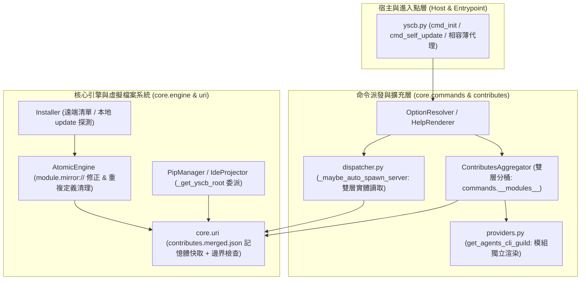
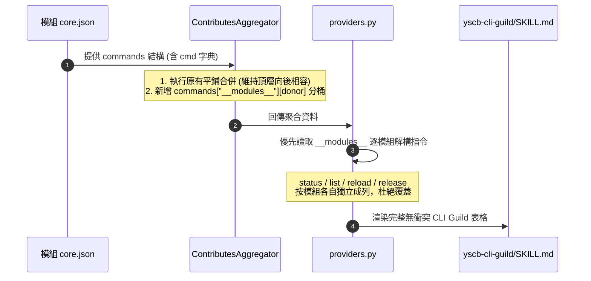
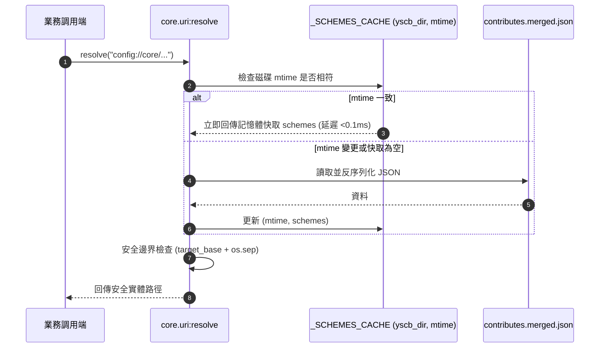

# 架構設計說明書 (Architecture Design)

> 功能名稱：sub_01_host_and_core_foundation_remediation  
> 建立日期：2026-10-14  
> 所屬主計畫：2026_10_14_1224_deep_audit_and_ecosystem_refinement  
> 狀態：Confirmed  
> 模板版本：v1.2  

---

## 1. 模組架構分層與職責邊界 (Layered Architecture)

---

## 2. 核心資料流與循序圖 (Data Flow & Sequence Diagram)

### 2.1 雙層分桶指令聚合與 CLI Guild 渲染循序圖

### 2.2 URI 記憶體快取與邊界防禦循序圖

---

## 3. 受影響檔案與新建檔案清單 (Impacted & New Files Inventory)

| 檔案路徑 | 類型 | 職責與變更說明 |
| :--- | :---: | :--- |
| `ys_codebase/source/core/core/contributes.py` | Modify | 實作 `ContributesAggregator` 於 `commands` 建立 `"__modules__"` 分桶映射。 |
| `ys_codebase/source/core/core/providers.py` | Modify | `get_agents_cli_guild` 優先走訪 `__modules__` 渲染獨立指令列，相容頂層 fallback。 |
| `ys_codebase/source/core/contributes/core.json` | Modify | 補齊 `contributes list` 之 `module` 選項 `"args"` 定義；補齊 `restore` 之 `provider` 選項。 |
| `ys_codebase/source/core/core/engine.py` | Modify | 清除重複定義方法 (L249-252, L648-755)；`act_prepare` 修正為 `module.mirror://`；`act_deploy_configs_from_modules` 容錯讀取 `commands.cmd`。 |
| `ys_codebase/source/core/core/pip_manager.py` | Modify | `_resolve_yscb_root` 委派 `core.uri._get_yscb_root()`；`_ensure_gitignore` 委派 `installer.generate_internal_gitignore`。 |
| `ys_codebase/source/core/core/ide_projector.py` | Modify | `_resolve_yscb_root` 委派 `core.uri._get_yscb_root()`。 |
| `ys_codebase/source/core/core/commands/dispatcher.py` | Modify | `_maybe_auto_spawn_server` 依序合併 `config.project.json` 與 `config.local.json`。 |
| `ys_codebase/source/core/core/installer.py` | Modify | `cmd_list` 支援 manifest 讀取與 remote/provider；`cmd_update` 支援本地 `.zip`/`index.json` 探測；修正預設 URL。 |
| `yscb.py` | Modify | 進入點參數解析支援空格傳參與等號雙語法；`_fetch_and_extract_zip` 補齊防呆例外。 |
| `ys_codebase/source/core/core/uri.py` | Modify | 補齊 `target_base + os.sep`；`to_uri` 支援 `config` 協議；`reconcile_undefined_uri` 刷新快取；加入 `(yscb_dir, mtime)` 記憶體快取。 |
| `ys_codebase/source/core/contributes/_format.json` | Modify | `ArgDef.required` 預設值修正為 `"bool? = true"`。 |
| `ys_codebase/source/core/core/commands/registry.py` | Modify | 同時相容 `choice` 與 `choices`。 |
| `ys_codebase/source/core/core/__init__.py` | Modify | 補齊 `_MODULE_MAP` 與 `__all__`（`config`, `validator`, `providers`, `ide_projector`）。 |
| `ys_codebase/source/core/core/semver.py` | Modify | 修正 `VersionTuple.__str__` 在含 `prerelease` 時保留非零 `revision`。 |

---

## 4. 架構決策記錄 (Architecture Decision Records)

- **[P02:DR-01] 聚合隔離與平鋪雙軌結構**：
  在 `commands` 頂層保留原有平鋪字典，同時在 `commands["__modules__"][donor_mod]` 保存各模組專屬指令集合。提供者函式優先依模組分組，既徹底消滅 `status` / `list` 等同名指令覆蓋，又保護使用舊平鋪字典 mock 的單元測試。
- **[P02:DR-02] 基於實體路徑的雙層組態合併**：
  `_maybe_auto_spawn_server(host_dir, yscb_abs)` 嚴格以傳入的 `yscb_abs` 拼接實體路徑讀取，不調用全域 `core.config.get()`，以避免破壞 `test_core_commands.py:509-619` 臨時測試目錄環境。
- **[P02:DR-03] URI Schemes 記憶體快取失效策略**：
  以 `(yscb_dir, mtime)` 為快取 Key。每次查詢僅執行極輕量 `os.path.getmtime()`（耗時數微秒），當且僅當 `mtime` 不符或快取缺失時才重新讀取反序列化，達成效能與即時一致性之最佳平衡。

