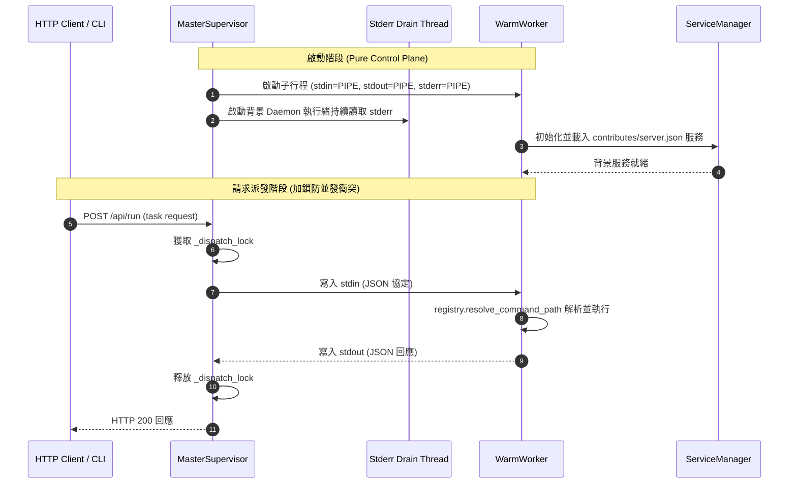

# 架構設計說明書 (Architecture Design)

> 功能名稱：sub_02_dev_and_server_reliability_remediation  
> 建立日期：2026-10-14  
> 所屬主計畫：2026_10_14_1224_deep_audit_and_ecosystem_refinement  
> 狀態：Confirmed  
> 模板版本：v1.2  

---

## 1. 模組架構分層與職責邊界 (Layered Architecture)

```text
+-----------------------------------------------------------------------------------+
|                            Developer CLI Interface                                |
|   (dev test -k, dev create, dev check, dev release-check --all, server start/stop) |
+-----------------------------------------------------------------------------------+
           |                                                      |
           v                                                      v
+-----------------------------+               +--------------------------------------+
|       Dev Toolchain         |               |       Server Control Plane (Master)  |
| - cli.py: Option parsing    |               | - MasterSupervisor: HTTP API & PIDs  |
| - tester.py: -k & --target  |               | - _dispatch_lock: Serialized Worker  |
| - scaffold.py: Modern arch  |               | - Stderr Drain Daemon: Zero deadlock |
| - checker.py: Strict specs  |               +--------------------------------------+
+-----------------------------+                                  | (IPC: stdio)
                                                                 v
                                              +--------------------------------------+
                                              |       Server Execution Plane (Worker)|
                                              | - WarmWorker: stdio loop listener    |
                                              | - ServiceManager: contributes/server |
                                              | - registry.resolve_command_path      |
                                              +--------------------------------------+
```

---

## 2. 核心資料流與循序圖 (Data Flow & Sequence Diagram)



---

## 3. 受影響檔案與新建檔案清單 (Impacted & New Files Inventory)

| 檔案路徑 | 類型 | 職責與變更說明 |
| :--- | :---: | :--- |
| `ys_codebase/source/dev/scripts/cli.py` | Modify | 改用 `bags.get_option_value()` 修正選項物件字串寫入缺陷 |
| `ys_codebase/source/dev/dev/tester.py` | Modify | 支援 `-k` 測試篩選參數；修正 `--target` 冒號與無冒號模組萃取 |
| `ys_codebase/source/dev/dev/scaffold.py` | Modify | 升級模組骨架模板為微內核標準合約（`CmdBags`、`YSCBTestCase`、四位版號） |
| `ys_codebase/source/dev/dev/case.py` | Modify | 補齊 mock 模組生成之 `self.mark_passed()` 呼叫 |
| `ys_codebase/source/dev/dev/checker.py` | Modify | 當宣告 `commands.cmd` 時剛性校驗葉節點函式；排除首行 Docstring AST |
| `ys_codebase/source/dev/dev/releaser.py` | Modify | 實作 `release-check --all` 批次預檢功能 |
| `ys_codebase/source/dev/contributes/core.json` | Modify | 補齊 `test`, `release-check`, `release-git` 漏宣告選項 |
| `ys_codebase/source/server/server/master.py` | Modify | `_dispatch_lock` 序列化保護；背景執行緒排空 `stderr`；關閉 Pipe 資源 |
| `ys_codebase/source/server/server/worker.py` | Modify | 整合 `ServiceManager` 託管動態服務；以 `resolve_command_path` 解析多層指令 |
| `ys_codebase/source/server/server/logger.py` | Modify | 更新 `HIST_REGEX` 支援 `(?:_\d{2,})?_log$` |
| `ys_codebase/source/server/tests/test_server*.py` | Modify | 補齊 `super().setUp()` / `tearDown()` 調用 |

---

## 4. 架構決策記錄 (Architecture Decision Records)

- **[P02:DR-01] 堅守「Master is pure control plane」鐵律**：
  MasterSupervisor 僅作為純粹控制平面與 HTTP 閘道，負責行程守護與 IPC 調度，嚴禁將 KnowledgeDB 等領域背景服務直接塞入 Master。領域背景服務統一在 Worker 端由 `ServiceManager` 依據宣告配置安全託管。
- **[P02:DR-02] IPC 通訊管線原子鎖與主動排空防死鎖**：
  對單一 Worker 標準輸入輸出的調用以執行緒鎖 `_dispatch_lock` 保證原子序列化；Worker `stderr` 由獨立 Daemon 執行緒隨時吸納日誌，防止 OS Pipe Buffer（典型 64KB）在大型例外輸出時堵塞 Worker 進程。

