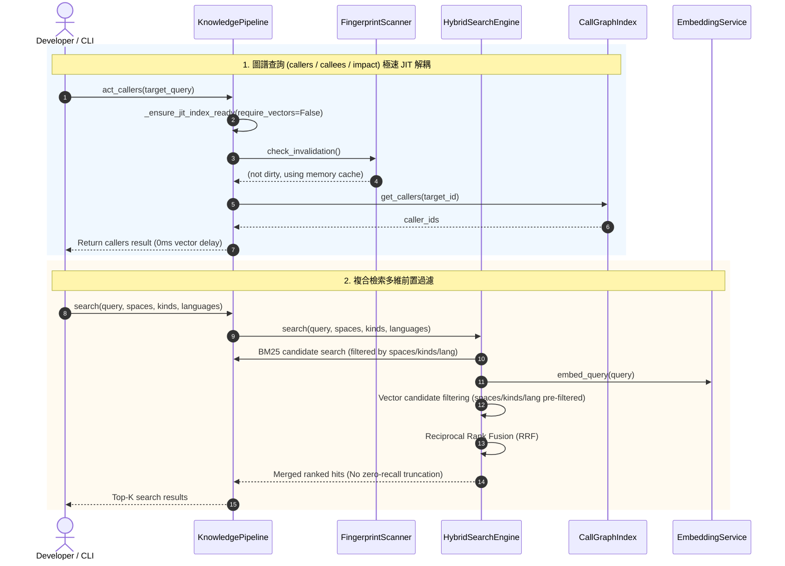

# 架構設計說明書 (Architecture Design)

> 功能名稱：sub_03_knowledge_db_and_workflow_engine_remediation  
> 建立日期：2026-10-14  
> 所屬主計畫：2026_10_14_1224_deep_audit_and_ecosystem_refinement  
> 狀態：Confirmed  
> 模板版本：v1.2  

---

## 1. 模組架構分層與職責邊界 (Layered Architecture)

```text
┌────────────────────────────────────────────────────────────────────────┐
│                        CLI / Developer Interface                       │
│  knowledge-db (search, callers, callees, impact, clean)                │
│  agents-workflow (list, init, verify-plan, session-analysis)           │
└────────────────────────────────────┬───────────────────────────────────┘
                                     │
       ┌─────────────────────────────┴─────────────────────────────┐
       ▼                                                           ▼
┌──────────────────────────────┐            ┌──────────────────────────────┐
│       Knowledge-DB Core      │            │    Agents-Workflow Engine    │
├──────────────────────────────┤            ├──────────────────────────────┤
│ • Pipeline & JIT Readiness   │            │ • ArtifactPublisher          │
│   (ensure_jit_index_ready)   │            │   (recursive dir hashing)    │
│ • HybridSearchEngine         │            │ • ArtifactCompiler           │
│   (spaces/kinds/lang filter) │            │   (Stage 2 link & slash fix) │
│ • InvertedIndex & Graph      │            │ • PlanVerifier               │
│   (exact/suffix path match)  │            │   (status enums & 2-lvl rule)│
│ • EmbeddingService           │            │ • Analyzer Script            │
│   (empty array on failure)   │            │   (antigravity brain paths)  │
│ • Formatter & ServiceWorker  │            │                              │
└──────────────────────────────┘            └──────────────────────────────┘
```

---

## 2. 核心資料流與循序圖 (Data Flow & Sequence Diagram)



---

## 3. 受影響檔案與新建檔案清單 (Impacted & New Files Inventory)

| 檔案路徑 | 類型 | 職責與變更說明 |
| :--- | :---: | :--- |
| `ys_codebase/source/knowledge-db/knowledge_db/pipeline.py` | Modify | 增量修補同名檔精確路徑比對；提取 `_ensure_jit_index_ready`；`clean()` 補齊向量二進位刪除與全域快取清理 |
| `ys_codebase/source/knowledge-db/knowledge_db/retrieval.py` | Modify | `InvertedIndex.patch_incremental` 修正路徑包含斜線時之比對邏輯，保留純檔名向後相容 |
| `ys_codebase/source/knowledge-db/knowledge_db/hybrid.py` | Modify | `HybridSearchEngine.search` 支援 `spaces`、`kinds`、`languages` 前置過濾 |
| `ys_codebase/source/knowledge-db/knowledge_db/embedding.py` | Modify | `embed_texts` 在非 mock 且無可用模型/異常時回傳空陣列 |
| `ys_codebase/source/knowledge-db/knowledge_db/formatter.py` | Modify | 修正 `format_callees_output` 詳細模式下重複附加程式碼切片問題 |
| `ys_codebase/source/knowledge-db/knowledge_db/service.py` | Modify | 修正 `.watcher_dirty` 清理時機，移至熱修補成功之後 |
| `ys_codebase/source/agents-workflow/agents_workflow/publisher.py` | Modify | `_get_source_file_sha1` 支援目錄型資產遞迴雜湊 |
| `ys_codebase/source/agents-workflow/agents_workflow/compiler.py` | Modify | Stage 2 路徑解析保留尾斜線，Markdown 連結括號內反引號剝除 |
| `ys_codebase/source/agents-workflow/agents_workflow/plans/verifier.py` | Modify | `VALID_STATUSES` 擴充 SOP 狀態枚舉；預設歸檔路徑容錯 |
| `ys_codebase/source/agents-workflow/assets/skills/session-analysis/scripts/analyzer.py` | Modify | 補齊 Antigravity brain 軌跡目錄路徑 |
| `ys_codebase/source/agents-workflow/scripts/cli.py` | Modify | `list` 命令輸出解開描述中的佔位符標籤 |
| `docs/knowledge-db/DESIGN_NOTES.md` | Modify | 登記 `[DN-KDB-08]` 增量同名檔防護、複合檢索前置過濾與 JIT 解耦 |
| `docs/agents-workflow/DESIGN_NOTES.md` | Modify | 登記 `[DN-AWF-07]` 目錄遞迴指紋、Stage 2 尾斜線與計畫狀態對齊 |

---

## 4. 架構決策記錄 (Architecture Decision Records)

- **[P02:DR-01] 增量修補同名檔連坐誤刪消除**：
  若傳入路徑含有斜線（`"/" in p`），嚴禁僅以 `Path(p).name == sym_fn` 做為判定依據；必須滿足 `sym_path_norm == p`、`sym_path_norm.endswith("/" + p)` 或 `p.endswith("/" + sym_path_norm)`。僅在不含斜線之邊界情況下允許檔名退化比對。
- **[P02:DR-02] 複合檢索維度前置注入過濾**：
  維度過濾（`spaces`、`kinds`、`languages`）必須在檢索評分與截斷前完成，保證輸出的 Top-K 候選集皆滿足維度約束。
- **[P02:DR-03] JIT 索引檢查與向量推論管線解耦**：
  呼叫圖譜（`act_callers`、`act_callees`、`act_impact`）以結構化 AST 符號與邊為核心，無須向量資料；透過獨立 `_ensure_jit_index_ready(require_vectors=False)` 觸發熱自愈，跳過所有向量模型推論。

