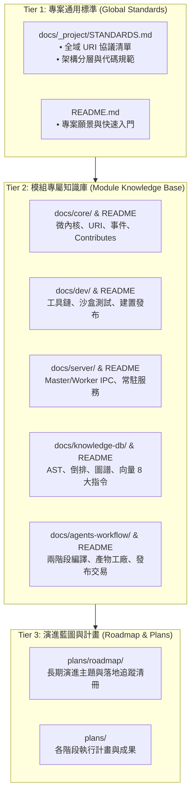

# 架構設計與拓撲規劃書 (Architecture Plan)

> 功能名稱：sub_04_docs_standards_and_docstring_alignment  
> 建立日期：2026-10-14  
> 所屬主計畫：2026_10_14_1224_deep_audit_and_ecosystem_refinement  
> 狀態：Confirmed  
> 模板版本：v1.4  

---

## 1. 模組架構分層與職責邊界 (Architecture & Responsibility)

- **Tier 1 (全域標準)**：`docs/_project/STANDARDS.md` 定義系統級規範與標準 URI 協議映射。
- **Tier 2 (模組知識庫)**：五大模組 `README.md`、`DESIGN_NOTES.md` 與專題手冊，對齊真實代碼行為。
- **Tier 3 (演進與路線圖)**：`plans/roadmap/` 記錄長程架構主題與落地追蹤。

---

## 2. 核心資料流與循序圖 (Data Flow & Sequence Diagram)

---

## 3. 受影響檔案與新建檔案清單 (Affected & New Files)

| 檔案路徑 | 變更類型 | 變更說明 |
| :--- | :---: | :--- |
| `docs/_project/STANDARDS.md` | Modify | 校準 URI 協議映射表 |
| `docs/core/DESIGN_NOTES.md` | Modify | 修正 DN-09 標題與 SEMVER 說明 |
| `docs/dev/DESIGN_NOTES.md` | Modify | 修正 DN-DEV-02 與 CmdBags 範例 |
| `source/server/README.md` | New | 建立 server 模組說明文件 |
| `docs/server/README.md` | Modify | 更新 Worker ServiceManager 架構說明 |
| `docs/knowledge-db/*.md` | Modify | 收斂 8 大指令，刪除已廢止指令範例 |
| `docs/agents-workflow/*.md` | Modify | 更新兩階段架構與動態語法說明 |
| `plans/roadmap/*.md` | Modify | 更新已落地主題狀態 |

---

## 4. 架構決策紀錄 (Architecture Decision Records, ADR)

- **[P02:ADR-01] 確立文檔為唯一真理 (SSOT)**：
  文檔必須 100% 反映真實代碼架構與命令列介面，嚴禁遺留已刪除指令之教學。

