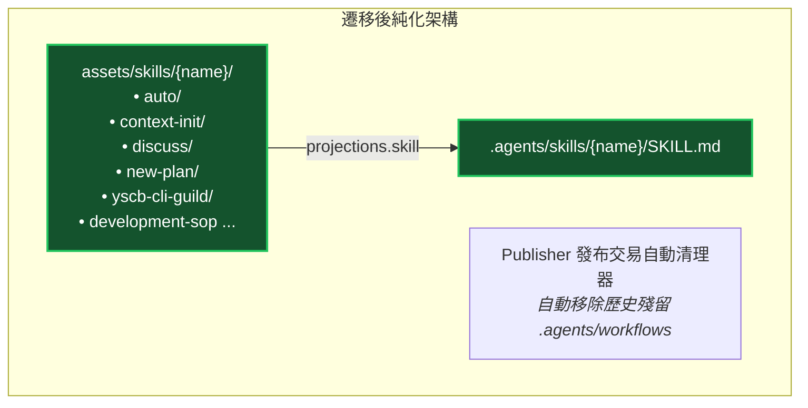

# 架構設計與拓撲規劃書 (Architecture Plan)

> 功能名稱：sub_05_agents_workflow_skill_unification  
> 建立日期：2026-10-14  
> 所屬主計畫：2026_10_14_1224_deep_audit_and_ecosystem_refinement  
> 狀態：Confirmed  
> 模板版本：v1.4  

---

## 1. 模組架構分層與職責邊界 (Architecture & Responsibility)

- **資產宣告層**：`_format.json` 與 `contributes/agents-workflow.json` 定義純 Skill 資產 DSL。
- **編譯解析層**：`compiler.py` 負責雙階段解析，歷史 workflow 自動相容轉譯為 skill。
- **發布發行層**：`publisher.py` 投影至 `.agents/skills/` 並自動清理歷史殘留 `.agents/workflows/`。

---

## 2. 核心資料流與循序圖 (Data Flow & Sequence Diagram)

---

## 3. 受影響檔案與新建檔案清單 (Affected & New Files)

| 檔案路徑 | 變更類型 | 變更說明 |
| :--- | :---: | :--- |
| `assets/skills/*/SKILL.md` | New | 建立 8 大流程之獨立 Skill 套件目錄 |
| `assets/workflows/` | Delete | 移除舊版 workflows 目錄 |
| `contributes/agents-workflow.json` | Modify | 8 大資產轉為 `skill` 導出 |
| `config/agents-workflow/skills/bump-revision/SKILL.md` | New | 專案特化 `bump-revision` 遷移至標準 Skill 結構 |
| `config/agents-workflow/workflows/` | Delete | 移除專案組態中的舊版 workflows 目錄 |
| `publisher.py` | Modify | 發布時自動清理專案中殘留之 `.agents/workflows/` 目錄 |

---

## 4. 架構決策紀錄 (Architecture Decision Records, ADR)

- **[P02:ADR-01] 全面統一為 Skill 規範**：
  廢除獨立 Workflow 模型，全面對齊業界 Agent 技能標準（目錄包含 `SKILL.md` 與標準 YAML frontmatter）。

