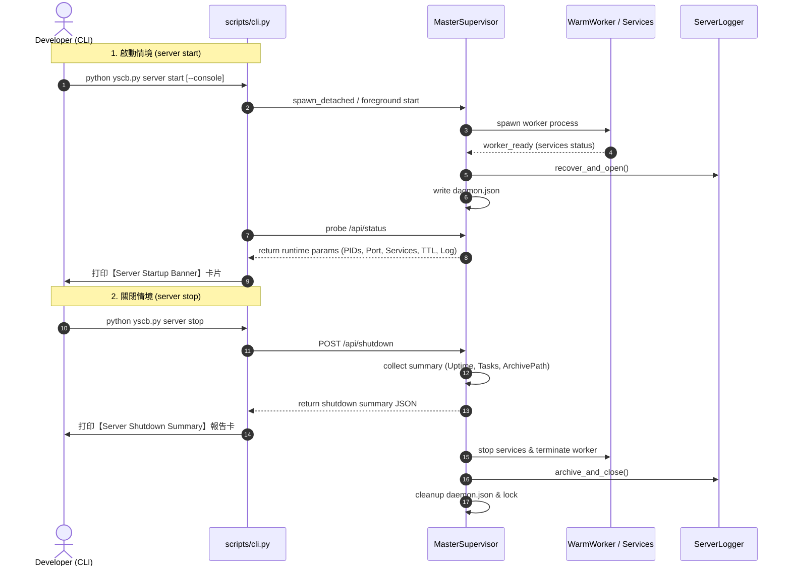

# Phase 2: 架構設計與拓撲規劃 (P02 Architecture Plan)

> 功能名稱：sub_06_downstream_cli_ux_and_server_feedback  
> 建立日期：2026-10-14  
> 所屬主計畫：2026_10_14_1224_deep_audit_and_ecosystem_refinement  
> 狀態：Confirmed  
> 模板版本：v1.4  

---

## 1. 模組架構分層與職責邊界 (Architecture & Responsibility)

- **MasterSupervisor 控制平面**：持有多進程狀態指標（Uptime、任務數、服務狀態），提供可觀測性 API。
- **CLI 終端呈現層**：格式化結構化 ASCII 啟動橫幅與停機報告卡，並支援前台日誌串流回顯。
- **ServerLogger 磁碟日誌層**：提供 `get_expected_archive_path()` 與 Console 即時 Tee 串流。

---

## 2. 核心資料流與循序圖 (Data Flow & Sequence Diagram)

---

## 3. 受影響檔案與新建檔案清單 (Affected & New Files)

| 檔案路徑 | 變更類型 | 變更重點說明 |
| :--- | :---: | :--- |
| `source/server/server/master.py` | Modify | 記錄 `start_time`，格式化橫幅與總結，擴充 status/shutdown API |
| `source/server/scripts/cli.py` | Modify | 整合橫幅與總結輸出至 `start()`、`stop()` 與 `status()` |
| `source/server/server/logger.py` | Modify | 支援 `get_expected_archive_path()` 與 `echo_console` |
| `source/server/tests/test_server.py` | Modify | 增補橫幅與總結單元測試 |

---

## 4. 架構決策紀錄 (Architecture Decision Records, ADR)

- **[P02:ADR-01] 格式化模組集中於 master.py**：
  橫幅與總結之格式化邏輯放置於 `server/master.py` 作為純函式，使 CLI 與前台模式可零重複共享，亦利於單元測試直接測試字串斷言。

