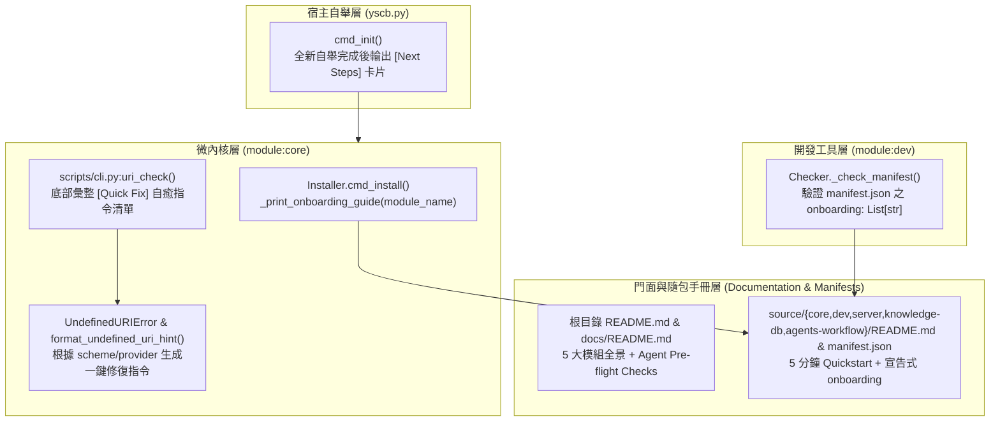
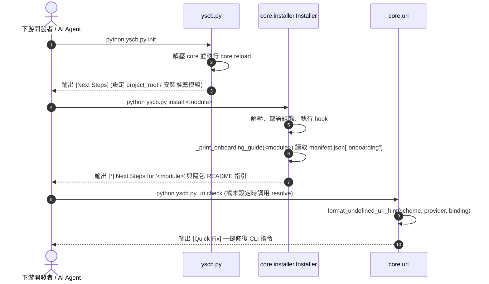

# 架構設計說明書 (Architecture Design)

> 功能名稱：2026_10_14_1554_downstream_onboarding_and_ux_guidance  
> 建立日期：2026-10-14  
> 所屬主計畫：N/A (獨立計畫)  
> 狀態：Confirmed  
> 模板版本：v1.2  

---

## 1. 模組架構分層與職責邊界 (Layered Architecture)

---

## 2. 核心資料流與循序圖 (Data Flow & Sequence Diagram)

---

## 3. 受影響檔案與新建檔案清單 (Impacted & New Files Inventory)

| 檔案路徑 | 類型 | 職責與變更說明 |
| :--- | :---: | :--- |
| `yscb.py` | Modify | `cmd_init` 於全新初始化成功後輸出 `[Next Steps]` 引導卡片 |
| `ys_codebase/source/core/core/installer.py` | Modify | 新增 `_print_onboarding_guide(module_name)` 並在 `cmd_install` 成功後調用 |
| `ys_codebase/source/core/core/uri.py` | Modify | 新增 `format_undefined_uri_hint` 並整合至 `UndefinedURIError` |
| `ys_codebase/source/core/scripts/cli.py` | Modify | `uri_check` 於存在 `UNDEFINED` 協議時輸出 `[Quick Fix]` 修復指令區塊 |
| `ys_codebase/source/dev/dev/checker.py` | Modify | `_check_manifest` 支援檢驗 `onboarding` 選填欄位（必須為非空字串之 `list`） |
| `ys_codebase/source/*/manifest.json` | Modify | 為 `core`, `dev`, `server`, `knowledge-db`, `agents-workflow` 補齊 `onboarding` 引導步驟 |
| `README.md`, `docs/README.md` | Modify | 補齊 5 大模組架構全景、`yscb.py init` 起手式、修正 `knowledge-db` 與 `agents-workflow` 教學 |
| `ys_codebase/source/*/README.md` | Modify | 5 大模組隨包 `README.md` 補齊 5 分鐘 Quickstart、正確組態設定與 Cookbook |
| `ys_codebase/source/core/tests/test_uri.py` | Modify | 新增 `UndefinedURIError` 與 `uri_check` 自癒提示單元測試 |
| `ys_codebase/source/core/tests/test_remote_zip_bootstrap.py` | Modify | 新增 `cmd_init` 與 `cmd_install` onboarding 引導輸出單元測試 |

---

## 4. 架構決策記錄 (Architecture Decision Records)

- **[P02:DR-01] 宣告式 `manifest.json` `onboarding` 欄位設計**：
  - 採用字串陣列 `"onboarding": ["python yscb.py ...", ...]`，保持 JSON 結構扁平直觀，同時讓 `Installer` 自動附加 `.modules/<mod>/README.md` 本地手冊路徑提示。
- **[P02:DR-02] `format_undefined_uri_hint` 智慧分流規則**：
  - 針對 `project` 協議提示 `python yscb.py config set core project_root ./`；針對 `agents-workflow` 提供的 `workflow.*` 協議提示一鍵初始化 `python yscb.py agents-workflow init --default`；針對一般模組協議則提示 `python yscb.py config set <provider> <binding> <path>`。

