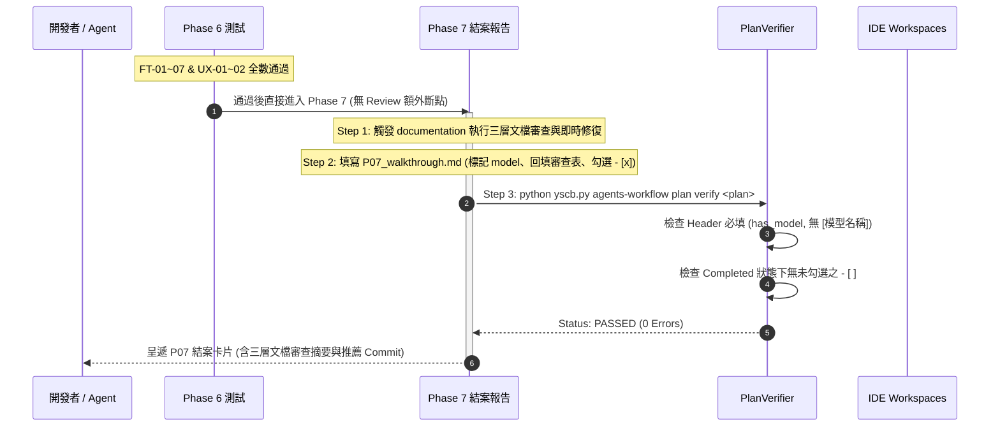

# 架構設計說明書 (Architecture Design)

> 功能名稱：2026_10_14_1650_agents_workflow_audit_and_consolidation  
> 建立日期：2026-10-14  
> 所屬主計畫：N/A (獨立計畫)  
> 狀態：Confirmed  
> 模型：Gemini 3.8 Flash  

> 模板版本：v1.2  

---

## 1. 模組架構分層與職責邊界 (Layered Architecture)

```text
┌────────────────────────────────────────────────────────────────────────┐
│                        IDE Layer (Agents & Tools)                      │
│     AGENTS.md / CLAUDE.md  <-- Projected from .agents/skills/          │
└───────────────────────────────────┬────────────────────────────────────┘
                                    │
┌───────────────────────────────────▼────────────────────────────────────┐
│                    Assets Layer (SSOT Source Assets)                   │
│  - standards/AgentsStandards.md                                        │
│  - skills/ (12 Skills, new-plan 輕量化 ~25 行，指向 development-sop)    │
│  - templates/ (15 模板純淨化，全數標頭新增 > 模型：[模型名稱])         │
└───────────────────────────────────┬────────────────────────────────────┘
                                    │
┌───────────────────────────────────▼────────────────────────────────────┐
│                     Engine Layer (agents_workflow/)                    │
│  - compiler.py (Stage 1/2 Token 編譯，收斂 59->15 Token，清除死代碼)    │
│  - publisher.py (原子發布至各 release_target)                         │
│  - plans/                                                              │
│    ├── __init__.py (_resolve_uri_path 抽取共用)                        │
│    ├── verifier.py (新增 has_model、移除 archived 檢驗、未勾選 FAIL)   │
│    ├── scanner.py / searcher.py / archiver.py (共用模組調用)           │
│    └── roadmap.py                                                      │
└────────────────────────────────────────────────────────────────────────┘
```

---

## 2. 核心資料流與循序圖 (Data Flow & Sequence Diagram)



---

## 3. 受影響檔案與新建檔案清單 (Impacted & New Files Inventory)

| 檔案路徑 | 類型 | 職責與變更說明 |
| :--- | :---: | :--- |
| `assets/templates/header.md` | Modify | 新增 `> 模型：[模型名稱]` 統一標頭 |
| `assets/templates/{umbrella_overview,RXX_research_report,roadmap,handoff}.md` | Modify | 頂部標頭新增 `> 模型：[模型名稱]`，清除頂部 HTML 註解 |
| `assets/templates/{fast_track_plan,changelog}.md` | Modify | 清除頂部 HTML 註解，修正 Fast Track 與偏差等級衝突 |
| `assets/templates/P07_walkthrough.md` | Modify | 增強結構化三層文檔審查表與結案合規 Checkbox |
| `assets/skills/new-plan/SKILL.md` | Modify | 廢除 `DEVELOPMENT_STANDARDS` 注入，精簡為 ~25 行輕量分流啟動入口 |
| `assets/skills/development-sop/SKILL.md` | Modify | 導航矩陣與追溯鏈將 Review 內化併入 P07，修正超連結 |
| `assets/skills/development-sop/references/review_gate.md` | Delete | 廢除獨立 Review Gate 文件，內容完整內化至 `phase_07_walkthrough.md` |
| `assets/skills/development-sop/references/phase_07_walkthrough.md` | Modify | 重構為「Phase 7: 結案品質審查與成果展示」，內化 3-Step 審查管線 |
| `assets/skills/development-sop/references/phase_06_test.md` | Modify | 修正下一步直接導向 Phase 7 結案 |
| `assets/skills/development-sop/references/plan_modes.md` | Modify | 修正 Fast Track FT-3 內化審查，簡化 Research/Roadmap 導向專屬 Skill |
| `assets/skills/auto/SKILL.md` | Modify | 修正 P06 通過後接續步驟直接為 Phase 7 |
| `assets/skills/{continue,pause,discuss,research,roadmap}/SKILL.md` | Modify | 修正開頭導向 `development-sop`，消除重複與雙斜線 |
| `assets/skills/context-init/SKILL.md` | Modify | 更新準則描述與當前 `AgentsStandards.md` 一致 |
| `contributes/agents-workflow.json` | Modify | 移除 48 個碎片與死 Token，刪除 `DEVELOPMENT_STANDARDS` 與 `DYNAMIC_CONTEXT_MAP`，更新過時描述 |
| `contributes/_manifest.md` | Modify | 同步最新 CLI、語意 URI 與導出清冊 |
| `agents_workflow/providers.py` | Delete | 刪除 76 行未被任何 Skill 引用之死代碼 |
| `agents_workflow/plans/__init__.py` | Modify | 抽取共用 `_resolve_uri_path(uri: str)` 輔助函式 |
| `agents_workflow/plans/verifier.py` | Modify | 新增 `has_model` 檢核、佔位符攔截、移除 `verify_all_plans` archived 檢查、檢查 Completed 下未勾選 `- [ ]` |
| `agents_workflow/plans/{scanner,archiver,searcher}.py` | Modify | 引用 `plans.__init__._resolve_uri_path`，統一 fallback 路徑為 `plans/archived` |
| `agents_workflow/compiler.py` | Modify | 移除重複 `return` 死代碼，修復雙斜線產生問題 |
| `scripts/cli.py` | Modify | 修復 `plan_search` 之 `get_option` 為 `get_option_value` |
| `tests/test_plans_toolchain.py` | Modify | 測試輔助函式補齊 `model` 標頭，新增 `model` 檢核與未勾選 Checkbox 阻斷測試 |
| `tests/test_compiler.py` | Modify | 移除針對已刪除 `providers.py` 的測試依賴 |

---

## 4. 架構決策記錄 (Architecture Decision Records)

- **[P02:DR-01] 標頭欄位與佔位符正則約束**：
  - Header 模式統一為：`> 模型：[模型名稱]`。`PlanVerifier` 解析時不分大小寫比對 `["模型", "model", "使用模型", "執行模型", "ai_model"]`。未替換佔位符攔截加入 `r"\[模型名稱\]"` 與 `r"\[Model Name\]"`。
- **[P02:DR-02] 驗證器單一職責純化：活躍計畫嚴格守門、歷史封存完全凍結**：
  - `verify_all_plans()` 刪除對 `workflow.archived://` 的掃描。歷史歸檔計畫為不可變歷史產物，不再受新版規則或標頭約束回溯影響。
- **[P02:DR-03] P07 審查防忽略三合一閉環**：
  - 結案品質審查不是額外的「過場階段」，而是 P07 成果展示的第一道必要工序；透過指引強約束、模板強結構、驗證器未勾選強阻斷，保證審查品質不降級。
- **[P02:DR-04] Token 空間拓撲瘦身**：
  - `contributes/agents-workflow.json` 保留核心跨模組注入點（`PHASEXX_HEADER`、`WORKFLOW_SOP_STANDARDS`、`AGENTS_SKILL_ROUTING`、`AGENTS_CLI_GUILD`、`SESSION_ANALYSIS_CHECK_ITEMS`），大幅提升編譯掃描效能與可維護性。

