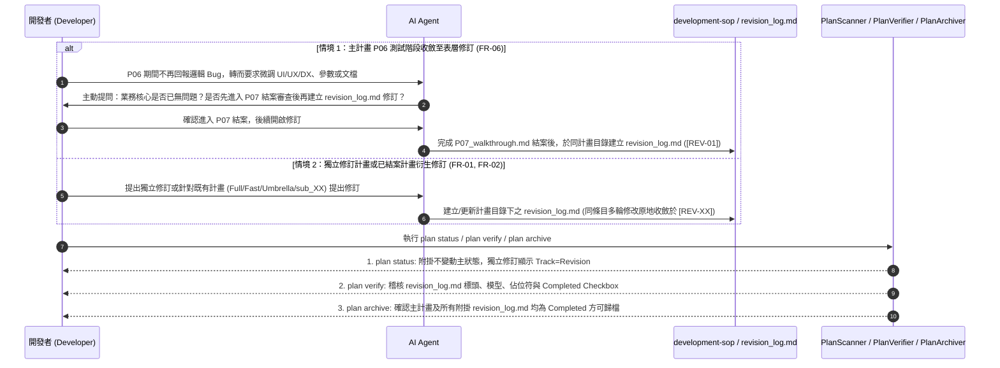

# 架構設計說明書 (Architecture Design)

> 功能名稱：修訂計畫 (Revision Plan) 正交化定位重構、留檔強制化與 SOP 邊界純化  
> 建立日期：2026-10-17  
> 所屬主計畫：N/A  
> 狀態：Confirmed  
> 模型：Gemini 4 Argon (Low)  

> 模板版本：v1.2  

---

## 1. 模組架構分層與職責邊界 (Layered Architecture)

```text
+-----------------------------------------------------------------------------------+
|                      agents-workflow 資產與規範層 (Assets & Skills)               |
|  - assets/templates/revision_log.md (新增標準模板，嵌入 PHASEXX_HEADER)           |
|  - assets/skills/development-sop/ (SKILL.md + references/plan_modes.md,           |
|    phase_00_discuss.md, phase_05_task.md, phase_06_test.md, phase_07_walkthrough) |
|  - assets/skills/{new-plan,continue,auto}/SKILL.md                                |
|  - 去特化純化：剝離 YSCB 自引用規則 (@build / dev test)，回歸通用專案框架表述      |
+-----------------------------------------------------------------------------------+
                                         |
                                         v (Contributes & Stage 1/2 編譯發布)
+-----------------------------------------------------------------------------------+
|                      Dev Plans 工具鏈引擎 (agents_workflow.plans)                  |
|  - PlanScanner (scanner.py): 獨立修訂計畫識別為 Track="Revision"，附掛免疫         |
|  - PlanVerifier (verifier.py): 映射 revision_log.md，支援 [REV-XX] 動態標題正規化  |
|  - PlanArchiver (archiver.py): 檢核獨立與附掛 (含 sub_*) revision_log.md Completed |
+-----------------------------------------------------------------------------------+
```

---

## 2. 核心資料流與循序圖 (Data Flow & Sequence Diagram)



---

## 3. 受影響檔案與新建檔案清單 (Impacted & New Files Inventory)

| 檔案路徑 | 類型 | 職責與變更說明 |
| :--- | :---: | :--- |
| `ys_codebase/source/agents-workflow/assets/templates/revision_log.md` | New | 新增修訂紀錄書標準模板（含 `[REV-01]` 結構與結案合規檢核清單） |
| `ys_codebase/source/agents-workflow/contributes/agents-workflow.json` | Modify | 於 `export` 陣列註冊 `revision_log.md` 模板資產 |
| `ys_codebase/source/agents-workflow/agents_workflow/plans/scanner.py` | Modify | `get_plan_info` 支援獨立修訂計畫（`Revision` Track）識別，並確保附掛於既有計畫時不干擾原狀態 |
| `ys_codebase/source/agents-workflow/agents_workflow/plans/verifier.py` | Modify | `_map_file_to_template` 納入 `revision_log.md`；`get_resolved_template_headers` 排除 `[REV-XX]` 動態條目標題以免誤判缺失 |
| `ys_codebase/source/agents-workflow/agents_workflow/plans/archiver.py` | Modify | `archive_plan` 納入 `revision_log.md` 作為獨立計畫完成依據，並強制檢查所有附掛（含 `sub_*`）之 `revision_log.md` 均已標記 `Completed` |
| `ys_codebase/source/agents-workflow/assets/skills/development-sop/SKILL.md` | Modify | 更新修訂計畫表項定義（正交定位、強制產出 `revision_log.md`）與模板指針清單 |
| `ys_codebase/source/agents-workflow/assets/skills/development-sop/references/plan_modes.md` | Modify | 重構第 3 節「修訂計畫 (Revision Plan)」，明定正交雙軌存在型態、`REV-XX` 原地收斂原則，並移除 `dev test` / `@build` 特化詞彙 |
| `ys_codebase/source/agents-workflow/assets/skills/development-sop/references/phase_00_discuss.md` | Modify | 對齊 P00 分流說明（支援獨立修訂計畫前置討論後轉入 `revision_log.md`） |
| `ys_codebase/source/agents-workflow/assets/skills/development-sop/references/phase_05_task.md` | Modify | 移除硬編碼之 `ys_codebase/source/` 與 `dev check <mod>` 特化描述，改為通用源碼空間與靜態檢查表述 |
| `ys_codebase/source/agents-workflow/assets/skills/development-sop/references/phase_06_test.md` | Modify | 新增「業務功能測試專注與轉入 P07 -> Revision 主動詢問機制」（FR-06），並移除硬編碼之 `dev test` / `@build` 特化描述（FR-07） |
| `ys_codebase/source/agents-workflow/assets/skills/development-sop/references/phase_07_walkthrough.md` | Modify | 移除硬編碼之 `@build` / `dev bump` / `dev release` 特化描述，改為通用發布守門表述（FR-07） |
| `ys_codebase/source/agents-workflow/assets/skills/new-plan/SKILL.md` | Modify | 更新分流導航表中修訂計畫之適用情境與產物描述（`revision_log.md` + `changelog.md`） |
| `ys_codebase/source/agents-workflow/assets/skills/continue/SKILL.md` | Modify | 補充獨立或附掛 `revision_log.md` 之進度判定說明 |
| `ys_codebase/source/agents-workflow/assets/skills/auto/SKILL.md` | Modify | 於步驟 4 補充 P06 若開發者轉入 UI/UX/DX/參數/文檔微調時主動詢問先入 P07 再開 `revision_log.md` 之提醒 |
| `ys_codebase/source/agents-workflow/README.md` | Modify | 對齊修訂計畫正交定位與 `revision_log.md` 模板說明 |
| `docs/agents-workflow/README.md` | Modify | 同步更新 15 大標準模板庫與修訂計畫正交架構說明 |
| `docs/agents-workflow/user_guide.md` | Modify | 同步更新 `plan status`、`plan verify`、`plan archive` 對 `revision_log.md` 之支援說明 |
| `docs/agents-workflow/DESIGN_NOTES.md` | Modify | 登錄 `[DN-AW-17]` 修訂計畫正交化、強制留檔與 P06/P07 職責邊界分流設計決策 |
| `ys_codebase/source/agents-workflow/tests/test_plans_toolchain.py` | Modify | 新增 FT-11 ~ FT-14 單元與邊界測試（覆蓋獨立/附掛 `revision_log.md` 之掃描、檢核與歸檔阻斷） |

---

## 4. 架構決策記錄 (Architecture Decision Records)

- **[P02:DR-01] `PlanScanner.get_plan_info` 獨立修訂計畫與前置 `P00`/`RXX` 的判定優先序**：
  - 在 `PlanScanner.get_plan_info(plan_dir)` 中，判定順序設計為：
    1. `Umbrella`（存在 `umbrella_overview.md` 或 `master_plan_*.md`）
    2. `Fast Track`（存在 `fast_track_plan.md` 或 `FT_plan.md`）
    3. `Full Track`（存在 `P01_requirements_spec.md`）
    4. `Revision`（存在 `revision_log.md`）：即使該獨立修訂計畫同時包含前置 `P00_discuss.md` 或 `RXX_*_research.md`，只要尚未開立 `P01`/`fast_track`/`umbrella` 且已有 `revision_log.md`，即代表已進入獨立修訂軌道，Track 模式回傳 `"Revision"`，狀態解析自 `revision_log.md` 標頭。
    5. `Phase 0`（僅存在 `P00_discuss.md`）
  - 如此一來，既有主計畫（1~3）即使後續新增 `revision_log.md`，也會先命中 1~3 分支，保證附掛修訂完全不影響原計畫在 `plan status` 中的 Track 與狀態顯示。
- **[P02:DR-02] `PlanVerifier` 對 `revision_log.md` 內 `[REV-XX]` 動態三級標題的相容策略**：
  - `PlanVerifier.get_resolved_template_headers` 在讀取模板建立預期標題清單時，針對以 `### [REV-` 開頭的範例條目標題予以略過（僅強制要求一級/二級結構章節 `## 1. 修訂紀錄清單` 與 `## 2. 結案與合規檢核` 100% 存在），同時在 `_verify_markdown_file` 中針對 `revision_log.md` 驗證內文至少包含一個 `[REV-` 條目（類似 `P06` 檢查 `FT-/ET-`），兼顧結構嚴謹性與多條目動態擴充彈性。
- **[P02:DR-03] `PlanArchiver` 對獨立與附掛 `revision_log.md` 的雙重守門機制**：
  - 在 `PlanArchiver.archive_plan` 中：
    1. 將 `src_dir / "revision_log.md"` 納入主計畫 `is_completed` 候選檢查清單，使獨立修訂計畫在 `revision_log.md` 標記 `Completed` 時可正常通過完成狀態檢查。
    2. 新增「附掛 `revision_log.md` 結案守門」：掃描 `src_dir / "revision_log.md"` 以及所有 `src_dir / "sub_*" / "revision_log.md"`；若任何存在的 `revision_log.md` 未包含 `Completed` 狀態標記（且 `not force`），立即拋出 `PlanIncompleteError` 阻斷歸檔，確保主計畫與子計畫下的所有修訂均已收尾。
- **[P02:DR-04] `agents-workflow` 通用化去特化與 `dev` 模組職責邊界**：
  - 將 `agents-workflow` 內所有直接寫死 `ys_codebase/source/`、`dev test`、`dev check`、`@build`、`dev bump`、`dev release` 的段落重構為通用工程表述（如「專案源碼目錄」、「執行專案單元測試與靜態檢查」、「禁止未獲授權擅自執行版本晉升或正式發布」）。本專案自身的 `@build` 與 `dev` CLI 鐵律已由 `AGENTS.md` 路由至 `yscb-module-dev` 與 `yscb-cli-guild` 100% 承載，無須污染通用 `agents-workflow` 資產。

