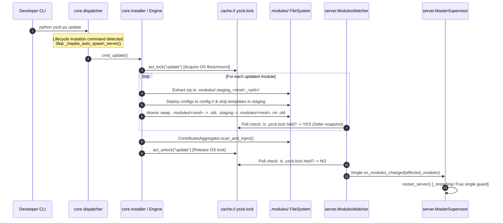

# 架構設計說明書 (Architecture Design)

> 功能名稱：2026_10_27_1143_atomic_module_deploy_and_server_leak_fix  
> 建立日期：2026-10-27  
> 狀態：Confirmed  
> 模型：Gemini 4 Argon (Low)  

> 模板版本：v1.2  

---

## 1. 模組架構分層與職責邊界 (Layered Architecture)

```text
+-----------------------------------------------------------------------------------+
| Host & CLI Dispatch Layer (yscb.py / core.commands.dispatcher)                    |
|  - Filters lifecycle mutation commands (update/install/remove/reload/restore/...) |
|    from pre-dispatch _maybe_auto_spawn_server()                                   |
|  - Probes both daemon.json and daemon.lock (non-blocking) before spawning server  |
+-----------------------------------------+-----------------------------------------+
                                          |
                                          v
+-----------------------------------------------------------------------------------+
| Atomic Package Engine Layer (core.installer / core.engine / yscb.py)              |
|  - Acquires InterProcessLock on cache://.yscb.lock across install/update/reload   |
|  - Extracts zip into .modules/.staging_<mod>_<pid>_<ts>/                          |
|  - Deploys & strips configurable/ templates inside staging directory              |
|  - Performs atomic directory swap (.modules/<mod> <-> .old <-> .staging)          |
+-----------------------------------------+-----------------------------------------+
                                          |
                                          v
+-----------------------------------------------------------------------------------+
| Server Control Plane (server.master / server.watcher)                             |
|  - MasterSupervisor.start(): Rigid daemon.lock gate (returns immediately if busy) |
|  - Writes initial daemon.json BEFORE spawning WarmWorker                          |
|  - MasterSupervisor.restart_server(): Single-entry _restarting guard              |
|  - ModulesWatcher: Skips snapshot polling while cache://.yscb.lock is held        |
+-----------------------------------------------------------------------------------+
```

---

## 2. 核心資料流與循序圖 (Data Flow & Sequence Diagram)



---

## 3. 受影響檔案與新建檔案清單 (Impacted & New Files Inventory)

| 檔案路徑 | 類型 | 職責與變更說明 |
| :--- | :---: | :--- |
| `ys_codebase/source/server/server/master.py` | Modify | 修復 `start()` 鎖獲取失敗穿透漏洞（立即返回 `state.pid` 或 `0`）；綁定 HTTP Port 後先寫入初始 `daemon.json` 再啟動 Worker；於 `restart_server()` 增設 `self._restarting` 單次重入守門鎖並優先停止 `self.watcher`。 |
| `ys_codebase/source/server/server/watcher.py` | Modify | 新增 `_is_core_transaction_locked()` 探測 `cache://.yscb.lock` 跨進程檔案鎖與核心 manifest 完整性，於 `core` 更新/重載交易期間延後快照比對與回調。 |
| `ys_codebase/source/core/core/commands/dispatcher.py` | Modify | 新增 `_LIFECYCLE_MUTATION_COMMANDS` 排除集合，禁止在 `update`/`install`/`remove`/`reload`/`restore`/`rollback` 等環境變更指令執行前觸發 `_maybe_auto_spawn_server()`；於 `_maybe_auto_spawn_server()` 增設 `daemon.lock` 非阻塞探測。 |
| `ys_codebase/source/core/core/engine.py` | Modify | 新增 `_atomic_swap_dir()` 與 `_deploy_and_strip_single_module_config()`；重構 `act_reload()` Stage 2 & 3 於 `.modules/.staging_<mod>_<pid>_<ts>` 內完成解壓與組態剝離後執行目錄級原子替換。 |
| `ys_codebase/source/core/core/installer.py` | Modify | 於 `cmd_reload()` 與 `cmd_restore()` 補齊 `act_lock` / `act_unlock` 交易鎖保護。 |
| `yscb.py` | Modify | 升級 `_fetch_and_extract_zip()` 採用同父目錄 `.staging_<name>_<pid>` 臨時目錄解壓並原子替換至目標目錄。 |
| `ys_codebase/source/server/tests/test_server.py` | Modify | 新增 `MasterSupervisor.start()` 鎖競爭防穿透測試、`restart_server()` 防重入測試與 `ModulesWatcher` `.yscb.lock` 交易延後測試。 |
| `ys_codebase/source/core/tests/test_distribution_lifecycle.py` | Modify | 新增 `act_reload` Staging 原子目錄替換、異常回滾與生命週期指令免預喚醒 Server 測試。 |
| `docs/core/DESIGN_NOTES.md` | Modify | 更新 `[DN-06]` 補充 Staging 預組裝與原子目錄替換機制說明。 |
| `docs/server/DESIGN_NOTES.md` | Modify | 更新 `[DN-08]` 補充 `start()` 剛性單例鎖守門、`restart_server()` 防重入與 `ModulesWatcher` 交易鎖感知說明。 |

---

## 4. 架構決策記錄 (Architecture Decision Records)

- **[P02:DR-01] 同父目錄隱藏 Staging (`.staging_<mod>_<pid>_<ts>`) 與雙步 `os.replace` 原子切換**：
  - 由於 POSIX 與 Windows 皆無法對「非空既有目錄」直接以單次 `os.replace(staging_dir, target_dir)` 覆寫（會拋出 `OSError: [Errno 39] Directory not empty` 或 `PermissionError`），因此採用同父目錄雙步原子位移：先將 `target_dir` `os.replace` 至同目錄 `.old_<mod>_<pid>_<ts>`，緊接著在微秒內將 `staging_dir` `os.replace` 至 `target_dir`，若第二步失敗則立即將 `.old` `os.replace` 回 `target_dir` 確保零資料遺失，成功後再 `shutil.rmtree(.old)`。
  - 所有臨時目錄均以 `.` 開頭（`.staging_*`、`.old_*`），`ModulesWatcher._extract_affected_modules` 原生過濾 `not parts[0].startswith(".")`，確保預組裝與清理過程對 Watcher 100% 隱形。
- **[P02:DR-02] `ModulesWatcher` 非阻塞探測 `.cache/.yscb.lock`**：
  - `ModulesWatcher` 透過 `InterProcessLock` 對 `<yscb_root>/.cache/.yscb.lock`（若該鎖檔存在）進行瞬時非阻塞探測（取得後立即釋放）；若無法取得鎖，代表 `core` 正在進行批次安裝/更新/重載交易，Watcher 立即跳過該輪快照比對，待交易完成鎖釋放後才進行唯一一次變更聚合通知。

