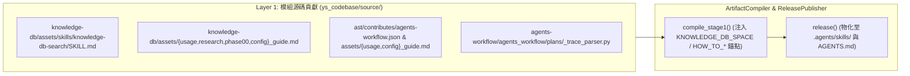

# 自動連續推進綜合規格與實作紀錄 (`P01-05_auto.md`) — `agents-workflow` 與 `knowledge-db-search` 技能對齊 `yscb ast` 路由與文檔更新 (`sub_03`)

> 功能名稱：agents-workflow 與 knowledge-db-search 技能對齊 yscb ast 路由與文檔更新
> 建立日期：2026-11-02
> 所屬主計畫：2026_11_02_1009_ast_topology_engine_modularization
> 狀態：Completed
> 模型：Gemini 4 Argon (Low)

---

## 1. 需求規格與邊界契約 (P01)

### 1.1 功能需求清單 (Functional Requirements)

| 需求編號 | 需求名稱 | 詳細規格與驗收條件 (Acceptance Criteria) | 優先級 | 對應 P00 語意 |
| :--- | :--- | :--- | :---: | :--- |
| **FR-01** | `knowledge-db-search` 技能三階段漏斗、空間清單按需下沉與 `yscb:ignore` 註記隔離 | 更新 [`ys_codebase/source/knowledge-db/assets/skills/knowledge-db-search/SKILL.md`](file:///workspace/ys-codebase/ys_codebase/source/knowledge-db/assets/skills/knowledge-db-search/SKILL.md)、新建 [`ys_codebase/source/knowledge-db/assets/skills/knowledge-db-search/references/registered-spaces.md`](file:///workspace/ys-codebase/ys_codebase/source/knowledge-db/assets/skills/knowledge-db-search/references/registered-spaces.md) 並更新 `knowledge-db/assets/{usage_guide,research_guide,phase00_guide,config_guide}.md`：<br/>1. 維持 `knowledge-db-search` 作為單一檢索與結構導航入口技能。<br/>2. 確立 **Stage 1**（`knowledge-db search` 找未知座標）$\to$ **Stage 1.5**（`ast outline <file>` 取得類別/成員行號區間、支援 `--public/--private/--static/--non-static/--methods/--fields/--types/--merged` 正交過濾與 `[Partial Siblings]` 跨分部姊妹檔提示）$\to$ **Stage 2**（原生工具精準行號區段讀取）之漏斗流程。<br/>3. 將 `callers`、`callees`、`impact` 路由全面指向 `python __${project://yscb.py}__ ast <callers\|callees\|impact>`，並說明同名異載（Method Overloads）同父型別預設群組展開與帶參數簽名過濾語法。<br/>4. **漸進式揭露（Progressive Disclosure）與 `yscb:ignore` 純化**：將 `__@{KNOWLEDGE_DB_SPACE}__` 已註冊空間清單下沉至 `references/registered-spaces.md`（唯有當預設跨空間聯集搜尋無法取得目標資料或需排除跨空間雜訊時才按需查閱），並將編輯/維護者註記包裹於 `<!-- yscb:ignore:begin --> ... <!-- yscb:ignore:end -->` 於編譯時自動剝除。 | P0 | `[P00:DR-01]` |
| **FR-02** | `module:ast` 貢獻 `agents-workflow` 導覽與組態指南 | 新建 [`ys_codebase/source/ast/contributes/agents-workflow.json`](file:///workspace/ys-codebase/ys_codebase/source/ast/contributes/agents-workflow.json) 與 [`ys_codebase/source/ast/assets/{usage_guide,config_guide}.md`](file:///workspace/ys-codebase/ys_codebase/source/ast/assets/usage_guide.md)，將 `module:ast` 注入 `HOW_TO_YSCB_MODULES` 與 `HOW_TO_CONFIG_MODULES` 錨點，使 `/how-to-yscb` 與 `/how-to-config-yscb` 完整涵蓋 `file-space`、`ast`、`knowledge-db` 三階模組。 | P0 | `[P00:DR-02]` |
| **FR-03** | `agents-workflow` 會話軌跡解析器 (`_trace_parser.py`) 與技能引用對齊 | 1. 更新 [`ys_codebase/source/agents-workflow/agents_workflow/plans/_trace_parser.py`](file:///workspace/ys-codebase/ys_codebase/source/agents-workflow/agents_workflow/plans/_trace_parser.py)：當命令列包含 `knowledge-db` (`search`, `callers`, `callees`, `impact`) 或 `ast` (`outline`, `callers`, `callees`, `impact`) 時，同步重設 `state.consecutive_source_reads = 0` 並設 `state.has_recent_kdb_query = True`。<br/>2. 更新 [`ys_codebase/source/agents-workflow/assets/skills/code-optimizer/references/exploration-and-delegation.md`](file:///workspace/ys-codebase/ys_codebase/source/agents-workflow/assets/skills/code-optimizer/references/exploration-and-delegation.md) 將 `knowledge-db callers` 改為 `ast callers`。 | P0 | `[P00:DR-03]` |
| **FR-04** | 系統知識庫 `docs/` 三層文檔與 `CHANGELOG.md` 全面對齊 | 更新 `docs/knowledge-db/{README,architecture,DESIGN_NOTES,contributes_guide,incremental_hot_reload,parsers,bundler,call_graph_and_reference_index}.md` 與根目錄 [`CHANGELOG.md`](file:///workspace/ys-codebase/CHANGELOG.md)，完整反映 `file-space -> ast -> knowledge-db` 三階單向 DAG、Single-Parse Symbol Sharing 與 `yscb ast` 介面，並執行 `@build` 安裝與 `agents-workflow compile` + `release` 同步二層物化空間。 | P0 | `[P00:DR-03]` |

### 1.2 邊界與異常情況 (Edge Cases & Failure Modes)

| 邊界編號 | 情境說明 | 預期防禦與處理行為 |
| :--- | :--- | :--- |
| **EC-01** | Agent 僅使用 `yscb.py ast outline <file>` 取得行號後直接執行 $\le 160$ 行區段讀取（未先呼叫 `knowledge-db search`） | `_trace_parser.py` 將 `ast outline` 視為有效結構定位指令，設定 `has_recent_kdb_query = True` 並歸零 `consecutive_source_reads`，因此後續 $\le 160$ 行精準區段讀取不會被誤計入 `wasted_blind_reads` 或 `CONTEXT_WASTE`。 |
| **EC-02** | 二層物化空間（`.agents/skills/`、`AGENTS.md`）與第一層源碼同步 | 嚴禁手動直接編輯 `.agents/skills/`；必須先安裝 `ast@build`、`knowledge-db@build`、`agents-workflow@build`，再透過 `python yscb.py agents-workflow release` 編譯物化，確保 `publisher` 自癒校驗與 Stage 1/2 編譯 0 警告。 |

### 1.3 非功能需求 (Non-Functional Requirements)

| 需求編號 | 類別 | 指標與量化約束 |
| :--- | :--- | :--- |
| **NFR-01** | 技能精簡度 | `knowledge-db-search/SKILL.md` 維持精煉高密度表格與指令速查，行數控制在 $\le 65$ 行以內，不傾倒冗長範例。 |
| **NFR-02** | 編譯與測試零回歸 | `dev check`（`ast`, `knowledge-db`, `agents-workflow`）、`contributes check`、`agents-workflow compile`、`agents-workflow release` 與 `dev test agents-workflow` 100% 通過。 |

### 1.4 知識庫與踩坑紀錄查閱 (Known Gotchas & CAUTIONs)
- **Stage 1 / Stage 2 URI 標籤規範**：於モジュール `assets/` 內撰寫技能或引導片段時，CLI 入口應使用 `__${project://yscb.py}__` 或 `__${yscb.host://yscb.py}__`，模組 README 連結使用 `` [`...`](`__#{module://<mod>/README.md}__`) ``，確保 `ArtifactCompiler` 正確解析。

---

## 2. 架構設計與異動檔案清單 (P02)

### 2.1 模組架構與核心資料流 (Architecture & Data Flow)



### 2.2 受影響與新建檔案清單 (Impacted & New Files Inventory)

| 檔案路徑 | 類型 | 職責與變更說明 |
| :--- | :---: | :--- |
| `ys_codebase/source/knowledge-db/assets/skills/knowledge-db-search/SKILL.md` | Modify | 升級為三階段漏斗檢索與結構推理技能（整合 `knowledge-db search`、`ast outline` 與 `ast callers/callees/impact`，並將空間表下沉至 `references/`、維護註記移入 `yscb:ignore`） |
| `ys_codebase/source/knowledge-db/assets/skills/knowledge-db-search/references/registered-spaces.md` | New | 按需揭露之已註冊知識庫空間清單（含 `__@{KNOWLEDGE_DB_SPACE}__` 動態注入錨點與 `yscb:ignore` 維護註記） |
| `ys_codebase/source/knowledge-db/contributes/agents-workflow.json` | Modify | 更新 `AGENTS_SKILL_ROUTING` 描述，涵蓋單檔結構大綱 (`ast outline`) 與拓撲查詢 (`ast callers/callees/impact`) |
| `ys_codebase/source/knowledge-db/assets/usage_guide.md` | Modify | 更新 `knowledge-db` 指令速查並引導結構與拓撲查詢使用 `ast` 模組 |
| `ys_codebase/source/knowledge-db/assets/research_guide.md` | Modify | 將 `callers`/`callees`/`impact` 更新為 `ast` CLI 並加入 `ast outline` |
| `ys_codebase/source/knowledge-db/assets/phase00_guide.md` | Modify | 將 `impact` 查詢更新為 `python __${project://yscb.py}__ ast impact` |
| `ys_codebase/source/knowledge-db/assets/config_guide.md` | Modify | 更新 `knowledge-db` 組態說明，對齊 `file-space`、`ast` 與 `knowledge-db` 三階分工 |
| `ys_codebase/source/ast/contributes/agents-workflow.json` | New | 註冊 `HOW_TO_YSCB_MODULES` 與 `HOW_TO_CONFIG_MODULES` 導覽注入 |
| `ys_codebase/source/ast/assets/usage_guide.md` | New | 提供 `/how-to-yscb` 之 `ast` 模組核心定位與指令速查 |
| `ys_codebase/source/ast/assets/config_guide.md` | New | 提供 `/how-to-config-yscb` 之 `ast` 語言擴充與健康度檢查指南 |
| `ys_codebase/source/agents-workflow/agents_workflow/plans/_trace_parser.py` | Modify | 擴充 CLI 偵測支援 `ast` (`outline`, `callers`, `callees`, `impact`) 歸零連續盲讀計數 |
| `ys_codebase/source/agents-workflow/assets/skills/code-optimizer/references/exploration-and-delegation.md` | Modify | 將 `knowledge-db callers` 更新為 `ast callers` |
| `ys_codebase/source/agents-workflow/tests/test_plans_toolchain.py` | Modify | 新增驗證 `yscb.py ast outline/callers` 觸發二階段漏斗精準讀檔豁免之斷言 |
| `docs/knowledge-db/{README,architecture,DESIGN_NOTES,contributes_guide,incremental_hot_reload,parsers,bundler,call_graph_and_reference_index}.md` | Modify | 全面對齊三階單向 DAG、`ASTEngine` 快照共享與 `DN-30` 設計筆記 |
| `CHANGELOG.md` | Modify | 記錄 `sub_02` 與 `sub_03` 完整交付成果並將主計畫標記為完成 |

### 2.3 架構決策記錄 (Architecture Decision Records)
- **[P02:DR-01] `knowledge-db` 專題文檔保留與跨模組指針導引**：`docs/knowledge-db/{parsers,bundler,call_graph_and_reference_index}.md` 為歷史與專題連結入口，保留檔案並更新標頭與內容以反映核心實作已移轉至 `module:ast` (`ast_engine.*`) 及 [`docs/ast/README.md`](file:///workspace/ys-codebase/docs/ast/README.md)，同時保留 `knowledge_db` 薄轉發層說明，確保既有文檔內部連結 100% 不斷鏈。

---

## 3. 介面契約與 API 簽名 (P03)

### 3.1 介面契約與核心簽名 (Interface Inventory & Method Signatures)

```python
# ys_codebase/source/agents-workflow/agents_workflow/plans/_trace_parser.py
# 於 _process_tool_calls_in_step 內識別結構化檢索與 AST 導航指令：
if (
    ("knowledge-db" in cmd_line and any(k in cmd_line for k in ("search", "callers", "callees", "impact")))
    or ("ast" in cmd_line and any(k in cmd_line for k in ("outline", "callers", "callees", "impact")))
):
    state.consecutive_source_reads = 0
    state.has_recent_kdb_query = True
```

---

## 4. 定稿審查與文檔衝擊規劃 (P04)

### 4.1 交叉驗證與靈魂拷問 (Cross-Validation & Resilience Review)
- [x] `knowledge-db-search/SKILL.md` 是否同時涵蓋 `knowledge-db search`、`ast outline`（含正交過濾旗標與 `[Partial Siblings]`）與 `ast callers/callees/impact`（含同名重載群組定址）？是（對應 `FR-01`）。
- [x] `_trace_parser.py` 在執行 `python yscb.py ast outline <file>` 後進行區段讀檔是否豁免盲讀浪費？是（對應 `FR-03`, `EC-01`）。
- [x] `ast` 模組是否已註冊 `contributes/agents-workflow.json` 並通過 `contributes check`？是（對應 `FR-02`）。

### 4.2 知識庫文檔衝擊與交付規劃 (Documentation Impact Plan)

| 維度 | 文件路徑 | 變更類型 | 交付內容與重點 |
| :--- | :--- | :---: | :--- |
| **知識庫總覽** | `docs/knowledge-db/README.md` | Modify | 對齊 `file-space -> ast -> knowledge-db` 三階架構、Single-Parse Symbol Sharing 與 CLI 職責邊界 |
| **知識庫架構** | `docs/knowledge-db/architecture.md` | Modify | 更新架構圖與組件表，說明 `IndexingPipeline` 直接消費 `ASTEngine.ensure_jit_synced()` 之 `ASTSnapshot` |
| **知識庫設計筆記** | `docs/knowledge-db/DESIGN_NOTES.md` | Modify | 新增 `[DN-30]` 記錄三階單向 DAG 解耦、單次解析符號共享與 `acked_ast_generation` 水位線協議 |
| **知識庫專題文檔** | `docs/knowledge-db/{contributes_guide,incremental_hot_reload,parsers,bundler,call_graph_and_reference_index}.md` | Modify | 對齊 `module:ast` 語言註冊、增量熱修補雙水位線與 `yscb ast` CLI |
| **專案變更歷史** | `CHANGELOG.md` | Modify | 完整補齊 `sub_02` 與 `sub_03` 變更紀錄 |

---

## 5. 實作任務清單與偏差紀錄 (P05)

### 5.1 實作任務清單 (Task Breakdown)
- [x] **TASK-01**：更新 `ys_codebase/source/knowledge-db/contributes/agents-workflow.json`、`assets/skills/knowledge-db-search/SKILL.md`、新建 `assets/skills/knowledge-db-search/references/registered-spaces.md` 與更新 `assets/{usage_guide,research_guide,phase00_guide,config_guide}.md`，並新建 `ys_codebase/source/ast/contributes/agents-workflow.json` 與 `assets/{usage_guide,config_guide}.md`（對應 `FR-01`, `FR-02`）
- [x] **TASK-02**：更新 `ys_codebase/source/agents-workflow/agents_workflow/plans/_trace_parser.py`、`assets/skills/code-optimizer/references/exploration-and-delegation.md` 與 `tests/test_plans_toolchain.py`（對應 `FR-03`, `EC-01`）
- [x] **TASK-03**：更新 `docs/knowledge-db/{README,architecture,DESIGN_NOTES,contributes_guide,incremental_hot_reload,parsers,bundler,call_graph_and_reference_index}.md` 與根目錄 `CHANGELOG.md`（對應 `FR-04`）
- [x] **TASK-04**：執行 `dev check`、`dev test`、`@build` 熱部署、`contributes check`、`agents-workflow compile` 與 `agents-workflow release` 驗證物化產物（對應 `EC-02`, `NFR-01`, `NFR-02`）

### 5.2 實作偏差紀錄表 (Implementation Deviations)

| 關聯任務 | 偏差級別 | 偏差內容與原因說明 | 規格回寫狀態 |
| :--- | :---: | :--- | :--- |
| - | - | 尚無偏差 | - |

