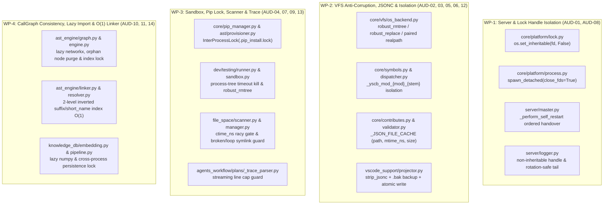

# 自動連續推進綜合規格與實作紀錄 (Consolidated Auto Plan & Task Log)

> 功能名稱：2026_11_04_0540_audit_808d156_remediation_p0_to_p3  
> 建立日期：2026-11-04  
> 所屬主計畫：N/A (Root Plan)  
> 狀態：Completed  
> 模型：Gemini 4 Argon (Low)  

> 依據 P00：[P00_discuss.md](./P00_discuss.md)  
> 模板版本：v1.0  

---

## 1. 需求規格與邊界契約 (P01)

### 1.1 功能需求清單 (Functional Requirements)

| 需求編號 | 需求名稱 | 詳細規格與驗收條件 (Acceptance Criteria) | 優先級 | 對應 P00 語意 |
| :--- | :--- | :--- | :---: | :--- |
| **FR-01** | **P0 句柄繼承隔離、Master 自我重啟移交序列與日誌輪替安全 (`AUD-01`, `AUD-08`)** | 1. `core/platform/lock.py` 之 `_open_lock_fd` 開啟鎖檔後強制呼叫 `os.set_inheritable(fd, False)`，防止子進程繼承單例鎖 FD。<br/>2. `core/platform/process.py:spawn_detached` 於全平台顯式傳遞 `close_fds=True`；`server/master.py` 派生 Worker 時傳遞 `close_fds=True`，且自我重啟序列嚴格遵循「停 Watcher $\to$ 終止並等待回收 Worker $\to$ 關閉 HTTPD $\to$ 釋放單例鎖 $\to$ 關閉/歸檔日誌 $\to$ `spawn_detached_master`」。<br/>3. `server/logger.py:ServerLogger` 開啟日誌流後設定句柄不可繼承 (`os.set_inheritable(f.fileno(), False)`)，並新增 `read_tail_chunks(offset)` 非鎖定短暫開啟讀取方法（當偵測到檔案被截斷 `st_size < offset` 或 `st_ino` 變更時自動將讀取偏移量重置為 `0`，讀取完畢立即關閉句柄不阻塞 Windows 輪替）。 | P0 | [P00:DR-02] |
| **FR-02** | **P1 `.vscode/settings.json` 字串感知 JSONC 剝離、`.bak` 備份保護與原子替換 (`AUD-02`)** | 1. 於 `vscode_support/projector.py` 實作純標準庫字串感知之 `strip_jsonc(raw_text: str) -> str`，移除雙引號字串外的 `//...` 單行註解、`/*...*/` 多行註解與物件/陣列尾隨逗號（保留字串內之 `http://`、`/*` 等內容）。<br/>2. 當 `sync_vscode_settings` 或 `revert_vscode_settings` 讀取 `.vscode/settings.json` 時：若標準 `json.loads` 失敗但經 `strip_jsonc` 後解析成功，先將原始內容完整備份至 `.vscode/settings.json.bak`，再執行軟合併與 `vfs.write_json(..., atomic=True)` 原子寫入；若經 `strip_jsonc` 仍無法解析為 `dict`，則同樣備份至 `.vscode/settings.json.bak`、向 `stderr` 輸出告警並回傳 `False`（絕不以 `{}` 覆寫原檔）。<br/>3. `vscode_support/schema_compiler.py:_write_json_zero_touch` 統一改用 `vfs.write_text(..., atomic=True)` 享有同目錄 `.tmp` + Windows `PermissionError` 退避重試保護。 | P1 | [P00:DR-01], [P00:DR-02] |
| **FR-03** | **P1 跨平台 `robust_rmtree`、`robust_replace`、成對 `realpath` 與跨掛載點 `EXDEV` 防護 (`AUD-03`, `AUD-05`)** | 1. 於 `core/vfs/os_backend.py` 實作並匯出 `robust_rmtree(path, ignore_errors=False, max_retries=5)` 與 `robust_replace(src, dst, max_retries=10)`：處理唯讀位元 (`os.chmod(..., stat.S_IWRITE | stat.S_IREAD)`)、Windows `WinError 5 / 32` 短暫句柄鎖退避重試，以及跨檔案系統 `EXDEV (errno.EXDEV)` 自動回退為同目錄暫存複製後原子替換。<br/>2. 將 `OSBackend.remove`、`OSBackend.rmtree`、`OSBackend.copy`、`OSBackend.move`、`OSBackend.atomic_write`、`core/engine.py`、`yscb.py` 與 `dev/testing/sandbox.py` 之目錄清理/替換統一接入此防腐機制。<br/>3. 確保 `OSBackend.assert_safe_path`、`core/uri.py` 與 `sandbox.py` 之路徑邊界包含檢查對基準根路徑與目標路徑**成對執行 `os.path.realpath`**，相容 macOS `/var -> /private/var` 與 `/tmp -> /private/tmp`。 | P1 | [P00:DR-02] |
| **FR-04** | **P1 多進程 Tree-sitter JIT Provisioning 與 Pip 安裝排他鎖 (`AUD-04`)** | 於 `core/pip_manager.py:PipManager.install_packages` / `ensure_venv` 與 `ast_engine/provisioner.py:GrammarProvisioner.load_language` / `_try_pip_install` 入口透過 `InterProcessLock`（鎖檔位於 `yscb.venv://.pip_install.lock`）取得跨進程排他鎖，並在獲鎖後執行 Double-Checked `importlib.import_module` 驗證，避免多進程同時編譯或寫入同一 `.venv` 造成動態庫載入損毀。 | P1 | [P00:DR-02] |
| **FR-05** | **P2 同進程跨模組腳本命名空間隔離、測試子進程樹超時清理、Racy Stat Gate 與呼叫圖一致性 (`AUD-06`, `AUD-07`, `AUD-09`, `AUD-10`)** | 1. `AUD-06`：`yscb.py`、`core/commands/dispatcher.py`、`core/events.py` 與 `core/symbols.py` 動態載入模組腳本時，統一使用唯一模組命名空間 `_yscb_mod_{mod_pkg}_{script_stem}` 載入，並於載入前確保模組專屬路徑置頂且不誤中其他模組之同名 `scripts.cli` / `scripts.hook` 快取。<br/>2. `AUD-07`：`dev/testing/runner.py` 新增支援子進程隔離超時執行輔助函式 `run_subprocess_with_tree_timeout`（以獨立 Process Group / Session 啟動，超時時呼叫 `terminate_popen_tree` 終止整棵進程樹並為 `communicate()` 加上二次超時防線）。<br/>3. `AUD-09`：`file_space/scanner.py` 與 `file_space/manager.py` 走訪檔案時對 `scandir` / `stat()` / `is_dir()` 捕獲 `OSError` 以忽略懸空或循環符號連結；指紋評估除 `st_mtime_ns` 與 `st_size` 外，納入 `st_ctime_ns` 變動感知與 `RACY_CLEAN_WINDOW_NS` 臨界時間窗強制重新計算內容雜湊。<br/>4. `AUD-10`：`ast_engine/engine.py` 與 `ast_engine/graph.py` 增量熱修補刪除或修改檔案時，先依 `file_to_symbol_ids` 徹底拔除舊節點與關聯邊（含已刪除檔案殘留之孤兒節點）；`ast_engine/engine.py` 與 `knowledge_db/pipeline.py` 於持久化索引讀寫時加上跨進程空間排他鎖 (`InterProcessLock`)。 | P2 | [P00:DR-02] |
| **FR-06** | **P3 頂層重型依賴延遲載入、Contributes JSON I/O 快取、JSONL 串流防線與跨檔案後綴 $O(1)$ 索引 (`AUD-11` ~ `AUD-14`)** | 1. `AUD-11`：`ast_engine/graph.py`（延遲載入 `networkx`）與 `knowledge_db/embedding.py`（延遲載入 `numpy`）頂層移除重型第三方套件直接 `import`，改為 `if TYPE_CHECKING:` + 方法內 Lazy Import。<br/>2. `AUD-12`：`core/contributes.py` 與 `core/validator.py` 新增基於 `(norm_path, mtime_ns, size)` 之程序內 JSON 解析快取 `_JSON_FILE_CACHE`，消除單次 CLI 週期內對 `manifest.json`、`_format.json` 與 `contributes/*.json` 的重複磁碟讀取與反序列化。<br/>3. `AUD-13`：`agents_workflow/plans/_trace_parser.py` 與 `session_trace.py` 增設單行超長截斷水位 (`MAX_JSONL_LINE_BYTES = 2 * 1024 * 1024`) 與串流生成器讀取。<br/>4. `AUD-14`：`ast_engine/linker.py` 與 `ast_engine/resolver.py` 預先建構 `_by_short_name: Dict[str, List[UnifiedSymbol]]` 與 `_by_module_suffix: Dict[str, List[UnifiedSymbol]]` 二級倒排雜湊表，將跨檔案呼叫與符號後綴解析由 $O(N)$ 線性掃描加速為 $O(1)$ 雜湊查找。 | P3 | [P00:DR-02] |

### 1.2 邊界與異常情況 (Edge Cases & Failure Modes)

| 邊界編號 | 情境說明 | 預期防禦與處理行為 |
| :--- | :--- | :--- |
| **EC-01** | **`.vscode/settings.json` 含雙引號字串內的 `"http://..."` 或 `"/* not comment */"`，同時外層有 `//` 註解與尾隨逗號** | `strip_jsonc` 狀態機精確追蹤字串字面量與跳脫字元 `\"`，僅移除字串外的註解與尾隨逗號，字串內之 URL 與符號 100% 原樣保留；若檔案為嚴重損毀之非法 JSON（連剝離後仍無法解析），備份至 `.bak` 並保留原檔不覆寫。 |
| **EC-02** | **Windows 下 `.git/objects/pack/*` 唯讀檔案或剛退出子進程短暫鎖定目錄 (`WinError 5 / 32`)** | `robust_rmtree` 於 `onerror` 自動執行 `os.chmod(failed_path, stat.S_IWRITE | stat.S_IREAD)` 後立即重試，若遇 `WinError 32` 則進行最多 5 次短暫退避重試。 |
| **EC-03** | **跨掛載點（如 `/tmp` tmpfs 與 `/workspace` virtiofs）執行 `robust_replace(src, dst)` 觸發 `EXDEV`** | 捕獲 `OSError` (`errno.EXDEV`) 後自動在目標目錄同級父目錄建立同掛載點暫存檔/目錄完成拷貝，再執行同分區 `os.replace` 並清理原 `src`。 |
| **EC-04** | **工作區存在懸空符號連結（Broken Symlink）或指向父目錄之循環符號連結（Symlink Loop）** | `file-space` 掃描器在 `stat()` / `resolve()` 時捕獲 `OSError` 並追蹤已訪問之真實 `(st_dev, st_ino)` 目錄集合，安全略過壞連結與循環連結而不中斷掃描。 |
| **EC-05** | **同一毫秒/微秒內覆寫同大小檔案（Racy Git / 測試腳本高速改寫）** | 當 `abs(scan_start_ns - mtime_ns) < RACY_CLEAN_WINDOW_NS` 或 `ctime_ns` 大於快照記錄之 `mtime_ns` 時，強制繞過 `(mtime_ns, size)` 快取門檻，重新計算內容雜湊。 |
| **EC-06** | **在未安裝 `networkx` 或 `numpy` 的極簡環境匯入 `ast_engine.graph` 或 `knowledge_db.embedding` 頂層模組** | 頂層 `import` 零報錯通過；僅在實際實例化 `CallGraphIndex` 或執行向量運算時按需載入，維持輕量指令冷啟動零負擔。 |

### 1.3 非功能需求 (Non-Functional Requirements)

| 需求編號 | 類別 | 指標與量化約束 |
| :--- | :--- | :--- |
| **NFR-01** | **零外部新依賴與跨平台相容** | 100% 使用 Python 3.10+ 標準庫與既有選配依賴實作；通過全倉 8 模組 `dev check --all`（0 Failed, 0 Warnings）與 `contributes check`。 |
| **NFR-02** | **效能與啟動指標** | `ast_engine.graph` 與 `knowledge_db.embedding` 匯入時不觸發 `networkx`/`numpy` 載入；`TopologyLinker` 後綴與匯入路徑解析透過二級倒排索引達到 $O(1)$ 候選定位。 |

### 1.4 知識庫與踩坑紀錄查閱 (Known Gotchas & CAUTIONs)

- **`[!CAUTION]` Windows 句柄繼承與 `close_fds=True`**：在 Python 中，雖然 `os.open` 建立之 FD 預設為 non-inheritable（PEP 446），但在部分 C 擴充或特殊 Win32 API 情境下顯式呼叫 `os.set_inheritable(fd, False)` 並於 `subprocess.Popen` 明確設定 `close_fds=True` 是防止單例鎖與日誌檔被背景 Worker 繼承的雙重保險。
- **`[!NOTE]` JSONC 尾隨逗號狀態機**：移除尾隨逗號時，必須先將註解替換為空白（使得 `1, /* comment */ ]` 簡化為 `1,   ]`），再由第二階段或單遍前瞻狀態機安全移除緊鄰 `}` 或 `]` 前的 `,`。

---

## 2. 架構設計與異動檔案清單 (P02)

### 2.1 模組架構與核心資料流 (Architecture & Data Flow)



### 2.2 受影響與新建檔案清單 (Impacted & New Files Inventory)

| 檔案路徑 | 類型 | 職責與變更說明 |
| :--- | :---: | :--- |
| `ys_codebase/source/core/core/platform/lock.py` | Modify | `_open_lock_fd` 開啟 FD 後呼叫 `os.set_inheritable(fd, False)` (`FR-01`, `AUD-01`) |
| `ys_codebase/source/core/core/platform/process.py` | Modify | `spawn_detached` 於 POSIX/Windows 統一確保 `close_fds=True` (`FR-01`, `AUD-01`) |
| `ys_codebase/source/server/server/master.py` | Modify | 新增 `_perform_self_restart` 標準移交序列、Worker `Popen` 傳遞 `close_fds=True` (`FR-01`, `AUD-01`) |
| `ys_codebase/source/server/server/logger.py` | Modify | 日誌句柄設為不可繼承，新增 `read_tail_chunks` 支援輪替/截斷偏移量自動歸零與短暫開啟讀取 (`FR-01`, `AUD-08`) |
| `ys_codebase/source/vscode-support/vscode_support/projector.py` | Modify | 新增 `strip_jsonc` 字串感知剝離器、`.vscode/settings.json.bak` 自動備份與損毀保護 (`FR-02`, `AUD-02`) |
| `ys_codebase/source/vscode-support/vscode_support/schema_compiler.py` | Modify | `_write_json_zero_touch` 統一改用 `vfs.write_text(..., atomic=True)` (`FR-02`, `AUD-02`) |
| `ys_codebase/source/core/core/vfs/os_backend.py` | Modify | 實作 `robust_rmtree` 與 `robust_replace`（唯讀剝離、退避重試、`EXDEV` 回退）與成對 `realpath` 校驗 (`FR-03`, `AUD-03`, `AUD-05`) |
| `ys_codebase/source/core/core/vfs/__init__.py` | Modify | 匯出 `robust_rmtree` 與 `robust_replace` (`FR-03`, `AUD-03`, `AUD-05`) |
| `ys_codebase/source/core/core/pip_manager.py` | Modify | `ensure_venv` 與 `install_packages` 加上跨進程 `InterProcessLock` (`FR-04`, `AUD-04`) |
| `ys_codebase/source/ast/ast_engine/provisioner.py` | Modify | `load_language` 與 `_try_pip_install` 加上跨進程排他鎖與獲鎖後 Double-Checked 驗證 (`FR-04`, `AUD-04`) |
| `ys_codebase/source/core/core/symbols.py` | Modify | 動態腳本載入統一使用 `_yscb_mod_{mod_pkg}_{script_stem}` 獨立命名空間，防止同名腳本污染 (`FR-05`, `AUD-06`) |
| `ys_codebase/source/core/core/commands/dispatcher.py` | Modify | `dispatch_local` 載入模組 `entry` 腳本時使用唯一模組命名空間 `_yscb_mod_{mod_pkg}_{stem}` (`FR-05`, `AUD-06`) |
| `ys_codebase/source/core/core/events.py` | Modify | Hook 腳本載入使用唯一模組命名空間 `_yscb_mod_{mod_pkg}_hook_{emit}` (`FR-05`, `AUD-06`) |
| `yscb.py` | Modify | 宿主 `dispatch_module` 與 `_safe_replace_dir` 對齊唯一腳本命名空間與 `EXDEV` 安全替換 (`FR-03`, `FR-05`, `AUD-05`, `AUD-06`) |
| `ys_codebase/source/dev/dev/testing/sandbox.py` | Modify | 沙盒建立與清理統一使用 `vfs.robust_rmtree` 處理唯讀 `.git` 物件與殘留句柄 (`FR-03`, `AUD-03`) |
| `ys_codebase/source/dev/dev/testing/runner.py` | Modify | 新增 `run_subprocess_with_tree_timeout` 支援獨立進程群組、超時進程樹終止與二次 `communicate` 防死鎖 (`FR-05`, `AUD-07`) |
| `ys_codebase/source/file-space/file_space/manager.py` | Modify | `_walk_root` 加入真實 `(st_dev, st_ino)` 循環符號連結防禦與壞連結 `OSError` 忽略 (`FR-05`, `AUD-09`) |
| `ys_codebase/source/file-space/file_space/scanner.py` | Modify | `_evaluate_entry_fingerprint` 納入 `st_ctime_ns` 與 `RACY_CLEAN_WINDOW_NS` 強制雜湊複核 (`FR-05`, `AUD-09`) |
| `ys_codebase/source/ast/ast_engine/graph.py` | Modify | 延遲載入 `networkx` (`AUD-11`)，強化 `patch_incremental` 孤兒節點清理 (`FR-05`, `FR-06`, `AUD-10`, `AUD-11`) |
| `ys_codebase/source/ast/ast_engine/engine.py` | Modify | `hot_patch_index` 與持久化讀寫加上跨進程 `InterProcessLock` 及刪除檔案之舊符號節點徹底拔除 (`FR-05`, `AUD-10`) |
| `ys_codebase/source/ast/ast_engine/linker.py` | Modify | 新增 `_by_short_name` 與 `_by_module_suffix` 二級倒排雜湊表，將 `_pick_best_by_import_path` 降為 $O(1)$ 查找 (`FR-06`, `AUD-14`) |
| `ys_codebase/source/ast/ast_engine/resolver.py` | Modify | 新增 `_by_short_name` 與 `_by_suffix` 二級倒排雜湊索引，消除 `resolve_symbol` 內之 $O(N)$ 全表掃描 (`FR-06`, `AUD-14`) |
| `ys_codebase/source/knowledge-db/knowledge_db/embedding.py` | Modify | 將頂層 `import numpy as np` 改為 `if TYPE_CHECKING:` + 方法內延遲匯入 (`FR-06`, `AUD-11`) |
| `ys_codebase/source/knowledge-db/knowledge_db/pipeline.py` | Modify | 索引落盤與熱修補加上跨進程 `InterProcessLock` 防護前景 JIT 與背景 Worker 寫入衝突 (`FR-05`, `AUD-10`) |
| `ys_codebase/source/core/core/contributes.py` | Modify | 新增 `_read_json_cached(path)` 基於 `(norm_path, mtime_ns, size)` 快取 JSON 讀取 (`FR-06`, `AUD-12`) |
| `ys_codebase/source/core/core/validator.py` | Modify | `validate_module_contributes` 復用基於 `(path, mtime_ns, size)` 之快取讀取 (`FR-06`, `AUD-12`) |
| `ys_codebase/source/agents-workflow/agents_workflow/plans/_trace_parser.py` | Modify | 新增 `MAX_JSONL_LINE_BYTES` 超長單行保護與流式行生成器 `_iter_jsonl_records` (`FR-06`, `AUD-13`) |
| `ys_codebase/source/vscode-support/tests/test_vscode_support.py` | Modify | 更新 `test_et_01` 驗證 JSONC 註解與尾隨逗號剝離合併、`.bak` 備份與損毀語法保護 (`FR-02`) |
| `ys_codebase/source/core/tests/test_vfs.py` | Modify | 新增 `robust_rmtree`（含唯讀檔案）、`robust_replace`（含 `EXDEV` 模擬）與腳本命名空間隔離測試 (`FR-03`, `FR-05`, `FR-06`) |
| `ys_codebase/source/server/tests/test_server_logging.py` | Modify | 新增鎖 FD 不可繼承、`read_tail_chunks` 日誌輪替偏移量歸零與 `_perform_self_restart` 測試 (`FR-01`) |
| `ys_codebase/source/ast/tests/test_overload_and_topology.py` | Modify | 新增刪除檔案孤兒節點清除、二級倒排索引 $O(1)$ 解析與 `networkx` 延遲載入測試 (`FR-04` ~ `FR-06`) |
| `ys_codebase/source/file-space/tests/test_fingerprint_scanner.py` | Modify | 新增懸空/循環符號連結防禦與同毫秒 `ctime_ns` Racy Gate 測試 (`FR-05`) |

### 2.3 架構決策記錄 (Architecture Decision Records)

- **[P02:DR-01] `core.vfs.os_backend` 統一提供 `robust_rmtree` 與 `robust_replace` 防腐層 (`U2` Anti-Corruption Shim)**：
  - 為避免在 `core`、`dev`、`vscode-support` 與 `yscb.py` 散落重複的 `onerror` 與 Windows 重試迴圈，統一於 `core/vfs/os_backend.py` 定義模組級函式 `robust_rmtree(path, ignore_errors=False, max_retries=5)` 與 `robust_replace(src, dst, max_retries=10)`，並透過 `core.vfs` 公開匯出。
- **[P02:DR-02] 字串感知兩階段 JSONC 剝離器 (`strip_jsonc`)**：
  - 階段一：單遍字元狀態機（追蹤 `in_string` 與 `escape`），將雙引號字串外的 `//...` 與 `/*...*/` 替換為等長或換行空白。
  - 階段二：在已無註解干擾的純淨文本上，再次以字串感知掃描移除緊接在 `}` 或 `]`（中間僅含空白字元）之前的尾隨逗號 `,`，確保字串內之 `",}"` 或 `"http://"` 100% 不受影響。

---

## 3. 介面契約與 API 簽名 (P03)

### 3.1 介面契約與核心簽名 (Interface Inventory & Method Signatures)

```python
# ys_codebase/source/core/core/vfs/os_backend.py
def robust_rmtree(path: str, ignore_errors: bool = False, max_retries: int = 5) -> None: ...
def robust_replace(src: str, dst: str, max_retries: int = 10) -> None: ...

# ys_codebase/source/vscode-support/vscode_support/projector.py
def strip_jsonc(raw_text: str) -> str: ...

# ys_codebase/source/server/server/master.py
class MasterSupervisor:
    def _perform_self_restart(self) -> int: ...

# ys_codebase/source/server/server/logger.py
class ServerLogger:
    def read_tail_chunks(self, last_offset: int = 0, last_inode: Optional[int] = None) -> Tuple[str, int, Optional[int]]: ...

# ys_codebase/source/dev/dev/testing/runner.py
def run_subprocess_with_tree_timeout(
    cmd: List[str],
    timeout_sec: float = 30.0,
    cwd: Optional[str] = None,
    env: Optional[Dict[str, str]] = None,
) -> Tuple[int, str, str]: ...
```

- **錯誤與例外契約 (Error & Exception Contracts)**：
  - `strip_jsonc`：純字串轉換不拋出例外；當 `json.loads(strip_jsonc(raw))` 仍拋出 `json.JSONDecodeError` 時，`SettingsProjector` 將原檔備份至 `.vscode/settings.json.bak`、向 `stderr` 輸出告警並回傳 `False`。
  - `robust_replace`：遇 `errno.EXDEV` 時自動透過目標同目錄暫存完成跨掛載點搬移；遇 `PermissionError` 進行退避重試，耗盡後拋出原始 `OSError`。
- **階段決策紀錄**：`[P03:DR-01]` 所有新增輔助函式保持向下相容預設參數，不破壞既有呼叫端簽名。

---

## 4. 定稿審查與文檔衝擊規劃 (P04)

### 4.1 交叉驗證與靈魂拷問 (Cross-Validation & Resilience Review)

- [x] **需求對齊**：`FR-01` ~ `FR-06`（100% 涵蓋 `AUD-01` ~ `AUD-14`）皆已於介面簽名與實作清單中完整對齊
- [x] **邊界防護**：`EC-01` ~ `EC-06` 皆有具體錯誤攔截與降級策略
- [x] **依賴純淨**：100% 符合 `NFR-01` ~ `NFR-02` 指標約束
- **靈魂拷問與防護解法**：
  1. *問：在 `ast_engine/graph.py` 與 `knowledge_db/embedding.py` 將 `networkx` 與 `numpy` 改為方法內延遲載入後，型別註解（如 `nx.DiGraph`、`np.ndarray`）是否會在模組載入時引發 `NameError`？*
     *答*：於檔案頂層啟用 `from __future__ import annotations` 並搭配 `if TYPE_CHECKING:` 匯入型別，使執行期評估型別標註為零開銷字串，徹底避免 `NameError`。
  2. *問：當同進程連續執行多個模組的 `scripts/cli.py` 時，若各模組內部另有相對或同目錄匯入，`_yscb_mod_{mod_pkg}_{stem}` 是否相容？*
     *答*：載入前將該模組根目錄置於 `sys.path[0]`，並以獨立名稱 `_yscb_mod_{mod_pkg}_{stem}` 註冊至 `sys.modules`，完全避免不同模組的 `scripts/cli.py` 互相覆蓋。

### 4.2 知識庫文檔衝擊與交付規劃 (Documentation Impact Plan)

| 維度 | 文件路徑 | 變更類型 | 交付內容與重點 |
| :--- | :--- | :---: | :--- |
| **模組手冊** | `docs/vscode-support/README.md` | Modify | 更新 `.vscode/settings.json` JSONC 註解自動剝離與 `.bak` 備份保護說明 |
| **專題手冊** | `docs/core/vfs.md`, `docs/core/platform.md` | Modify | 補充 `robust_rmtree` / `robust_replace` 防腐層與 `InterProcessLock` 不可繼承句柄契約 |
| **設計決策** | `docs/vscode-support/DESIGN_NOTES.md` | Modify | 更新 JSONC 相容性與 `.bak` 備份防坑說明 |
| **微觀註解** | 源碼檔案 Docstrings | Modify | 同步更新關鍵介面契約與模組 Docstring |
| **發布日誌** | `CHANGELOG.md` | Modify | 於 Phase 7 結案時記錄本計畫變更摘要 |

- **決策定稿**：**[P04:DR-01]** 確認通過動刀前規格定稿審查，準備執行 `Pre-Code Analyze Gate` 與實作。

---

## 5. 實作任務清單與偏差紀錄 (P05)

### 5.1 實作任務清單 (Task Breakdown)

- [x] **TASK-01 (WP-1)**：實作 `AUD-01` 與 `AUD-08`（`core/platform/lock.py` 句柄不可繼承、`core/platform/process.py` `close_fds=True`、`server/master.py` `_perform_self_restart` 標準移交序列、`server/logger.py` 句柄不可繼承與 `read_tail_chunks` 輪替安全讀取）
- [x] **TASK-02 (WP-2)**：實作 `AUD-02`、`AUD-03`、`AUD-05`、`AUD-06` 與 `AUD-12`（`core/vfs/os_backend.py` 之 `robust_rmtree` / `robust_replace` / 成對 `realpath` / `EXDEV` 回退、`vscode-support` 之 `strip_jsonc` + `.bak` 備份與原子寫入、`core/symbols.py` & `dispatcher.py` & `events.py` & `yscb.py` 腳本命名空間隔離、`core/contributes.py` & `validator.py` JSON I/O 快取）
- [x] **TASK-03 (WP-3)**：實作 `AUD-04`、`AUD-07`、`AUD-09` 與 `AUD-13`（`core/pip_manager.py` & `ast_engine/provisioner.py` 跨進程排他鎖、`dev/testing/sandbox.py` & `runner.py` 進程樹超時清理、`file_space/manager.py` & `scanner.py` 循環/壞連結防禦與 `ctime_ns` Racy Gate、`agents_workflow/plans/_trace_parser.py` 單行串流防線）
- [x] **TASK-04 (WP-4)**：實作 `AUD-10`、`AUD-11` 與 `AUD-14`（`ast_engine/graph.py` & `knowledge_db/embedding.py` 重型依賴 Lazy Import、`ast_engine/engine.py` & `knowledge_db/pipeline.py` 孤兒節點清除與跨進程持久化鎖、`ast_engine/linker.py` & `resolver.py` 二級倒排雜湊索引 $O(1)$ 加速）
- [x] **TASK-05 (Tests & Docs)**：擴充各子系統單元測試（`core`, `server`, `vscode-support`, `dev`, `file-space`, `ast`, `knowledge-db`, `agents-workflow`）、更新 `docs/` 文檔、執行全倉 `dev check --all` 與模組測試驗證並熱部署 `@build`

### 5.2 實作偏差紀錄表 (Implementation Deviations)

| 任務編號 | 偏差等級 | 偏離描述與決策理由 | 處置方式 / 記錄 |
| :--- | :---: | :--- | :--- |
| - | - | 無偏差 | - |

