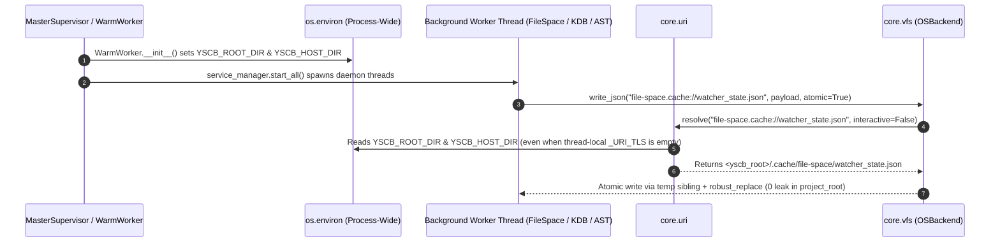

# 架構設計說明書 (Architecture Design)

> 功能名稱：跨模組路徑洩漏根治、背景執行緒 URI 上下文固化與 VFS 原子寫入收口  
> 建立日期：2026-11-06  
> 所屬主計畫：N/A  
> 狀態：Confirmed  
> 模型：Unknown  

> 模板版本：v1.2  

---

## 1. 模組架構分層與職責邊界 (Layered Architecture)

```text
+-----------------------------------------------------------------------------------+
| Layer 3: Domain & Workflow Modules (knowledge-db, agents-workflow)                |
|   - pipeline.py / config.py / service.py -> core.uri + core.vfs                   |
|   - compiler.py / publisher.py / roadmap.py / verifier.py / session_trace.py      |
+-----------------------------------------------------------------------------------+
                                         |
                                         v
+-----------------------------------------------------------------------------------+
| Layer 2: Foundational Service Modules (file-space, ast, server)                   |
|   - server/worker.py: WarmWorker.__init__ anchors YSCB_ROOT_DIR & YSCB_HOST_DIR   |
|   - file-space/{manager,scanner,service}.py: file-space.cache:// & storage.local  |
|   - ast/{bundler,engine}.py: ast.storage:// & ast.cache:// with yscb_root fallback|
+-----------------------------------------------------------------------------------+
                                         |
                                         v
+-----------------------------------------------------------------------------------+
| Layer 1: Microkernel Foundation (module:core)                                     |
|   - core.uri: Semantic URI resolution & resolve_yscb_root() physical topology SSOT|
|   - core.vfs: Unified atomic file/JSON/bytes read-write facade (OSBackend)        |
+-----------------------------------------------------------------------------------+
```

---

## 2. 核心資料流與循序圖 (Data Flow & Sequence Diagram)



---

## 3. 受影響檔案與新建檔案清單 (Impacted & New Files Inventory)

| 檔案路徑 | 類型 | 職責與變更說明 |
| :--- | :---: | :--- |
| `ys_codebase/source/server/server/worker.py` | Modify | 於 `WarmWorker.__init__` 預先解析並設定 `os.environ["YSCB_ROOT_DIR"]` 與 `os.environ[GUARD_ENV_HOST]`，確保 `pre_warm()` 啟動之所有背景執行緒共享正確 URI 根目錄。 |
| `ys_codebase/source/file-space/file_space/manager.py` | Modify | `storage_root` 的退避路徑由 `self.project_root / "ys_codebase" / ".storage.local" / "file-space"` 改為 `Path(uri.resolve_yscb_root()) / ".storage.local" / "file-space"`。 |
| `ys_codebase/source/file-space/file_space/service.py` | Modify | `_resolve_watcher_state_path` 改用 `file-space.cache://watcher_state.json`（若 `space_manager._explicit_storage_root` 存在則置於該沙盒下以隔離測試，退避錨定 `uri.resolve_yscb_root()`）；`_write_watcher_state_file` 與 `_remove_watcher_state_file` 改用 `core.vfs`；`is_transaction_locked` 移除 `p_root / ".cache" / ".yscb.lock"` 探測。 |
| `ys_codebase/source/file-space/file_space/scanner.py` | Modify | `_is_daemon_pid_alive` 與 `_read_watcher_state_file` 改用 `cache://server/daemon.json`、`file-space.cache://watcher_state.json` 與 `core.vfs.read_json`；`_atomic_write_bytes` 委派至 `core.vfs.write_bytes`；`mark_watcher_dirty` 改用 `core.vfs`。 |
| `ys_codebase/source/ast/ast_engine/bundler.py` | Modify | `_resolve_default_ast_storage_dir` 退避邏輯改用 `Path(uri.resolve_yscb_root()) / ".storage.local" / "ast"`，移除 `base / ".storage.local" / "ast"`。 |
| `ys_codebase/source/ast/ast_engine/engine.py` | Modify | `_resolve_index_lock_path` 退避邏輯改用 `Path(uri.resolve_yscb_root()) / ".cache" / "ast" / ".ast_index.lock"`；`_atomic_write_meta` 統一使用 `core.vfs.write_json`。 |
| `ys_codebase/source/knowledge-db/knowledge_db/pipeline.py` | Modify | `_resolve_default_knowledge_storage_dir` 退避邏輯改用 `Path(uri.resolve_yscb_root()) / ".storage.local" / "knowledge-db"`。 |
| `ys_codebase/source/knowledge-db/knowledge_db/config.py` | Modify | `is_agents_workflow_installed` 改用 `core.vfs.is_dir("module://agents-workflow")` 與 `Path(uri.resolve_yscb_root()) / ".modules" / "agents-workflow"`。 |
| `ys_codebase/source/knowledge-db/knowledge_db/service.py` | Modify | `write_worker_state` 與 `read_worker_state` 改用 `core.vfs.write_json` / `read_json` / `remove`。 |
| `ys_codebase/source/agents-workflow/agents_workflow/compiler.py` | Modify | `_write_cache_file` 統一使用 `core.vfs.write_text` 並以 `uri.resolve_yscb_root()` 作為退避根目錄。 |
| `ys_codebase/source/agents-workflow/agents_workflow/publisher.py` | Modify | `_write_text_atomic` 統一委派至 `core.vfs.write_text(..., atomic=True)`。 |
| `ys_codebase/source/agents-workflow/agents_workflow/roadmap.py` | Modify | `_atomic_write_text` 統一委派至 `core.vfs.write_text(..., atomic=True)`（保留對 `Path.write_text` 被單元測試 mock 時之偵測呼叫）。 |
| `ys_codebase/source/agents-workflow/agents_workflow/plans/_verifier_healer.py` | Modify | `_atomic_write_text` 統一委派至 `core.vfs.write_text(..., atomic=True)`。 |
| `ys_codebase/source/agents-workflow/agents_workflow/plans/verifier.py` | Modify | `PlanVerifier.__init__` 預設 `templates_dir` 移除 `Path.cwd() / ".cache"` 探測，改以 `uri.resolve_yscb_root()` 為退避基準。 |
| `ys_codebase/source/agents-workflow/agents_workflow/plans/session_trace.py` | Modify | `_get_configured_release_targets` 改用 `core.vfs.read_json("config.local://...")` 與 `"config://..."`，移除 `"ys_codebase/.config.local/..."` 硬編碼。 |
| `ys_codebase/source/file-space/tests/test_fingerprint_scanner.py` | Modify | 更新 `test_watcher_state_awareness_and_diff_all_spaces_aggregation` 中手寫 `self.proj_root / "ys_codebase" / ".cache"` 之測試準備路徑，並擴充下游 `project_root` 零 `.cache` 洩漏斷言。 |
| `ys_codebase/source/ast/tests/test_ast_engine.py` | Modify | 新增當 `project_root` 為獨立下游目錄時 `_resolve_index_lock_path` 與 `_resolve_default_ast_storage_dir` 絕不寫入 `project_root / ".cache"` 或 `project_root / ".storage.local"` 之回歸測試。 |
| `ys_codebase/source/server/tests/test_server.py` | Modify | 驗證 `WarmWorker` 初始化後 `os.environ["YSCB_ROOT_DIR"]` 與 `os.environ["YSCB_HOST_DIR"]` 已正確錨定。 |

---

## 4. 架構決策記錄 (Architecture Decision Records)

- **[P02:DR-01] 退避路徑（Fallback Path）一律錨定 `uri.resolve_yscb_root()` 而非 `project_root`**：
  - `core.uri.resolve_yscb_root()` 透過環境變數 `YSCB_ROOT_DIR` 或 `core/uri.py` 的 `__file__` 向上 3 層物理拓撲常數自省，在任何執行緒與工作目錄下皆可 100% 確定性定位 `<yscb_root>`，從根本上杜絕因 `uri.resolve()` 例外而將 `.cache` 或 `.storage.local` 寫入業務 `project_root` 的可能。
- **[P02:DR-02] 沙盒 `storage_root` 隔離感知**：
  - 在 `FileSpaceWatcherServiceWorker._resolve_watcher_state_path()` 與 `scanner._read_watcher_state_file()` 中，若 `space_manager._explicit_storage_root` 被顯式指定（例如單元測試傳入 `self.tmp_dir / "storage"`），則將 `watcher_state.json` 置於 `explicit_storage_root / "watcher_state.json"`；在真實環境（`_explicit_storage_root is None`）則 100% 解析 `file-space.cache://watcher_state.json`（對應 `<yscb_root>/.cache/file-space/watcher_state.json`）。這既保護了真實環境不洩漏至 `project_root`，又讓平行沙盒單元測試擁有 100% 獨立的 `watcher_state.json`。
