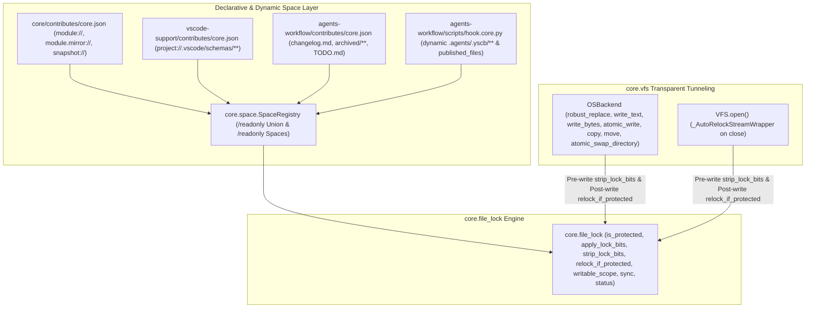

# 自動連續推進綜合規格與實作紀錄 (Consolidated Auto Plan & Task Log)

> 功能名稱：2026_11_10_0025_declarative_readonly_file_lock_sdk  
> 建立日期：2026-11-10  
> 狀態：Completed
> 模型：Gemini 3.1 Pro  

> 依據 P00：[P00_discuss.md](./P00_discuss.md)  
> 模板版本：v1.0  

---

## 1. 需求規格與邊界契約 (P01)

### 1.1 功能需求清單 (Functional Requirements)

| 需求編號 | 需求名稱 | 詳細規格與驗收條件 (Acceptance Criteria) | 優先級 | 對應 P00 語意 |
| :--- | :--- | :--- | :---: | :--- |
| **FR-01** | 宣告式唯讀空間匯聚 (`spaces.readonly` $\to$ `/readonly`) | 1. 擴充 `ys_codebase/source/core/core/space/registry.py`，將 `short_name in ("gitignore", "readonly")` 納入 `collapse_wildcard=False` 與 `default_watch=False`，並於預設 `resolve_spaces("")` 與 `resolve_spaces("*")` 中排除 `/readonly`。<br>2. 支援各模組於 `contributes/core.json` 靜態宣告 `"spaces": {"readonly": {...}}` 與於 `on_register_file_spaces` Hook 動態呼叫 `space_reg.register_space("<module>/readonly", ...)`，自動匯聚至 `/readonly` 聯集空間。 | P0 | [P00:DR-01] |
| **FR-02** | 三系統跨平台唯讀鎖引擎 (`core.file_lock`) | 1. 新建 `ys_codebase/source/core/core/file_lock.py`（並於 `core/__init__.py` 公開匯出 `file_lock`）及於 `core/context.py` 新增 `file_lock_tls` 與 `file_lock_cache` 狀態桶（全檔 0 頂層可變容器賦值、0 `global`）。<br>2. 實作 `@dataclass(frozen=True)` 之 `FileLockMatchInfo` 與 `FileLockSyncResult`，以及 `is_protected`、`inspect_path`、`is_file_readonly`、`apply_lock_bits`、`strip_lock_bits`、`relock_if_protected`、`writable_scope`、`lock_path`、`unlock_path`、`sync`、`status`。<br>3. 針對 Linux/macOS 移除 `S_IWUSR\|S_IWGRP\|S_IWOTH`（保留 `S_IXUSR` 等執行位元）並於解鎖時恢復 `S_IWUSR`；針對 Windows 切換 `stat.S_IREAD` / `stat.S_IREAD \| stat.S_IWRITE`；全面跳過符號連結 (`os.path.islink`) 與 `__pycache__`/`*.pyc`/`*.pyo`/`*.pyd`。 | P0 | [P00:DR-01], [P00:DR-02] |
| **FR-03** | `core.vfs` (`OSBackend` / `VFS`) 寫前自動解鎖與寫後自動復鎖透明穿透 | 1. 強化 `ys_codebase/source/core/core/vfs/os_backend.py` 之 `robust_replace`、`write_text`、`write_bytes`、`atomic_write`、`copy`、`_safe_copytree`、`move`、`atomic_swap_directory`：於覆寫前對目標調用 `file_lock.strip_lock_bits`，於寫入/替換/搬移完成後調用 `file_lock.relock_if_protected`。<br>2. 強化 `ys_codebase/source/core/core/vfs/vfs.py` 之 `VFS.open()`：當 `mode` 含寫入旗標 (`w`, `a`, `x`, `+`) 時，開啟前自動剝除唯讀位元，並在檔案串流 `close()` 時觸發 `file_lock.relock_if_protected`。 | P0 | [P00:DR-01], [P00:DR-03] |
| **FR-04** | `core`、`vscode-support`、`agents-workflow` 之 `spaces.readonly` 宣告與自動同步掛載 | 1. `core`：於 `contributes/core.json` 宣告 `spaces.readonly`（涵蓋 `module://`, `module.mirror://`, `snapshot://`，排除 `__pycache__`, `*.pyc`, `*.pyo`, `*.pyd`），於 `engine.py:act_reload` Stage 4 末尾呼叫 `file_lock.sync(emit_event=False)`，並新增 `yscb core file-lock <status\|sync\|lock\|unlock> [target] [--json]` CLI（`server_compatible: true`）。<br>2. `vscode-support`：於 `contributes/core.json` 宣告 `spaces.readonly`（涵蓋 `project://.vscode/schemas/**`），並於 `schema_compiler.py:_sync_all_schemas_impl` 寫入後呼叫 `file_lock.sync("vscode-support/readonly", emit_event=False)`。<br>3. `agents-workflow`：於 `contributes/core.json` 靜態宣告 `workflow.plans://**/changelog.md`、`workflow.archived://**`、`workflow.roadmap://TODO.md`；於 `publisher.py` 新增 `collect_readonly_patterns(proj_root)`（涵蓋 `.agents/.yscb/**` 及 `published_files`，排除 `AGENTS.md`/`CLAUDE.md` 與 `mode == "inject"` 軟合併檔）並於 `scripts/hook.core.py:on_register_file_spaces` 動態註冊 `agents-workflow/readonly`；於 `release_all` 與 `archive_plan` 完成後同步 `agents-workflow/readonly`。 | P0 | [P00:DR-01], [P00:DR-02], [P00:DR-03] |
| **FR-05** | 5 模組 18 處繞過 `core.vfs` 之原生 `os`/`shutil` 寫入與刪除收斂 | 將 `core`（`engine.py`, `installer.py`）、`dev`（`testing/sandbox.py`, `builder.py`）、`vscode-support`（`schema_compiler.py`）、`agents-workflow`（`publisher.py`, `plans/archiver.py`, `roadmap.py`）與 `gdrive-support`（`transport.py`, `sandbox_transport.py`, `coordinator.py`）共 18 處原生 `os.replace`、`shutil.copy2`、`os.remove`/`Path.unlink`、`shutil.rmtree`、`Path.write_text` 全面收斂至 `core.vfs` 原語，並於 `gdrive-support` 沙盒遠端副本與 `.conflict.*.bak` 落地後剝除唯讀位元。 | P0 | [P00:DR-03] |

### 1.2 邊界與異常情況 (Edge Cases & Failure Modes)

| 邊界編號 | 情境說明 | 預期防禦與處理行為 |
| :--- | :--- | :--- |
| **EC-01** | `VFS` 寫入觸發 `relock_if_protected` 時，`SpaceRegistry` 尚未初始化或正在建構中造成重入遞迴 | `core/context.py` 提供執行緒局部 `_in_lock_op` 重入守門旗標；當偵測到重入或 `SpaceRegistry` 解析拋出例外時，安全降級返回 `False` 而不阻斷底層 VFS I/O。 |
| **EC-02** | Python 執行期於已上鎖之 `.yscb/.modules/<mod>/` 目錄下嘗試建立或更新 `__pycache__/*.pyc` | `core/contributes/core.json` 之 `spaces.readonly` 明確排除 `**/__pycache__/**`, `**/*.pyc`, `**/*.pyo`, `**/*.pyd`，且 `file_lock` 僅針對一般檔案 (`os.path.isfile` 且非 `islink`) 施加位元鎖，**絕不鎖定目錄本身之寫入位元**，確保 Python 能在目錄內自由建立 `__pycache__`。 |
| **EC-03** | 使用者或測試透過 `with file_lock.writable_scope(path):` 開啟臨時可寫作用域，期間內部再呼叫 `vfs.write_text(path, ...)` 或發生巢狀 `writable_scope` | `writable_scope` 以執行緒局部引用計數字典 (`active_scopes[norm_path]`) 追蹤深度；當路徑處於 `active_scopes` 內時，`relock_if_protected` 暫緩上鎖，直到最外層 `writable_scope` 之 `finally` 區塊退場才執行唯一一次 `relock_if_protected`。 |
| **EC-04** | 跨平台符號連結 (`symlink`) 指向宿主外部檔案 | `apply_lock_bits` 與 `strip_lock_bits` 統一先檢查 `os.path.islink(path)`，若為符號連結則立即跳過，避免篡改連結目標權限。 |
| **EC-05** | `gdrive-support` 沙盒測試將已上鎖之宿主檔案複製為模擬遠端檔案，或衝突備份產生 `.conflict.<ts>.bak` | `sandbox_transport.py` 在複製模擬遠端檔案後、以及 `coordinator.py` 在產生 `.conflict.*.bak` 後顯式調用 `file_lock.strip_lock_bits()`，確保模擬雲端與使用者衝突合併副本皆可自由編輯。 |

### 1.3 非功能需求 (Non-Functional Requirements)

| 需求編號 | 類別 | 指標與量化約束 |
| :--- | :--- | :--- |
| **NFR-01** | 零外部依賴與靜態守門合規 | `core/file_lock.py` 100% 僅使用 Python 標準庫 (`os`, `stat`, `sys`, `time`, `dataclasses`, `contextlib`, `pathlib`, `typing`)，全檔 0 頂層可變容器賦值 (`C8`)、0 `global` (`C8`)、所有 `@dataclass` 皆標註 `frozen=True` (`C9`)。 |
| **NFR-02** | 同步與查詢效能 | `file_lock.is_protected(path)` 單次路徑比對 $< 0.2\text{ms}$；對已處於目標鎖狀態之檔案執行 `apply_lock_bits` / `strip_lock_bits` 透過單次 `os.stat` 零寫入短路跳過 (`skipped_count`)，避免不必要之 `os.chmod` 系統呼叫與 inode `ctime` 變動。 |
| **NFR-03** | 三系統相容性 (Tri-OS Parity) | Linux/macOS/Windows 之路徑正規化、權限位元 (`0o444`/`0o555` vs `stat.S_IREAD`) 與覆寫解鎖行為 100% 對齊。 |

### 1.4 知識庫與踩坑紀錄查閱 (Known Gotchas & CAUTIONs)

- **`[!CAUTION]` `SpaceRegistry` 萬用字元折疊 (`collapse_wildcard`) 陷阱**：`SpaceRegistry._compile_two_pass` 預設在聯集空間（如 `/readonly`）若遇到任一子空間宣告 `"include": ["*"]`（如 `core/readonly`），會將整個 `/readonly` 的 `include` 折疊為 `["*"]`！因此必須將 `short_name in ("gitignore", "readonly")` 一併設為 `collapse_wildcard=False`，確保 `core/readonly` 的 `["*"]` 僅綁定於其自身 `entries`（`module://`, `module.mirror://`, `snapshot://`），絕不污染 `project://` 或 `workflow.plans://`！
- **`[!CAUTION]` `agents-workflow/readonly` 空間掃描範圍優化**：在 `agents-workflow/scripts/hook.core.py` 動態註冊 `agents-workflow/readonly` 時，若將 `entries` 設為整個 `["project://"]`，`iter_space_files("agents-workflow/readonly")` 會走訪整個專案目錄樹。應在 `ReleasePublisher.collect_readonly_space_config(proj_root)` 中同時提供精確的 `entries`（如 `project://.agents` 及各外部發布檔案之父目錄或根路徑）並排除 `yscb://**`、`.git` 等無關重型目錄，使 `file_lock.sync()` 維持毫秒級極速收斂。

---

## 2. 架構設計與異動檔案清單 (P02)

### 2.1 模組架構與核心資料流 (Architecture & Data Flow)



### 2.2 受影響與新建檔案清單 (Impacted & New Files Inventory)

| 檔案路徑 | 類型 | 職責與變更說明 |
| :--- | :---: | :--- |
| `ys_codebase/source/core/core/file_lock.py` | New | 實作跨平台宣告式唯讀鎖引擎 (`FileLockMatchInfo`, `FileLockSyncResult`, `is_protected`, `inspect_path`, `is_file_readonly`, `apply_lock_bits`, `strip_lock_bits`, `relock_if_protected`, `writable_scope`, `lock_path`, `unlock_path`, `sync`, `status`)。 |
| `ys_codebase/source/core/core/context.py` | Modify | 於 `RuntimeContext` 新增 `file_lock_tls` (`threading.local()`) 與 `file_lock_cache` 狀態槽。 |
| `ys_codebase/source/core/core/__init__.py` | Modify | 於 `_MODULE_MAP` 與 `__all__` 公開匯出 `file_lock`。 |
| `ys_codebase/source/core/core/space/registry.py` | Modify | 將 `"readonly"` 與 `"gitignore"` 並列納入 `collapse_wildcard=False`、`default_watch=False` 與預設 `resolve_spaces` 過濾。 |
| `ys_codebase/source/core/core/vfs/os_backend.py` | Modify | 於 `robust_replace`, `write_text`, `write_bytes`, `atomic_write`, `copy`, `_safe_copytree`, `move`, `atomic_swap_directory` 植入寫前自動解鎖與寫後自動復鎖。 |
| `ys_codebase/source/core/core/vfs/vfs.py` | Modify | 於 `VFS.open()` 寫入模式開啟前自動解鎖，並以串流包裝器於 `close()` 後自動復鎖。 |
| `ys_codebase/source/core/core/engine.py` | Modify | 將 `act_backup` / `act_restore` 之 `shutil.copy2` / `os.replace` 收斂至 `vfs`，並於 `act_reload` Stage 4 末尾調用 `file_lock.sync(emit_event=False)`。 |
| `ys_codebase/source/core/core/installer.py` | Modify | 將 `_atomic_replace`、`_force_remove` 與 rollback 之原生 `os.replace` / `os.remove` / `shutil.rmtree` 收斂至 `vfs`。 |
| `ys_codebase/source/core/contributes/core.json` | Modify | 新增 `spaces.readonly` 宣告、`on_file_lock_synced` 事件與 `file-lock` CLI 宣告 (`server_compatible: true`)。 |
| `ys_codebase/source/core/scripts/cli.py` | Modify | 實作 `cmd_file_lock` (`status`, `sync`, `lock`, `unlock` 與 `--json` 支援)。 |
| `ys_codebase/source/core/locales/{en_US,zh_TW}.json` | Modify | 補齊 `core file-lock` 與 `on_file_lock_synced` 多語系字串。 |
| `ys_codebase/source/vscode-support/contributes/core.json` | Modify | 新增 `spaces.readonly` (`project://.vscode/schemas/**`)。 |
| `ys_codebase/source/vscode-support/vscode_support/schema_compiler.py` | Modify | 將 `_cleanup_orphan_schemas` 之 `os.remove` 改為 `vfs.remove`，並於 `_sync_all_schemas_impl` 結尾呼叫 `file_lock.sync("vscode-support/readonly", emit_event=False)`。 |
| `ys_codebase/source/agents-workflow/contributes/core.json` | Modify | 新增靜態 `spaces.readonly` (`workflow.plans://**/changelog.md`, `workflow.archived://**`, `workflow.roadmap://TODO.md`)。 |
| `ys_codebase/source/agents-workflow/scripts/hook.core.py` | Modify | 於 `on_register_file_spaces` 動態註冊 `agents-workflow/readonly`。 |
| `ys_codebase/source/agents-workflow/agents_workflow/publisher.py` | Modify | 新增 `collect_readonly_patterns(proj_root)`、將 `os.remove`/`shutil.rmtree` 改為 `vfs.remove`/`vfs.rmtree`，並於 `release_all` 結尾呼叫 `file_lock.sync("agents-workflow/readonly", emit_event=False)`。 |
| `ys_codebase/source/agents-workflow/agents_workflow/plans/archiver.py` | Modify | 將 `shutil.rmtree` 改為 `vfs.rmtree`，並於 `archive_plan` 結尾呼叫 `file_lock.sync("agents-workflow/readonly", emit_event=False)`。 |
| `ys_codebase/source/agents-workflow/agents_workflow/roadmap.py` | Modify | 將 `todo_path.write_text` 改為 `vfs.write_text(str(todo_path), ...)`。 |
| `ys_codebase/source/dev/dev/testing/sandbox.py` | Modify | 將 `shutil.rmtree` 改為 `vfs.rmtree`。 |
| `ys_codebase/source/dev/dev/builder.py` | Modify | 將 `_safe_replace_file` 與 `_safe_remove_tree` 收斂至 `vfs.robust_replace` 與 `vfs.rmtree`。 |
| `ys_codebase/source/gdrive-support/gdrive_support/transport.py` | Modify | 將 `os.replace` 與 `os.remove` 改為 `vfs.robust_replace` 與 `vfs.remove`。 |
| `ys_codebase/source/gdrive-support/gdrive_support/sandbox_transport.py` | Modify | 將 `unlink` 改為 `vfs.remove`，並於模擬遠端檔案寫入後呼叫 `file_lock.strip_lock_bits`。 |
| `ys_codebase/source/gdrive-support/gdrive_support/coordinator.py` | Modify | 將 `unlink` 改為 `vfs.remove`，並於 `.conflict.*.bak` 落地後呼叫 `file_lock.strip_lock_bits`。 |
| `ys_codebase/source/core/tests/test_file_lock.py` | New | 新建 `core.file_lock` 完整單元與跨模組整合測試套件。 |
| `ys_codebase/source/agents-workflow/tests/test_publisher.py` | Modify | 對齊 `release_all` 自動上鎖後之 `writable_scope` / `vfs.remove` 測試驗證與 `agents-workflow/readonly` Hook 斷言。 |
| `docs/core/README.md` | Modify | 新增 `core.file_lock` 宣告式唯讀鎖引擎與 VFS 透明穿透架構說明。 |

### 2.3 架構決策記錄 (Architecture Decision Records)

- **[P02:DR-01] 純 `spaces.readonly` 單一權威宣告源**：不引入額外頂層 `contributes` 鍵，100% 複用 `SpaceRegistry` 之靜態 `spaces.readonly` 與動態 `on_register_file_spaces` Hook 匯聚為 `/readonly` 聯集空間。
- **[P02:DR-02] 僅鎖定檔案位元、不鎖定目錄位元**：為確保 Python 能在 `.yscb/.modules/<mod>/` 內建立 `__pycache__`、且 `atomic_write` 能在同目錄建立臨時檔 `.tmp.*`，`file_lock` 僅對一般檔案 (`os.path.isfile` 且非 `symlink`) 移除寫入位元，目錄維持正常權限。
- **[P02:DR-03] `OSBackend` 單點閉環與 `writable_scope` 執行緒局部重入防護**：所有透過 `core.vfs` 的寫入、替換、複製、搬移與刪除皆在 `OSBackend` / `VFS.open` 內部完成寫前解鎖與寫後復鎖；當處於 `with file_lock.writable_scope(path):` 內時，由執行緒局部計數器延遲至 `with` 結束時才執行唯一一次復鎖。

---

## 3. 介面契約與 API 簽名 (P03)

### 3.1 介面契約與核心簽名 (Interface Inventory & Method Signatures)

```python
# ys_codebase/source/core/core/file_lock.py
from contextlib import contextmanager
from dataclasses import dataclass
from pathlib import Path
from typing import Any, Dict, Iterator, Optional, Tuple, Union

PathLike = Union[str, Path]

@dataclass(frozen=True)
class FileLockMatchInfo:
    path: str
    is_protected: bool
    matched_spaces: Tuple[str, ...] = ()
    exists: bool = False
    is_readonly: bool = False
    mode_octal: str = ""

@dataclass(frozen=True)
class FileLockSyncResult:
    target_space: str
    scanned_count: int
    locked_count: int
    already_locked_count: int
    unlocked_count: int
    skipped_count: int
    error_count: int
    elapsed_ms: float
    errors: Tuple[str, ...] = ()

    def to_dict(self) -> Dict[str, Any]: ...

def is_protected(path: PathLike, root_dir: Optional[PathLike] = None) -> bool: ...
def inspect_path(path: PathLike, root_dir: Optional[PathLike] = None) -> FileLockMatchInfo: ...
def is_file_readonly(path: PathLike) -> bool: ...
def apply_lock_bits(path: PathLike) -> bool: ...
def strip_lock_bits(path: PathLike) -> bool: ...
def relock_if_protected(path: PathLike, root_dir: Optional[PathLike] = None) -> bool: ...

@contextmanager
def writable_scope(*paths: PathLike, root_dir: Optional[PathLike] = None) -> Iterator[None]: ...

def lock_path(path: PathLike, *, force: bool = False, root_dir: Optional[PathLike] = None) -> FileLockSyncResult: ...
def unlock_path(path: PathLike, *, root_dir: Optional[PathLike] = None) -> FileLockSyncResult: ...
def sync(target_space: str = "/readonly", *, root_dir: Optional[PathLike] = None, emit_event: bool = True) -> FileLockSyncResult: ...
def status(target: Optional[str] = None, *, root_dir: Optional[PathLike] = None) -> Dict[str, Any]: ...
```

- **錯誤與例外契約 (Error & Exception Contracts)**：
  - `apply_lock_bits` / `strip_lock_bits` / `relock_if_protected`：當目標不存在、為目錄、為符號連結或因環境權限不支援 `chmod` 時，安全返回 `False` 而不拋出未捕獲之 `OSError`。
  - `writable_scope(*paths)`：進入時對所有路徑（若為目錄則遞迴其下檔案）調用 `strip_lock_bits` 並遞增 TLS 計數；退出 `finally` 時遞減計數並對計數歸零之路徑調用 `relock_if_protected`。
- **階段決策紀錄**：`[P03:DR-01]` 確認 `core.file_lock` 公開 API 與 `FileLockMatchInfo` / `FileLockSyncResult` 凍結資料結構。

---

## 4. 定稿審查與文檔衝擊規劃 (P04)

### 4.1 交叉驗證與靈魂拷問 (Cross-Validation & Resilience Review)

- [x] **需求對齊**：FR-01 ~ FR-05 皆已完整涵蓋於設計與介面契約中
- [x] **邊界防護**：EC-01 ~ EC-05 皆具備明確之防禦與回退機制
- [x] **依賴純淨**：符合 NFR-01 ~ NFR-03 全部非功能指標
- **靈魂拷問與防護解法**：
  - *問：當 `OSBackend.atomic_swap_directory(target_dir, staging_dir)` 將舊 `target_dir`（內含已上鎖之 `0o444` 檔案）移至 `backup_dir` 並在最後呼叫 `self.rmtree(backup_dir)` 時，為何不會因為路徑已變成 `.bak.<pid>`（不再匹配 `module://`）而無法解鎖刪除？*
  - *答*：`OSBackend._handle_remove_readonly` 在 `shutil.rmtree(..., onerror=...)`（及 Python 3.12+ `onexc`）被觸發時，是直接對報錯的 `path` 執行 `os.chmod(path, stat.S_IWRITE | stat.S_IREAD)`，不依賴該路徑是否仍匹配 `/readonly` 空間，因此無論備份目錄叫什麼名字都能 100% 強制剝除唯讀位元並刪除乾淨！

### 4.2 知識庫文檔衝擊與交付規劃 (Documentation Impact Plan)

| 維度 | 文件路徑 | 變更類型 | 交付內容與重點 |
| :--- | :--- | :---: | :--- |
| **模組手冊** | `docs/core/README.md` | Modify | 新增 `core.file_lock` 宣告式唯讀鎖引擎、`/readonly` 空間匯聚與 `core.vfs` 寫前解鎖/寫後復鎖章節 |
| **專題手冊** | `docs/core/uri_protocols.md` | N/A | URI 協議未變更 |
| **設計決策** | `docs/core/DESIGN_NOTES.md` | N/A | 無反直覺妥協 |
| **微觀註解** | `ys_codebase/source/core/core/file_lock.py` 等 Docstrings | New / Modify | 完整撰寫 Google Style Docstrings 與設計動機註解 |
| **發布日誌** | `CHANGELOG.md` | Modify | 於 Phase 7 結案時記錄 `core.file_lock` 與 5 模組唯讀防護落地摘要 |

- **決策定稿**：**[P04:DR-01]** 規格審查通過，進入 P05 實作與 P06 測試與三輪深度審計。

---

## 5. 實作任務清單與偏差紀錄 (P05)

### 5.1 實作任務清單 (Task Breakdown)

- [x] **TASK-01**：擴充 `core/context.py`、`core/space/registry.py` 並實作 `core/file_lock.py` 與 `core/__init__.py` 匯出。
- [x] **TASK-02**：強化 `core/vfs/os_backend.py` 與 `core/vfs/vfs.py` 寫前自動解鎖與寫後自動復鎖，並收斂 `core/engine.py`、`core/installer.py`、新增 `core/contributes/core.json` (`spaces.readonly` + `file-lock` CLI) 與 `core/scripts/cli.py:cmd_file_lock`。
- [x] **TASK-03**：完成 `vscode-support`、`agents-workflow`、`dev` 與 `gdrive-support` 之 `spaces.readonly` 宣告、Hook 註冊與 18 處原生 `os`/`shutil` 寫入/刪除收斂。
- [x] **TASK-04**：撰寫 `ys_codebase/source/core/tests/test_file_lock.py`、更新 `ys_codebase/source/agents-workflow/tests/test_publisher.py`，通過全量測試與 `dev check --all`，並執行 P06 三輪雙盲靶向深度審計。
- [x] **TASK-DOC**：更新 `docs/core/README.md` 與 `CHANGELOG.md`。

### 5.2 實作偏差紀錄表 (Implementation Deviations)

| 任務編號 | 偏差等級 | 偏離描述與決策理由 | 處置方式 / 記錄 |
| :--- | :---: | :--- | :--- |
| - | - | 無偏差 | - |
