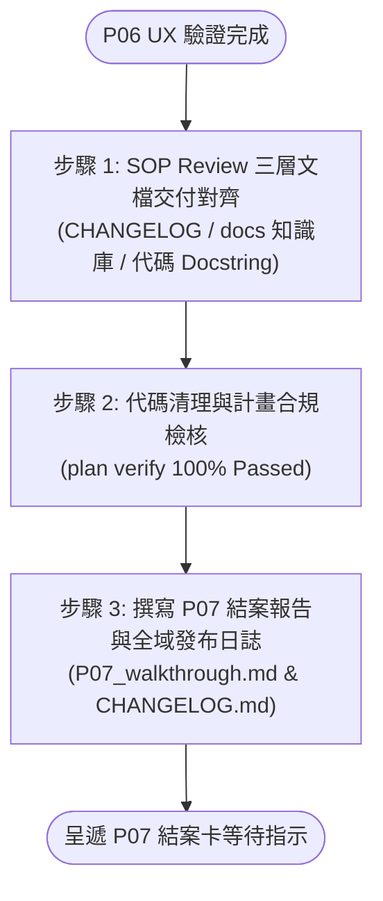

# Phase 7: 成果展示與結案報告 (P07 Walkthrough Guide)

本手冊定義 Phase 7 成果展示、SOP Review 三層文檔審查、合規檢核、開發歷程總結、全域發布日誌追加與結案交付規範。

---

## 1. 核心定位與三步結案管線 (3-Step Closure Pipeline)

進入 Phase 7 時，依序執行以下三步結案管線，確保文檔對齊、品質合規並產出結案報告：



### 步驟 1：SOP Review 三層文檔交付對齊 (Documentation Delivery Audit)
- [!] **文檔更新前強制觸發技能**：在執行三層文檔核驗與更新前，**強制必須先觸發並精讀 [`documentation`](`__#{module://agents-workflow/assets/skills/documentation/SKILL.md}__`) 技能手冊**，嚴格對齊專案知識庫 7 大知識維度與作者指引。
- [ ] **宏觀發布日誌**：專案根目錄 [`CHANGELOG.md`](`__#{project://CHANGELOG.md}__`) 最上方預擬或追加本次高階變更摘要。
- [ ] **中觀模組與專題手冊 (優先更新載體，嚴防 DN 膨脹)**：
  - **優先更新載體**：更新文檔時應優先從 `__${workflow.docs://}__/<Category>/README.md` 模組手冊或專題手冊 (`__${workflow.docs://}__/<Category>/[topic].md`) 下手更新架構、流程與功能資訊，嚴禁在 DN 一直增量！
  - **Design Notes 邊界防膨脹守門 (DN Anti-Bloat Axiom)**：`DESIGN_NOTES.md` (`DN-XX`) 僅限存放「真正高度特例、非直觀工程妥協、或從架構/專題設計文檔無法直觀看出的非直覺設計與防坑坑點」，不得作為一般架構描述、普通功能介紹或日常變更紀錄的傾倒處。
- [ ] **微觀代碼註解契約**：本次修改之 Public API 註解結構完整，複雜演算法具備 Why-Driven 動機註解。

### 步驟 2：代碼清理與計畫合規檢核 (Quality & Plan Compliance Verification)
- [ ] **代碼清理**：無死代碼、無除錯 print/log、無敷衍之 quick-and-dirty hack。
- [ ] **測試完整覆蓋**：所有單元測試與整合測試 100% 通過，無跳過或被破壞之斷言。
- [ ] **計畫合規性檢核**：實機執行 `python __${yscb.host://yscb.py}__ agents-workflow plan verify <plan_name>`，確認計畫文件結構完整、無未填寫之 `[...]` 佔位符、無未勾選 Checkbox 且標頭模型與狀態合法（100% Passed）。

### 步驟 3：撰寫結案報告與全域發布日誌 (Walkthrough & Global Changelog)
- 讀取模板 [`P07_walkthrough.md`](`__#{module://agents-workflow/assets/templates/P07_walkthrough.md}__`)，落檔於計畫目錄（狀態標記為 `Completed`）。
- 檢視 `P05` 實作偏差紀錄表，確認所有 Minor/Major 偏差均已妥善解決並閉環。
- 回填變更清單、測試結果、三層文檔對齊清冊與推薦 Commit 訊息。
- 於計畫目錄內 `changelog.md` 記錄結案。

---

## 2. 發布邊界、後續修訂與 Commit 紀律

- **發布與升版授權邊界**：
  - **[!] 嚴禁自主升版或對外發布**：Phase 7 結案僅代表開發與內部驗證完成；未獲開發者顯式指示前，嚴禁 Agent 擅自執行版本號晉升或正式對外打包發布指令。
- **結案後表層修訂 (`revision_log.md`) 銜接**：
  - 若結案後開發者針對本計畫功能提出 UI/UX/DX 表層微調、靜態參數調整或文檔修正（不涉及核心業務邏輯變更），可直接於本計畫目錄下建立或更新 [`revision_log.md`](`__#{module://agents-workflow/assets/templates/revision_log.md}__`) 進行正交修訂留檔。
- **計畫目錄歸檔紀律**：
  - 開發計畫目錄預設留存於 `__${project://plans}__` 原位，**嚴禁 Agent 自行執行 `plan archive` 或主動搬移目錄**（除非開發者明確下達歸檔指令）。
- **推薦 Commit 訊息**：
  - 結案報告尾部提供符合 Conventional Commits 規範之推薦 Commit 訊息，供開發者直接採用。

---

`__@{PHASE07_AGENTS_GUILD}__`

---

## [!] 3. Phase 7 結束 Checkpoint

- `P07_walkthrough.md` 建立完成（狀態 `Completed`），全域 [`__${project://CHANGELOG.md}__`](`__#{project://CHANGELOG.md}__`) 追加完成，`changelog.md` 記錄結案。
- **極精簡 Session 回覆格式**：對話中**嚴禁全文重複、傾倒完整結案報告或大篇幅轉述**，強制僅呈遞以下極簡卡片：
  ```markdown
  ###  P07 開發成果已結案
  - **產出文件**：[P07_walkthrough.md](__${project://plans}__/{plan_name}/P07_walkthrough.md)、[changelog.md](__${project://plans}__/{plan_name}/changelog.md)、[CHANGELOG.md](__${project://CHANGELOG.md}__)
  - **結案摘要**：[1~2 行高階成果 / 通過 SOP Review 審查與合規檢核]
  - **推薦 Commit**：`[type(scope): brief message]`
  - **後續動作**：[計畫已圓滿結案，可依需求開啟 revision_log.md 進行後續微調、執行 commit 或 plan archive]
  ```
- **立即 End Turn 等待指示**。
