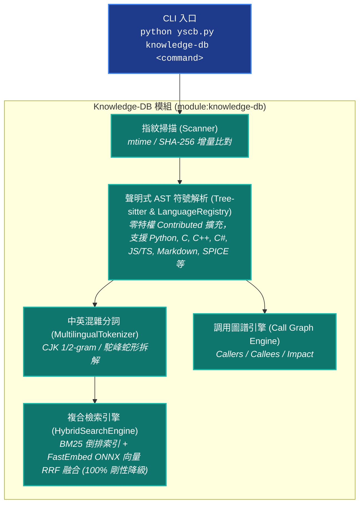

# YS-Codebase Knowledge-DB 知識庫與語意檢索模組 (Knowledge Database & Retrieval Engine)

> 模組名稱：`knowledge-db`  
> 職責定位：知識庫與符號檢索引擎。提供多語言 AST 符號解析、增量指紋比對、多語言分詞 (MultilingualTokenizer)、BM25 + FastEmbed ONNX 雙軌向量 RRF 複合檢索 (HybridSearchEngine)、調用圖譜分析 (Callers/Callees/Impact) 與 AST 代碼切片預覽。

---

## 0. 下游專案 5 分鐘快速上手 (Quickstart)

> [!CAUTION]
> **[Pre-flight Check] AI Agent 初始化確認**：初次為下游專案設定 `knowledge-db` 前，請先向開發者確認：**① 欲納入檢索的原始碼目錄（如 `src/`, `lib/`）與副檔名**，以及 **② 是否下載本地 ONNX 向量模型（或關閉向量檢索改用輕量極速之純 BM25 模式）**。

```bash
# 1. 設定專案源碼掃描空間 (注意鍵名為 include)
# [Linux / macOS (bash/zsh)]：
python yscb.py config set knowledge-db spaces.source.include '["project://src", "project://lib"]'
python yscb.py config set knowledge-db spaces.source.file_patterns '["*.py", "*.cpp", "*.h", "*.ts", "*.js"]'
# [Windows (PowerShell / CMD)] 請使用雙引號搭配反斜線跳脫內層雙引號：
# python yscb.py config set knowledge-db spaces.source.include "[\"project://src\", \"project://lib\"]"

# 2. 配置向量模型 (二選一：預載本地 ONNX 權重，或關閉向量檢索改用輕量純 BM25)
python yscb.py knowledge-db model download
# [輕量極速模式] 免下載向量模型，直接使用純 BM25 詞彙檢索：
# python yscb.py config set knowledge-db enable_vector_search false

# 3. 一鍵建立全管線索引 (增量指紋掃描 -> AST 提取 -> BM25 倒排索引 -> 向量特徵)
python yscb.py knowledge-db index

# 4. 開始語意檢索與調用圖譜探索 (Agent 推薦加 --json -s 取得高密度代碼切片)
python yscb.py knowledge-db search "核心業務關鍵字" --json -s
python yscb.py knowledge-db callers <symbol_name> --json -s
```

---

## 1. 模組架構全景 (Architecture Overview)

`knowledge-db` 模組提供代碼與文檔的解析、索引與多維複合檢索流水線：



---

## 2. 意圖導向三級複雜度矩陣 (3-Tier View Matrix)

本模組指令（`search`、`callers`、`callees`、`impact`）全面支援三級意圖複雜度與高密度 JSON 輸出：

| 複雜度層級 (Tier) | 觸發旗標 | 適用情境與終端輸出 | Agent 推薦 `--json` 格式 |
| :--- | :---: | :--- | :--- |
| **Tier 1: 極簡大綱 (Simple)**<br>*(預設模式)* | *(無旗標)*<br>`--simple` | 僅列出命中檔案、符號名稱、行號區間與分數，零代碼負擔。 | **超緊湊 JSON** (`--json`)：<br>Token 消耗 < 50 Tokens。 |
| **Tier 2: 內文瀏覽 (Preview)**<br>*(Agent 探索首選)*  | `-s` / `--snippet`<br>`--preview` | 一步到位取得帶行號之 AST 代碼切片、簽名與 Docstrings。 | **高密度業務 JSON** (`--json -s`)：<br>剪除雜湊 ID 與除錯欄位，資訊密度高達 86%+。 |
| **Tier 3: 全量除錯 (Detail)** | `-d` / `--detail`<br>`--verbose` | 包含 40 碼 SHA-1、BM25 分詞矩陣 (`matched_terms`) 與全量屬性。 | **全量除錯 JSON** (`--json -d`)：<br>保留全 Schema 與 2-space 縮排。 |

---

## 3. CLI 指令集速查與範例 (CLI Reference)

### 3.1 複合檢索與切片瀏覽 (`search`)

```bash
# 1. 極簡大綱檢索 (BM25 + 向量語意 RRF 融合，預設無 flag 即為 simple)
python yscb.py knowledge-db search 'HybridSearchEngine' --json

# 2. 內文切片檢索 (Agent 唯一首選 - 帶 AST 代碼切片)
python yscb.py knowledge-db search '編譯 佔位符 resolve' --json -s

# 3. 兩階段副檔名與空間定向過濾
python yscb.py knowledge-db search 'SOP 0~7' --ftype=md --json -s                 # 文檔脈絡
python yscb.py knowledge-db search 'resolve_uri' --space=source --ftype=py -s    # 指定空間與語言

# 4. 強制純詞彙檢索 (繞過向量推論，剛性降級)
python yscb.py knowledge-db search 'PIDController' --lexical-only --json -s
```

### 3.2 調用圖譜與影響面分析 (`callers`, `callees`, `impact`)

```bash
# 1. 查詢誰調用了特定 Public API (Who calls me)
python yscb.py knowledge-db callers resolve_stage2_uri --json -s

# 2. 查詢特定類別或函式調用了哪些子組件 (Whom do I call)
python yscb.py knowledge-db callees compile_stage1 --json -s

# 3. 評估重構多階擴散影響半徑 (Blast Radius)
python yscb.py knowledge-db impact ReleasePublisher --depth=2 --json
```

### 3.3 知識庫狀態、模型與維護管理 (`status`, `index`, `model`, `clean`)

```bash
# 查詢全系統註冊空間、指紋快取、索引狀態與模型狀態 (支援 --scan / --diff 比對增量指紋)
python yscb.py knowledge-db status
python yscb.py knowledge-db status --scan

# 一鍵全管線索引建置 (掃描 -> Bundle 提取 -> 倒排索引 -> 向量特徵)，支援導出 Bundle
python yscb.py knowledge-db index
python yscb.py knowledge-db index --export ./output/project.bundle.json

# 向量推論模型管理 (查詢模型狀態與顯式預載)
python yscb.py knowledge-db model status
python yscb.py knowledge-db model download

# 清理指定空間或全空間快取檔案
python yscb.py knowledge-db clean --all
```

---

## 4. Python SDK 公開 API 速查 (Python SDK Reference)

```python
from knowledge_db.engine import KnowledgeEngine

# 初始化門面引擎 (自動感知已註冊空間與同義詞庫)
engine = KnowledgeEngine()

# 1. 多欄位複合檢索
results = engine.search(
    query="ExecutionContext",
    limit=5,
    file_types=["py"],
    tier="snippet"  # "simple" | "snippet" | "detail"
)

# 2. 調用圖譜分析
callers = engine.callers("resolve_stage2_uri", tier="snippet")
callees = engine.callees("compile_stage1", tier="snippet")
impact = engine.impact("ReleasePublisher", max_depth=2)

# 3. 知識庫狀態與索引維護
status = engine.status()
indices = engine.build_index()
```

---

## 5. 組態配置項目與自訂空間指南 (Configuration & Spaces Reference)

本模組之組態位於 `config://knowledge-db/config.project.json`（團隊共享）與 `config://knowledge-db/config.local.json`（個人本機覆蓋），建議直接透過 `python yscb.py config set knowledge-db <key> <val>` 進行操作：

```json
{
  "enable_vector_search": true,
  "embedding_model": "BAAI/bge-small-zh-v1.5",
  "jit_vector_timeout_seconds": 5.0,
  "max_threads": "auto",
  "spaces": {
    "source": {
      "description": "專案核心原始碼空間",
      "include": ["project://src", "project://lib"],
      "exclude": ["**/__pycache__/**", "**/node_modules/**"],
      "file_patterns": ["*.py", "*.c", "*.cpp", "*.h", "*.ts", "*.js"]
    }
  }
}
```

| 設定鍵值 (Key) | 預設值 (Default) | 型態與說明 |
| :--- | :--- | :--- |
| `enable_vector_search` | `true` | `bool`。是否啟用 FastEmbed 向量語意檢索與特徵提取。設為 `false` 則跳過向量化並強制使用純 BM25 模式。 |
| `embedding_model` | `"BAAI/bge-small-zh-v1.5"` | `str`。指定 FastEmbed ONNX 嵌入模型名稱（512 維，支援中英多語言）。 |
| `jit_vector_timeout_seconds` | `5.0` | `float`。JIT 增量索引時 10 符號動態探針之超時臨界值。超過此值自動熔斷退回純 BM25 模式。 |
| `max_threads` | `"auto"` | `str` / `int`。向量推論與 ONNXRuntime 執行緒上限。預設 `"auto"` 為 CPU 核心數之一半。 |
| `spaces.<name>.include` | `[]` | `List[str]`。必填，欲納入掃描之語意 URI 目錄或檔案清單（如 `["project://src"]`）。 |
| `spaces.<name>.exclude` | `[]` | `List[str]`。選填，排除之 Glob 模式清單（如 `["**/__pycache__/**"]`）。 |
| `spaces.<name>.file_patterns` | `[]` | `List[str]`。選填，檔案副檔名 Glob 過濾（未宣告或為空時預設全包含）。 |

---

## 6. 相關規範與技能手冊

- **探索規範指南**：[`.agents/skills/knowledge-db-search/SKILL.md`](../agents-workflow/assets/skills/knowledge-db-search/SKILL.md)
- **指令權限對照**：[`.agents/skills/yscb-cli-guild/SKILL.md`](../agents-workflow/assets/skills/yscb-cli-guild/SKILL.md)

