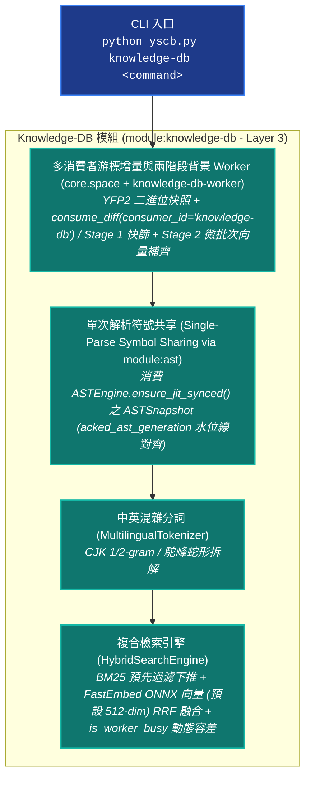

# YS-Codebase Knowledge-DB 知識庫與語意檢索模組 (Knowledge Database & Retrieval Engine)

> 模組名稱：`knowledge-db`  
> 職責定位：Layer 3 知識庫與跨空間混合檢索引擎（`core.space -> ast -> knowledge-db` 三階單向無環圖）。直接透過 **Single-Parse Symbol Sharing** 消費 `module:ast` 產出之 `ASTSnapshot` 符號快照，提供增量指紋比對、多語言分詞 (`MultilingualTokenizer`)、BM25 + FastEmbed ONNX 雙軌向量 RRF 複合檢索 (`HybridSearchEngine`) 與代碼切片預覽。  
> *(註：單檔符號大綱 `outline` 與靜態呼叫拓撲 `callers` / `callees` / `impact` 已獨立收斂至 Layer 2 [`module:ast`](../ast/README.md) 之 `yscb ast` 指令集。)*

---

## 0. 下游專案 5 分鐘快速上手 (Quickstart)

> [!CAUTION]
> **[Pre-flight Check] AI Agent 初始化確認**：初次為下游專案設定 `knowledge-db` 前，請先向開發者確認：**① 欲納入檢索的原始碼目錄（如 `src/`, `lib/`）與副檔名**，以及 **② 是否下載本地 ONNX 向量模型（或關閉向量檢索改用輕量極速之純 BM25 模式）**。

```bash
# 1. 設定專案工作空間幾何 (於 config/core/contribute.json 宣告) 與檢索加權係數 (於 config/knowledge-db/contribute.json 宣告；僅宣告於 space_weights 之空間會納入資料庫索引)
# config/knowledge-db/contribute.json:
# {
#   "space_weights": {
#     "source": 1.0
#   }
# }

# 2. 配置向量模型 (二選一：預載本地 ONNX 權重，或關閉向量檢索改用輕量純 BM25)
python yscb.py knowledge-db model download
# [輕量極速模式] 免下載向量模型，直接使用純 BM25 詞彙檢索：
# python yscb.py config set knowledge-db enable_vector_search false

# 3. 一鍵建立全管線索引 (增量指紋掃描 -> AST 快照同步 -> BM25 倒排索引 -> 向量特徵)
python yscb.py knowledge-db index

# 4. 開始語意檢索 (Agent 推薦加 --json -s 取得高密度代碼切片)
python yscb.py knowledge-db search "核心業務關鍵字" --json -s
```

---

## 1. 模組架構全景 (Architecture Overview)

`knowledge-db` 作為三階單向架構之 Layer 3 檢索消費者，直接複用 `module:ast` 產出的符號快照建立多維複合檢索流水線：



---

## 2. 意圖導向三級複雜度矩陣 (3-Tier View Matrix)

`search` 指令全面支援三級意圖複雜度與高密度 JSON 輸出：

| 複雜度層級 (Tier) | 觸發旗標 | 適用情境與終端輸出 | Agent 推薦 `--json` 格式 |
| :--- | :---: | :--- | :--- |
| **Tier 1: 極簡大綱 (Simple)**<br>*(預設模式)* | *(無旗標)*<br>`--simple` | 僅列出命中檔案、符號名稱、行號區間與分數，零代碼負擔。 | **超緊湊 JSON** (`--json`)：<br>Token 消耗 < 50 Tokens。 |
| **Tier 2: 內文瀏覽 (Preview)**<br>*(Agent 探索首選)*  | `-s` / `--snippet`<br>`--preview` | 一步到位取得帶行號之 AST 代碼切片、簽名與 Docstrings。 | **高密度業務 JSON** (`--json -s`)：<br>剪除雜湊 ID 與除錯欄位，資訊密度高達 86%+。 |
| **Tier 3: 全量除錯 (Detail)** | `-d` / `--detail`<br>`--verbose` | 包含 40 碼 SHA-1、BM25 分詞矩陣 (`matched_terms`) 與全量屬性。 | **全量除錯 JSON** (`--json -d`)：<br>保留全 Schema 與 2-space 縮排。 |

---

## 3. CLI 指令集速查與範例 (CLI Reference)

### 3.1 複合檢索與切片瀏覽 (`search`)

```bash
# 1. 極簡大綱檢索 (BM25 + 向量語意 RRF 融合，預設無 flag 即為 simple)
python yscb.py knowledge-db search 'HybridSearchEngine' --json

# 2. 內文切片檢索 (Agent 唯一首選 - 帶 AST 代碼切片)
python yscb.py knowledge-db search '編譯 佔位符 resolve' --json -s

# 3. 兩階段副檔名與空間定向過濾
python yscb.py knowledge-db search 'SOP 0~7' --ftype=md --json -s                 # 文檔脈絡
python yscb.py knowledge-db search 'resolve_uri' --space=source --ftype=py -s    # 指定空間與語言

# 4. 強制純詞彙檢索 (繞過向量推論，剛性降級)
python yscb.py knowledge-db search 'PIDController' --lexical-only --json -s
```

> [!TIP]
> **結構化大綱與呼叫拓撲查詢**：若已知檔案或符號座標，欲檢視單檔結構大綱或追蹤上下游呼叫鏈，請使用 Layer 2 `module:ast` 指令：
> - `python yscb.py ast outline <file> --json`
> - `python yscb.py ast callers <symbol> --json -s`
> - `python yscb.py ast callees <symbol> --json -s`
> - `python yscb.py ast impact <symbol> --depth=2 --json`

### 3.2 知識庫狀態、模型與維護管理 (`status`, `index`, `model`, `clean`)

```bash
# 查詢全系統註冊空間、檢索權重、AST 水位線、索引狀態與模型狀態
python yscb.py knowledge-db status
python yscb.py knowledge-db status --json

# 一鍵全管線索引建置 (AST 快照同步 -> 倒排索引 -> 向量特徵)，支援導出 Bundle
python yscb.py knowledge-db index
python yscb.py knowledge-db index --export ./output/project.bundle.json

# 向量推論模型管理 (查詢模型狀態與顯式預載)
python yscb.py knowledge-db model status
python yscb.py knowledge-db model download

# 清理指定空間或全空間快取檔案
python yscb.py knowledge-db clean --all
```

---

## 4. Python SDK 公開 API 速查 (Python SDK Reference)

```python
from knowledge_db.engine import KnowledgeEngine

# 初始化門面引擎 (自動感知已註冊空間、組態與 ASTEngine)
engine = KnowledgeEngine()

# 1. 多欄位複合檢索
results = engine.search(
    query="ExecutionContext",
    limit=5,
    ftypes=["py"],
    snippet=True
)

# 2. 知識庫狀態與索引維護
status = engine.status()
indices = engine.build_index()
```

---

## 5. 組態配置項目與自訂空間指南 (Configuration & Spaces Reference)

### 5.1 運作組態設定 (`config.project.json`)

本模組之運作組態位於 `config://knowledge-db/config.project.json`（團隊共享）與 `config.local://knowledge-db/config.local.json`（個人本機覆蓋），建議直接透過 `python yscb.py config set knowledge-db <key> <val>` 進行操作：

```json
{
  "enable_vector_search": true,
  "embedding_model": "BAAI/bge-small-zh-v1.5",
  "jit_vector_timeout_ms": 3000,
  "vector_batch_size": 32,
  "max_threads": "auto"
}
```

| 設定鍵值 (Key) | 預設值 (Default) | 型態與說明 |
| :--- | :--- | :--- |
| `enable_vector_search` | `true` | `bool`。是否啟用 FastEmbed 向量語意檢索與特徵提取。設為 `false` 則跳過向量化並強制使用純 BM25 模式。 |
| `embedding_model` | `"BAAI/bge-small-zh-v1.5"` | `str`。指定 FastEmbed ONNX 嵌入模型名稱（512 維，支援中英多語言）。 |
| `jit_vector_timeout_ms` | `3000` | `int`。向量容差等待與 JIT 熔斷超時（毫秒，向下相容舊鍵 `jit_vector_timeout_seconds`）。當背景 Worker 已運行時間 `< jit_vector_timeout_ms` 時最多等待剩餘時間；若 `>= jit_vector_timeout_ms` 則 0ms 瞬時降級純 BM25 並印出提示。無 Server 時作為前台 10 符號探針熔斷上限。 |
| `vector_batch_size` | `32` | `int`。背景 `knowledge-db-worker` Stage 2 微批次向量差集自癒之單批符號數量。 |
| `max_threads` | `"auto"` | `str` / `int`。向量推論與 ONNXRuntime 執行緒上限。預設 `"auto"` 為 CPU 核心數之一半。 |

### 5.2 空間檢索加權與宣告式擴充 (`contribute.json`)

工作空間幾何範圍統一向 `core` 模組 (`core.space`) 註冊（於 `config/core/contribute.json` 宣告 `spaces`），語言與語法擴充統一向 `ast` 模組註冊（於 `config/ast/contribute.json` 宣告 `languages`），而各邏輯空間之檢索加權係數 (`space_weights`) 則由 `config/knowledge-db/contribute.json` 託管：

```json
{
  "space_weights": {
    "source": 1.0,
    "docs": 1.2,
    "plans": 0.85
  }
}
```

| 宣告欄位 (Field) | 必填 | 型態與說明 |
| :--- | :---: | :--- |
| `space_weights` | 否 | `Dict[str, float]`。各邏輯空間之檢索加權係數（權重值必須 `> 0`）。 |

---

## 6. 相關規範與技能手冊

- **語法樹與呼叫拓撲模組**：[`module:ast` README](../ast/README.md)
- **探索規範指南**：[`.agents/skills/knowledge-db-search/SKILL.md`](../agents-workflow/assets/skills/knowledge-db-search/SKILL.md)
- **指令權限對照**：[`.agents/skills/yscb-cli-guide/SKILL.md`](../agents-workflow/assets/skills/yscb-cli-guide/SKILL.md)
