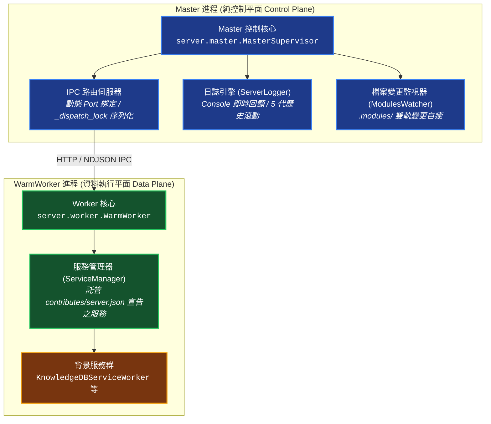

# YS-Codebase Server 常駐服務端模組 (Daemon & Service Runtime)

> 模組名稱：`server`  
> 職責定位：高效能常駐服務調度、Master/Worker IPC 通訊、背景服務託管 (`ServiceManager`)、檔案熱重載守護與全專案 Console 可觀測性。

---

## 0. 下游專案 5 分鐘快速上手 (Quickstart)

```bash
# 1. 啟動背景常駐守護進程 (一般終端環境；輸出結構化啟動參數橫幅，若已在運行則輸出當前運行現況橫幅)
python yscb.py server start

# [IDE Agent 環境專用] 若在受限沙盒終端中，請透過 IDE 背景常駐任務 (Daemon Task) 執行：
python yscb.py server start --console
# (若當前沙盒環境不支援背景常駐任務，請先執行：python yscb.py config set server auto_spawn false --local)

# 2. 檢視 Master/Worker PID、Port、Uptime、Idle TTL 倒數與背景服務清冊
python yscb.py server status

# 3. 優雅停止常駐進程並檢視本次運行統計總結報告 (Uptime / Tasks Handled / Archived Log)
python yscb.py server stop
```

---

## 1. 模組架構全景 (Architecture Overview)

`server` 模組採用嚴格的「Master 控制平面 + WarmWorker 資料平面」雙進程隔離模型：



---

## 2. 核心機制說明 (Core Mechanisms)

### 2.1 控制平面與執行平面分離 (Master vs Worker)
- **Master 進程**：純控制平面，負責啟動參數解析、進程樹維護、`_dispatch_lock` 序列化 IPC、Worker `stderr` 持續排空、兩階段優雅停機（NDJSON Exit 握手與 OS 進程樹收割）與檔案變更重啟分流。Master 本身絕不直接執行重型業務任務或加載重量級領域函式庫。
- **WarmWorker 子進程**：預熱執行環境，持有獨立私有 `_ipc_stdout` 管道與 `ipc_lock`（全域 `sys.stdout` 重導向至 `stderr` 防止雜訊污染），持有 `ServiceManager` 實例，負責實際執行由各模組註冊的長駐背景服務，並支援極速記憶體內熱派發（含 `Worker._module_cache` 與 `worker_warming` 廣播）。

### 2.2 背景服務託管架構 (ServiceManager)
各模組透過在自身 `contributes/server.json`（或 `contribute.json`）中宣告 `services` 節點，由 `WarmWorker` 自動發現並託管生命週期：
```json
{
  "services": [
    {
      "name": "knowledge-db-watcher",
      "worker_class": "knowledge_db.service:KnowledgeDBServiceWorker",
      "description": "知識庫即時檔案變更監聽與增量熱自癒服務",
      "auto_start": true
    }
  ]
}
```
`ServiceManager` 支援動態注入 `.modules/<provider>` 至 `sys.path`，支援連字號模組名稱正規化與 `code.class://` 前綴相容，並嚴格杜絕 `source/` 源碼路徑注入。
Worker 在啟動時依序初始化各 ServiceWorker，並透過 `worker_ready` 封包將服務清單與狀態回傳 Master 供 `server start` 橫幅與 `server status` 呈現。

### 2.3 檔案監視與自癒重載 (ModulesWatcher)
- 監視 `yscb://.modules/`（即 `module://` 運行空間）變更，具備 500ms 批次防抖與頂層模組目錄 (`affected_modules`) 解析。
- **領域模組變更**（如 `knowledge-db`）：觸發 Worker 子進程優雅重啟，sub-500ms 完成刷新。
- **核心模組變更**（如 `core`、`server`）：觸發 Master 自重啟整棵進程樹。

### 2.4 全週期可觀測性與終端反饋
- **結構化啟動橫幅 (`format_startup_banner`)**：`server start`（含背景脫鉤與 `--console`）統一輸出對齊的 ASCII 橫幅，完整顯示運行模式、Master/Worker PID、Port、Idle TTL、Modules Watcher 狀態、託管服務與即時日誌路徑；**當已在運行中再次呼叫 `server start` 時，亦會輸出提示並附帶當前運行現況橫幅**。
- **停機運行總結 (`format_shutdown_summary`)**：`server stop` 優雅關閉時輸出本次運行總時長 (Uptime)、累計執行任務數 (Tasks Handled)、終止服務數與歸檔日誌路徑。

---

## 3. CLI 指令參考與啟動優先級 (CLI Commands & Mode Priority)

| 指令 | 核心參數 / 選項 | 說明 |
| :--- | :--- | :--- |
| `python yscb.py server start` | `[--daemon]` `[--console]` `[--ttl <sec>]` | 啟動 Master 伺服器進程樹並輸出啟動參數橫幅（已在運行時輸出當前運行現況橫幅） |
| `python yscb.py server stop` | `[--force]` | 優雅停止常駐伺服器進程樹並輸出運行總結報告 |
| `python yscb.py server reload` | 無 | 重新加載 Worker 子進程與各背景服務 |
| `python yscb.py server status` | 無 | 查詢進程狀態、Uptime、Idle TTL、Port 與服務清冊 |

- **啟動模式優先級仲裁與互斥約束**：
  - CLI 透過 `add_mutually_exclusive_group()` 強制 `--console` 與 `--daemon` 互斥。
  - 啟動模式判定優先級：CLI `--console`（強制前台除錯與日誌實時回顯） > CLI `--daemon`（強制背景常駐） > 組態 `enable_console`（`ServerConfig`） > 預設 `False`（靜默脫鉤背景常駐）。

---

## 4. 組態配置與常見情境操作指南 (Configuration & Cookbook)

### 4.1 組態設定 (`config://server/config.project.json`)

```bash
# 調整無操作空閒超時自毀秒數 (預設 900.0 秒 = 15 分鐘)
python yscb.py config set server idle_timeout_sec 1800

# 調整預設啟動是否走前台 Console 模式 (預設 false；可被 CLI --console / --daemon 覆寫)
python yscb.py config set server enable_console false

# 若不希望執行一般指令時自動於背景喚醒常駐進程，可關閉 auto_spawn
python yscb.py config set server auto_spawn false
```

### 4.2 查閱即時與歷史運行日誌
- **即時日誌路徑**：`python yscb.py uri resolve cache://server/log`（預設位於 `.cache/server/log`）。
- **歷史歸檔日誌**：每次停止或重啟時自動歸檔為 `.cache/server/{YYYY}_{MM}_{DD}_{HH}.{MM}.{SS}_log`（支援 `_01` 同秒序號後綴，自動滾動保留最新 5 份）。
